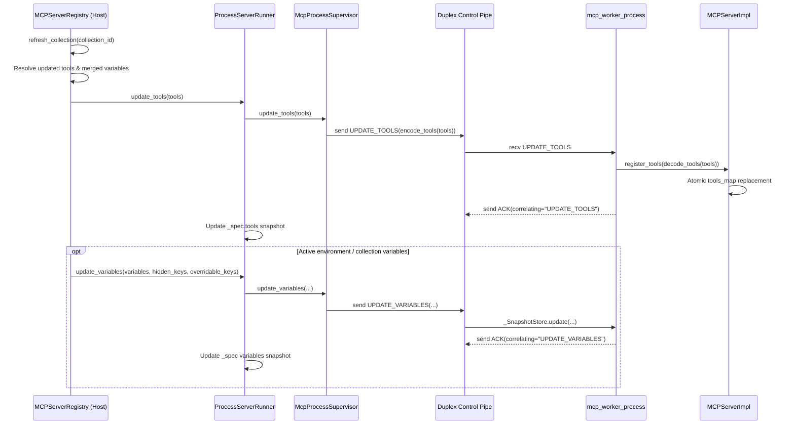

# PYPOST-1465: Process-Mode Tool Refresh Architecture

## Research

`MCPServerRegistry.refresh_collection(collection_id)` (`pypost/core/mcp_server_registry.py`) currently resolves a workspace collection via `_collection_lookup(collection_id)` and iterates only `self._managers` (populated exclusively in shared `thread` execution mode). When `execution_mode == "process"` (isolated execution mode), active servers reside in `self._runners` as `ProcessServerRunner` instances and `self._managers` is empty, making `refresh_collection` a silent no-op for isolated servers (deferred from PYPOST-1439 TD-4).

Key architectural findings across the MCP runtime layers:

- **Worker Tool Registry (`pypost/core/mcp_server_impl.py`)**: `MCPServerImpl` registers MCP `list_tools` and `call_tool` handlers once at startup, and both handlers read `self.tools_map` dynamically on every incoming request. Calling `register_tools(requests)` rebuilds `self.tools_map` in memory without restarting the HTTP/SSE transport or dropping listening sockets.
- **Worker IPC Protocol (`pypost/core/mcp_worker_ipc.py`, `pypost/core/mcp_worker_process.py`)**: The control pipe already carries `encode_tools` / `decode_tools` (JSON-serialized `RequestModel` payloads) for `START` and `UPDATE_VARIABLES` for live environment snapshot replacement (`_SnapshotStore.update`). Adding `UPDATE_TOOLS` to `MsgType` lets the worker replace its tool map in place and reply with `ACK(correlating="UPDATE_TOOLS")`, matching the zero-downtime `UPDATE_VARIABLES` flow and avoiding ~150–350 ms `spawn` restart latency or port-rebind races.
- **Collection-Scoped Variables & Library-Backed Collections (`pypost/core/mcp_server_registry.py`, `pypost/core/library_runtime_resolver.py`)**: Collections carry both `requests` (tools) and `variables` (`CollectionVariable` defaults and secret flags). Furthermore, local servers may bind to a collection either via workspace `configuration.collection_id` or via library-backed `configuration.library_collection_path` (`LibraryRuntimeResolver`). Refreshing a collection must push both the updated tool definitions (`update_tools`) and the updated merged variable snapshot (`update_variables` with collection defaults merged beneath active environment variables and secret collection variables merged into `hidden_keys`) while keeping the server's active environment context intact.
- **Accepted Snapshot Consistency (`pypost/core/mcp_server_runner.py`)**: `ProcessServerRunner` stores `_spec: ServerStartSpec` (returned by `start_snapshot`) so `MCPServerRegistry.reconfigure` (PYPOST-1463) can recover the pre-reconfigure server if a replacement start fails. `ProcessServerRunner.update_tools` and `update_variables` must update `_spec` so any subsequent rollback restores the latest refreshed tools and variables.
- **External References**:
  - [Python `multiprocessing` — Pipes and Queues](https://docs.python.org/3/library/multiprocessing.html#pipes-and-queues)
  - [Model Context Protocol (MCP) — Tools Specification](https://modelcontextprotocol.io/specification/2025-03-26/server/tools)

## Implementation Plan

1. **Extend Worker IPC (`pypost/core/mcp_worker_ipc.py`, `pypost/core/mcp_worker_process.py`)**:
   - Add `"UPDATE_TOOLS"` to `MsgType` in `mcp_worker_ipc.py`.
   - Handle `"UPDATE_TOOLS"` in `worker_main`: decode `msg.get("tools", [])` with `decode_tools`, invoke `impl.register_tools(tools)` when `impl` supports tool registration (`MCPServerImpl`), and send `make_message("ACK", correlating="UPDATE_TOOLS")` (or `ERROR` if decoding/registration fails).
2. **Make `MCPServerImpl.register_tools` Atomic (`pypost/core/mcp_server_impl.py`)**:
   - Build a fresh dictionary of sanitized tool names to `RequestModel` copies and assign `self.tools_map = new_map` atomically so concurrent `list_tools` / `call_tool` coroutines on the worker's asyncio loop never observe a partially cleared map.
3. **Add `update_tools` to Supervisor & Runners (`pypost/core/mcp_process_supervisor.py`, `pypost/core/mcp_server_runner.py`, `pypost/core/qt/mcp_server.py`)**:
   - Add `McpProcessSupervisor.update_tools(tools: list[Any]) -> bool`: guard that the worker is alive and pipe is open, send `make_message("UPDATE_TOOLS", tools=encode_tools(tools))`, and return `bool` (catching `OSError`/`BrokenPipeError`/`EOFError`/`ValueError` without raising).
   - Add `update_tools(tools: list[Any]) -> bool` to `MCPServerRunnerProtocol`, `ThreadServerRunner`, and `ProcessServerRunner`.
   - In `ProcessServerRunner.update_tools`, forward to `self._supervisor.update_tools(tools)` and on success update `self._spec.tools = deepcopy(list(tools))`. Also update `ProcessServerRunner.update_variables` to keep `self._spec.variables`, `self._spec.hidden_keys`, and `self._spec.overridable_keys` synchronized with accepted live updates.
   - In `MCPServerManager.update_tools` (`pypost/core/qt/mcp_server.py`), ensure in-place request modifications (URL, method, description, headers, body, parameters) always refresh `self._impl.register_tools(tools)` even when the `(id, name)` signature is unchanged, while preserving the existing restart behavior when tool IDs/names change.
4. **Unify `MCPServerRegistry.refresh_collection` (`pypost/core/mcp_server_registry.py`)**:
   - Match local server instances bound to `collection_id` either directly (`configuration.collection_id == collection_id`) or via library-backed collection path/ID (`configuration.library_id` with matching collection ID or stem). Proxy servers (`server_type == "proxy"`) are never matched.
   - Resolve refreshed `(requests, variables, hidden_keys, overridable_keys)` per matched instance:
     - For library-backed instances, resolve via `_runtime_inputs(configuration)` (which merges updated collection variables with active environment and overlay via `LibraryRuntimeResolver`).
     - For workspace-backed instances, resolve `collection` via `_collection_lookup(collection_id)` and merge collection variable defaults (`{v.name: str(v.default) for v in collection.variables if v.default is not None}`) beneath active environment variables and secret collection variable keys into `hidden_keys`.
   - If the target collection is missing or fails resolution, mark that instance `"failed"` with a diagnostic error without affecting peer instances.
   - For running instances, dispatch `update_tools` (and `update_variables` when an environment/variable context is active) through the active runner (`_runners.get(instance_id)`) or manager (`_managers.get(instance_id)`). If a process runner reports a dead worker or failed IPC (`update_tools` returns `False` or `is_alive()` is `False`), transition that instance to `"failed"` without crashing the host or disturbing healthy servers.

### Failing Repro: Step 3

Create `tests/test_mcp_process_tool_refresh_repro.py` with explicit `@pytest.mark.timeout` bounds and polling helpers (`wait_until`) covering:

- **`test_process_mode_refresh_collection_updates_tools_live_add_modify_remove`**: Start a process-mode server for a collection with two requests, verify initial MCP `tools/list` and `tools/call`, mutate the collection (modify request path/description, remove second request, add third request), call `refresh_collection`, and assert live `tools/list` and `tools/call` reflect the new tool set on the same port and worker PID without restart.
- **`test_process_mode_refresh_collection_updates_collection_variables_and_preserves_env`**: Start a process-mode server with collection variables (including a secret variable) and an active environment override, update collection variable defaults and secret flags, call `refresh_collection`, and assert live tool execution resolves the updated collection variables while preserving active environment overrides and secret redaction.
- **`test_process_mode_refresh_collection_isolates_neighbor_and_proxy_servers`**: Run two process-mode local servers on different collections plus a process-mode proxy server, refresh one collection, and verify only the targeted server updates while the neighbor collection server and proxy server remain untouched on their ports and PIDs.
- **`test_process_mode_refresh_collection_contains_exited_worker_and_updates_snapshot`**: Verify that refreshing a collection when one bound worker has exited marks only that dead instance failed without raising or interrupting a healthy peer bound to the same collection, and verify `runner.start_snapshot.tools` reflects refreshed tools on healthy runners.
- **`test_shared_mode_refresh_collection_regression_parity`**: Verify `execution_mode="thread"` `refresh_collection` updates live tool definitions (including modified request paths and added/removed tools) without regression.

## Architecture

### Module Responsibilities and Interfaces

| Module | Responsibility | Key Interfaces |
| --- | --- | --- |
| `pypost/core/mcp_worker_ipc.py` | Define IPC message schema and tool codec for host-worker control channel. | `MsgType` (`"UPDATE_TOOLS"`), `encode_tools()`, `decode_tools()` |
| `pypost/core/mcp_worker_process.py` | Dispatch `"UPDATE_TOOLS"` in the worker control loop and acknowledge completion. | `worker_main()` |
| `pypost/core/mcp_server_impl.py` | Rebuild `tools_map` atomically so live MCP `list_tools` and `call_tool` handlers immediately serve updated tools. | `MCPServerImpl.register_tools(requests)` |
| `pypost/core/mcp_process_supervisor.py` | Send `"UPDATE_TOOLS"` over the parent pipe when the worker is alive and contain pipe/process errors. | `McpProcessSupervisor.update_tools(tools) -> bool` |
| `pypost/core/mcp_server_runner.py` | Expose unified `update_tools` on `MCPServerRunnerProtocol`, `ThreadServerRunner`, and `ProcessServerRunner`; keep `_spec` snapshot current. | `MCPServerRunnerProtocol.update_tools()`, `ProcessServerRunner.update_tools()`, `ThreadServerRunner.update_tools()` |
| `pypost/core/mcp_server_registry.py` | Locate workspace and library-backed local servers for `collection_id`, resolve tools and collection variables, and update running runners/managers with failure containment. | `MCPServerRegistry.refresh_collection(collection_id)` |

## Q&A

**Q: Why use an in-place `UPDATE_TOOLS` IPC message instead of restarting the worker process on collection refresh?**
**A:** `MCPServerImpl` dynamically consults `self.tools_map` on every MCP `list_tools` and `call_tool` invocation. Updating `self.tools_map` via `UPDATE_TOOLS` over the existing control pipe takes <5 ms, preserves the worker PID and listening socket without port-rebind races (FR4), and matches the existing `UPDATE_VARIABLES` design (NFR1).

**Q: How are collection-scoped variables refreshed without losing active environment overrides?**
**A:** During `refresh_collection`, library-backed instances re-run `_runtime_inputs` (`LibraryRuntimeResolver` 3-tier merge: collection defaults < active environment < runtime overlay), and workspace-backed instances merge `collection.variables` defaults beneath the active environment's variables and merge secret collection variable names into `hidden_keys`, then dispatch `update_variables`.

**Q: How does `UPDATE_TOOLS` interact with `reconfigure` rollback (PYPOST-1463)?**
**A:** `ProcessServerRunner.update_tools` and `update_variables` mutate `self._spec` in place after sending the IPC update. If a later `reconfigure` fails and recovers from `runner.start_snapshot`, the recovered worker starts with the latest refreshed tools and variables rather than stale initial-start state.
