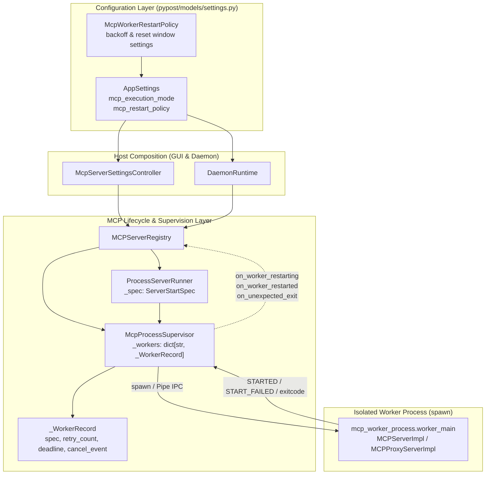
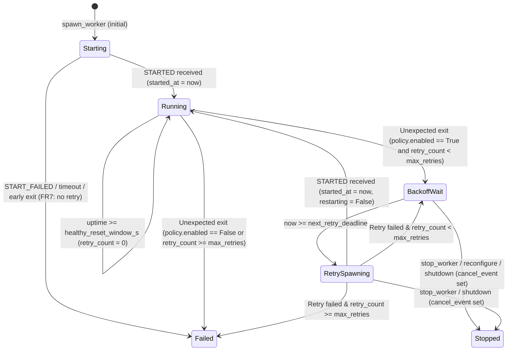

# PYPOST-1466: Auto-Restart Policy with Exponential Backoff for Isolated MCP Servers

## Research

### 1. Current Isolated Supervisor Lifecycle (`PYPOST-1439` – `PYPOST-1465`)

- **Supervisor Monitoring (`pypost/core/mcp_process_supervisor.py`)**: `McpProcessSupervisor`
  spawns one headless `mcp_worker_process.worker_main` child per isolated server using
  `multiprocessing.get_context("spawn")`. Its background `_monitor_loop` polls
  `process.is_alive()` and `process.exitcode` every 100 ms. Today, when a worker in
  `state == "running"` exits unexpectedly, `_monitor_loop` unconditionally transitions
  `record.state = "failed"`, logs `mcp_worker_unexpected_exit`, and invokes
  `on_unexpected_exit(instance_id, exitcode)` with no recovery attempt (deferred from
  [PYPOST-1439](https://pypost.atlassian.net/browse/PYPOST-1439) TD-5).
- **Runner & Snapshot Ownership (`pypost/core/mcp_server_runner.py`)**: `ProcessServerRunner`
  retains `self._spec: ServerStartSpec` (updated in place by `update_tools` and
  `update_variables` per PYPOST-1465). However, `McpProcessSupervisor._WorkerRecord` currently
  stores only `(instance_id, process, parent_conn, state, last_error, started_event,
  reader_stop, reader_thread)` and discards the spawn parameters (`host`, `port`, `tools`,
  `variables`, `hidden_keys`, `overridable_keys`, `server_type`, `upstream_url`,
  `upstream_transport`, `headers`, `timeout`) after sending `START`. For supervisor-driven
  auto-restart to respawn a worker with up-to-date state (`FR5`), `_WorkerRecord` must retain
  and synchronize a `_WorkerSpawnSpec` snapshot across `spawn_worker`, `update_tools`, and
  `update_variables`.
- **Registry & Host Status Wiring (`pypost/core/mcp_server_registry.py`,
  `pypost/ui/mcp_server_controller.py`, `pypost/core/qt/daemon_runtime.py`)**:
  `MCPServerRegistry` maps `on_unexpected_exit` to `_handle_worker_unexpected_exit`, which
  marks the runner and registry status `"failed"`. In `DaemonRuntime._on_registry_status`, any
  transition to `state == "failed"` immediately triggers `self._fail(...)` and shuts down the
  daemon. Therefore, while an isolated worker is actively recovering under an enabled
  auto-restart policy, the registry status must transition to `"starting"` (recovering) and
  return to `"running"` once the replacement child reports `STARTED`, emitting `"failed"` only
  when retries are disabled (`enabled=False`) or all configured retries are exhausted (`FR3`).
- **Settings Model Conventions (`pypost/models/settings.py`, `pypost/models/websocket.py`)**:
  `AppSettings` embeds typed Pydantic policy models (`HeartbeatPolicy`, `ReconnectPolicy`,
  `RetryPolicy`) with `Field(...)` bounds and `default_factory`. Defining
  `McpWorkerRestartPolicy` in `pypost/models/settings.py` and attaching
  `mcp_restart_policy: McpWorkerRestartPolicy = Field(default_factory=McpWorkerRestartPolicy)`
  on `AppSettings` follows the established configuration architecture.

### 2. Supervisor Backoff & Reset Window Best Practices

Standard process-supervision architectures (such as systemd `RestartSec` /
`StartLimitIntervalSec`, Erlang/OTP supervisor intensity/period, and Kubernetes crash-loop
backoff with reset windows) combine three mechanisms:

1. **Capped Exponential Backoff**: Delay before retry attempt $k \in \{1 \dots N\}$ grows as
   $\min(\text{max\_backoff}, \text{initial\_backoff} \times \text{multiplier}^{k-1})$ to avoid
   CPU and process-table saturation during transient outages.
2. **Healthy Uptime Reset Window**: Recording the monotonic timestamp when a worker reaches
   `running` allows resetting `retry_count = 0` once continuous uptime reaches
   `healthy_reset_window_s`, ensuring a transient fault hours after recovery still receives a
   full retry budget.
3. **Interruptible Deadline Scheduling**: Recording a monotonic deadline on the worker record
   and waiting on a per-worker cancellation `threading.Event` allows `stop_worker`,
   `reconfigure`, and `shutdown` to abort pending backoff waits in milliseconds without blocking
   peer server monitoring.

References:

- [Python `multiprocessing` — Process-based parallelism][py-mp]
- [Python `threading` — Event Objects][py-event]
- [Multi-Process Supervisor Evaluation (`doc/dev/mcp_process_supervisor_evaluation.md`)][eval-doc]
- [MCP Process vs Thread Execution Mode (`doc/dev/mcp_process_isolation.md`)][iso-doc]

[py-mp]: https://docs.python.org/3/library/multiprocessing.html
[py-event]: https://docs.python.org/3/library/threading.html#event-objects
[eval-doc]: ../../doc/dev/mcp_process_supervisor_evaluation.md
[iso-doc]: ../../doc/dev/mcp_process_isolation.md

---

## Implementation Plan

1. **Add `McpWorkerRestartPolicy` to Settings (`pypost/models/settings.py`)**:
   - Define `McpWorkerRestartPolicy(BaseModel)` with validated fields and safe defaults:
     `enabled: bool = False`, `max_retries: int = 3` (`ge=0, le=100`),
     `initial_backoff_s: float = 0.5` (`gt=0.0`), `max_backoff_s: float = 8.0` (`gt=0.0`),
     `backoff_multiplier: float = 2.0` (`ge=1.0`), and
     `healthy_reset_window_s: float = 30.0` (`ge=0.0`), plus a model validator enforcing
     `max_backoff_s >= initial_backoff_s` and a `backoff_for_attempt(attempt: int) -> float`
     helper.
   - Add `mcp_restart_policy: McpWorkerRestartPolicy` (`Field(default_factory=...)`)
     to `AppSettings`.
2. **Implement Supervisor Backoff, Snapshot Sync, and Cancellation
   (`pypost/core/mcp_process_supervisor.py`)**:
   - Accept `restart_policy: McpWorkerRestartPolicy | None = None`,
     `on_worker_restarting: Callable[[str, int, float, int | None], None] | None = None`, and
     `on_worker_restarted: Callable[[str, int], None] | None = None` in
     `McpProcessSupervisor.__init__`.
   - Store `_WorkerSpawnSpec` on `_WorkerRecord` during `spawn_worker` and update it on
     `update_tools` and `update_variables` (including while a worker is waiting in backoff) so
     restarts always use the latest tools, variables, hidden/overridable keys, and proxy
     configuration (`FR5`).
   - Track `started_at`, `retry_count`, `next_retry_deadline`, `restarting`, and `cancel_event`
     per `_WorkerRecord`.
   - In `_monitor_loop`, reset `retry_count = 0` when a running worker's uptime meets or exceeds
     `healthy_reset_window_s` (`FR4`). On unexpected exit from `"running"`, either fail
     immediately when `not policy.enabled` / retries are exhausted, or schedule a non-blocking
     exponential backoff deadline and dispatch a restart attempt thread when the deadline
     arrives (`FR2`, `FR3`, `FR8`).
   - Keep initial `spawn_worker` failures immediate (`FR7`): exits or `START_FAILED` during the
     initial operator-initiated start raise directly without scheduling background retries.
   - In `stop_worker` and `shutdown`, set `record.cancel_event`, clear any pending retry
     deadline, log `mcp_worker_restart_cancelled`, and reclaim any active process within
     `DEFAULT_STOP_BUDGET_S` (`FR6`, `NFR2`).
3. **Wire Runner, Registry, Controller, and Daemon (`pypost/core/mcp_server_runner.py`,
   `pypost/core/mcp_server_registry.py`, `pypost/ui/mcp_server_controller.py`,
   `pypost/core/qt/daemon_runtime.py`)**:
   - Expose `is_restarting()` and recovery state helpers on `ProcessServerRunner`; allow
     `update_tools` and `update_variables` to update the stored snapshot while a worker is
     restarting so `refresh_collection` and `refresh_environment` preserve changes across
     in-flight recovery.
   - Pass `restart_policy` from `AppSettings` into `MCPServerRegistry` in
     `McpServerSettingsController` and `DaemonRuntime`, and forward it to
     `McpProcessSupervisor`.
   - Wire `MCPServerRegistry` callbacks (`_on_worker_restarting`, `_on_worker_restarted`,
     `_on_worker_unexpected_exit`) so recovering instances transition to `"starting"` with a
     diagnostic message, return to `"running"` on recovery, and transition to `"failed"` on
     exhaustion. Ensure `reconfigure`, `stop`, `stop_all`, `remove`, `clear`, and
     `restore_snapshot` cancel any pending restart immediately.

### Mandatory — Failing Repro (next Step 3)

Create `tests/test_mcp_process_autorestart_repro.py` (with explicit `@pytest.mark.timeout`
markers and bounded polling helpers) before any production implementation:

1. **`test_restart_policy_settings_defaults_and_validation`**:
   - Assert `AppSettings().mcp_restart_policy` defaults to `enabled=False`, `max_retries=3`,
     `initial_backoff_s=0.5`, `max_backoff_s=8.0`, `backoff_multiplier=2.0`,
     `healthy_reset_window_s=30.0`, validates custom values, rejects invalid bounds (e.g.
     `max_backoff_s < initial_backoff_s`, negative retries), and wires through
     `McpServerSettingsController` and `DaemonRuntime` to `MCPServerRegistry`.
2. **`test_default_policy_disabled_fails_immediately_without_retry`**:
   - Start an isolated server with default policy (`enabled=False`), trigger `DEBUG_ABORT`, and
     assert immediate transition to `"failed"` with zero restart attempts (`FR1`).
3. **`test_auto_restart_recovers_crashed_worker_with_exponential_backoff_and_latest_state`**:
   - Configure `McpWorkerRestartPolicy(enabled=True, max_retries=3, initial_backoff_s=0.1,
     max_backoff_s=0.4, backoff_multiplier=2.0, healthy_reset_window_s=10.0)`.
   - Start an isolated server, refresh tools (`refresh_collection`) and variables
     (`refresh_environment`), trigger `DEBUG_ABORT`, and assert the server enters recovery,
     respawns a new worker PID after backoff, returns to `"running"`, and serves the refreshed
     tools and variables on the same port (`FR2`, `FR5`).
4. **`test_auto_restart_exhaustion_transitions_to_failed_after_max_retries`**:
   - Configure `max_retries=2` with short backoff (`0.08s`, multiplier `2.0`), force consecutive
     crashes after each start (or startup failure during retry), and assert delays progress
     ($\approx 0.08\text{s}, 0.16\text{s}$) and the server transitions to `"failed"` after 2
     retries with no 3rd retry (`FR2`, `FR3`, `NFR1`).
5. **`test_healthy_reset_window_resets_retry_counter_for_later_crash`**:
   - Configure `max_retries=1` and `healthy_reset_window_s=0.25`. Crash the worker once, wait
     for recovery plus `0.3s` of healthy operation, crash the worker a second time, and assert
     the second crash also recovers automatically because the retry counter reset (`FR4`).
6. **`test_operator_stop_and_shutdown_cancel_pending_backoff_immediately`**:
   - Configure a long backoff (`initial_backoff_s=5.0`, `max_backoff_s=10.0`), trigger
     `DEBUG_ABORT` so the worker enters backoff wait, immediately call `registry.stop(id)` (and
     `registry.stop_all()`), and assert stop completes in `<1.0s` (`NFR2`), status is
     `"stopped"`, and the worker never respawns (`FR6`).
7. **`test_initial_start_failure_does_not_trigger_auto_restart`**:
   - With `enabled=True`, attempt to start a server on an already occupied port (or invalid
     reference) and assert it fails immediately with zero background retry attempts (`FR7`).

---

## Architecture

### System Module Diagram



### Recovery State Machine & Sequence



```mermaid
sequenceDiagram
    autonumber
    participant Reg as MCPServerRegistry
    participant Run as ProcessServerRunner
    participant Sup as McpProcessSupervisor
    participant Child as mcp_worker_process

    Reg->>Run: start(spec)
    Run->>Sup: spawn_worker(instance_id, ...)
    Sup->>Child: spawn + IPC START
    Child-->>Sup: IPC STARTED
    Sup->>Sup: state="running", started_at=monotonic()
    Sup-->>Reg: status="running"

    Note over Reg,Child: Live tool/variable updates refresh _WorkerRecord.spec
    Reg->>Run: update_tools(tools) / update_variables(...)
    Run->>Sup: update_tools / update_variables
    Sup->>Sup: Update _WorkerRecord.spec snapshot

    Child--xSup: Unexpected exit (exitcode != 0)
    Sup->>Sup: Check healthy window; increment retry_count (1 <= max_retries)
    Sup->>Sup: Compute delay_s; set next_retry_deadline & restarting=True
    Sup-->>Reg: on_worker_restarting(instance_id, attempt, delay_s, exitcode)
    Reg->>Reg: _set_status(instance_id, "starting", restarting message)

    alt Operator stops or reconfigures during backoff
        Reg->>Run: stop()
        Run->>Sup: stop_worker(instance_id)
        Sup->>Sup: cancel_event.set(), pop record, log cancelled
        Sup-->>Reg: stopped immediately (<5ms)
    else Backoff deadline elapses
        Sup->>Child: Respawn with latest _WorkerRecord.spec + IPC START
        Child-->>Sup: IPC STARTED
        Sup->>Sup: state="running", restarting=False, started_at=monotonic()
        Sup-->>Reg: on_worker_restarted(instance_id, attempt)
        Reg->>Reg: _set_status(instance_id, "running")
    end
```

### Module Responsibilities

| Module | Responsibility |
| --- | --- |
| `pypost/models/settings.py` | `McpWorkerRestartPolicy` model and `AppSettings` field. |
| `pypost/core/mcp_process_supervisor.py` | Backoff scheduling, spec sync, reset window, cancel. |
| `pypost/core/mcp_server_runner.py` | Snapshot sync on `start`/`update_*`; `is_restarting()`. |
| `pypost/core/mcp_server_registry.py` | Policy wiring, recovery status, stop/reconfigure cancel. |
| `pypost/ui/mcp_server_controller.py` | Passes `mcp_restart_policy` to `MCPServerRegistry`. |
| `pypost/core/qt/daemon_runtime.py` | Passes `mcp_restart_policy` to `MCPServerRegistry`. |

### Selected Architectural Patterns

1. **Declarative Policy Object (`McpWorkerRestartPolicy`)**: Encapsulates all retry and timing
   knobs in a validated Pydantic value object on `AppSettings`, matching `HeartbeatPolicy` and
   `ReconnectPolicy` while keeping `enabled=False` as the zero-regression default (`FR1`).
2. **Non-Blocking Deadline Polling + Event Cancellation**: `_monitor_loop` never blocks on
   `time.sleep(delay_s)`. Instead, it records `next_retry_deadline = time.monotonic() + delay_s`
   and checks deadlines on each poll cycle, while per-attempt spawn handshakes run on a
   cancellable helper thread gated by `record.cancel_event`. This guarantees that one worker's
   backoff wait or retry startup never delays crash detection for peer workers (`FR8`) and
   allows `stop_worker` to cancel pending retries instantaneously (`FR6`, `NFR2`).
3. **Authoritative Spawn Snapshot (`_WorkerSpawnSpec`)**: `McpProcessSupervisor` stores a
   deep-copied `_WorkerSpawnSpec` per worker and mutates it atomically during `update_tools`
   and `update_variables` (even if the worker is currently waiting in a backoff window),
   ensuring respawned workers always reflect the latest collection tools, environment variables,
   secret keys, and proxy settings (`FR5`).

### Key Interfaces and Contracts

```python
"""Illustrative interface contracts for PYPOST-1466 (high-level signatures only)."""

from __future__ import annotations
from typing import Any, Callable, Literal
from pydantic import BaseModel, Field


class McpWorkerRestartPolicy(BaseModel):
    enabled: bool = False
    max_retries: int = Field(default=3, ge=0, le=100)
    initial_backoff_s: float = Field(default=0.5, gt=0.0)
    max_backoff_s: float = Field(default=8.0, gt=0.0)
    backoff_multiplier: float = Field(default=2.0, ge=1.0)
    healthy_reset_window_s: float = Field(default=30.0, ge=0.0)

    def backoff_for_attempt(self, attempt: int) -> float: ...


class McpProcessSupervisor:
    def __init__(
        self,
        *,
        on_unexpected_exit: Callable[[str, int | None], None] | None = None,
        on_worker_restarting: Callable[[str, int, float, int | None], None] | None = None,
        on_worker_restarted: Callable[[str, int], None] | None = None,
        restart_policy: McpWorkerRestartPolicy | None = None,
        stop_budget_s: float = 2.0,
    ) -> None: ...

    @property
    def restart_policy(self) -> McpWorkerRestartPolicy: ...

    def is_restarting(self, instance_id: str) -> bool: ...
    def retry_count(self, instance_id: str) -> int: ...
```

### Structured Observability Events (`FR8`)

All supervisor and registry log records use key-value structured formatting and omit secret
values, variable maps, headers, `upstream_url`, and tool payloads:

- `mcp_worker_restart_scheduled`: `instance_id`, `attempt`, `max_retries`, `delay_s`, `exitcode`
- `mcp_worker_restarted`: `instance_id`, `pid`, `attempt`, `max_retries`
- `mcp_worker_restart_exhausted`: `instance_id`, `attempts`, `max_retries`, `exitcode`
- `mcp_worker_restart_counter_reset`: `instance_id`, `pid`, `uptime_s`, `previous_retry_count`
- `mcp_worker_restart_cancelled`: `instance_id`, `attempt`, `reason`

---

## Q&A

**Q: Why does `_monitor_loop` use monotonic deadlines instead of sleeping during backoff?**
**A:** A single `McpProcessSupervisor` supervises all isolated MCP servers in the host process.
Sleeping inside `_monitor_loop` for a multi-second backoff would freeze exit detection for all
neighboring workers (`FR8`) and delay `shutdown()` (`NFR2`). Checking `time.monotonic() >=
record.next_retry_deadline` on each 50–100 ms monitor tick keeps monitoring responsive across
all peers and lets `stop_worker` cancel a pending backoff wait in milliseconds.

**Q: How are initial startup failures distinguished from runtime crashes (`FR7`)?**
**A:** During initial operator-requested `spawn_worker`, `record.state` is `"starting"`,
`record.started_at` is `None`, and `record.restarting` is `False`. If the child exits or sends
`START_FAILED` before `STARTED`, `_wait_started` raises immediately to the caller and removes
the failed record without entering the auto-restart state machine. Only workers that have
reached `state == "running"` (`started_at is not None`)—or subsequent retry attempts within an
already initiated recovery cycle (`record.restarting == True`)—participate in backoff retries.

**Q: What happens if `refresh_collection` or `refresh_environment` runs while a worker is in a
backoff window (`FR5`)?**
**A:** When `record.restarting` is `True`, `McpProcessSupervisor.update_tools` and
`update_variables` update `record.spec` (and `ProcessServerRunner` updates `self._spec`) in
memory and return success (`True`) even though no child pipe is currently connected. When the
backoff deadline expires, the new worker process is spawned from that updated `record.spec`,
preserving all tool and variable updates across the recovery window.

**Q: Why does `MCPServerRegistry` transition a recovering server to `"starting"` instead of
`"failed"` during backoff?**
**A:** In `MCPServerRegistry`, `"failed"` represents a terminal error state (and causes
`DaemonRuntime` to abort the daemon process). Transitioning to `"starting"` with a diagnostic
message while backoff/retry is active accurately communicates that recovery is in progress and
only emits `"failed"` if all configured retry attempts are exhausted (`FR3`).
