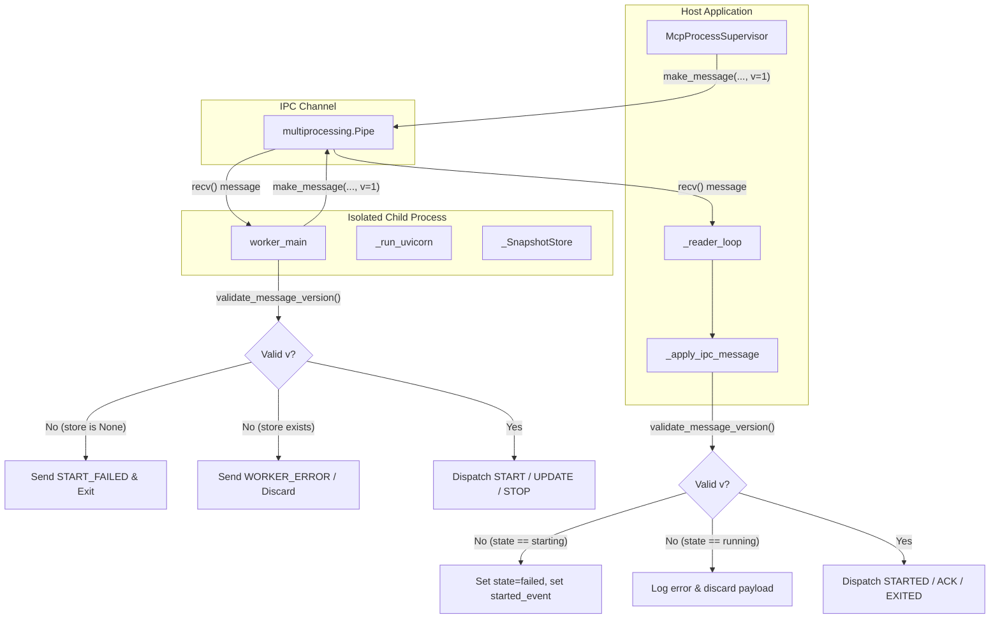

# PYPOST-1467: IPC Protocol Version Negotiation and Mismatch Rejection

## Research

### 1. Current State of IPC Subsystem (PYPOST-1439 through PYPOST-1466)

- **Envelope Definition (`pypost/core/mcp_worker_ipc.py`)**:
  - Defines constant `MSG_V = 1`.
  - `make_message(msg_type: MsgType, **payload: Any) -> dict[str, Any]` packages payloads into
    `{"v": MSG_V, "type": msg_type, **payload}`.
  - `message_type(message: dict[str, Any]) -> str` extracts the string value of `"type"`.
  - No version validation helper, error class, or supported version collection exists.
- **Worker Message Ingress (`pypost/core/mcp_worker_process.py`)**:
  - `worker_main(conn: Any)` loops on `conn.recv()`, discarding non-dict objects.
  - Calls `msg_type = message_type(message)` and dispatches solely on `msg_type`.
  - The `"v"` field is ignored completely.
  - If an incompatible or corrupted envelope is received, the worker will either raise an unhandled
    exception (`KeyError`, `TypeError`), corrupt internal state, or execute invalid operations.
- **Supervisor Message Ingress (`pypost/core/mcp_process_supervisor.py`)**:
  - `_reader_loop(instance_id, conn, stop_event)` receives child envelopes and passes them to
    `_apply_ipc_message(instance_id, message)`.
  - `_apply_ipc_message` checks `if not isinstance(message, dict): return` and inspects
    `message.get("type")`.
  - The `"v"` field is completely uninspected.
  - If a worker sends an incompatible payload format, the supervisor risks silent misbehavior or
    unhandled exceptions in the background reader thread.

### 2. Multi-Process Version Validation & Protocol Evolution Patterns

- **Fail-Fast Ingress Validation**: In robust IPC architectures (such as Erlang node distribution,
  Chromium Mojo, and Language Server Protocol), every envelope's protocol version must be validated
  immediately at transport ingress before parsing opcodes or payload parameters.
- **Strict Integer Versioning**: Protocol versions must be positive integers. Missing versions,
  non-integer types (`bool`, `str`, `float`, `None`), or unsupported version numbers must be
  deterministically rejected with structured diagnostics.
- **Lifecycle-Aware Rejection Handling**:
  - **Pre-Start Phase**: If version validation fails before the worker has initialized (`START`),
    the startup sequence must abort cleanly, notifying the counterpart via `START_FAILED` with
    descriptive error details, setting the supervisor worker state to `failed` and signaling
    `started_event` to prevent hang timeouts.
  - **Running Phase**: If a version mismatch arrives while running (e.g. invalid `UPDATE_TOOLS` or
    `HEARTBEAT`), the invalid envelope must be rejected and discarded without terminating the
    process or corrupting internal state, returning a structured error response
    (`WORKER_ERROR` or `VERSION_MISMATCH`).
- **Structured Observability**: Version rejection events on both sides of the boundary must emit
  structured log messages (`mcp_worker_ipc_version_rejected` and
  `mcp_supervisor_ipc_version_rejected`) detailing `instance_id`, `received_v`, `supported_v`, and
  the rejection reason without logging sensitive request data or environment secrets.

## Implementation Plan

### High-Level Execution Sequencing

1. **Step 2 (Architecture & Design)**: Document module responsibilities, interfaces, validation
   rules, and the Step 3 failing repro specification in `20-architecture.md`.
2. **Step 3 (Failing Repro)**: Implement `tests/test_mcp_ipc_protocol_version_repro.py` containing
   red tests that assert strict version validation and mismatch rejection across envelope helpers,
   worker process ingress, and supervisor ingress.
3. **Step 4 (Development)**:
   - Implement `SUPPORTED_MSG_VERSIONS`, `McpProtocolVersionError`, and `validate_message_version()`
     in `pypost/core/mcp_worker_ipc.py`.
   - Add `"VERSION_MISMATCH"` to `MsgType`.
   - Integrate version validation into `worker_main()` in `pypost/core/mcp_worker_process.py`.
   - Integrate version validation into `_apply_ipc_message()` in
     `pypost/core/mcp_process_supervisor.py`.
   - Verify all repro and regression tests pass green.
4. **Steps 5–8**: Perform code cleanup, add observability metrics/logs, analyze technical debt,
   and update developer documentation.

### Mandatory — Failing Repro (next Step 3)

- **Target Test File**: `tests/test_mcp_ipc_protocol_version_repro.py`
- **Timeout Marking**: Marked with `pytestmark = pytest.mark.timeout(30)` in compliance with
  `do-testing`.
- **Planned Test Cases**:
  1. `test_ipc_envelope_version_validation_unit`:
     - Asserts `validate_message_version({"v": 1, "type": "START"})` succeeds and returns `1`.
     - Asserts missing `"v"` raises `McpProtocolVersionError` with `received_v=None`.
     - Asserts non-integer types (`"1"`, `True`, `False`, `1.5`, `None`, `[]`) raise
       `McpProtocolVersionError`.
     - Asserts unsupported integers (`0`, `2`, `99`, `-1`) raise `McpProtocolVersionError`.
  2. `test_worker_start_rejects_unsupported_version`:
     - Spawns a real headless worker via `multiprocessing.Pipe()` and `worker_main`.
     - Sends a `START` envelope stamped with `v=99`.
     - Asserts worker sends back `START_FAILED` containing version mismatch details and exits
       cleanly without spawning uvicorn or hanging.
  3. `test_worker_runtime_command_rejects_unsupported_version`:
     - Starts worker successfully with valid `v=1` `START` message.
     - Sends `UPDATE_TOOLS` command stamped with `v=2`.
     - Asserts worker rejects the command, emits `mcp_worker_ipc_version_rejected`, sends
       `WORKER_ERROR` (or `VERSION_MISMATCH`), and continues running without crashing.
     - Verifies worker remains healthy by exchanging a valid `v=1` `HEARTBEAT`/`HEARTBEAT_PONG`.
  4. `test_supervisor_rejects_unsupported_version_from_starting_worker`:
     - Creates `McpProcessSupervisor` instance with mock pipe.
     - Worker connection delivers `{"v": 2, "type": "STARTED", "pid": 1234}` during startup.
     - Asserts supervisor logs `mcp_supervisor_ipc_version_rejected`, sets record state to `failed`,
       sets `last_error`, signals `started_event`, and does not enter `running`.
  5. `test_supervisor_rejects_unsupported_version_from_running_worker`:
     - Simulates running worker sending an invalid version envelope (`v=0` or missing `"v"`).
     - Asserts supervisor logs rejection, discards payload, and does not alter worker state or
       crash.
- **Sequencing**:
  - Step 3 creates the automated red test suite asserting these exact behaviors.
  - Step 4 implements production changes until all tests turn green.

## Architecture

### Component Interaction and Ingress Filtering



### Module Responsibilities & Changes

1. **`pypost/core/mcp_worker_ipc.py`**:
   - Constants:
     - `MSG_V: int = 1` (existing)
     - `SUPPORTED_MSG_VERSIONS: frozenset[int] = frozenset({1})` (new)
   - Exception:
     - `McpProtocolVersionError(ValueError)`:
       - Attributes: `message: str`, `received_v: Any = None`,
         `supported_versions: frozenset[int] = SUPPORTED_MSG_VERSIONS`.
   - Function:
     - `validate_message_version(message: dict[str, Any]) -> int`:
       - Validates `"v" in message`.
       - Validates `not isinstance(raw_v, bool) and isinstance(raw_v, int)`.
       - Validates `raw_v in SUPPORTED_MSG_VERSIONS`.
       - Returns `raw_v`.
   - Type definition:
     - Update `MsgType` literal to include `"VERSION_MISMATCH"`.

2. **`pypost/core/mcp_worker_process.py`**:
   - In `worker_main(conn)`:
     - Immediately after receiving a message dict:
       ```python
       try:
           validate_message_version(message)
       except McpProtocolVersionError as exc:
           logger.error(
               "mcp_worker_ipc_version_rejected received_v=%s supported_v=%s error=%s",
               exc.received_v,
               sorted(exc.supported_versions),
               str(exc),
           )
           if store is None:
               try:
                   conn.send(
                       make_message(
                           "START_FAILED",
                           message=f"IPC version rejected: {exc}",
                       )
                   )
               except (BrokenPipeError, OSError, EOFError):
                   pass
               break
           else:
               try:
                   conn.send(
                       make_message(
                           "WORKER_ERROR",
                           message=f"IPC version rejected: {exc}",
                       )
                   )
               except (BrokenPipeError, OSError, EOFError):
                   pass
               continue
       ```

3. **`pypost/core/mcp_process_supervisor.py`**:
   - In `_apply_ipc_message(instance_id, message)`:
     ```python
     if not isinstance(message, dict):
         return
     try:
         validate_message_version(message)
     except McpProtocolVersionError as exc:
         logger.error(
             "mcp_supervisor_ipc_version_rejected instance_id=%s received_v=%s "
             "supported_v=%s error=%s",
             instance_id,
             exc.received_v,
             sorted(exc.supported_versions),
             str(exc),
         )
         with self._lock:
             record = self._workers.get(instance_id)
             if record is not None and record.state == "starting":
                 record.state = "failed"
                 record.last_error = f"IPC version rejected: {exc}"
                 record.started_event.set()
         return
     ```
   - In `_apply_ipc_message`: handle optional `"VERSION_MISMATCH"` opcode from worker:
     ```python
     elif msg_type == "VERSION_MISMATCH":
         logger.error(
             "mcp_worker_version_mismatch instance_id=%s pid=%s message=%s",
             instance_id,
             record.process.pid,
             message.get("message"),
         )
         if record.state == "starting":
             record.state = "failed"
             record.last_error = str(
                 message.get("message") or "protocol version mismatch"
             )
             record.started_event.set()
     ```

## Q&A

**Q: Why use `frozenset({1})` for `SUPPORTED_MSG_VERSIONS` instead of a single integer?**
A: A frozenset provides $O(1)$ set membership testing and immutability, while making the protocol
ready for future multi-version windows (e.g. supporting `v=1` and `v=2` simultaneously during
rolling protocol upgrades).

**Q: Why must `isinstance(raw_v, bool)` be checked explicitly?**
A: In Python, `bool` is a subclass of `int` (`isinstance(True, int)` evaluates to `True`). Without
an explicit boolean check, an envelope with `{"v": True}` would incorrectly pass integer validation
and match version `1`.

**Q: What happens if a version mismatch occurs during a running worker's tool update?**
A: The worker logs `mcp_worker_ipc_version_rejected`, sends a `WORKER_ERROR` envelope describing
the rejection back to the supervisor, and discards the invalid payload. The running uvicorn server
and internal variable snapshot store remain untouched and fully operational.
