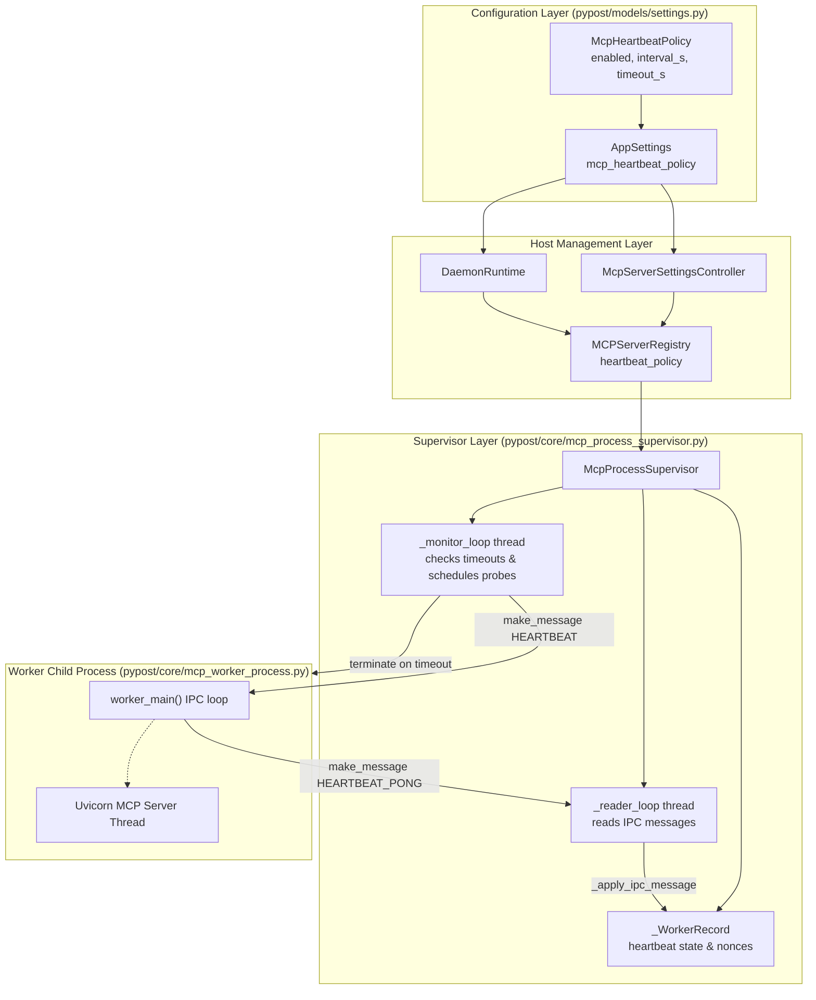

# PYPOST-1468: Active HEARTBEAT Watchdog and Failed State Transition for MCP Workers

## Research

### 1. Existing IPC Heartbeat Capabilities in Worker & Supervisor

- **Worker IPC Loop (`pypost/core/mcp_worker_process.py`)**:
  - The worker process runs a dedicated IPC polling loop over a bidirectional multiprocessing
    `Pipe`.
  - Lines 305–314 explicitly handle `HEARTBEAT` messages:
    ```python
    elif msg_type == "HEARTBEAT":
        try:
            conn.send(
                make_message(
                    "HEARTBEAT_PONG",
                    nonce=message.get("nonce"),
                )
            )
        except (BrokenPipeError, OSError, EOFError):
            pass
    ```
  - The worker immediately replies with `HEARTBEAT_PONG` and echoes back the caller's `nonce`.
  - Test-only debug opcodes: lines 340–348 implement `DEBUG_HANG` (guarded by
    `PYPOST_MCP_ALLOW_DEBUG_IPC=1`). Upon receiving `DEBUG_HANG`, the worker enters an
    uninterruptible `time.sleep(3600)` loop, ignoring future IPC messages and simulating an
    unresponsive application freeze while keeping the OS process alive.

- **Supervisor Current Gap (`pypost/core/mcp_process_supervisor.py`)**:
  - `McpProcessSupervisor` manages worker lifecycles, spawns child processes, and runs a dedicated
    background `_monitor_loop` thread polling every 50 ms.
  - Currently, `_monitor_loop` checks:
    1. Healthy uptime reset window for auto-restart retry counters.
    2. Backoff deadlines for pending worker restarts.
    3. Child process termination via `process.is_alive()` and `process.exitcode`.
    4. Periodic memory RSS sampling against soft and hard memory limits.
  - The supervisor *never* dispatches `HEARTBEAT` messages, nor does `_apply_ipc_message` handle
    `HEARTBEAT_PONG`.
  - Consequently, if a worker event loop freezes (e.g. simulated by `DEBUG_HANG` or deadlocks),
    `process.is_alive()` remains `True`, so the supervisor considers the worker healthy
    indefinitely. Requests stall until clients abort or system resources run out.

- **Settings Model Conventions (`pypost/models/settings.py`)**:
  - Configuration policies in PyPost follow Pydantic v2 `BaseModel` definitions with explicit
    `Field(...)` bounds and `@model_validator(mode="after")` constraints (e.g.,
    `McpResourceLimitsPolicy`, `McpWorkerRestartPolicy`).
  - Adding `McpHeartbeatPolicy` to `pypost/models/settings.py` and attaching
    `mcp_heartbeat_policy: McpHeartbeatPolicy = Field(default_factory=McpHeartbeatPolicy)` on
    `AppSettings` adheres to established conventions and allows seamless GUI / daemon integration.

### 2. Industry Watchdog Patterns and Timing Considerations

- **Active Ping/Pong with Nonce Correlation**:
  - Active probing ensures end-to-end responsiveness of the child event loop.
  - Generating an ephemeral unique nonce per probe prevents stale or delayed pong messages from
    clearing timeouts prematurely.
- **Configurable Cadence & Timeout Bounds**:
  - An interval of 2.0s with a 5.0s timeout ensures rapid detection of freezes without saturating
    IPC bandwidth or CPU cycles.
  - The invariant `timeout_s >= interval_s > 0.0` prevents pathological watchdog flapping.
- **Graceful Escalation on Timeout**:
  - When a timeout occurs, the supervisor logs `mcp_worker_heartbeat_timeout`, terminates the
    runaway process (`SIGTERM` then `SIGKILL`), marks the worker state as `failed`, and informs
    downstream listeners via `on_unexpected_exit` (or schedules an auto-restart if
    `McpWorkerRestartPolicy.enabled=True`).

---

## Implementation Plan

### 1. Configuration Model (`pypost/models/settings.py`)

- Define `McpHeartbeatPolicy(BaseModel)`:
  - `enabled: bool = True` (watchdog active by default).
  - `interval_s: float = Field(default=2.0, gt=0.0)` (probing frequency).
  - `timeout_s: float = Field(default=5.0, gt=0.0)` (maximum latency before timeout).
  - Model validator enforcing `timeout_s >= interval_s`.
- Attach `mcp_heartbeat_policy: McpHeartbeatPolicy = Field(default_factory=McpHeartbeatPolicy)`
  to `AppSettings`.

### 2. Supervisor Watchdog Implementation (`pypost/core/mcp_process_supervisor.py`)

- Update `_WorkerRecord` dataclass to include heartbeat tracking state:
  - `last_heartbeat_sent_at: float = 0.0`
  - `last_heartbeat_pong_at: float = 0.0`
  - `pending_heartbeat_nonce: str | None = None`
  - `pending_heartbeat_sent_at: float = 0.0`
- Accept `heartbeat_policy: McpHeartbeatPolicy | None = None` in `McpProcessSupervisor.__init__`,
  storing `self._heartbeat_policy = heartbeat_policy.model_copy() if heartbeat_policy is not None
  else McpHeartbeatPolicy()`, exposed via `@property def heartbeat_policy(self)`.
- In `_apply_ipc_message`, handle `HEARTBEAT_PONG`:
  - Verify message nonce matches `record.pending_heartbeat_nonce`.
  - Clear `pending_heartbeat_nonce` and `pending_heartbeat_sent_at`.
  - Update `record.last_heartbeat_pong_at = now`.
  - Log debug metrics (`latency_s`). If nonce does not match, log warning and ignore.
- In `_monitor_loop`:
  - When worker is `record.state == "running"` and not `record.restarting` and
    `record.process.is_alive()`:
    - If `self._heartbeat_policy.enabled`:
      - **Check pending timeout**:
        - If `record.pending_heartbeat_nonce is not None` and
          `(now - record.pending_heartbeat_sent_at) > self._heartbeat_policy.timeout_s`:
          - Log error `mcp_worker_heartbeat_timeout`.
          - Terminate runaway child process (`terminate()`, bounded wait, `kill()`).
          - Clear pending probe state.
          - Set `record.last_error = f"heartbeat timeout ({self._heartbeat_policy.timeout_s}s)"`.
          - If `self._restart_policy.enabled` and `record.retry_count < max_retries`:
            - Schedule restart backoff, update state to `starting`, dispatch restart event.
          - Else:
            - Set `record.state = "failed"`, record unexpected exit event.
          - Enqueue reader thread for cleanup.
      - **Check probe interval**:
        - If no probe is pending (`record.pending_heartbeat_nonce is None`) and
          `(now - record.last_heartbeat_sent_at) >= self._heartbeat_policy.interval_s`:
          - Generate unique nonce (`uuid.uuid4().hex[:16]`).
          - Set `record.pending_heartbeat_nonce = nonce`, `record.pending_heartbeat_sent_at = now`,
            and `record.last_heartbeat_sent_at = now`.
          - Send `make_message("HEARTBEAT", nonce=nonce)` across `parent_conn`.
          - Handle `(BrokenPipeError, OSError, EOFError)` gracefully.

### 3. Wire Policy through Registry and Application Host

- Update `MCPServerRegistry.__init__`:
  - Accept `heartbeat_policy: McpHeartbeatPolicy | None = None`.
  - Expose `@property def heartbeat_policy(self) -> McpHeartbeatPolicy | None`.
  - Pass `heartbeat_policy` when instantiating `McpProcessSupervisor`.
- Update `McpServerSettingsController` (`pypost/ui/mcp_server_controller.py`) and `DaemonRuntime`
  (`pypost/core/qt/daemon_runtime.py`):
  - Pass `heartbeat_policy=settings.mcp_heartbeat_policy` when instantiating `MCPServerRegistry`.

---

### Mandatory — Failing Repro (next Step 3)

Create `tests/test_mcp_ipc_heartbeat_watchdog_repro.py` (with `@pytest.mark.timeout(...)` per
`do-testing`) asserting desired watchdog behavior before implementing production changes:

1. **`test_heartbeat_policy_validation_and_defaults`**:
   - Assert `McpHeartbeatPolicy` defaults to `enabled=True`, `interval_s=2.0`, `timeout_s=5.0`.
   - Validate custom parameters and rejection of invalid values (`interval_s <= 0`,
     `timeout_s <= 0`, `timeout_s < interval_s`).
   - Verify wiring on `AppSettings`, `McpProcessSupervisor`, and `MCPServerRegistry`.
2. **`test_normal_worker_heartbeats_roundtrip_successfully`**:
   - Start an isolated worker with active policy (`interval_s=0.2`, `timeout_s=0.6`).
   - Run across multiple heartbeat intervals; confirm supervisor issues heartbeats, worker replies
     with matching nonces, and the worker remains continuously in `running` state.
3. **`test_hung_worker_times_out_and_is_terminated_to_failed`**:
   - Start an isolated worker with `heartbeat_policy(enabled=True, interval_s=0.2, timeout_s=0.4)`
     and `restart_policy.enabled=False`.
   - Trigger worker hang using `DEBUG_HANG` (with `PYPOST_MCP_ALLOW_DEBUG_IPC=1`).
   - Verify that within bounded time (>0.4s and <2.0s), the supervisor detects timeout, logs
     `mcp_worker_heartbeat_timeout`, terminates the child PID, and transitions state to `failed`.
4. **`test_disabled_watchdog_does_not_terminate_hung_worker`**:
   - Start an isolated worker with `heartbeat_policy(enabled=False)`.
   - Send `DEBUG_HANG` to the worker.
   - Wait beyond normal timeout duration; assert worker process remains alive and supervisor
     does not terminate it.
   - Cleanly stop the worker via `stop_worker`.
5. **`test_heartbeat_timeout_interplay_with_auto_restart`**:
   - Start an isolated worker with `heartbeat_policy(enabled=True, interval_s=0.2, timeout_s=0.4)`
     and `restart_policy(enabled=True, max_retries=2, initial_backoff_s=0.1)`.
   - Send `DEBUG_HANG`.
   - Assert watchdog timeout triggers process termination, but because auto-restart is enabled,
     the supervisor initiates a restart cycle, spawns a new responsive worker process, and
     restores the instance to `running`.

---

## Architecture

### System Module Diagram



### Component Responsibilities

1. **`McpHeartbeatPolicy`**:
   - Enforces configuration invariants: positive intervals/timeouts and `timeout_s >= interval_s`.
   - Serializes into `AppSettings` for UI and headless daemon operation.
2. **`McpProcessSupervisor`**:
   - Tracks probe nonces, dispatch timestamps, and response latencies per worker record.
   - `_monitor_loop`: Dispatches periodic probes on configured intervals and detects timeouts.
   - `_apply_ipc_message`: Correlates received `HEARTBEAT_PONG` messages against expected nonces.
   - Escalates unresponsive workers by terminating process handles and updating state to `failed`
     (or initiating backoff recovery if auto-restart is configured).
3. **`MCPServerRegistry`**:
   - Ingests `heartbeat_policy` from app settings and propagates it to supervisor instances.
   - Coordinates state notifications when workers transition between running, restarting, and
     failed.
4. **`mcp_worker_process.worker_main`**:
   - Listens on the IPC pipe, immediately bounces `HEARTBEAT` requests as `HEARTBEAT_PONG` with
     the matching `nonce`.

### Module Interfaces and Data Flow

1. **Heartbeat Probe Dispatch**:
   ```
   Supervisor._monitor_loop
     -> if now - last_heartbeat_sent_at >= interval_s and pending_nonce is None:
          nonce = uuid.uuid4().hex[:16]
          parent_conn.send({"type": "HEARTBEAT", "nonce": nonce, ...})
          record.pending_heartbeat_nonce = nonce
          record.pending_heartbeat_sent_at = now
          record.last_heartbeat_sent_at = now
   ```

2. **Heartbeat Pong Receipt**:
   ```
   Worker.worker_main
     -> conn.send({"type": "HEARTBEAT_PONG", "nonce": nonce, ...})
   Supervisor._reader_loop
     -> Supervisor._apply_ipc_message
          if message["type"] == "HEARTBEAT_PONG":
            if message["nonce"] == record.pending_heartbeat_nonce:
              record.pending_heartbeat_nonce = None
              record.pending_heartbeat_sent_at = 0.0
              record.last_heartbeat_pong_at = now
   ```

3. **Watchdog Timeout Escalation**:
   ```
   Supervisor._monitor_loop
     -> if pending_nonce is not None and (now - pending_sent_at) > timeout_s:
          logger.error("mcp_worker_heartbeat_timeout ...")
          process.terminate() -> wait(0.2s) -> process.kill()
          record.pending_heartbeat_nonce = None
          record.last_error = "heartbeat timeout"
          if restart_policy.enabled:
            schedule_restart(record)
          else:
            record.state = "failed"
            on_unexpected_exit(instance_id, process.exitcode)
   ```

### Failure Containment and Resource Reclamation

- **Peer Worker Isolation**:
  - Heartbeat tracking state is strictly isolated per `_WorkerRecord`. A timeout or termination of
    worker A does not affect worker B or worker C.
- **Supervisor Stability**:
  - All probe dispatches and responses catch IPC exceptions (`BrokenPipeError`, `OSError`,
    `EOFError`). If a pipe breaks while sending a heartbeat, the supervisor does not crash.
- **Resource Reclamation**:
  - Hung processes are terminated cleanly (`SIGTERM` followed by `SIGKILL` escalation), preventing
    zombie or orphan processes from consuming CPU and memory.
  - IPC reader threads are joined and closed outside the internal record lock to avoid deadlocks.

---

## Q&A

**Q: Why use a unique nonce for each heartbeat probe?**
A: A unique nonce ensures that a delayed pong from an earlier slow period is not mistakenly
attributed to the latest probe, avoiding race conditions and false responsiveness indications.

**Q: What happens if an operator stops a worker while a probe is pending?**
A: When `stop_worker` is called, the worker process is sent `STOP`, its state is set to `stopped`,
and its record is removed or cancelled. The monitor loop only evaluates heartbeats for workers
with `state == "running"`, preventing false timeout triggers during graceful shutdown.

**Q: How does the watchdog interact with the existing auto-restart policy?**
A: When a heartbeat timeout triggers worker termination, the supervisor checks whether
`McpWorkerRestartPolicy.enabled` is `True`. If enabled and retries remain, the supervisor schedules
an exponential backoff restart cycle; otherwise, it marks the worker as `failed` and notifies
downstream listeners.
