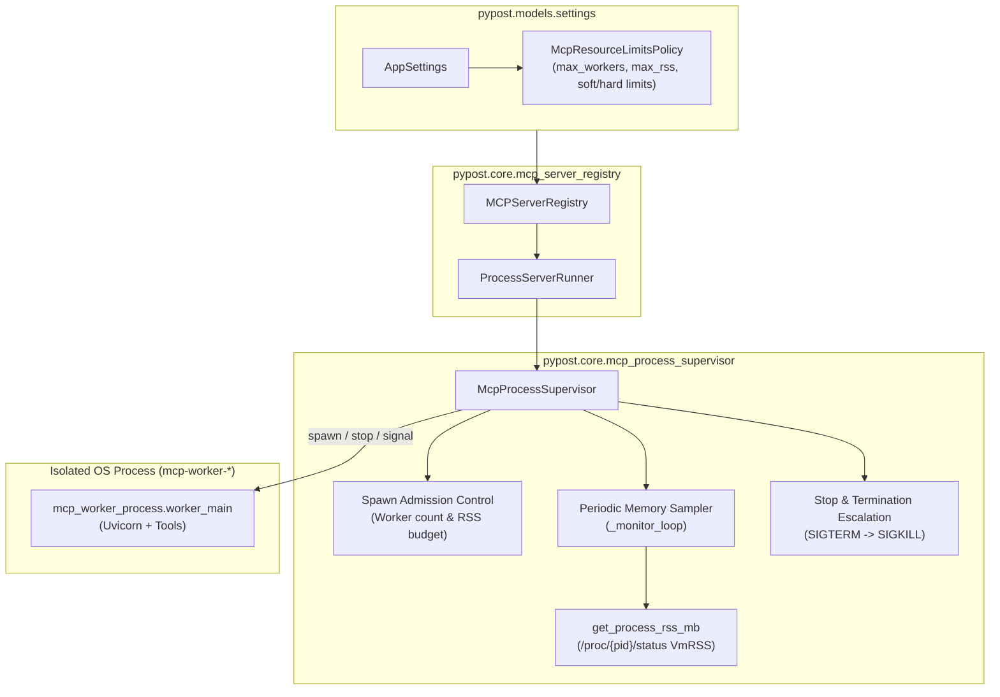
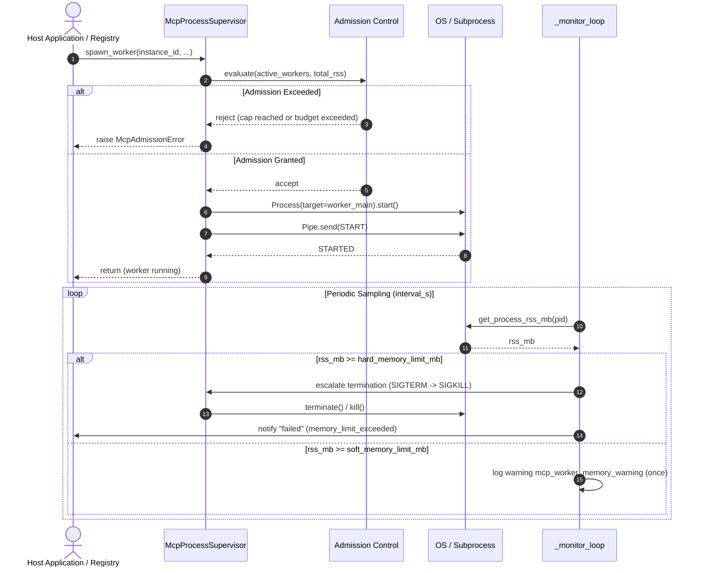

# PYPOST-1469: Per-Worker Memory Ceilings and Spawn Admission for Isolated MCP Servers

## Research

### 1. Existing Isolated MCP Supervisor Architecture (`PYPOST-1439`, `PYPOST-1466`)

- **Process Supervision (`pypost/core/mcp_process_supervisor.py`)**: `McpProcessSupervisor`
  manages child worker processes running `mcp_worker_process.worker_main` using
  `multiprocessing.get_context("spawn")`. A background `_monitor_loop` polls worker liveness,
  handles unexpected exits, and runs exponential backoff recovery when
  `McpWorkerRestartPolicy.enabled` is true. Today, the supervisor has no admission barrier before
  calling `process.start()`, and no background sampling of worker memory consumption. Unconstrained
  spawning or unbounded memory growth in worker processes can exhaust host RAM and trigger host
  OS OOM killing (deferred from
  [PYPOST-1439](https://pypost.atlassian.net/browse/PYPOST-1439) TD-8).
- **Settings & Policy Models (`pypost/models/settings.py`)**: `AppSettings` contains typed Pydantic
  configuration models (such as `McpWorkerRestartPolicy`, `HeartbeatPolicy`, `ReconnectPolicy`, and
  `RetryPolicy`). Adding `McpResourceLimitsPolicy` embedded as `mcp_resource_limits` follows the
  established declarative settings architecture with explicit field bounds and validators.
- **Runner & Registry Lifecycle (`pypost/core/mcp_server_runner.py`,
  `pypost/core/mcp_server_registry.py`)**: `ProcessServerRunner` delegates process lifecycle to
  `McpProcessSupervisor`. `MCPServerRegistry` coordinates runners, managers, and status signals.
  When spawn admission rejects a new server, the refusal must be returned immediately as an
  actionable error without disrupting existing running workers or corrupting registry state.

### 2. Linux & POSIX Process Memory Accounting Models

- **Resident Set Size (RSS)**: Measures the portion of process memory held in physical RAM.
  Unlike virtual memory size (VMS), which includes reserved but unmapped address space, RSS reflects
  actual physical memory footprint.
- **Platform-Independent Sampling**:
  - *Linux (Primary)*: Reading `/proc/{pid}/status` line `VmRSS:\s+(\d+)\s+kB` or
    `/proc/{pid}/statm` (`resident * page_size`) incurs negligible overhead (sub-millisecond,
    no system forks) and requires zero C-extension dependencies.
  - *POSIX / macOS / Windows Fallback*: Fall back to standard OS utilities or return graceful
    fallback if unavailable. In unit tests, an injectable memory sampler callable enables
    deterministic testing of warning and termination thresholds without allocating real host RAM.
- **Fail-Safe Sampling**: If a child process terminates concurrently with a sample, the sampler
  handles `FileNotFoundError`, `ProcessLookupError`, or `PermissionError` cleanly without crashing
  the supervisor monitor loop.

### 3. Spawn Admission & Rate/Capacity Enforcement Patterns

- **Worker Cap Admission**: Enforcing `max_process_workers` prevents starting more concurrent
  isolated workers than configured workstation capacity allows.
- **Aggregate Memory Budget Admission**: When `max_total_rss_mb > 0.0`, the supervisor computes
  projected total memory: sum of current resident set sizes of all active workers plus an estimated
  baseline for the candidate worker (defaulting to 50 MB, reflecting the measured baseline in
  `doc/dev/mcp_process_supervisor_evaluation.md`). If projected memory exceeds the budget, spawn is
  rejected before creating child processes or pipes.
- **Safe Rejection Semantics**: Rejection raises `McpAdmissionError` (a `ValueError` subclass)
  with a descriptive, actionable message instructing operators how to resolve the bottleneck
  (e.g., stop an inactive server or increase limits). Existing running servers continue serving
  requests without interruption.

### 4. Controlled Escalation & Terminal Containment (`SIGTERM` -> `SIGKILL`)

- **Dual Memory Ceilings**:
  - *Soft Ceiling (`soft_memory_limit_mb`)*: Emits a structured warning event
    `mcp_worker_memory_warning` once per threshold crossing. The worker continues serving requests.
  - *Hard Ceiling (`hard_memory_limit_mb`)*: Triggers controlled worker termination. The supervisor
    initiates stop escalation (`SIGTERM` -> `SIGKILL`), logs `mcp_worker_memory_exceeded`, and
    transitions the worker state to `"failed"` with reason `"memory_limit_exceeded"`.
- **Auto-Restart Harmonization**: A worker terminated for exceeding hard memory ceilings must not
  enter an immediate infinite restart loop that repeatedly exhausts host memory. If the restart
  policy is enabled, admission denial during a restart backoff attempt immediately halts recovery
  and marks the worker permanently `"failed"`.

### 5. References

- [Python `multiprocessing` — Process-based parallelism][py-mp]
- [Linux Procfs Status Documentation][proc-status]
- [Multi-Process Supervisor Evaluation (`doc/dev/mcp_process_supervisor_evaluation.md`)][eval-doc]
- [MCP Process vs Thread Execution Mode (`doc/dev/mcp_process_isolation.md`)][iso-doc]

[py-mp]: https://docs.python.org/3/library/multiprocessing.html
[proc-status]: https://man7.org/linux/man-pages/man5/proc.5.html
[eval-doc]: ../../doc/dev/mcp_process_supervisor_evaluation.md
[iso-doc]: ../../doc/dev/mcp_process_isolation.md

---

## Implementation Plan

1. **Policy Configuration Model (`pypost/models/settings.py`)**:
   - Define `McpResourceLimitsPolicy(BaseModel)`:
     - `max_process_workers: int = Field(default=0, ge=0, le=100)` (0 = unlimited).
     - `max_total_rss_mb: float = Field(default=0.0, ge=0.0)` (0.0 = unlimited).
     - `soft_memory_limit_mb: float = Field(default=0.0, ge=0.0)` (0.0 = disabled).
     - `hard_memory_limit_mb: float = Field(default=0.0, ge=0.0)` (0.0 = disabled).
     - `memory_sample_interval_s: float = Field(default=1.0, gt=0.0)`.
     - `default_worker_rss_estimate_mb: float = Field(default=50.0, ge=0.0)`.
   - Add model validator ensuring `hard_memory_limit_mb >= soft_memory_limit_mb` whenever both
     are greater than 0.
   - Attach `mcp_resource_limits: McpResourceLimitsPolicy = Field(...)` to `AppSettings`.
2. **Admission Control & Error Hierarchy (`pypost/core/mcp_process_supervisor.py`)**:
   - Define `class McpAdmissionError(ValueError): pass` with structured diagnostics.
   - In `McpProcessSupervisor.spawn_worker`, before creating the `Process` or `Pipe`:
     - Calculate active worker count (workers in `"starting"`, `"running"`, or restarting).
     - Reject with `McpAdmissionError` if `max_process_workers > 0` and cap is reached.
     - Reject with `McpAdmissionError` if `max_total_rss_mb > 0.0` and projected RSS exceeds budget.
     - Ensure rejected spawn leaves all running workers and supervisor state untouched.
3. **Memory Sampling & Ceiling Enforcement (`pypost/core/mcp_process_supervisor.py`)**:
   - Implement `get_process_rss_mb(pid: int) -> float | None` reading Linux `/proc/{pid}/status`
     with fail-safe fallback.
   - Add injectable `memory_sampler` hook in `McpProcessSupervisor.__init__` for unit testability.
   - Add `last_rss_mb: float = 0.0` and `soft_limit_warned: bool = False` to `_WorkerRecord`.
   - In `_monitor_loop`, periodically (every `memory_sample_interval_s`):
     - Sample RSS for each running worker.
     - If `soft_memory_limit_mb > 0.0` and `rss >= soft_memory_limit_mb`:
       if not `record.soft_limit_warned`: emit warning log `mcp_worker_memory_warning` once.
       Reset `soft_limit_warned` when RSS falls back below threshold.
     - If `hard_memory_limit_mb > 0.0` and `rss >= hard_memory_limit_mb`:
       emit error log `mcp_worker_memory_exceeded`, escalate stop (`SIGTERM` -> `SIGKILL`),
       mark `record.state = "failed"`, `record.last_error = "memory_limit_exceeded"`, and
       notify `on_unexpected_exit`.
4. **Auto-Restart Admission & Memory Termination Harmonization**:
   - In `_attempt_restart`, perform admission check before restarting. If admission capacity is
     exhausted, cancel retries, log `mcp_worker_restart_admission_rejected`, and transition worker
     permanently to `"failed"`.
   - Prevent runaway memory-terminated workers from immediately restarting into repeated kills.
5. **Registry, Runner, Controller, and Daemon Integration**:
   - Forward `mcp_resource_limits` from `AppSettings` through `MCPServerRegistry` and
     `McpServerSettingsController` to `McpProcessSupervisor`.
   - Handle `McpAdmissionError` gracefully in `MCPServerRegistry.start()` and `reconfigure()`,
     updating server status to `"failed"` with the error message and emitting `status_changed`.
   - Ensure thread mode (`execution_mode == "thread"`) bypasses process admission limits gracefully.
   - Ensure secret-safe logging: diagnostics log only instance id, pid, RSS, and configured limits.

### Mandatory — Failing Repro (next Step 3)

Automated red test suite will live in `tests/test_mcp_process_resource_limits_repro.py` with
explicit `@pytest.mark.timeout(60)` markers:

1. **`test_resource_limits_policy_settings_defaults_and_validation`**:
   - Asserts default values of `McpResourceLimitsPolicy` (`max_process_workers=0`,
     `max_total_rss_mb=0.0`, `soft_memory_limit_mb=0.0`, `hard_memory_limit_mb=0.0`,
     `memory_sample_interval_s=1.0`, `default_worker_rss_estimate_mb=50.0`).
   - Asserts validation rejects `hard_memory_limit_mb < soft_memory_limit_mb` and negative limits.
   - Asserts `AppSettings().mcp_resource_limits` defaults cleanly and serializes to/from dict.
2. **`test_spawn_admission_worker_cap_rejection_protects_running_workers`**:
   - Configures `max_process_workers=2`. Spawns 2 isolated workers successfully.
   - Spawning a 3rd worker raises `McpAdmissionError` with clear error message.
   - Verifies the 2 existing running workers remain healthy, running, and listening.
   - Stopping 1 worker frees capacity, allowing a new worker to spawn successfully.
3. **`test_spawn_admission_aggregate_memory_budget_rejection`**:
   - Configures `max_total_rss_mb=120.0` with baseline 50.0 MB.
   - Two running workers occupy 100 MB budget. Spawning a 3rd worker (projected 150 MB > 120 MB)
     raises `McpAdmissionError`.
4. **`test_soft_memory_ceiling_warning_emitted_once_without_stopping_worker`**:
   - Configures `soft_memory_limit_mb=80.0` and `memory_sample_interval_s=0.05`.
   - Injects simulated RSS growth exceeding 80 MB.
   - Asserts structured log `mcp_worker_memory_warning` is captured once.
   - Asserts worker remains in `state == "running"` without interruption.
5. **`test_hard_memory_ceiling_escalation_terminates_runaway_worker`**:
   - Configures `hard_memory_limit_mb=120.0` and `memory_sample_interval_s=0.05`.
   - Injects simulated RSS exceeding 120 MB.
   - Asserts supervisor logs `mcp_worker_memory_exceeded`, terminates child process via stop
     escalation, marks state `"failed"` with memory limit breach diagnostic, while peer workers
     continue running unaffected.
6. **`test_admission_rejection_during_auto_restart_backoff_cancels_retries`**:
   - Configures restart policy `enabled=True` and `max_process_workers=1`.
   - Running worker crashes. While in backoff, capacity is filled.
   - On restart attempt, admission check fails: worker transitions permanently to `"failed"` and
     retry cycle halts cleanly.
7. **`test_shared_thread_mode_bypasses_process_memory_ceilings`**:
   - Asserts shared thread execution mode starts multiple endpoints unconstrained by process
     resource limits, maintaining backward compatibility.

---

## Architecture

### System Module Diagram



### Module Responsibilities

1. **`pypost.models.settings`**:
   - Defines `McpResourceLimitsPolicy` with typed fields, boundary constraints, and cross-field
     validation (`hard_memory_limit_mb >= soft_memory_limit_mb`).
   - Embeds policy in `AppSettings.mcp_resource_limits`.
2. **`pypost.core.mcp_process_supervisor`**:
   - Defines `McpAdmissionError` exception.
   - Implements `get_process_rss_mb(pid: int) -> float | None` for Linux `/proc` sampling with
     safe exception handling.
   - Enforces spawn admission in `spawn_worker`: evaluates active worker count against
     `max_process_workers` and estimated aggregate RSS against `max_total_rss_mb`.
   - Monitors running worker resident memory in `_monitor_loop`:
     - Emits `mcp_worker_memory_warning` once upon crossing `soft_memory_limit_mb`.
     - Initiates termination escalation upon crossing `hard_memory_limit_mb`.
   - Halts auto-restart retry loops if admission capacity is lost during recovery backoff.
3. **`pypost.core.mcp_server_runner`**:
   - `ProcessServerRunner` delegates start/stop to supervisor, translating `McpAdmissionError`
     into actionable start errors.
4. **`pypost.core.mcp_server_registry`**:
   - Receives `resource_limits` and configures `McpProcessSupervisor`.
   - Handles admission errors during server start or reconfiguration, transitioning status to
     `"failed"` and emitting `status_changed` without destabilizing other servers.
   - Bypasses process resource limits in shared thread mode.
5. **`pypost.ui.mcp_server_controller` & `pypost.core.qt.daemon_runtime`**:
   - Pass `AppSettings.mcp_resource_limits` when creating `MCPServerRegistry`.

### Module Interaction & Sequence



### Selected Architectural Patterns and Justification

1. **Declarative Policy Object**:
   - *Pattern*: Pydantic `BaseModel` configuration embedded in `AppSettings`.
   - *Justification*: Consistent with `McpWorkerRestartPolicy` and other core policies in PyPost,
     providing validated defaults, serialization, and clean dependency injection.
2. **Fail-Fast Admission Gate**:
   - *Pattern*: Guard precondition in `spawn_worker` before creating OS resources.
   - *Justification*: Prevents resource leaks, orphaned pipes, and uncoordinated OS OOM kills
     by rejecting requests before child processes exist.
3. **Dual-Threshold Rate/Ceiling Control (Warning & Killing)**:
   - *Pattern*: Soft warning threshold coupled with hard termination threshold.
   - *Justification*: Operators get advance notice of memory growth before destructive action,
     while host stability is guaranteed if memory grows beyond safe limits.
4. **Pluggable Memory Sampler with Fallback**:
   - *Pattern*: Callable sampler hook defaulting to `/proc/{pid}/status` parser.
   - *Justification*: Zero third-party C dependencies on Linux; 100% mockable in automated tests
     for fast, deterministic verification without large memory allocations.

### Main Interfaces & Contracts

```python
class McpResourceLimitsPolicy(BaseModel):
    max_process_workers: int = Field(default=0, ge=0, le=100)
    max_total_rss_mb: float = Field(default=0.0, ge=0.0)
    soft_memory_limit_mb: float = Field(default=0.0, ge=0.0)
    hard_memory_limit_mb: float = Field(default=0.0, ge=0.0)
    memory_sample_interval_s: float = Field(default=1.0, gt=0.0)
    default_worker_rss_estimate_mb: float = Field(default=50.0, ge=0.0)


class McpAdmissionError(ValueError):
    """Raised when an MCP worker spawn request violates admission limits."""


def get_process_rss_mb(pid: int) -> float | None:
    """Sample resident memory in megabytes from /proc/{pid}/status on Linux."""
```

### Secret-Safe Diagnostics & Observability Contract

- All log events emitted by admission control and memory sampling strictly include only:
  `instance_id`, `pid`, `rss_mb`, `limit_mb`, and `worker_count`.
- Tool payloads, argument schemas, environment variables, headers, and secret tokens are
  strictly excluded from log formatting (`FR11`).

---

## Q&A

**Q: Why use `/proc/{pid}/status` instead of `psutil`?**
A: `psutil` is an external dependency not currently present in PyPost's virtual environment.
Reading `/proc/{pid}/status` (`VmRSS`) on Linux is standard, highly performant (no process forks),
and requires zero additional packages. For testing and multi-platform support, the supervisor
accepts an injectable sampler.

**Q: How does aggregate memory admission estimate memory for newly spawned workers?**
A: Active running workers use their most recent sampled resident set size (`last_rss_mb`). For
newly starting workers that have not yet been sampled, the policy applies
`default_worker_rss_estimate_mb` (default 50 MB, matching measured baseline). If total projected
RSS exceeds `max_total_rss_mb`, spawn is rejected cleanly.

**Q: What happens if a server terminated by hard memory ceiling has auto-restart enabled?**
A: To prevent destructive restart loops that repeatedly exhaust host RAM, memory-terminated
workers do not immediately restart. If an auto-restart attempt occurs and admission capacity
is full, the restart is immediately cancelled and the server transitions to `"failed"`.

**Q: How does this impact shared-execution mode?**
A: In shared thread mode, all servers share the host application address space. Process admission
caps and memory ceilings are ignored or not applicable, preserving existing lightweight behavior.
