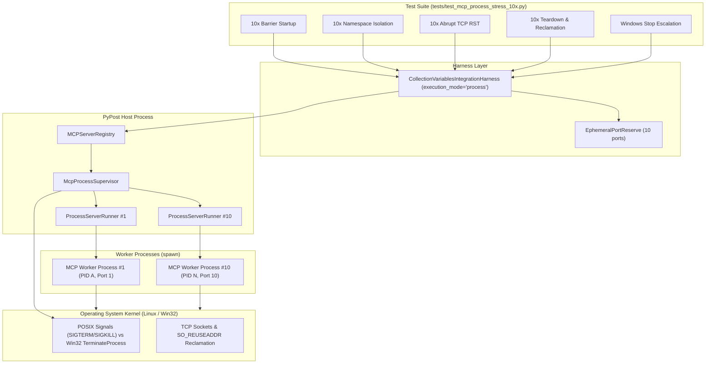
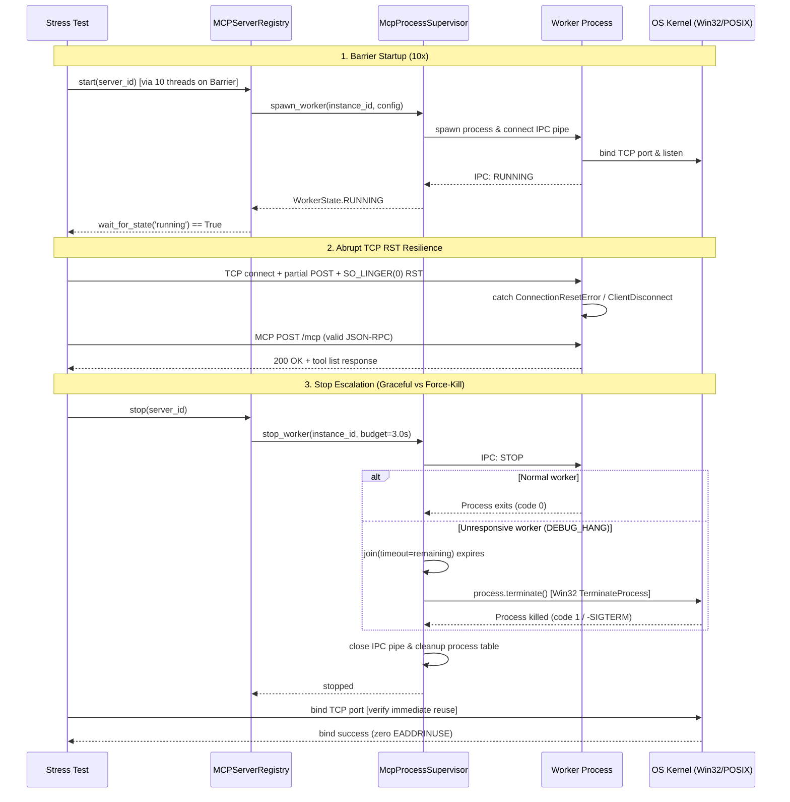

# PYPOST-1470: Process-mode 10x stress parity + Windows stop CI

## Research

### 1. Thread-Mode 10x Stress Baseline (`tests/test_mcp_multiserver_stress_10x.py`)

The thread-mode stress suite validates 10 concurrent MCP servers hosted inside daemon threads:
- `test_mcp_10x_parallel_startup_barrier_synchronization`: Uses `threading.Barrier(10)` across
  10 executor threads to trigger simultaneous `registry.start()`. Asserts `wait_for_state`
  reaches `running`, `wait_for_port` resolves, and concurrent `_mcp_list_tools` calls succeed.
- `test_mcp_10x_variable_namespace_isolation_under_concurrent_load`: Launches 10 servers with
  distinct `server_id` variable values. Mocks `RequestService` to return `resolved_id`, running
  100 concurrent requests across 10 servers with 0 cross-talk.
- `test_mcp_10x_abrupt_client_disconnect_rst_resilience`: Establishes raw TCP connections, sends
  partial HTTP POST payloads, and forces TCP RST via `SO_LINGER` (timeout 0). Verifies server
  threads remain alive, unhandled exceptions are caught, and subsequent requests succeed.
- `test_mcp_10x_concurrent_teardown_and_socket_reclamation`: Parallel teardown of 10 servers via
  `harness.registry.stop_all()`. Asserts thread termination and immediate socket rebinding
  without `EADDRINUSE` errors using `EphemeralPortReserve.verify_all_rebound`.

### 2. Process-Mode Baseline and Isolation Constraints (`test_mcp_process_isolation_repro.py`)

Process mode isolates each MCP server in an independent OS child process via `spawn`:
- Memory boundary: Child processes cannot access parent thread memory or monkey-patched mocks
  (e.g., `unittest.mock.patch` on `RequestService`). Instead, `MCPServerImpl` provides an echo
  gate triggered by `PYPOST_MCP_TEST_ECHO_VARS=1`, allowing workers to return variable snapshots.
- Debug IPC opcodes: Test hooks `DEBUG_HANG` and `DEBUG_ABORT` are guarded by the environment
  gate `PYPOST_MCP_ALLOW_DEBUG_IPC=1`.
- Harness configuration: Tests currently rebuild the registry manually via `_bind_execution_mode`.
  Extending `CollectionVariablesIntegrationHarness` to accept `execution_mode` natively avoids
  boilerplate and aligns test harness ergonomics across execution modes.

### 3. Process Supervisor Stop Escalation (`pypost/core/mcp_process_supervisor.py:415-485`)

`McpProcessSupervisor.stop_worker` coordinates child termination within `_stop_budget_s`:
1. Cooperative shutdown: Sends `{"opcode": "STOP"}` message over the IPC parent pipe.
2. Cooperative wait: Waits `process.join(timeout=remaining)`.
3. First escalation: If alive after budget, calls `process.terminate()` and waits with a bounded
   join timeout (`max(remaining, 0.05)`).
4. Second escalation: If still alive, calls `process.kill()` and waits with a bounded join timeout.
5. Cleanup: Pops record from `_workers`, closes IPC pipes, joins background reader thread, and
   marks status as `stopped` (or `failed` if deadline exceeded).

### 4. Windows Win32 `TerminateProcess` Semantics vs POSIX Signals

Process management semantics diverge across platforms:
- POSIX: `terminate()` sends `SIGTERM` (15); `kill()` sends `SIGKILL` (9). Uncooperative workers
  can handle or trap `SIGTERM` but are killed by `SIGKILL`. Exitcodes reflect negative signal
  numbers (`-15`, `-9`).
- Windows: POSIX signals do not exist. Python's `multiprocessing.Process.terminate()` and
  `Process.kill()` both invoke the Win32 API `_winapi.TerminateProcess(self._handle, 1)`.
- Immediate termination: `TerminateProcess` immediately halts all threads of the target process
  without executing DLL detach routines or Python `finally` / `atexit` blocks.
- Exit code: Windows processes terminated via `TerminateProcess` exit with exit code `1`.
- Socket and handle reclamation: Windows kernel closes all process handles and socket descriptors
  upon process exit. The supervisor's stop escalation succeeds identically on Windows, but exitcode
  assertions must accommodate platform differences (`1` on Windows, `-SIGTERM`/`-SIGKILL` on POSIX).

### 5. CI Matrix Analysis (`.github/workflows/test.yml`)

The existing CI matrix runs exclusively on `ubuntu-latest` (Python 3.11 and 3.13). Windows runners
are currently omitted. Because process handles, IPC pipes, and socket reuse behave differently
under the Win32 kernel, a dedicated Windows CI job is necessary to guard against zombie processes,
unreleased port bindings, and runner hangs.

---

## Implementation Plan

### High-Level Delivery Order (Steps 3–8)

1. **Step 3 — Failing Repro**: Create red tests in `tests/test_mcp_process_stress_10x.py` asserting
   10x process-mode startup barrier, namespace isolation under load, TCP RST resilience, concurrent
   teardown port reclamation, and cross-platform stop escalation.
2. **Step 4 — Development**:
   - Extend `CollectionVariablesIntegrationHarness` and `ServerRegistryFixtureMixin` to accept
     `execution_mode: str = "thread"`.
   - Implement `tests/test_mcp_process_stress_10x.py` covering all acceptance criteria.
   - Add a dedicated Windows CI job (`windows-process-stop`) in `.github/workflows/test.yml` running
     on `windows-latest` to exercise process stop escalation and lifecycle tests.
   - Drive red tests green; ensure thread-mode 10x stress tests remain green.
3. **Step 5 — Code Cleanup**: Run `make lint` and format code according to project guidelines.
4. **Step 6 — Observability**: Verify supervisor logs for process lifecycle, worker stop
   escalations (`mcp_worker_terminate`, `mcp_worker_kill`), and exitcodes.
5. **Step 7 — Tech Debt**: Document Windows-specific test run constraints and port allocation notes
   in `60-tech-debt.md`.
6. **Step 8 — Dev Docs**: Update `doc/dev/` testing documentation with Windows CI job details and
   process-mode 10x stress test execution instructions.

### Module Placement

| Module | Responsibility |
| --- | --- |
| `tests/helpers/collection_integration_harness.py` | Add `execution_mode` parameter to harness |
| `tests/test_mcp_process_stress_10x.py` | 10x process stress suite + stop escalation |
| `.github/workflows/test.yml` | Add `windows-process-stop` job on `windows-latest` |

### Harness Extension Design (`execution_mode="process"`)

`CollectionVariablesIntegrationHarness.__init__` and `ServerRegistryFixtureMixin` are updated to
accept `execution_mode: str = "thread"`. When `execution_mode="process"`, the registry initializes
with `execution_mode="process"`, enabling direct process-mode tests without manual helper methods:

```python
with CollectionVariablesIntegrationHarness(
    tmp_path, execution_mode="process"
) as harness:
    ...
```

### 10x Process Stress Test Layout (`tests/test_mcp_process_stress_10x.py`)

1. `test_mcp_process_10x_parallel_startup_barrier_synchronization`:
   - 10 servers configured in process mode started concurrently via `threading.Barrier(10)`.
   - Asserts all 10 reach `running` state and report `is_listening == True`.
   - Executes concurrent `_mcp_list_tools` calls across all 10 processes.
2. `test_mcp_process_10x_variable_namespace_isolation_under_concurrent_load`:
   - 10 process servers with distinct variable sets; env `PYPOST_MCP_TEST_ECHO_VARS=1`.
   - 100 concurrent requests (10 rounds across 10 servers) verifying zero variable cross-talk.
3. `test_mcp_process_10x_abrupt_client_disconnect_rst_resilience`:
   - 10 process servers receive partial HTTP POSTs aborted via `SO_LINGER(1, 0)`.
   - Asserts child worker processes remain alive, healthy, and answer subsequent requests.
4. `test_mcp_process_10x_concurrent_teardown_and_socket_reclamation`:
   - Parallel shutdown of all 10 process servers within stop budget.
   - Asserts child processes exit, no zombies remain, and all 10 ports re-bind immediately.
5. `test_mcp_process_stop_escalation_cross_platform_parity`:
   - Simulates uncooperative worker via `DEBUG_HANG` opcode.
   - Calls `registry.stop()`, verifying bounded escalation to `terminate()` / `kill()`.
   - Cross-platform assertion: verifies `exitcode == 1` on Windows or `exitcode in (-15, -9, 1)`
     on POSIX, worker is dead, and port is immediately re-bindable.

### Windows CI Job Design (`.github/workflows/test.yml`)

Add job `windows-process-stop`:
- Target runner: `windows-latest`.
- Python runtime: `3.11`.
- Steps:
  1. `actions/checkout@v4`
  2. `actions/setup-python@v5` with `python-version: "3.11"` and pip cache.
  3. `Install test dependencies`: `python -m pip install -e ".[dev,otel]"`
  4. `Run Windows process stop escalation & stress suite`:
     `python -m pytest tests/test_mcp_process_stress_10x.py`
     `  tests/test_mcp_process_isolation_repro.py -v --tb=short`
  5. Timeout guard: Bounded job and step timeouts prevent stuck runners.

### Mandatory — Failing Repro (next Step 3)

The failing repro for Step 3 will write tests in `tests/test_mcp_process_stress_10x.py`:
- Desired behavior:
  1. `CollectionVariablesIntegrationHarness(tmp_path, execution_mode="process")` works natively.
  2. 10x process-mode servers achieve barrier startup parity, namespace isolation, TCP RST fault
     tolerance, and concurrent port reclamation.
  3. Stop escalation cleanly kills unresponsive workers on both Windows and POSIX without port
     leaks or zombie processes.
- Where it lives: `tests/test_mcp_process_stress_10x.py`.
- How to force failure before Step 4:
  1. `CollectionVariablesIntegrationHarness` currently rejects `execution_mode="process"` with
     `TypeError: __init__() got an unexpected keyword argument 'execution_mode'`.
  2. The 10x process stress suite does not yet exist.
- Sequencing: Step 3 commits red tests -> Step 4 implements harness extension and CI workflow ->
  all tests run green.

---

## Architecture

### System Component Architecture



### Module Interaction



### Interface Specifications

#### 1. Harness Execution Mode Extension
```python
class CollectionVariablesIntegrationHarness(
    LibraryFixtureMixin,
    EnvironmentFixtureMixin,
    ServerRegistryFixtureMixin,
):
    def __init__(
        self,
        tmp_path: Path | None = None,
        *,
        in_memory: bool = False,
        backend: InMemoryVirtualFS | None = None,
        execution_mode: str = "thread",
    ) -> None:
        ...
```

#### 2. Process Supervisor Stop Escalation Protocol
- `McpProcessSupervisor.stop_worker(instance_id: str, timeout: float | None = None) -> bool`:
  Executes phased escalation:
  1. `parent_conn.send(make_message("STOP"))`
  2. `process.join(timeout=remaining)`
  3. `process.terminate()` -> `process.join(timeout=max(remaining, 0.05))`
  4. `process.kill()` -> `process.join(timeout=max(remaining, 0.05))`
  Returns `True` if `process is None or not process.is_alive()`.

### Resource and Port Cleanup Guarantees

- **Ephemeral Port Safety**: `EphemeralPortReserve(10)` ensures dynamic non-colliding port
  allocations across concurrent tests.
- **Immediate Port Rebinding**: In teardown tests, all 10 ports are verified via
  `verify_all_rebound` and raw TCP socket bind probes with `SO_REUSEADDR` to ensure
  immediate reuse.
- **Process Table Integrity**: `McpProcessSupervisor.stop_worker` pops worker records upon clean
  termination, joins pipe reader threads, and closes IPC handles to avoid descriptor leaks.
- **Zero Orphan Guarantee**: In the event of test failure, `harness.teardown()` calls
  `registry.stop_all(timeout=10.0)` which invokes `supervisor.shutdown()`, terminating any
  lingering child processes.

---

## Q&A

### Q1: Why extend `CollectionVariablesIntegrationHarness` rather than helper functions?
A1: Rebuilding `harness.registry` via helper functions (`_bind_execution_mode`) bypasses harness
initialization and creates maintenance overhead across tests. Providing `execution_mode` as a
first-class constructor parameter provides clean ergonomics for both thread and process mode.

### Q2: How does the Windows CI job avoid slowing down PR workflows?
A2: The `windows-process-stop` job targets only process lifecycle and stop escalation tests
(`test_mcp_process_stress_10x.py` and `test_mcp_process_isolation_repro.py`) rather than the entire
GUI test suite. This keeps runner execution fast (under 2 minutes) while verifying Win32 semantics.

### Q3: How do child workers handle variable isolation without shared parent memory?
A3: Child worker processes receive variable snapshots through initial configuration IPC messages
and reflect updates via `UPDATE_VARIABLES` IPC messages. The test echo gate
(`PYPOST_MCP_TEST_ECHO_VARS=1`) allows workers to return variable state in tool responses without
relying on parent-process in-memory mocks.

### Q4: Why is Win32 `TerminateProcess` exit code `1` while POSIX is negative?
A4: POSIX encodes the terminating signal number as a negative exit status in Python's
`multiprocessing` module (`-SIGTERM = -15`, `-SIGKILL = -9`). Windows does not have signals;
`TerminateProcess` specifies an exit code directly (Python's stdlib passes `1`). The test
assertions account for this platform difference.
