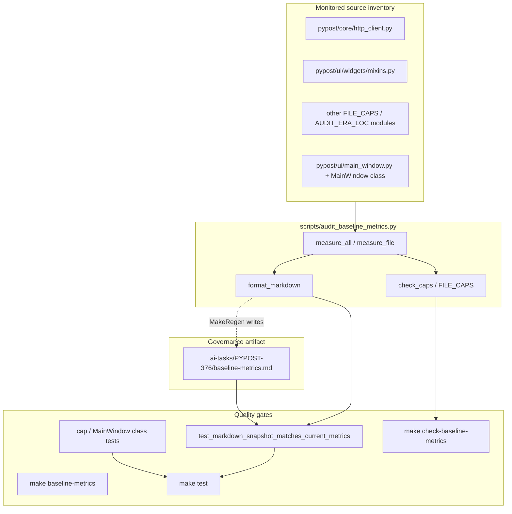

# PYPOST-1492: Refresh SOLID audit markdown snapshot (mixins.py LOC drift / full snapshot resync)

## Research

### Industry pattern: committed metrics baseline + exact (or threshold) drift gate

Modern architectural-governance stacks treat size and structure metrics as a
**committed baseline artifact** plus a **CI gate that recomputes the same
metrics live** and fails on unintended drift:

- **Shared computation library** so report generation and the gate cannot diverge
  (e.g. SynthOrg’s architecture report + drift check sharing one metrics lib;
  see [architectural feedback loop ADR](https://github.com/Aureliolo/synthorg/blob/main/docs/decisions/0011-architectural-feedback-loop.md)).
- **Deliberate baseline refresh** in the same change that intentionally moves
  numbers — never silent threshold raises to green a gate
  ([MMCA ADR-060 performance baseline](https://ivanball.github.io/docs/adr/060-performance-regression-gate.html);
  [pawl record/check](https://github.com/tiangong-dev/pawl)).
- **Hard caps distinct from recorded baseline values** — baselines track “what is”;
  caps track “what is allowed”
  ([dpone quality metrics](https://paulkov.github.io/dpone/quality-metrics/);
  [SynthOrg tiered module-size ADR](https://synthorg.io/docs/decisions/0006-tiered-module-size-policy/)).

PyPost’s SOLID audit stack already follows this pattern: one generator
(`format_markdown(measure_all())`), one committed Markdown snapshot, exact
UTF-8 equality in pytest, and separate `--check` / cap tests. PYPOST-1492 is a
**baseline refresh**, not a new gate design.

### Local system of record (PYPOST-376 / PYPOST-40 lineage)

| Component | Path | Role |
| --- | --- | --- |
| Metrics auditor | `scripts/audit_baseline_metrics.py` | `FILE_CAPS`, `AUDIT_ERA_LOC`, `measure_all()`, `format_markdown()`, `check_caps()` |
| Canonical snapshot | `ai-tasks/PYPOST-376/baseline-metrics.md` | Checked-in UTF-8 Markdown; **generated**, not hand-edited |
| Snapshot + cap guards | `tests/test_solid_audit_baseline.py` | Exact equality + cap / MainWindow class contracts |
| Make façade | `Makefile` | `baseline-metrics` (write snapshot), `check-baseline-metrics` (`--check`) |
| Policy docs | `doc/dev/solid_audit.md` | Maintenance rules; troubleshooting for “caps pass, snapshot stale” |

**Interfaces (already stable — this task does not change them):**

- `measure_all() -> list[FileMetrics]` — discover physical LOC (+ AST class spans)
  for `sorted(set(FILE_CAPS) | set(AUDIT_ERA_LOC))`.
- `format_markdown(metrics) -> str` — sole renderer; trailing newline via join of
  lines ending with empty regenerate section.
- `check_caps() -> list[str]` — empty list means all inventory within caps.
- CLI: `--markdown PATH` (write), `--check` (exit 1 on violations), `--json PATH`,
  or stdout Markdown with no flags.
- Make: `make baseline-metrics` → writes `ai-tasks/PYPOST-376/baseline-metrics.md`;
  `make check-baseline-metrics` → `--check` only.

### Current failure (Step 2 verification, Make-only)

- **Red:** `make test PYTEST_ARGS='tests/test_solid_audit_baseline.py::TestSolidAuditBaseline::test_markdown_snapshot_matches_current_metrics -v'`
  → `AssertionError` on exact string equality (`actual` committed snapshot ≠
  `expected` from `format_markdown(measure_all())`).
- **Green caps:** `make check-baseline-metrics` exits **0** (no module exceeds
  `FILE_CAPS` / `MAIN_WINDOW_CLASS_CAP`).
- **Observed live vs committed Baseline LOC (physical `wc -l` vs snapshot table):**
  - `pypost/core/http_client.py`: snapshot **378** → live **395** (cap **418**)
  - Remaining monitored inventory rows (including `mixins.py` at **396** / cap **411**,
    `tabs_presenter.py` **1055** / **1165**, `main_window.py` **462** / **477**)
    currently match the committed snapshot table.
- **Historical filing (PYPOST-1324 triage):** excerpt cited `mixins.py` 1053 vs 1055;
  the tree has since moved. Requirements require **full snapshot resync**, not a
  one-row patch keyed only to that excerpt.
- **Out of scope:** dialog-audit inventory coherence (e.g. PYPOST-1475 / PYPOST-374
  report sync). This Debt item is SOLID `baseline-metrics.md` only.

### Prior art in-repo

PYPOST-1361 and PYPOST-1025 already established the approved remediation:
regenerate via `make baseline-metrics`, leave caps and assertion rigor untouched,
verify with `make check-baseline-metrics` and the solid-audit pytest module.
`doc/dev/solid_audit.md` troubleshooting explicitly: *“Caps pass but snapshot
equality fails: regenerate the snapshot… do not hand-edit generated values.”*

## Implementation Plan

### High-level strategy (Steps 3–8 foreshadow only; not executed here)

1. **Step 3 — Failing repro:** Capture the existing red equality test under Make as
   the automated repro (no new production behavior; no new gate required).
2. **Step 4 — Development:** Run `make baseline-metrics` so
   `ai-tasks/PYPOST-376/baseline-metrics.md` becomes byte-identical to
   `format_markdown(measure_all())`. Do **not** edit `FILE_CAPS`,
   `MAIN_WINDOW_CLASS_CAP`, or weaken tests. Optionally sync summary LOC figures
   in `doc/dev/solid_audit.md` only if they disagree with the regenerated snapshot
   (policy doc troubleshooting); prefer minimal doc churn if already aligned.
3. **Verification (Make-only):**
   - `make check-baseline-metrics` (still green; caps unchanged)
   - `make test PYTEST_ARGS='tests/test_solid_audit_baseline.py'`
   - Broader `make check` as workflow quality gate when implementing
4. **Steps 5–8:** Cleanup / observability / tech-debt / dev-docs per Top-Down;
   no application runtime code expected.

### Mandatory — Failing Repro (next Step 3)

**Not N/A.** There is no product runtime behavior change, but there **is** an
existing automated governance contract that is already red and must stay the
Step 3 anchor:

| Item | Detail |
| --- | --- |
| **Test** | `tests/test_solid_audit_baseline.py::TestSolidAuditBaseline::test_markdown_snapshot_matches_current_metrics` |
| **Asserts** | Committed UTF-8 text of `ai-tasks/PYPOST-376/baseline-metrics.md` equals `format_markdown(measure_all())` exactly |
| **Force failure without live external deps** | Already local: reads repo files + committed Markdown; no network |
| **Make repro** | `make test PYTEST_ARGS='tests/test_solid_audit_baseline.py::TestSolidAuditBaseline::test_markdown_snapshot_matches_current_metrics -v'` |
| **Sequencing** | Step 3 documents/confirm red → Step 4 `make baseline-metrics` → re-run until green; do not delete/skip/weaken the assertion |

Companion green checks (not the red target, but prove caps stay intact):
`test_audit_module_inventory_within_caps`, `test_main_window_*_within_cap`, and
`make check-baseline-metrics`.

## Architecture

### Module diagram



### Responsibilities

| Module | Responsibility in this task |
| --- | --- |
| `scripts/audit_baseline_metrics.py` | **Unchanged** source of truth for discovery, rendering, and caps |
| `ai-tasks/PYPOST-376/baseline-metrics.md` | **Only intentional change:** regenerate so Baseline LOC columns match live discovery |
| `tests/test_solid_audit_baseline.py` | **Unchanged** contracts; equality test transitions red → green after refresh |
| `Makefile` | **Unchanged** Make-only operator interface |
| Application packages under `pypost/` | **Out of scope** for edits; sizes already within caps |

### Selected patterns (justification)

1. **Generated living documentation** — Snapshot is an artifact of the auditor, so
   CI equality cannot drift from the measurement algorithm.
2. **Separation of baseline vs ceiling** — Refreshing Baseline LOC acknowledges
   intentional growth; caps remain the hard architectural policy (NFR-2).
3. **Exact-match gate (no tolerance)** — Forces intentional acknowledgment of
   metric changes; matches FR-1 / FR-2 and industry “record then check” practice.
4. **Make-only façade** — Satisfies NFR-4 and AGENTS tooling standard; avoids
   divergent raw interpreter invocations in docs or workflows.

### Dependencies

```
Live tree → audit_baseline_metrics (measure/format/check)
                ↓
         baseline-metrics.md  ←── make baseline-metrics
                ↓
         test_solid_audit_baseline (equality + caps)
                ↓
         make test / make check
```

No new modules, APIs, or dependency packages are introduced.

## Q&A

- **Q: Is hand-editing the `http_client.py` Baseline LOC cell enough?**
  **A:** No. The equality test compares the **entire** Markdown document to
  `format_markdown(measure_all())`. Use `make baseline-metrics` for a full
  resync so formatting, MainWindow guard table, and inventory rows stay
  generator-canonical.

- **Q: Why not raise `http_client.py` cap or skip the equality test?**
  **A:** Caps already allow 395 (cap 418). Raising caps or softening equality
  would violate DoD / NFR-2. The defect is stale snapshot content only.

- **Q: Does the historical `mixins.py` 1053≠1055 excerpt still drive the fix?**
  **A:** It explains ticket origin. Current verification shows inventory drift
  centered on `http_client.py` (378→395). Done still means full snapshot match.

- **Q: Any application runtime or public API change?**
  **A:** No (FR / NFR-3). Governance document currency only.

- **Q: Who marks Step 2 `[x]`?**
  **A:** The acceptance-gate owner after review PASS (and user approval in
  interactive mode). This execution leaves STEP 2 as `[/]`.
