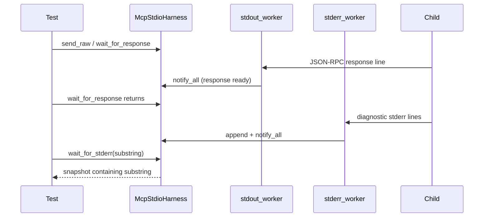

# PYPOST-1493: Stabilize flaky MCP stdio harness stderr collection test

## Research

### Failure class

| Item | Detail |
| --- | --- |
| Node id | `tests/test_mcp_stdio_harness.py::test_harness_stderr_collection` |
| Symptom | Assertion on `"diagnostic error: line 1"` fails; `stderr_output` empty |
| Alone | Passes |
| Parallel | Intermittent under full-suite `make test` workers |
| Base | Passed at `4a40ff6b96994455e69d4da71ac02c8e235b89b0` |
| Suspected cause | Race: `wait_for_response` returns via stdout worker notify; stderr worker has not yet appended drained lines when `get_stderr()` is called |

### Current harness behavior

- `_stdout_worker` appends responses under `_condition` and `notify_all()`.
- `_stderr_worker` appends under `_stderr_lock` only — **does not notify** the
  shared condition.
- `get_stderr()` is an immediate snapshot; `wait_for_predicate` can poll stderr
  but only wakes on stdout notifies or the 50ms interval.
- Existing test: child writes stderr first, then responds; under load the
  stderr drain can still lag the response wait wake-up.

### Industry / prior art

Concurrent stdout/stderr drains must not assume drain-thread writes are visible
to the caller the moment another stream’s wait returns. Standard advice:
drain both pipes on background threads, then **join or wait on content** before
asserting (Stack Overflow “read stdout and stderr concurrently”; asyncio
TaskGroup drain patterns). Pytest itself documents races when background
threads and capture interact — the fix is synchronization, not sleeps.

In-repo precedent: `wait_for_response` / `wait_for_predicate` already use a
monitor condition for stdout-correlated waits (PYPOST-1429 /
`doc/dev/mcp_standalone_wire_ipc_stress.md`). Stderr needs the same wake-up
path.

### Preferred pattern

1. **Notify** `_condition` after each stderr append (without holding
   `_stderr_lock` while taking `_lock` — avoid lock-order deadlock).
2. Add **`wait_for_stderr(substring, timeout=...)`** that blocks until the
   snapshot contains the substring or raises `TimeoutError` with diagnostics.
3. Update `test_harness_stderr_collection` (and a deterministic post-response
   repro) to wait for content instead of asserting on a bare snapshot right
   after `wait_for_response`.

## Implementation Plan

1. Step 3 — Red repro: child emits correlated JSON-RPC response **then**
   stderr after a short delay; assert desired visibility via
   `wait_for_stderr` contract (or equivalent). On current code, immediate
   snapshot / missing wait fails with empty stderr.
2. Step 4 — Implement `wait_for_stderr`; notify from `_stderr_worker`; update
   named flaky test + repro to use the wait.
3. Steps 5–8 — Cleanup, light harness DEBUG observability if useful, tech-debt
   notes, update `doc/dev/mcp_standalone_wire_ipc_stress.md` API section.

**Mandatory — Failing Repro (next Step 3):**

| Item | Detail |
| --- | --- |
| **Asserts** | After `wait_for_response`, expected stderr substring is observable via bounded `wait_for_stderr` (desired API) / must not rely on empty race snapshot |
| **Where** | `tests/test_mcp_stdio_harness.py::test_harness_stderr_visible_when_emitted_after_response` |
| **Force failure** | Child writes stdout response first, sleeps briefly, then writes stderr; without stderr wait/notify, immediate `get_stderr()` (or missing wait API path) sees empty string |
| **Live deps** | None (`sys.executable -c` child only) |
| **Make repro** | `make test PYTEST_ARGS='tests/test_mcp_stdio_harness.py::test_harness_stderr_visible_when_emitted_after_response -v'` |
| **Sequencing** | Red → harness wait + notify → green; then stabilize `test_harness_stderr_collection` the same way |
| **Timeout** | Module already has `pytestmark = pytest.mark.timeout(30)` |

## Architecture



| Module | Responsibility |
| --- | --- |
| `tests/helpers/mcp_stdio_harness.py` | Notify on stderr append; add `wait_for_stderr` |
| `tests/test_mcp_stdio_harness.py` | Red repro + stabilize `test_harness_stderr_collection` |
| `doc/dev/mcp_standalone_wire_ipc_stress.md` | Document wait API / race guidance |
| Production `pypost/` MCP | Unchanged |

### Patterns

- **Monitor condition** for stream readiness (same as responses).
- **Bounded wait-for-content** instead of fixed sleep.
- **Lock ordering:** append under `_stderr_lock`, then notify under `_condition`
  separately.

### Dependencies

```
Child stderr → _stderr_worker → _stderr_lines + notify
                                  ↓
                    wait_for_stderr / wait_for_predicate
                                  ↓
                         test assertions
```

No new packages.

## Q&A

- **Q: Why not only `time.sleep` in the flaky test?**
  **A:** Does not close the race; slows CI; violates NFR-2.

- **Q: Why a new method instead of only `wait_for_predicate`?**
  **A:** Predicate already works via polling, but stderr never notifies so
  wake-ups are interval-only. A named `wait_for_stderr` documents the contract
  and shares the notify path; predicate remains available for custom checks.

- **Q: Any production MCP change?**
  **A:** No — test helper only (FR / DoD).

- **Q: Who marks Step 2 `[x]`?**
  **A:** Acceptance-gate owner after review PASS. Execution leaves `[/]`.
