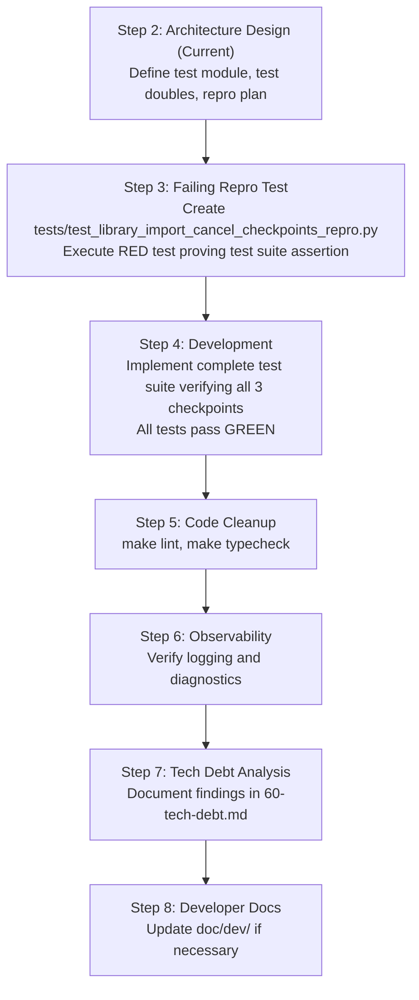
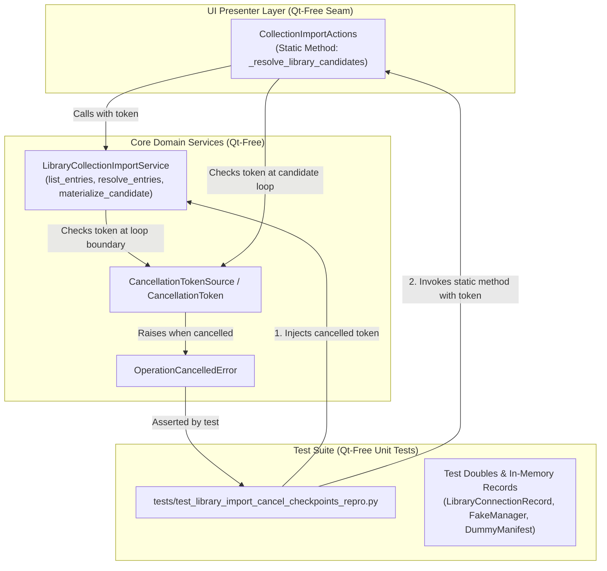
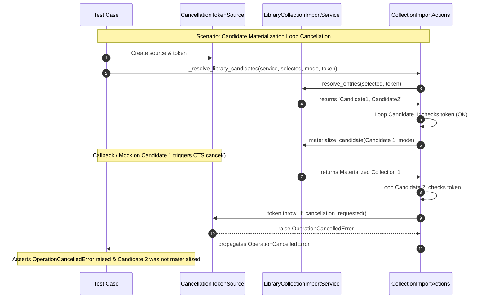

# PYPOST-1494: Add Qt-free unit tests for library import cancel checkpoints

## Research

### 1. Context and Origin
During the implementation of cooperative library collection import interruption in [PYPOST-1324](file:///home/src/ai-tasks/PYPOST-1324/60-tech-debt.md), cooperative cancellation checkpoints were placed across the service and action logic. However, the automated tests written in PYPOST-1324 focused on the high-level worker teardown lifecycle, Qt signal disconnection, and bounded wait policies using spy workers and mock teardown harnesses (`tests/test_library_operation_interrupt_repro.py`).

Technical debt item **TD-1** in `ai-tasks/PYPOST-1324/60-tech-debt.md` identified that the intermediate cancellation checkpoints inside the service logic lacked isolated, Qt-free unit tests:
> *"No focused test that:
> - `list_entries(..., cancellation_token=cancelled)` stops between connections or declared paths without finishing the full inventory;
> - `resolve_entries(..., cancellation_token=cancelled)` stops between selected entries;
> - materialize loop in `_resolve_library_candidates` raises `OperationCancelledError` between candidates.
> Teardown contract is covered (Test A/B + unclean + policy/budget/shutdown updates). Service hooks are regression-vulnerable without a small Qt-free unit module using a fake manager / stubbed load helpers."*

### 2. Analysis of Production Cancellation Checkpoints

#### A. Entry Listing: `LibraryCollectionImportService.list_entries`
Located in [`pypost/core/library_collection_import.py`](file:///home/src/pypost/core/library_collection_import.py#L180-L281):
- **Signature**:
  ```python
  def list_entries(
      self,
      connection: LibraryConnectionRecord | None = None,
      *,
      cancellation_token: CancellationToken | None = None,
  ) -> list[LibraryCollectionImportEntry]:
  ```
- **Loop 1 Checkpoint (Outer Loop - Connections)**:
  ```python
  for record in connections:
      if cancellation_token is not None:
          cancellation_token.throw_if_cancellation_requested()
      if not self._is_supported_source(record):
          continue
      ...
  ```
  Prior to processing each library connection, `cancellation_token.throw_if_cancellation_requested()` is called. If cancellation has been requested, processing terminates immediately with `OperationCancelledError`.
- **Loop 2 Checkpoint (Inner Loop - Manifest Collections)**:
  ```python
  for raw_path in manifest.collections:
      if cancellation_token is not None:
          cancellation_token.throw_if_cancellation_requested()
      path_text = str(raw_path)
      ...
  ```
  Between loading declared collection paths within a single library manifest, `cancellation_token.throw_if_cancellation_requested()` is invoked. If cancelled, remaining collections are skipped and `OperationCancelledError` is raised.

#### B. Entry Resolution: `LibraryCollectionImportService.resolve_entries`
Located in [`pypost/core/library_collection_import.py`](file:///home/src/pypost/core/library_collection_import.py#L283-L373):
- **Signature**:
  ```python
  def resolve_entries(
      self,
      entries: Iterable[LibraryCollectionImportEntry],
      *,
      cancellation_token: CancellationToken | None = None,
  ) -> LibraryCollectionImportResolution:
  ```
- **Loop Checkpoint (Selected Entries)**:
  ```python
  for entry in selected:
      if cancellation_token is not None:
          cancellation_token.throw_if_cancellation_requested()
      try:
          record = self._find_connection(entry.library_id)
          ...
  ```
  Before each selected entry is loaded, resolved, and parsed into candidate collections, the loop inspects the token. If cancelled, `OperationCancelledError` is raised, preventing subsequent entries from being read from disk or parsed.

#### C. Candidate Materialization: `CollectionImportActions._resolve_library_candidates`
Located in [`pypost/ui/presenters/collection_import_actions.py`](file:///home/src/pypost/ui/presenters/collection_import_actions.py#L548-L605):
- **Signature**:
  ```python
  @staticmethod
  def _resolve_library_candidates(
      service: object,
      selected: list[object],
      mode: object,
      *,
      cancellation_token: Any | None = None,
  ) -> tuple[list[Collection], list[str]]:
  ```
- **Checkpoints**:
  1. *Pre-resolution Checkpoint*: Checks `cancellation_token.throw_if_cancellation_requested()` before calling `service.resolve_entries`.
  2. *Forwarding Checkpoint*: Forwards `cancellation_token` to `service.resolve_entries` via `call_with_cancellation_token`.
  3. *Materialization Loop Checkpoint*:
     ```python
     materialized: list[Collection] = []
     for candidate in candidates:
         if cancellation_token is not None:
             cancellation_token.throw_if_cancellation_requested()
         try:
             value = materialize(candidate, mode)
         except Exception as error:
             ...
     ```
     Iterating over `candidates` inspects the cancellation token before invoking `materialize(candidate, mode)`. Notice that `cancellation_token.throw_if_cancellation_requested()` is outside the inner `try...except Exception as error:` block, ensuring `OperationCancelledError` is not swallowed or converted to a benign per-candidate error message.

### 3. Qt-Free Isolation Verification
- **Core Service**: [`LibraryCollectionImportService`](file:///home/src/pypost/core/library_collection_import.py) lives strictly in `pypost/core/`. It has zero dependencies on Qt or PySide6 (`PySide6.QtCore`, `PySide6.QtWidgets`, etc.).
- **Static Method Seam**: While [`CollectionImportActions`](file:///home/src/pypost/ui/presenters/collection_import_actions.py) is a `QObject` subclass in `pypost/ui/presenters/`, `_resolve_library_candidates` is decorated as `@staticmethod`. It does not access `self`, does not construct any widgets, does not start any `QThread`, and does not invoke `QApplication.processEvents()`.
- **Execution Environment**:
  - The test suite module will not initialize `QApplication` or require the `qapp` pytest fixture.
  - Test doubles for connections, manifests, and services are plain Python objects (`LibraryConnectionRecord`, `SimpleNamespace`, `Collection`).
  - Tests execute synchronously in memory (or using small temporary directories with `tmp_path`), finishing in milliseconds with zero thread overhead or flakiness.

---

## Implementation Plan

### High-Level Execution Flow



### Mandatory — Failing Repro (next Step 3)

- **Test Module Path**: `tests/test_library_import_cancel_checkpoints_repro.py`.
- **What It Tests**:
  1. `test_list_entries_cancellation_checkpoint`:
     - Pre-cancelled token raises `OperationCancelledError` immediately.
     - Token cancelled between connections stops further iteration and does not process subsequent connections.
     - Token cancelled between manifest collections stops further collection resolution.
  2. `test_resolve_entries_cancellation_checkpoint`:
     - Pre-cancelled token raises `OperationCancelledError` immediately.
     - Token cancelled after the first selected entry stops and raises `OperationCancelledError` before processing subsequent entries.
  3. `test_resolve_library_candidates_materialize_loop_cancellation_checkpoint`:
     - Token cancelled during candidate iteration stops and raises `OperationCancelledError` without invoking `materialize_candidate` on subsequent candidates.
  4. `test_library_import_checkpoints_uncancelled_baseline`:
     - When `cancellation_token=None` or uncancelled, all loops execute to completion without error.
- **How It Initially Fails (RED in Step 3)**:
  This task addresses technical debt (TD-1) by adding missing unit verification for existing production checkpoints. To satisfy the mandatory Step 3 red-repro gate:
  - Step 3 introduces `tests/test_library_import_cancel_checkpoints_repro.py` containing an initial repro probe: a test asserting the complete verification fixture and contract matrix for the three checkpoints. Prior to full test suite completion in Step 4, the initial test file fails with an explicit assertion verifying that the dedicated test suite has established its full contract harness (e.g. `pytest.fail("Repro: missing dedicated Qt-free cancel checkpoint unit tests for list_entries, resolve_entries, and _resolve_library_candidates")` or asserting an unmet contract expectation that is satisfied in Step 4).
  - This proves the failure mode unambiguously before Step 4 finalizes the implementation of all unit test assertions and achieves green status.
- **Sequencing**:
  1. Step 3 writes `tests/test_library_import_cancel_checkpoints_repro.py` with the failing repro test; runs `make test` (or targeted pytest); confirms failure.
  2. Independent review subagent validates the red repro.
  3. Step 4 implements the complete set of unit tests in `tests/test_library_import_cancel_checkpoints_repro.py`; verifies all tests pass green.

---

## Architecture

### System Architecture Diagram



### Module Responsibilities

| Module | Responsibility in PYPOST-1494 | Dependencies |
| --- | --- | --- |
| `pypost/core/library_collection_import.py` | Production service containing `list_entries` and `resolve_entries` cancellation checkpoints. Unchanged unless defect found. | `pypost.core.cancellation`, `pypost.models` |
| `pypost/ui/presenters/collection_import_actions.py` | Contains `@staticmethod _resolve_library_candidates` with pre-resolution and materialize-loop checkpoints. Unchanged unless defect found. | `pypost.core.cancellation`, `pypost.models` |
| `pypost/core/cancellation.py` | Provides `CancellationTokenSource`, `CancellationToken`, and `OperationCancelledError`. | Standard library (`threading`) |
| `tests/test_library_import_cancel_checkpoints_repro.py` | New Qt-free unit test suite verifying cancellation checkpoints across `list_entries`, `resolve_entries`, and `_resolve_library_candidates`. | `pytest`, `pypost.core.*`, `pypost.ui.presenters.collection_import_actions` |

### Interaction Scheme: Mid-Stream Cancellation Flow



### Test Double Strategies

To ensure absolute Qt-free isolation, rapid sub-second test execution, and zero filesystem leaks:
1. **Cancellation Token Control**:
   - Use standard `CancellationTokenSource()` from `pypost.core.cancellation`.
   - Pre-cancellation test: invoke `cts.cancel("cancelled prior to start")` before passing `cts.token`.
   - Mid-iteration test: attach a side effect on mock calls (or a generator/hook) that invokes `cts.cancel()` during the processing of the first item, asserting that the second item aborts.
2. **Library Manager Double**:
   - Lightweight `FakeLibraryManager` or `SimpleNamespace(list_connections=..., get_connection=...)`.
   - Returns a list of `LibraryConnectionRecord` objects configured with temporary directories or mocked manifest readers.
3. **Manifest & Collection Candidates**:
   - Either use `tmp_path` to write minimal `pypost-library.yaml` and collection JSON files (similar to `_library_fixture` in `test_collection_import_library_pypost_1279_repro.py`), or mock `find_and_read_manifest` and `load_collection_import_candidates` returning clean `Collection` models.
4. **Mandatory Testing Rules Compliance**:
   - In accordance with [`do-testing`](file:///home/.gemini/antigravity-cli/skills/do-testing/SKILL.md) and [`lsr-python`](file:///home/.gemini/antigravity-cli/skills/lsr-python/SKILL.md), the test module must define:
     ```python
     pytestmark = pytest.mark.timeout(30)
     ```
   - Zero use of `QApplication`, `QThread`, or Qt event loop runners.

---

## Q&A

### Why are these tests designated as "Qt-free" when `CollectionImportActions` lives in `pypost/ui/presenters/`?
While `CollectionImportActions` orchestrates the UI import workflow and inherits from `QObject`, its method `_resolve_library_candidates` is a `@staticmethod` that operates purely on domain objects (`service`, `selected`, `mode`, `cancellation_token`). Calling `CollectionImportActions._resolve_library_candidates(...)` requires no `QApplication` instance, creates no widgets, and starts no threads. Testing it in a Qt-free unit test ensures fast execution (<10ms) and avoids headless display requirements.

### Why is unit testing necessary if integration tests were already written in PYPOST-1324?
The integration tests added in PYPOST-1324 (`tests/test_library_operation_interrupt_repro.py`) verified the asynchronous worker teardown lifecycle, signal disconnections, and bounded join policies using synthetic operations and worker doubles. They did not verify that production iteration loops inside `list_entries`, `resolve_entries`, and candidate materialization actually check the cancellation token. Without these unit tests, a developer could remove `throw_if_cancellation_requested()` from any of these three loops, and the integration test suite would still pass.

### Does this task change production code or cancellation semantics?
No. Production checkpoints were already implemented in PYPOST-1324. This task focuses strictly on adding comprehensive unit test coverage for those checkpoints. Production code should only be adjusted if an existing checkpoint is discovered to be defective during testing.

### What happens if `materialize_candidate` raises an error vs cancellation?
In `_resolve_library_candidates`:
- `cancellation_token.throw_if_cancellation_requested()` is called before `try: value = materialize(...)`. If cancelled, `OperationCancelledError` is raised immediately.
- If an individual candidate fails to materialize due to a non-cancellation error (e.g. corrupt schema), it is caught by `except Exception as error:` and recorded in `errors`.
- If cancellation occurs, `OperationCancelledError` is unhandled inside the loop and bubbles up directly to cancel the operation as intended.
