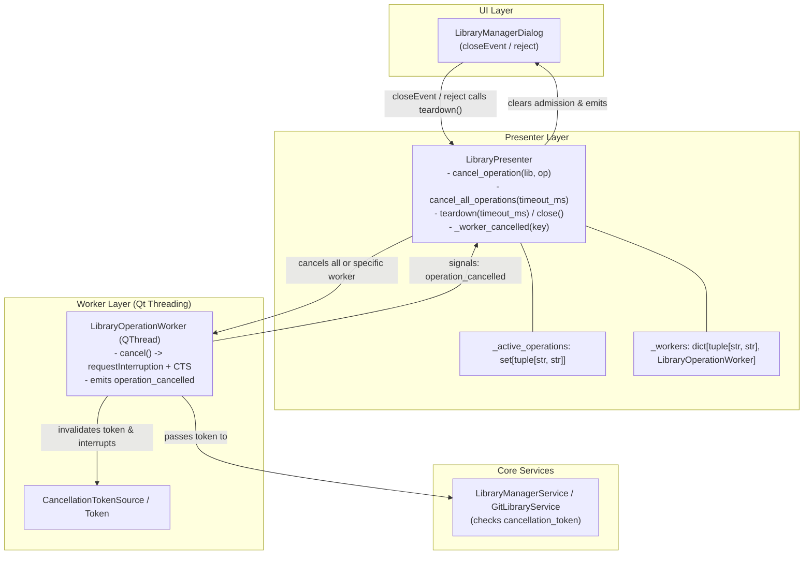
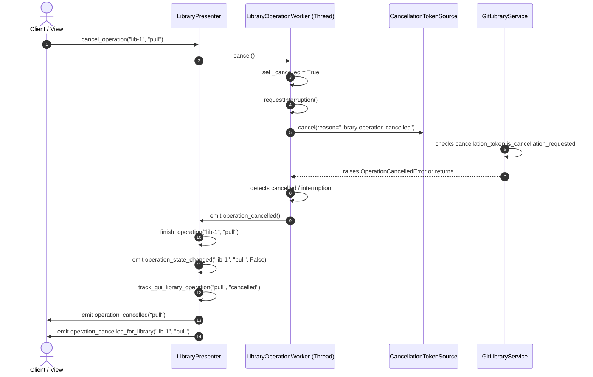
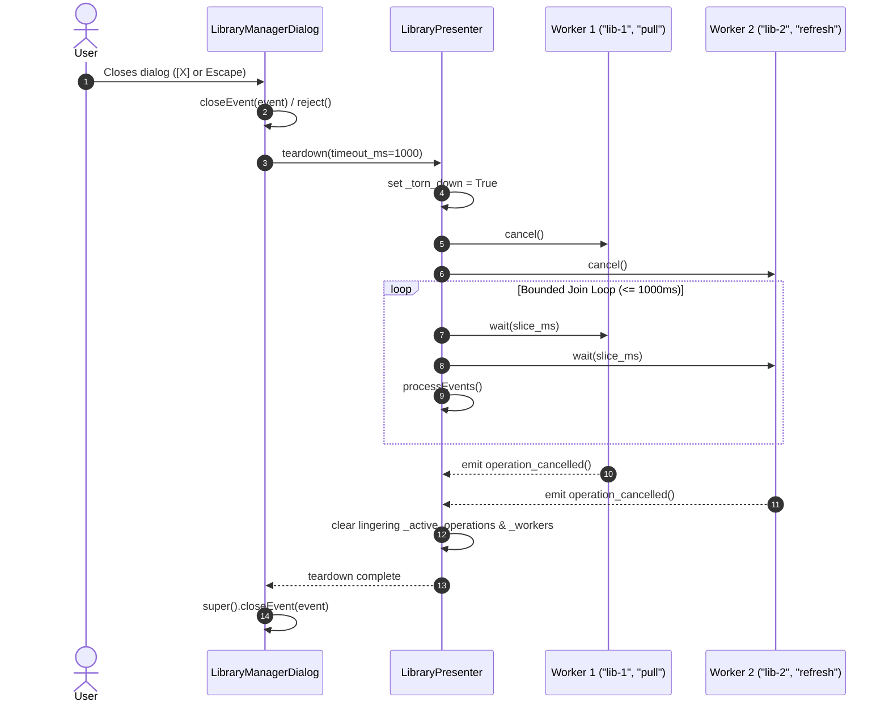
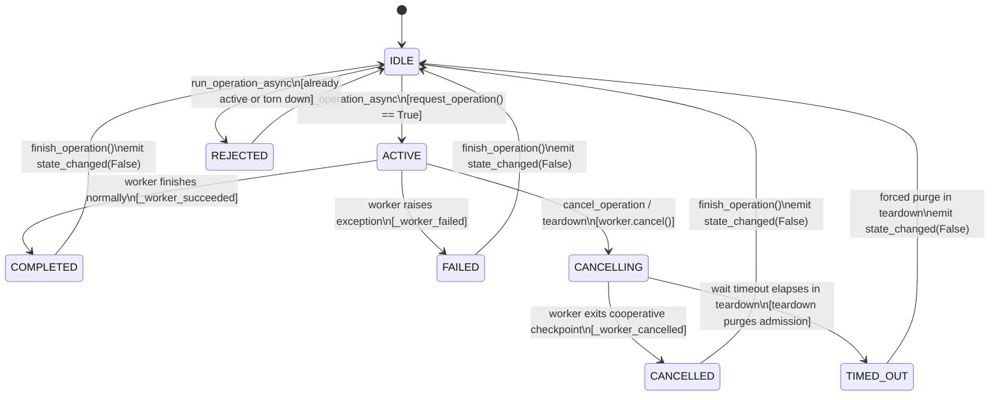

# PYPOST-1497: Optional LibraryPresenter close-path cooperative cancel

## Research

### Current Code Facts (Verified)

1. **`pypost/ui/presenters/library_presenter.py`**:
   - Manages library operations and tracks running workers in `self._workers: Dict[tuple[str, str], LibraryOperationWorker]`.
   - Coordinates operation concurrency via admission set `self._active_operations: set[tuple[str, str]]`, admitting one concurrent operation per `(library_id, operation)` pair (`request_operation` at line 837).
   - In `run_operation_async` (lines 850-874):
     - Instantiates `worker = LibraryOperationWorker(callback, *args, **kwargs)`.
     - Connects `worker.operation_completed` to `_worker_succeeded`.
     - Connects `worker.operation_failed` to `_worker_failed`.
     - Connects `worker.finished` to `lambda: self._workers.pop(key, None)`.
     - **Deficiency 1 (No Cancel Signal Wiring)**: Does *not* connect `worker.operation_cancelled`. When a worker is cooperatively cancelled, it emits `operation_cancelled`, which is silently dropped. Neither `self.finish_operation(*key)` nor any cancellation notification is called, permanently stranding `(library_id, operation)` in `self._active_operations`. Subsequent attempts to run the same operation on that library are rejected with "operation already in progress".
     - **Deficiency 2 (No Cancellation APIs)**: Has no public methods to cancel an individual in-flight operation (`cancel_operation`), cancel all active operations (`cancel_all_operations`), or safely tear down background tasks (`teardown` / `close`).
     - **Deficiency 3 (Missing Cancel Signals)**: Possesses signals for started, completed, failed, blocked, and state changes, but lacks `operation_cancelled = Signal(str)` and `operation_cancelled_for_library = Signal(str, str)`.
     - **Deficiency 4 (Late Result Vulnerability)**: Does not track presenter teardown state (`self._torn_down`). If a worker finishes or errors after teardown, callbacks could trigger UI mutations, status cache updates, or popup error alerts on a discarded view.

2. **`pypost/core/qt/library_operation_worker.py`**:
   - Implemented in PYPOST-1324 as a one-shot `QThread`.
   - Exposes `operation_completed = Signal(object)`, `operation_failed = Signal(object)`, and `operation_cancelled = Signal()`.
   - Provides `cancel()` which sets `self._cancelled = True`, calls `self.requestInterruption()`, and invalidates `self._cts.cancel(reason="library operation cancelled")`.
   - In `run()`, wraps execution with `call_with_cancellation_token(...)`. If `OperationCancelledError` is caught, or if `self._cancelled or self.isInterruptionRequested()` is True after execution or on exception, emits `operation_cancelled` and strictly suppresses `operation_completed` and `operation_failed`.
   - The worker-level cooperative cancellation mechanism is fully operational and ready for presenter integration.

3. **`pypost/ui/dialogs/library_dialogs.py` (`LibraryManagerDialog`)**:
   - Top-level modal/dialog UI for managing collection libraries. Owns an instance of `LibraryPresenter` (`self.presenter`).
   - Listens to presenter signals (`operation_state_changed`, `operation_completed_for_library`, `operation_failed_for_library`, etc.).
   - Displays user-facing `QMessageBox.information` on operation completion and `QMessageBox.critical` on operation failure.
   - **Deficiency 5 (No Close Event Hook)**: Implements neither `closeEvent(event: QCloseEvent)` nor `reject()`. When dismissed via window close button [X], Escape key, or system shortcuts, in-flight operations continue executing blindly in the background. If they complete or fail later, late callbacks or dialog messages can occur against dismissed widgets.

4. **Metrics & Observability**:
   - `pypost/core/metrics_registry.py` defines `_LIBRARY_OPERATION_OUTCOMES`:
     `frozenset({"started", "success", "failure", "blocked", "rejected", "cancelled"})`.
   - Outcome `"cancelled"` is already supported in `MetricsTrackerProtocol.track_gui_library_operation(operation, outcome)`.
   - Presenter already logs `library_operation_started`, `library_operation_completed`, `library_operation_failed`, `library_operation_rejected`, and `library_operation_blocked`. It needs structured logging for `library_operation_cancelled`, `library_presenter_cancel_operation`, `library_presenter_teardown_started`, and `library_presenter_teardown_completed`.

### Gap Summary

| Requirement / DoD | Current State | Target Architecture Solution |
| --- | --- | --- |
| **DOD-1: Teardown Lifecycle Method** | `LibraryPresenter` lacks teardown / close methods. Abandoned workers run until process termination. | Add `teardown(timeout_ms: int = 1000) -> None` and `close(timeout_ms: int = 1000) -> None`. Idempotently cancels all workers, performs bounded join, and purges remaining admission state. |
| **DOD-2: Targeted Cancel Method** | Cannot cancel an individual operation programmatically. | Add `cancel_operation(library_id: str, operation: str) -> bool`. Dispatches cooperative stop to target worker, returning `True` if active and cancelled, `False` otherwise. |
| **DOD-3: Worker Cancellation Connected** | `worker.operation_cancelled` is unconnected; admission locks remain stuck. | Connect `worker.operation_cancelled` to `_worker_cancelled(key)`. Clears admission via `finish_operation(*key)`, emits `operation_cancelled` and `operation_cancelled_for_library`, and tracks metrics. |
| **DOD-4: Dialog Close Integration** | `LibraryManagerDialog` close/reject dismisses UI without notifying presenter. | Override `closeEvent` and `reject` in `LibraryManagerDialog` to invoke `self.presenter.teardown()`. |
| **DOD-5: No Stale Result Propagation** | Late worker completion could trigger popups after dialog close. | Presenter sets `self._torn_down = True`. Late results/failures after teardown suppress view-facing signals (`operation_completed`, `operation_failed`). |
| **DOD-6: Preserved Existing Behavior** | Normal operations work. | Non-cancelled operations preserve identical signal emissions, return values, and status cache updates. |
| **DOD-7: Automated Test Coverage** | Zero tests for presenter cancellation or dialog teardown. | Author comprehensive repro test suite in `tests/test_library_presenter_cancel_repro.py` with explicit timeout markers (`pytestmark = pytest.mark.timeout(30)`). |
| **DOD-8: Quality Gate Verification** | Pending implementation. | Pass `make check`, `make typecheck`, `make check-baseline-metrics`, and `make verify-ai-tasks`. |

---

## Implementation Plan

### High-Level Execution Phases

1. **Step 3: Failing Repro Test (`tests/test_library_presenter_cancel_repro.py`)**:
   - Write a standalone pytest suite covering the missing capabilities:
     - Missing `cancel_operation` method and admission release on cancel.
     - Missing `cancel_all_operations` and bounded worker waiting.
     - Missing `teardown` and `close` methods and idempotency.
     - Missing `operation_cancelled` and `operation_cancelled_for_library` signals.
     - Missing `LibraryManagerDialog.closeEvent` and `reject` teardown invocation.
     - Suppression of late completion/failure signals when torn down.
   - Run tests through `make test` to verify expected red failures.
2. **Step 4: Development**:
   - Enhance `LibraryPresenter` with signals, cancel methods, teardown lifecycle, signal wiring, and late result suppression.
   - Update `LibraryManagerDialog` to hook `closeEvent` and `reject` into `self.presenter.teardown()`.
   - Run repro tests and full test suite to verify green status without regressions.
3. **Step 5: Code Cleanup**:
   - Verify PEP 8 compliance, line length <= 100 characters, type annotations, and flake8 clean status.
4. **Step 6: Observability and Operations**:
   - Ensure structured logging and metrics tracking on cancellation/teardown.
   - Verify caplog contracts for error-path handling.
5. **Step 7: Technical Debt Analysis**:
   - Review implementation for any residual tech debt or follow-up opportunities.
6. **Step 8: Developer Documentation**:
   - Update lifecycle documentation in `doc/dev/` covering `LibraryPresenter` teardown and dialog disposal.

### Mandatory — Failing Repro Plan (Step 3)

The automated failing repro suite will be authored in `tests/test_library_presenter_cancel_repro.py` before modifying production code.

- **Suite Location**: `tests/test_library_presenter_cancel_repro.py`
- **Timeout Marking**: Module-level `pytestmark = pytest.mark.timeout(30)` per `do-testing` rules.
- **Controlled Test Synchronization**: Uses `threading.Event` barriers within mocked background callbacks to pause execution deterministically without arbitrary `time.sleep()`.

#### Specific Repro Test Cases

1. **`test_repro_cancel_operation_releases_admission_and_emits_signals`**:
   - *Setup*: Presenter initialized with mock service. Register slow callback that waits on a test event or checks `cancellation_token`.
   - *Action*: Call `presenter.run_operation_async("lib-1", "pull", slow_op)`. Verify operation is active in `presenter._active_operations`. Call `presenter.cancel_operation("lib-1", "pull")`.
   - *Assertions*:
     - `cancel_operation` returns `True`.
     - `operation_cancelled` signal emits `"pull"`.
     - `operation_cancelled_for_library` signal emits `("lib-1", "pull")`.
     - Admission lock is released: `("lib-1", "pull")` not in `presenter._active_operations`.
     - Subsequent `run_operation_async("lib-1", "pull", ...)` is admitted (returns `True`).
   - *Initial Failure*: `AttributeError: 'LibraryPresenter' object has no attribute 'cancel_operation'`.

2. **`test_repro_cancel_nonexistent_operation_returns_false`**:
   - *Setup*: Presenter initialized with no active operations.
   - *Action*: Call `presenter.cancel_operation("lib-1", "nonexistent")`.
   - *Assertions*: Returns `False`; no unhandled exceptions raised.
   - *Initial Failure*: `AttributeError: 'LibraryPresenter' object has no attribute 'cancel_operation'`.

3. **`test_repro_cancel_all_operations_bounded_wait_and_cleans_up`**:
   - *Setup*: Presenter starts two concurrent operations (`("lib-1", "pull")` and `("lib-2", "refresh")`) waiting on cancellation.
   - *Action*: Call `presenter.cancel_all_operations(timeout_ms=1000)`.
   - *Assertions*:
     - Returns `True`.
     - Both workers receive cancellation requests and stop running.
     - `_active_operations` is empty after Qt event processing.
   - *Initial Failure*: `AttributeError: 'LibraryPresenter' object has no attribute 'cancel_all_operations'`.

4. **`test_repro_teardown_idempotent_and_cleans_admission`**:
   - *Setup*: Presenter with active worker.
   - *Action*: Call `presenter.teardown(timeout_ms=500)` twice in succession. Also verify `presenter.close()` alias.
   - *Assertions*:
     - First call cancels workers and clears admission.
     - Second call returns cleanly without error.
     - Presenter is marked torn down (`is_torn_down` or internal `_torn_down`).
   - *Initial Failure*: `AttributeError: 'LibraryPresenter' object has no attribute 'teardown'`.

5. **`test_repro_teardown_suppresses_late_completion_and_failure`**:
   - *Setup*: Spy signal listeners on `presenter.operation_completed` and `presenter.operation_failed`.
   - *Action*: Presenter is torn down while worker is executing. Simulate worker attempting to deliver a late result or error after teardown.
   - *Assertions*: Neither `operation_completed` nor `operation_failed` is emitted.
   - *Initial Failure*: `teardown` does not exist, and presenter currently emits completed/failed regardless.

6. **`test_repro_idle_teardown_immediate_without_delay`**:
   - *Setup*: Presenter with zero active operations.
   - *Action*: Measure elapsed time of `presenter.teardown(timeout_ms=1000)`.
   - *Assertions*: Returns in < 50 ms without waiting for timeout budget.
   - *Initial Failure*: `AttributeError: 'LibraryPresenter' object has no attribute 'teardown'`.

7. **`test_repro_dialog_close_and_reject_invokes_teardown`**:
   - *Setup*: `LibraryManagerDialog` instantiated with mock presenter in Qt test environment (`qapp`).
   - *Action*: Spy `presenter.teardown`. Trigger `dialog.close()` (which issues `closeEvent`) and `dialog.reject()`.
   - *Assertions*: `presenter.teardown` is called on both dismissal paths.
   - *Initial Failure*: `dialog.close()` does not call `presenter.teardown`.

---

## Architecture

### System Overview & Component Interactions



### Module Responsibilities

1. **`LibraryPresenter` (`pypost/ui/presenters/library_presenter.py`)**:
   - **Lifecycle Management**: Tracks active workers in `self._workers` and active operation admission locks in `self._active_operations`.
   - **Cancellation Dispatch**:
     - `cancel_operation(library_id, operation)`: Target cancellation of a single worker.
     - `cancel_all_operations(timeout_ms)`: Iterates active workers, issues `worker.cancel()`, and performs bounded cooperative wait.
     - `teardown(timeout_ms)` / `close(timeout_ms)`: Idempotently cancels all operations, waits within bounded budget, purges remaining admission locks, and marks presenter torn down.
   - **Signal Handling**:
     - Connects `worker.operation_cancelled` to `_worker_cancelled((library_id, operation))`.
     - In `_worker_cancelled`: calls `finish_operation(library_id, operation)`, emits `operation_cancelled(operation)` and `operation_cancelled_for_library(library_id, operation)`, and logs structured telemetry.
   - **Late Result Guarding**:
     - `self._torn_down: bool`: Checked in `_worker_succeeded` and `_worker_failed` to suppress UI notifications and dialog popups when the presenter has been dismantled.

2. **`LibraryOperationWorker` (`pypost/core/qt/library_operation_worker.py`)**:
   - One-shot `QThread` running a background operation callable.
   - Provides `cancel()`: sets `_cancelled = True`, calls `requestInterruption()`, and cancels its `CancellationTokenSource`.
   - Emits `operation_cancelled` if cancellation was requested or `OperationCancelledError` was caught.
   - Suppresses `operation_completed` and `operation_failed` when cancelled.

3. **`LibraryManagerDialog` (`pypost/ui/dialogs/library_dialogs.py`)**:
   - Window dialog hosting library manager list and detail widgets.
   - Implements `closeEvent(event: QCloseEvent)`: invokes `self.presenter.teardown()`, ensuring background operations do not outlive dialog closure.
   - Implements `reject()`: invokes `self.presenter.teardown()`, ensuring Escape key or Cancel dismissal terminates background tasks.

### Detailed API Design

#### 1. New Signals on `LibraryPresenter`

```python
operation_cancelled = Signal(str)  # Emits: operation name (e.g. "pull", "refresh")
operation_cancelled_for_library = Signal(str, str)  # Emits: (library_id, operation)
```

#### 2. `cancel_operation` Method

```python
def cancel_operation(self, library_id: str, operation: str) -> bool:
    """Cooperatively cancel one active background library operation.

    Args:
        library_id: Identifier of the target library.
        operation: Name of the operation to cancel (e.g., 'pull', 'refresh').

    Returns:
        True if an active worker was found and cancellation requested;
        False if no active worker matched the library and operation.
    """
```
- **Behavior**:
  - Checks `key = (library_id, operation)`.
  - If `key` is present in `self._workers`:
    - Retrieves worker: `worker = self._workers[key]`.
    - If `worker.isRunning()`:
      - Calls `worker.cancel()`.
      - Logs: `logger.info("library_presenter_cancel_operation library_id=%s operation=%s", self._safe_operation_id(library_id), operation)`.
      - Returns `True`.
  - If no active running worker exists for `key`, returns `False`.

#### 3. `cancel_all_operations` Method

```python
def cancel_all_operations(self, timeout_ms: int = 1000) -> bool:
    """Request cooperative cancellation for all active background operations.

    Args:
        timeout_ms: Maximum total time in milliseconds to wait for active workers
            to terminate. If timeout_ms <= 0, cancellation is requested asynchronously
            without waiting.

    Returns:
        True if all workers terminated cleanly within timeout_ms (or if no workers
        were active); False if any worker was still running when the timeout elapsed.
    """
```
- **Behavior**:
  - Takes snapshot: `running_workers = [w for w in self._workers.values() if w.isRunning()]`.
  - If empty: returns `True` immediately.
  - Calls `w.cancel()` on each running worker.
  - If `timeout_ms <= 0`: returns `all(not w.isRunning() for w in running_workers)`.
  - If `timeout_ms > 0`:
    - Computes deadline using `time.monotonic()`.
    - Loop while `any(w.isRunning() for w in running_workers)` and `remaining_ms > 0`:
      - Dispatches pending events via `QCoreApplication.instance().processEvents()` (if `QCoreApplication.instance()` exists).
      - Waits on each running worker with slice `min(50, remaining_ms)`.
    - Dispatches final pending events to flush signal queues.
    - Returns `True` if `all(not w.isRunning() for w in running_workers)`, `False` if timed out.

#### 4. `teardown` and `close` Methods

```python
def teardown(self, timeout_ms: int = 1000) -> None:
    """Tear down presenter, cancelling all background workers and releasing admission state.

    Idempotent: safe to invoke multiple times without error.

    Args:
        timeout_ms: Maximum milliseconds to wait for in-flight workers to exit.
    """
```
- **Behavior**:
  - Idempotency guard: if `self._torn_down`, returns immediately.
  - Sets `self._torn_down = True`.
  - Logs: `logger.info("library_presenter_teardown_started timeout_ms=%d active_ops=%d", timeout_ms, len(self._active_operations))`.
  - Calls `self.cancel_all_operations(timeout_ms=timeout_ms)`.
  - Purges lingering admission entries:
    - For each `(lib_id, op)` in list of `self._active_operations`:
      - Emits `self.operation_state_changed.emit(lib_id, op, False)`.
    - Clears `self._active_operations.clear()`.
    - Clears `self._workers.clear()`.
  - Logs: `logger.info("library_presenter_teardown_completed")`.

```python
def close(self, timeout_ms: int = 1000) -> None:
    """Convenience alias for teardown."""
    self.teardown(timeout_ms=timeout_ms)
```

#### 5. Worker Signal Wiring in `run_operation_async`

```python
def run_operation_async(
    self,
    library_id: str,
    operation: str,
    callback: Callable[..., object],
    *args: object,
    **kwargs: object,
) -> bool:
    if self._torn_down or not self.request_operation(library_id, operation):
        self._operation_rejected(library_id, operation)
        return False
    key = (library_id, operation)
    worker = LibraryOperationWorker(callback, *args, **kwargs)
    self._workers[key] = worker
    self._operation_started(library_id, operation)
    self.operation_started.emit(operation)
    self.operation_state_changed.emit(library_id, operation, True)
    worker.operation_completed.connect(
        lambda result, k=key: self._worker_succeeded(k, result)
    )
    worker.operation_failed.connect(
        lambda error, k=key: self._worker_failed(k, error)
    )
    worker.operation_cancelled.connect(
        lambda k=key: self._worker_cancelled(k)
    )
    worker.finished.connect(lambda k=key: self._workers.pop(k, None))
    worker.start()
    return True
```

#### 6. Cancellation Callback `_worker_cancelled`

```python
def _worker_cancelled(self, key: tuple[str, str]) -> None:
    """Handle cooperative cancellation signal from a library operation worker."""
    self.finish_operation(*key)
    library_id, operation = key
    self._operation_cancelled(library_id, operation)
    self.operation_cancelled.emit(operation)
    self.operation_cancelled_for_library.emit(library_id, operation)

def _operation_cancelled(self, library_id: str, operation: str) -> None:
    """Record a cancelled operation in metrics and logs without sensitive payload."""
    safe_id = self._safe_operation_id(library_id)
    self._metrics.track_gui_library_operation(operation, "cancelled")
    logger.info(
        "library_operation_cancelled library_id=%s operation=%s", safe_id, operation
    )
```

#### 7. Dialog Close Hook in `LibraryManagerDialog`

```python
def closeEvent(self, event: QCloseEvent) -> None:
    """Cooperatively tear down presenter and in-flight workers on dialog close."""
    self.presenter.teardown()
    super().closeEvent(event)

def reject(self) -> None:
    """Cooperatively tear down presenter and in-flight workers on dialog dismissal."""
    self.presenter.teardown()
    super().reject()
```

---

### Sequence Diagrams

#### Sequence 1: Single Operation Cancellation



#### Sequence 2: Dialog Close / Teardown Bulk Cancellation



---

### State Machine & Admission Lifecycle



| Current State | Event | Next State | Actions / Signals |
| --- | --- | --- | --- |
| **IDLE** | `run_operation_async(lib, op)` | **ACTIVE** | `_active_operations.add((lib, op))`, emit `operation_started`, emit `operation_state_changed(True)`, start worker |
| **ACTIVE** | Worker finishes | **IDLE** | `_worker_succeeded`, `finish_operation()`, emit `operation_completed`, emit `operation_state_changed(False)` |
| **ACTIVE** | Worker fails | **IDLE** | `_worker_failed`, `finish_operation()`, emit `operation_failed`, emit `operation_state_changed(False)` |
| **ACTIVE** | `cancel_operation(lib, op)` | **CANCELLING** | `worker.cancel()`, worker interruption requested, CTS cancelled |
| **CANCELLING** | Worker stops | **IDLE** | `_worker_cancelled`, `finish_operation()`, emit `operation_cancelled`, emit `operation_cancelled_for_library`, emit `operation_state_changed(False)` |
| **ACTIVE** / **CANCELLING** | `teardown(timeout_ms)` | **IDLE** | Cancel all workers, bounded wait, purge remaining `_active_operations` and `_workers`, emit `operation_state_changed(False)` |

---

## Q&A

- **Q: Why does `cancel_operation` return a boolean?**
  - **A**: A boolean return (`True` if active worker found and cancel requested, `False` otherwise) enables callers and tests to differentiate between an actual in-flight operation cancellation and a no-op cancellation on an already finished or non-existent operation.

- **Q: Why are both `operation_cancelled` and `operation_cancelled_for_library` emitted?**
  - **A**: Consistency with the existing presenter signal architecture. `LibraryPresenter` already pairs general and library-specific signals: `operation_completed` paired with `operation_completed_for_library`, and `operation_failed` paired with `operation_failed_for_library`. Emitting both ensures existing views expecting general signals and detail panels tracking specific libraries can both respond appropriately.

- **Q: What happens if an external Git CLI process is uninterruptible?**
  - **A**: Qt cooperative cancellation flags `requestInterruption()` and cancels the `CancellationTokenSource`. If a subprocess ignores Python signals until completion, `cancel_all_operations` and `teardown` wait only up to the bounded `timeout_ms` (default 1000 ms). When the timeout expires, `teardown` still completes cleanly, purges admission tracking so future sessions are not locked, and returns to ensure the UI thread is never frozen.

- **Q: Why hook both `closeEvent` and `reject` in `LibraryManagerDialog`?**
  - **A**: In Qt dialogs, clicking window close [X] generates a `QCloseEvent`. Pressing Escape or calling `dialog.reject()` bypasses `closeEvent` in some window manager modes and directly invokes `reject()`. Hooking both entry points guarantees deterministic teardown regardless of how the user dismisses the dialog. Because `teardown()` is strictly idempotent, multiple invocations are completely safe.

- **Q: Are user-facing "Cancel" buttons being added to the UI?**
  - **A**: No. Per requirement constraints, this task focuses exclusively on presenter lifecycle methods, cooperative worker signal wiring, and dialog close hooks. UI cancel buttons remain out of scope.
