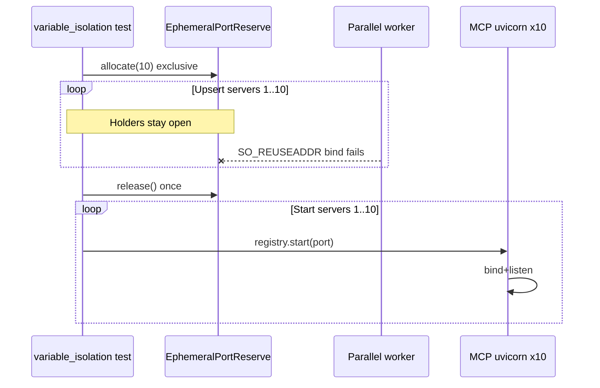

# PYPOST-1508: Stabilize flaky MCP process-mode concurrent variable isolation test

## Research

### Failure class

| Item | Detail |
| --- | --- |
| Node id | `tests/test_mcp_process_isolation_repro.py::test_process_mode_variable_isolation_under_concurrent_load` |
| Symptom | uvicorn `[Errno 98] address already in use`; `mcp_process_runner_start_failed` STARTED timeout 15s; harness `AssertionError` |
| Alone | PASSED (~5.76s) |
| Parallel | Intermittent under `make test` workers |
| Related | PYPOST-1541 (LiveMCPServer held socket); PYPOST-1546 (exclusive batch hold + release) |

### PYPOST-1546 status on this suite

Exclusive hold via `EphemeralPortReserve` / `allocate_bound_tcp_socket(..., reuse_addr=False)`
is already wired into `test_mcp_process_isolation_repro.py`. Remaining gap on the flaky
node:

```text
for each of 10 ports:
    upsert(server)
    reserve.release()   # releases ALL holders after first iteration
    registry.start(...)
```

After the first upsert, all ten exclusive sockets are closed while upserts 2–10 still run.
Parallel workers can steal ports 2–10 during that setup window → child bind `EADDRINUSE`.
`release()` is idempotent, so later loop iterations are no-ops.

Correct handoff (already used by crash-isolation / hang nodes in the same file):

1. Upsert **all** servers while holders stay open.
2. **One** `reserve.release()` / `ports.release()`.
3. Then `registry.start` for each server.

### Helpers (unchanged)

| Helper | Role |
| --- | --- |
| `allocate_bound_tcp_socket(..., reuse_addr=False)` | Exclusive bind |
| `EphemeralPortReserve` / `EphemeralPorts.release()` | Batch hold + handoff |
| `tests/test_ephemeral_port_reserve_hold_repro.py` | Single-port hold contract (PYPOST-1546) |

No production MCP runner / listen changes required.

## Implementation Plan

1. Add a deterministic multi-step setup hold contract (Step 3) that fails when
   batch `release()` runs after the first of N setup steps while asserting
   remaining ports stay exclusive through the full setup phase.
2. Fix `test_process_mode_variable_isolation_under_concurrent_load`: move
   `reserve.release()` to **after** the upsert loop and **before** starts
   (or start-wait loop).
3. Confirm sibling nodes in the same file already use single release-before-start.
4. Document hold-through-all-upserts in `doc/dev/testing.md` (PYPOST-1508).

**Failing Repro (Step 3):**

| Item | Plan |
| --- | --- |
| Desired behavior | During an N-step multi-server setup, exclusive ports reject `SO_REUSEADDR` thieves after **every** setup step until a **single** `release()` after the last step. |
| Where | `tests/test_mcp_process_isolation_port_hold_repro.py` |
| Force failure | Mirror the current isolation anti-pattern: `release()` after first of N steps → thief bind succeeds → `pytest.raises(OSError)` fails. |
| Live deps | None (loopback only). |
| Sequencing | Red (early release) → fix isolation call site + repro to hold through all steps → green. |
| Timeout | Module `pytestmark = pytest.mark.timeout(30)`. |

## Architecture



| Module | Responsibility |
| --- | --- |
| `tests/test_mcp_process_isolation_port_hold_repro.py` | Deterministic multi-step hold contract |
| `tests/test_mcp_process_isolation_repro.py` | Call-site: release once after all upserts |
| `tests/helpers/port_allocation.py` | Unchanged (PYPOST-1546) |
| Production MCP | Unchanged |

### Patterns

- **Hold through all upserts** — closes the mid-setup TOCTOU left by release-inside-loop.
- **Single release-before-start** — process-mode handoff from PYPOST-1546.
- **Bounded** — no sleeps; existing flock attempts remain capped.

## Q&A

- **Q:** Why not change the helper again?
  **A:** Helper already holds exclusively; the flake is call-site ordering.
- **Q:** Why not per-port release?
  **A:** Out of scope; one batch release after all upserts matches sibling suites and shrinks the race to the spawn window only.
