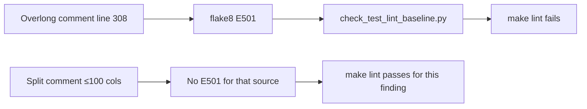

# PYPOST-1509: Fix pre-existing registry test line-length lint failure

## Research

### Defect location (verified)

At base commit `33d5cb1a`, `tests/test_mcp_server_registry.py` contains a single
comment in `test_failed_bind_clears_server_thread_after_worker_exits`:

```text
# Desired: worker clears its own ref on exit (asserts worker cleared _server_thread after failed bind).
```

Measured length is 111 characters (including leading indentation). Repository
policy (`lsr-requirements`, `.flake8`) caps lines at 100 characters. The test
lint gate (`scripts/check_test_lint_baseline.py` via `make lint` → `lint-tests`)
treats this as a failing finding:

```text
tests/test_mcp_server_registry.py:308:101: E501 line too long (111 > 100 characters)
make: *** [Makefile:234: lint-tests] Error 1
```

### Quality-gate context

- Production flake8 (`pypost/`) and docs lint are unrelated to this defect.
- Test lint compares live flake8 output against `test-lint-baseline.json`.
  New or unresolved E501 findings fail the gate.
- Wrapping a comment changes the physical source identity of the finding and
  removes the E501 without touching assertions.

### Current tree note

On the task working tree (post-`33d5cb1a` history), the comment is already
split across two lines (introduced while clearing lint during PYPOST-1394
cleanup). Architecture still records the intended minimal change relative to
the debt base so Step 3/4 remain auditable against the ticket.

## Implementation Plan

1. **Step 3 — Failing repro:** Run `make lint` against base `33d5cb1a` (or
   document the equivalent failure) and record the E501 as the red signal.
   No production or test-behavior edit in Step 3.
2. **Step 4 — Fix:** Ensure the overlong comment is wrapped to ≤ 100 characters
   per physical line, preserving wording and nearby asserts.
3. **Step 5 — Cleanup:** Confirm no further lint issues from the edit; record
   cleanup report.
4. **Steps 6–8:** Observability N/A; tech-debt note; brief `doc/dev` mention
   under the test-lint maintenance section.

**Mandatory — Failing Repro (next Step 3):** Automated red check is **`make
lint`** (specifically `lint-tests` / `check_test_lint_baseline.py`), not a new
pytest. Asserted desired outcome after Step 4: that command exits 0 without
reporting E501 for the registry comment. If the working tree already fails on
this E501, that live failure is the red repro; if HEAD already wraps the
comment, document the base-commit worktree failure as the historical red repro.

## Architecture



| Component | Responsibility | Change |
| --- | --- | --- |
| `tests/test_mcp_server_registry.py` | Registry lifecycle tests | Comment wrap only |
| `scripts/check_test_lint_baseline.py` | Test lint gate | Unchanged |
| `pypost/core/mcp_server_registry.py` | Production registry | Unchanged |

No new modules, APIs, or patterns. Pattern: mechanical PEP 8 line-length
compliance for comments.

## Q&A

- **Q: Why not noqa the line?**
  **A:** Project practice prefers fixing source over silencing E501 for a
  trivially wrappable comment.
- **Q: Why is Step 3 a lint command rather than a pytest?**
  **A:** The defect is invisible to pytest; the acceptance criterion is the
  make lint gate named in the Jira issue.
