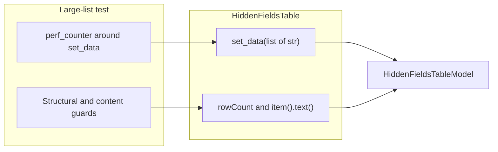

# PYPOST-1532: Keep the large-list timing gate at 100 ms

## Research

The large-list check already lives in
`tests/test_hidden_fields_virtualization_repro.py`, in
`test_model_virtualization_1000_selectors_zero_qtablewidgetitem_allocations`.
It times `HiddenFieldsTable.set_data` for 1,000 selectors with
`time.perf_counter` and fails when elapsed time is 100 ms or longer. The same
test then checks row count (1,000 selectors plus one trailing blank), a
lightweight `item()` facade that is not a `QTableWidgetItem`, and selector
text at the first, last, and trailing rows. The module timeout is
`pytestmark = pytest.mark.timeout(30)`. Production load stays
`HiddenFieldsTable.set_data` delegating to `HiddenFieldsTableModel.set_data`.

[PYPOST-1386 debt analysis](../PYPOST-1386/60-tech-debt.md) records that this
cutoff can miss on a heavily loaded shared runner while the table is still a
lightweight virtualized list. That note is a known environment risk. It does
not include a node id, assertion text, run id, or log of a red
`set_data(1000)` sample. [PYPOST-1536](../PYPOST-1536/20-architecture.md)
replaced a different wall-clock assert only after a recorded parallel-suite
failure (`elapsed` about 0.241 s on dialog construction). That observation
belongs to another test and is not evidence for this check.

Current guidance on timing gates agrees that a single absolute wall-clock
sample is environment-sensitive, and that a budget should move only with
evidence:

- Spec Kitty's flakiness policy treats a wall-clock budget as a threshold gate
  and allows tuning it only from recorded data. Widening an absolute budget to
  absorb a slow runner, or retrying the sample, is rejected without that
  evidence
  ([Test-flakiness handling policy](https://docs.spec-kitty.ai/development/testing/testing-flakiness.html)).
- A 2025 performance-canary write-up shows why one short sample is a poor CI
  gate: shared runners make a single latency reading noisy, so a fail should
  mean repeated misses of a chosen floor, not one busy sample
  ([Practical CI-friendly Performance Tests](https://solidean.com/blog/2025/practical-performance-tests/)).
- `pytest-benchmark` keeps correctness asserts in the test and moves statistics
  to a separate `--benchmark-only` run. That is a benchmark-only timing mode,
  not a drop-in edit of an in-suite `assert`
  ([pytest-benchmark usage](https://pytest-benchmark.readthedocs.io/en/stable/usage.html)).

Those sources describe what a later change could look like. They do not show a
flake of this check.

## Implementation Plan

The timing policy for this ticket is the existing hard 100 ms cutoff. This
design does not treat the recorded environment risk as the flake condition.
No CI failure of `set_data(1000) < 100 ms` is claimed. The cutoff therefore
stays a CI failure. Structural and content guards stay hard assertions beside
it. The duration signal stays the `elapsed < 0.1` assert. A higher wall-clock
budget, and a soft or benchmark-only timing mark, stay unused because the
flake condition is not met. Production behavior stays as it is.

**Mandatory — Failing Repro (next Step 3):** `N/A — no behavioral change`.
The widget, the model, and the large-list test already implement the accepted
policy: structural guards fail the run when virtualization or content breaks,
and the 100 ms cutoff fails the run when that load is slow. There is no
product defect to force red, and inverting the current assert would contradict
the policy. Sequencing stops at this decision record. Step 4 does not edit
`tests/test_hidden_fields_virtualization_repro.py` or
`pypost/ui/widgets/hidden_fields_table.py` to raise, soften, or remove the
duration assert.

1. Leave `HiddenFieldsTable` and `HiddenFieldsTableModel` unchanged.
2. Leave the large-list test's structural asserts and `elapsed < 0.1` assert
   unchanged. Do not add `pytest-benchmark`, a warning-only timer, `xfail`,
   `skip`, or a rerun of a slow sample.
3. If a future run records an actual red timing result for this node while the
   structural guards hold, a follow-up may then choose one allowed response:
   a higher wall-clock budget, or a soft or benchmark-only timing mark. This
   ticket does not choose or implement that follow-up.
4. Later documentation steps may cite this decision. They do not reopen the
   cutoff.

## Architecture

| Module | Responsibility |
| --- | --- |
| `HiddenFieldsTable` | `QTableView` facade. `set_data` loads selectors and keeps one trailing blank row. `item()` returns a lightweight facade. Unchanged. |
| `HiddenFieldsTableModel` | Stores the ordered selectors and serves visible cells. Unchanged. |
| `test_model_virtualization_1000_selectors_zero_qtablewidgetitem_allocations` | Hard structural gate and hard 100 ms duration gate for a load of 1,000 selectors. Unchanged. |

Interaction stays the current call order. The test builds 1,000 selector
strings, records `time.perf_counter` around `set_data`, and fails if that
span is not under 0.1 seconds. It then fails if `rowCount()` is not 1,001, if
`item()` is a `QTableWidgetItem`, or if the first, last, and trailing texts
differ from the loaded list plus one blank. Editing, save and reload, and
change signals stay on their existing tests and are outside this decision.

| Boundary | Contract |
| --- | --- |
| `set_data(data: list[str]) -> None` | Replace the selector list and leave one trailing blank row. |
| `rowCount() -> int` | Selector count plus one. |
| `item(row, column) -> facade or None` | Display text for a loaded cell. Not a `QTableWidgetItem`. |
| Duration sample | Elapsed `set_data` time. Hard CI failure at 100 ms. |

Pattern: one test, two hard gates. The structural gate is the deterministic
large-list guarantee. The duration gate is an absolute wall-clock budget that
remains in force. No new dependency, marker, or retry wrapper is introduced.
Model/View and the compatibility facade stay as delivered by PYPOST-1386.

## Q&A

- What is the timing policy? The hard 100 ms cutoff stays a CI failure on
  `set_data` of 1,000 selectors. Structural guards stay hard assertions. The
  duration signal stays.
- Is the recorded environment risk the flake condition? No. This design does
  not treat that recorded risk as "if CI flakes appear." It does not invent an
  observed CI failure. The optional responses (a higher budget, or soft or
  benchmark-only timing) are therefore not applied.
- Why leave the number at 100 ms? The workstation expectation and the CI
  cutoff are both still that figure. Moving it would require the flake
  condition this ticket does not claim.
- What would a later flake change? Only a recorded red result of this check.
  A follow-up could then raise the budget or mark timing soft or
  benchmark-only. The structural guards would stay the hard product gate, and
  the duration signal would stay.
- Does production change? No. Selector editing, save and reload, and change
  notification stay as they are.
