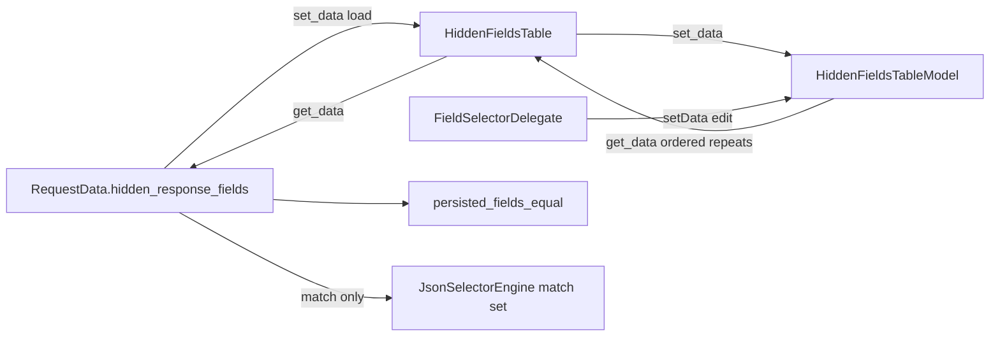

# PYPOST-1533: Keep repeated hidden-field selectors

## Research

The accepted rule is keep repeats. `set_data` and edits trim whitespace, drop
blank selectors, preserve order, and do not collapse duplicate selector text.
The single unsaved trailing blank stays. Saved lists are not uniquified. Case
remains significant.

`HiddenFieldsTableModel` in `pypost/ui/models/hidden_fields_table_model.py`
already follows that rule. The methods were read, then exercised offscreen
(`QT_QPA_PLATFORM=offscreen`) on a fresh model. The probe matches the source.
Production behavior already satisfies the requirement, so this task leaves the
model as it is.

### Verified `set_data`

`set_data` (lines 210-216) replaces rows and then appends one blank record:

```python
valid = [str(s).strip() for s in selectors if str(s).strip()]
self._records = [_make_record(s) for s in valid]
self._records.append(_make_record())
```

`str(s).strip()` trims each entry. A blank or whitespace-only entry fails the
`if` and is omitted. The comprehension keeps input order. Equal text stays as
separate entries because the code never compares one selector with another.
Letter case is left as stripped. `get_data` (lines 202-208) returns every
non-blank selector in row order, repeats included. That return value is the
saved list.

Offscreen probe of `set_data`:

- `["token", "password", "token"]` displays `token`, `password`, `token`,
  `""`. `get_data()` is `["token", "password", "token"]`.
- `["token", " token ", "", "   ", "password"]` displays `token`, `token`,
  `password`, `""`. `get_data()` is `["token", "token", "password"]`.
- `["Token", "token", "TOKEN"]` displays `Token`, `token`, `TOKEN`, `""`.
  `get_data()` is `["Token", "token", "TOKEN"]`.
- `["  Token  ", "token"]` displays `Token`, `token`, `""`. `get_data()` is
  `["Token", "token"]`.
- `[]` displays `""`. `get_data()` is `[]`.

### Verified `setData`

`setData` (lines 167-189) stores `str(value).strip()` on the edited row. It
does not look at other rows, so a repeat stays. Case stays as stripped. A
blank commit on the trailing row returns `False` and leaves the row list
unchanged. A non-blank commit on the trailing row appends one new empty
record.

Offscreen probe of `setData` and `add_row`:

- Rows `token`, `password`, blank. `setData` on row 1 with `"  token  "`
  returns `True`. Rows become `token`, `token`, `""`. `get_data()` is
  `["token", "token"]`.
- Rows `token`, blank. `setData` on the trailing row with `" token "`
  returns `True`. Rows become `token`, `token`, `""`. Count goes from 2
  to 3. `get_data()` is `["token", "token"]`.
- Rows `token`, blank. `setData` on the trailing row with `"   "` returns
  `False`. Rows stay `token`, `""`. Count stays 2. `get_data()` is
  `["token"]`.
- Rows `token`, blank. `add_row(" token ")` yields `token`, `token`, `""`.
  `get_data()` is `["token", "token"]`.
- Rows `token`, `password`, blank. `add_row("")` leaves `token`,
  `password`, `""`. `get_data()` is `["token", "password"]`.

`add_row` strips, then reuses the trailing blank through `setData` when that
row is empty (lines 233-242). A repeat typed there is another saved selector,
and one new trailing blank remains.

Clearing a non-trailing row to whitespace stores `""` on that row and leaves
the trailing blank in place. Probe: `token`, `password`, `token` with row 1
set to `"   "` returns `True`, display rows `token`, `""`, `token`, `""`, and
`get_data()` `["token", "token"]`. The blank is omitted from the saved list.
The other selectors stay, including the repeat. That is the current edit path,
and it already matches the saved-list rule. This task leaves it as it is.

### Saved list and match-time membership

`HiddenFieldsTable.set_data` and `get_data` forward to the model
(`pypost/ui/widgets/hidden_fields_table.py`, lines 74-80).
`RequestWidget.load_data` loads `RequestData.hidden_response_fields` through
`set_data`. `update_request_data` and `get_request_data_from_ui` store
`get_data()` back on that field (`pypost/ui/widgets/request_editor.py`, lines
336, 422, and 437). The field is `list[str]` with a default empty list
(`pypost/models/models.py`, line 113). `persisted_fields_equal` compares the
lists with `!=` (`pypost/core/request_persisted_fields.py`, lines 52-56), so
order and repeats participate in unsaved-change detection.

`JsonSelectorEngine._compile` adds each cleaned selector to a set used for
matching (`pypost/core/json_selector_engine.py`, lines 146-155).
`format_masked_json` builds `JsonMaskFormatter(set(hidden_fields), ...)`
(`pypost/ui/widgets/response_mask_controller.py`, line 141). A repeated name
hides that field once. Those sets exist only for matching. The list stored on
the request stays ordered and keeps repeats.

`FieldSelectorDelegate.setModelData` commits editor text through `setData`
(`pypost/ui/delegates/field_selector_delegate.py`, lines 48-58). Syntax
feedback stays advisory. The delegate does not rewrite the list.

Header-name folding in `sanitize_headers` is outside this task. Selector text
on the saved list keeps its case.

### External notes

Python lists keep insertion order and allow duplicate values. A set drops
duplicates and has no stable order
([Python data structures](https://docs.python.org/3/tutorial/datastructures.html)).
The model stores selectors in a list, which is the structure that keeps
repeats.

An editable Qt model implements `setData` and emits `dataChanged`. The
framework stores the value the model writes
([QAbstractItemModel](https://doc.qt.io/qt-6/qabstractitemmodel.html),
[QAbstractTableModel](https://doc.qt.io/qt-6/qabstracttablemodel.html)).
A trailing blank row that grows after a commit is a common editable-table
pattern. See the Qt discussion of a blank editable row:

<https://stackoverflow.com/questions/1628126/in-qt-create-a-table-with-an-blank-editable-row>

This model already appends that row inside `setData` when the trailing cell
becomes non-blank.

## Implementation Plan

No production change. `set_data` and `setData` already trim whitespace, drop
blank selectors from the saved list, preserve order, and keep duplicate
selector text as separate entries. Case remains significant. The single
unsaved trailing blank stays. `get_data` returns that ordered list and does
not uniquify it.

Leave these modules as they are:

- `pypost/ui/models/hidden_fields_table_model.py`
- `pypost/ui/widgets/hidden_fields_table.py`
- `pypost/ui/delegates/field_selector_delegate.py`
- `pypost/ui/widgets/request_editor.py`
- `pypost/models/models.py`
- `pypost/core/request_persisted_fields.py`
- `pypost/core/json_selector_engine.py`

**Mandatory — Failing Repro (next Step 3):** `N/A — no behavioral change`.
The accepted rule is already the runtime behavior verified above. There is no
missing product behavior to force red. Step 4 leaves production code as it is
for this policy.

## Architecture

The pattern stays Qt Model/View. The model owns the ordered selector list.
The view forwards load, save, and add. The delegate commits edits into
`setData`. Persistence is that same list. Masking compiles a set only while
deciding which response fields to hide.



| Module | Responsibility |
| --- | --- |
| `HiddenFieldsTableModel` | Ordered rows, trim, drop blanks, trailing blank, `get_data` |
| `HiddenFieldsTable` | View. Forwards `set_data`, `get_data`, and `add_row` |
| `FieldSelectorDelegate` | Commits editor text through `setData` |
| `RequestData` | Stores `list[str]` as saved, repeats included |
| `persisted_fields_equal` | Compares that list, order and repeats included |
| `JsonSelectorEngine` | Match membership. A repeat hides the field once |

### Interfaces

- `set_data(selectors: list[str]) -> None` — replace rows from the list, trim,
  drop blanks, keep order and repeats, append one trailing blank.
- `setData(index, value, role) -> bool` — store stripped text on that row.
  Reject a blank trailing commit. Append one trailing blank after a non-blank
  trailing commit. Keep duplicate selector text.
- `get_data() -> list[str]` — non-blank selectors in row order, repeats kept,
  trailing blank omitted. This is the saved list.
- `add_row(selector: str) -> int` — strip, then reuse the trailing row through
  `setData` when it is blank. A repeat is added. An empty add focuses the
  trailing row.

Modules, signals, and the persisted field stay as they are.

## Q&A

- **Q: Does the model already keep repeats?**
  - **A:** Yes. `set_data` and `setData` were read and probed. Duplicate
    selector text stays. Case stays. `get_data` returns the ordered list with
    repeats. One trailing blank remains, and that blank is omitted from the
    saved list.

- **Q: Why is Step 3 N/A?**
  - **A:** The accepted rule is already the runtime behavior. A failing repro
    would describe a gap that the model does not have.

- **Q: Does match-time use of a set rewrite the saved list?**
  - **A:** The engine uses a set while matching, so a repeated name hides that
    field once. The list stored on the request stays ordered and keeps
    repeats.
