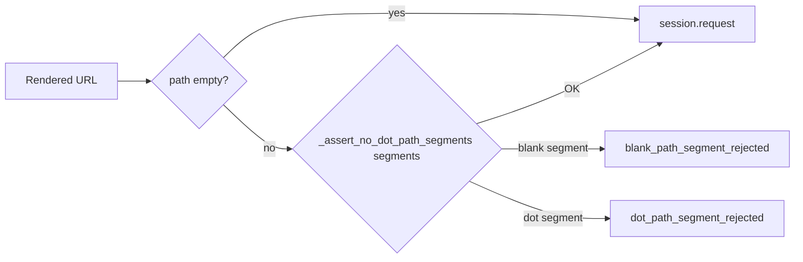

# PYPOST-1534: Allow empty URL path while keeping blank-segment rejection

## Research

### Defect mechanism

1. `_assert_no_dot_path_segments` (`pypost/core/http_client.py`) splits
   `urlsplit(url).path` on `/` and rejects every empty segment except index `0` when
   `path.startswith("/")` (synthetic absolute-path leading empty from PYPOST-1332 /
   PYPOST-1346).
2. For an origin-only URL such as `http://x` or `http://example.test`, `urlsplit(...).path`
   is `""` (empty string). `"".split("/")` yields `['']` at index `0`, and
   `path.startswith("/")` is **False**, so the helper raises
   `ExecutionError` with detail `Blank path segment is not allowed.`
3. `HTTPClient._prepare_request_kwargs` catches that error, logs
   `blank_path_segment_rejected` with an origin-bounded URL, and re-raises — so
   `session.request` never runs.
4. Most `tests/test_http_client.py` fixtures use `url="http://x"` (empty path). Those cases
   fail for the blank-segment guard, not for the behavior under test (~35 failures).

### Intended product contract (from history)

| Case | Intended result | Source |
| ---- | --------------- | ------ |
| Mid-path `//` or trailing blank | Reject TEMPLATE before dispatch | PYPOST-1332 |
| Whole-segment `.` / `..` | Reject TEMPLATE before dispatch | PYPOST-1346 |
| Absolute path leading `/` synthetic empty | Skip | PYPOST-1332 / 1346 docs |
| **Empty path** (`http://host` → path `""`) | **Allow** — no path segments to validate | HTTP + this debt ticket |

Empty path is not a missing template variable rendering `//`; it is the absence of a path
component. Rejecting it is over-broad relative to the security goal (fail closed on blank
*segments*).

### Options

| Option | Verdict |
| ------ | ------- |
| A. Change all fixtures to `http://x/` or `http://x/api` | Reject — encodes wrong product rule; `http://x/` is itself a trailing blank reject |
| B. Early-return / skip when `path == ""` in the shared helper | **Adopt** — minimal, restores intended security boundary |
| C. Remove blank-segment rejection entirely | Reject — undoes PYPOST-1332 product safety |

### Peer confirmation

- RFC 3986 allows a URI with empty path after authority (`http://example.com`).
- Existing blank rejection tests use non-empty paths with `//` or trailing `/` — they stay
  red until blank segments appear, and green after this fix for empty path alone.
- Doc `doc/dev/http_path_segment_rejection.md` already says skip only the synthetic empty
  from absolute `/…`; it does not yet call out empty path explicitly — Step 8 updates that.

## Implementation Plan

1. **Step 3 — Failing repro (red):** Add
   `TestHTTPClientBlankPathSegmentRejection.test_empty_path_origin_url_still_prepares`
   asserting `_prepare_request_kwargs` succeeds for `http://example.test` (empty path) and
   returns that URL. Today: raises blank-segment `ExecutionError`.
2. **Step 4 — Development:** In `_assert_no_dot_path_segments`, if `path == ""`, return
   immediately (nothing to inspect). Keep existing skip for index-0 empty when
   `path.startswith("/")`, and keep blank / `.` / `..` rejects. Confirm blank rejection
   tests and full `tests/test_http_client.py` go green.
3. **Steps 5–8:** Cleanup artifact, observability N/A (existing events unchanged), tech-debt
   note, update `doc/dev/http_path_segment_rejection.md` empty-path row.

### Mandatory — Failing Repro (next Step 3)

| Field | Plan |
| ----- | ---- |
| **Where** | `tests/test_http_client.py` — `TestHTTPClientBlankPathSegmentRejection` |
| **Arrange** | `RequestData(method="GET", url="http://example.test")`; mock session; call `_prepare_request_kwargs` |
| **Assert** | No raise; `kwargs["url"] == "http://example.test"`; `resolved.url` matches |
| **Why red today** | Empty path `""` treated as blank segment → `ExecutionError` |
| **Control** | Existing mid-path / trailing blank reject tests remain present |
| **Timeout** | Module `pytestmark` already on `test_http_client.py` |

**Sequencing:** research → red test → fix until green → docs + scoped `make test`.

## Architecture

```
TemplateService.render_string(url)
        │
        ▼
HTTPClient._prepare_request_kwargs
        │
        ├─ _assert_no_dot_path_segments(url)
        │         │
        │         ├─ path == ""  → return (PYPOST-1534: empty path OK)
        │         ├─ skip index-0 "" if path.startswith("/")
        │         ├─ reject other "" → blank_path_segment_rejected
        │         └─ reject "." / ".." → dot_path_segment_rejected
        │
        └─ build headers / params / body → session.request
```

- **Change surface:** Single helper in `pypost/core/http_client.py`; no new modules.
- **Logging / metrics:** Unchanged event names; empty-path URLs no longer emit false
  `blank_path_segment_rejected`.
- **Callers:** All prepare / send / MCP offline prepare paths inherit the corrected rule.



## Q&A

| Question | Answer |
| -------- | ------ |
| Does `http://example.test/` stay rejected? | Yes — path `/` → trailing blank segment. |
| Does this weaken MCP blank-arg protection? | No — those templates produce non-empty paths with empty segments (`/projects/` or `//`). |
