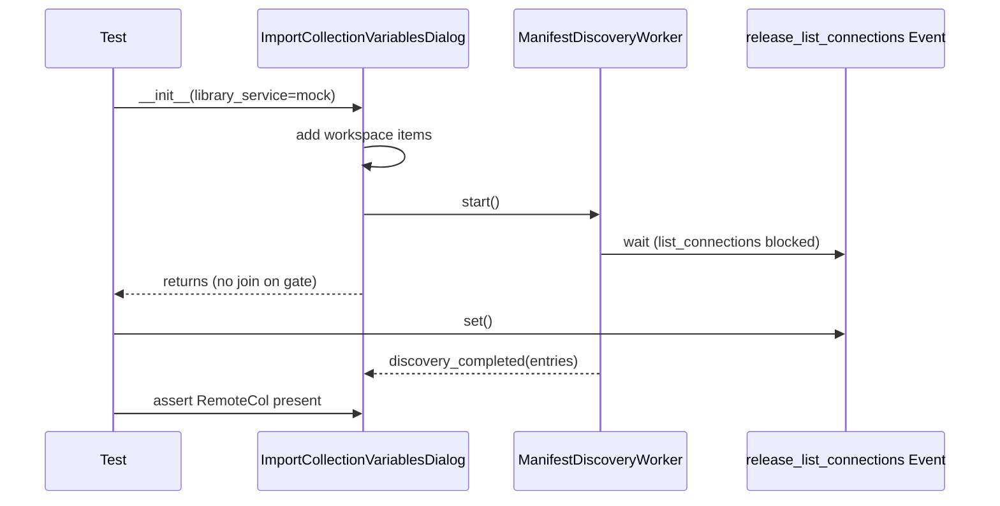

# PYPOST-1536: Async manifest discovery dialog init blocking repro

## Research

### Observed failure

Exact node id:

`tests/test_async_manifest_discovery_repro.py::test_dialog_init_does_not_block_on_slow_manifest_discovery`

Under full parallel suite (PYPOST-1387 Step 4, base `7b4d31be`):

```
AssertionError: Dialog __init__ blocked for 0.241s;
list_connections/list_manifest_collections must run off the UI thread
assert 0.24066... < 0.1
```

Log timestamps from that failure:

| Event | Time | Delta |
| --- | --- | --- |
| `collection_variable_import_dialog_opened` | 53.388 | — |
| `collection_variable_manifest_discovery_started` | 53.526 | +138ms (Qt UI build) |
| assert elapsed | ~0.241s total | |

A synchronous `time.sleep(0.2)` inside `list_connections` on the UI thread after
discovery-start would yield ~0.34s+ elapsed. The measured 0.241s matches
**slow Qt construction under CPU contention**, not sync discovery.

### Product path (already correct)

```
ImportCollectionVariablesDialog.__init__
  → populate workspace combo synchronously
  → _start_manifest_discovery()
       → ManifestDiscoveryWorker.start()  # QThread
            → run(): call_with_cancellation_token(list_connections)
  → self.show()
```

Isolation measurements on current HEAD: `__init__` returns in ~3–14ms while the
mock sleeps/gates in the worker thread.

### Options

| Option | Verdict |
| --- | --- |
| A. Change product (extra deferral of worker start) | Reject — product already off-thread; would not fix false wall-clock fails |
| B. Raise threshold to 0.5s | Reject — still load-sensitive; does not prove thread identity |
| C. Event-gate + off-UI-thread assert | **Adopt** — hangs only if `__init__` joins on `list_connections`; asserts call thread ≠ main |

## Implementation Plan

1. Keep `ManifestDiscoveryWorker` / dialog product code unchanged.
2. Rewrite the non-blocking init test:
   - `list_connections` side_effect waits on `threading.Event` until after
     `__init__` returns (gate released in test body / `finally`).
   - Assert workspace combo populated immediately.
   - Assert `_active_discovery_worker` is a `QThread`.
   - After release, wait until `list_connections` entered and assert every call
     thread is not the main/UI thread.
   - Wait for remote combo entry as today.
3. Update `doc/dev/workspace_environment_variable_import.md` test-contract blurb.

**Failing Repro (Step 3):** Existing test under parallel load (wall-clock assert).
Focused command:

```bash
make test PYTEST_ARGS='tests/test_async_manifest_discovery_repro.py::test_dialog_init_does_not_block_on_slow_manifest_discovery -vv --tb=short'
```

Sequencing: confirm false-red evidence → replace assert with Event-gate → green.

## Architecture



| Module | Responsibility |
| --- | --- |
| `import_collection_variables_dialog.py` | Sync workspace populate; start discovery worker (unchanged) |
| `manifest_discovery_worker.py` | Off-thread `list_connections` / manifest enum (unchanged) |
| `test_async_manifest_discovery_repro.py` | Load-stable non-blocking contract |

Pattern: synchronization-token test double instead of wall-clock deadline.

## Q&A

- **Q**: Why keep a 200ms sleep previously?
  **A**: It approximated “slow I/O” but the assert measured total `__init__`
  duration, including unrelated Qt work. The Event gate models “I/O not yet
  finished” without a race against construction time.
