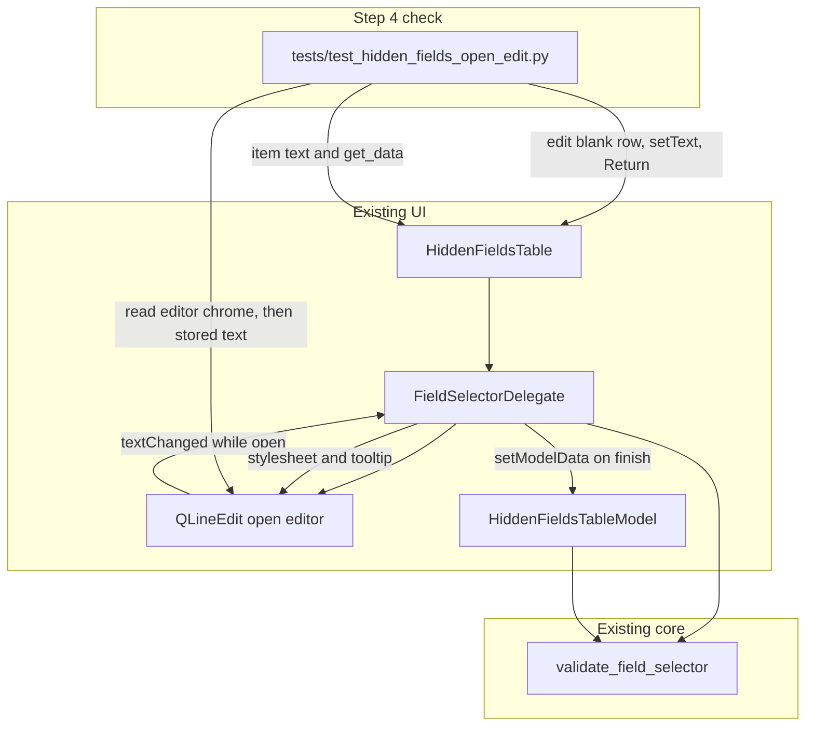

# PYPOST-1537: Live warning and advisory accept for hidden-field selectors

## Research

The open-edit promise from PYPOST-1387 is already implemented. This ticket's gap,
recorded under Missing Tests in
[PYPOST-1387 technical debt](../PYPOST-1387/60-tech-debt.md), is that no automated
check drives the editor while it is still open. Stored-row role feedback is already
covered and stays out of this check.

### Editor path

`HiddenFieldsTable` installs the delegate at
`pypost/ui/widgets/hidden_fields_table.py` line 48:

```python
        self.setItemDelegate(FieldSelectorDelegate(self))
```

`FieldSelectorDelegate` is the live editor. `createEditor` (lines 25-34) builds
a `QLineEdit` and connects `textChanged` to live feedback:

```python
editor.textChanged.connect(lambda text: self._apply_live_feedback(editor, text))
```

`setEditorData` (lines 36-44) loads the cell and applies that same feedback.
`setModelData` (lines 48-58) always writes `editor.text()` through `EditRole`.
It does not consult the validator and does not clear an unsupported draft:

```python
# Advisory: always commit the typed text (including invalid drafts).
model.setData(index, editor.text(), Qt.ItemDataRole.EditRole)
```

Live warning versus neutral feedback is `_apply_live_feedback`
(`pypost/ui/delegates/field_selector_delegate.py` lines 60-72):

```python
    def _apply_live_feedback(editor: QLineEdit, text: str) -> None:
        result = validate_field_selector(text)
        if result.ok or result.is_empty:
            editor.setStyleSheet("")
            editor.setToolTip("")
            return
        guidance = f"{result.message} {result.suggestions}".strip()
        editor.setToolTip(guidance)
        editor.setStyleSheet(
            f"QLineEdit {{ background-color: {VALIDATION_LABEL_BACKGROUND}; "
            f"color: {VALIDATION_LABEL_FOREGROUND}; }}"
        )
```

Those colors are `VALIDATION_LABEL_BACKGROUND` (`#fdd`) and
`VALIDATION_LABEL_FOREGROUND` (`#900`) in `pypost/ui/styles/ui_tokens.py`
(lines 9-10). A warning is a non-empty tooltip plus that stylesheet. Neutral
feedback is both properties cleared. The model `BackgroundRole` /
`ToolTipRole` paint path (`hidden_fields_table_model.py` lines 140-149) is the
stored-row presentation and is not this warning.

### Accepted strings

`validate_field_selector` (`pypost/core/field_selector_syntax.py`) is pure and
has no Qt dependency.

- `token` takes the simple-key branch (lines 106-111). It matches the identifier
  pattern and returns `ok=True`.
- `$.secret` contains `.`, so it takes the path branch (lines 113-118).
  `_validate_path` rejects any `$` before segment checks (lines 70-71) and
  returns `ok=False`, `is_empty=False`, with the shared unsupported message.
  The exact fixture `$.secret` is not in `tests/test_field_selector_syntax.py`;
  the `$` rule is the same rule that already rejects `$.users[0].name`.

### Advisory commit

`HiddenFieldsTableModel.setData` strips, then stores the string
(`hidden_fields_table_model.py` lines 167-172). `$.secret` has no surrounding
whitespace, so the stored selector is exactly `$.secret`. `get_data` (lines
202-208) keeps every non-empty selector. A new model starts as one blank
trailing row (lines 82-84), so the check can open an edit without first storing
an invalid value. Live feedback does not call `setData`, so typing does not
expand that trailing row. Commit still happens only when the edit finishes.
That split is the PYPOST-1387 design and remains correct.

Finish is Qt's delegate event filter. Return or Enter on a `QLineEdit` queues
`commitData`, and the view then calls `setModelData`. Escape closes without
committing. Qt documents that key handling on
[QAbstractItemDelegate][qt-delegate].
A local precedent already finishes a hidden-field editor with
`QTest.keyClick(..., Key_Return)` and `processEvents()`
(`tests/test_hidden_fields_event_paths.py` lines 165-169). The queued call is
why the check must process events after Return. Connecting `textChanged` to
`commitData` would store every keystroke and expand the trailing row mid-word;
the current delegate does not do that, and this ticket must not add it.

### Where the check must not live

- `tests/test_hidden_fields_syntax_validation_repro.py` locks stored-row
  `BackgroundRole`, `ToolTipRole`, and `get_data` after `set_data`. The open
  editor does not belong there.
- `tests/test_hidden_fields_event_paths.py` locks Delete, Backspace, and the
  context menu. Its helpers remove rows.
- `tests/test_field_selector_syntax.py` locks pure `validate_field_selector`
  and never opens an editor.
- `tests/test_hidden_fields_selector_only_repro.py` locks that check-state is
  unsupported.
- `tests/test_request_hidden_fields_model_and_ui.py` locks request persistence
  and the request editor.

The check belongs in a new module, `tests/test_hidden_fields_open_edit.py`.

## Implementation Plan

No production behavior change. Leave `FieldSelectorDelegate`,
`HiddenFieldsTable`, `HiddenFieldsTableModel`, and `validate_field_selector`
as they are.

1. Step 3 writes no test. The rationale is the failing-repro subsection below.
2. Step 4 adds one test in `tests/test_hidden_fields_open_edit.py`. It uses the
   shared `qapp` fixture and a real `HiddenFieldsTable` (delegate already
   installed). Show the table, edit the blank row, and require
   `EditingState` plus the child `QLineEdit`.
3. While that edit is open, `setText("$.secret")` (this emits `textChanged`).
   Assert the stylesheet contains `#fdd` and `#900`, and the tooltip is
   non-empty. Stay in `EditingState`.
4. While the same edit is open, `setText("token")`. Assert stylesheet `""` and
   tooltip `""`.
5. `setText("$.secret")`, then `QTest.keyClick` Return on the editor, then
   `QCoreApplication.processEvents()`. Assert `item(0, 0).text()` is
   `$.secret` and `get_data()` is `["$.secret"]`.
6. Do not read model `BackgroundRole` or `ToolTipRole`. Do not require a
   dialect-specific sentence. Do not call `_apply_live_feedback`,
   `remove_rows`, or the private removal helpers in the event-path module.
   Do not commit by calling `model.setData` from the test; finish goes through
   the editor so `setModelData` runs.
7. Module marker, after all imports: `pytestmark = pytest.mark.timeout(30)`.
   Use the default signal timeout. Do not set `method="thread"`. Close and
   `deleteLater` the table. No sleep, no network, no live service.
8. Run the suite with `make test`.

**Mandatory — Failing Repro (next Step 3):** `N/A — no behavioral change`.
Inspection shows the accepted behavior is already in the delegate and model:
an open `$.secret` sets the validation stylesheet and tooltip, an open
`token` clears both, and finishing writes `$.secret` unchanged. A red test
written before a fix would not fail for a missing behavior. The single check
is added in Step 4 against that existing behavior. If Step 4 finds the check
red, stop and treat that as a product defect before any production edit.

## Architecture

### System module diagram



### Module responsibilities

| Module | Responsibility in this ticket |
| --- | --- |
| `field_selector_syntax` | Unchanged. Classifies `token` as ok and `$.secret` as unsupported. |
| `FieldSelectorDelegate` | Unchanged. Warns on the open editor; commits typed text on finish. |
| `HiddenFieldsTable` | Unchanged. Hosts the delegate and the open edit. |
| `HiddenFieldsTableModel` | Unchanged. Stores finished text, including an unsupported draft. |
| `ui_tokens` | Unchanged. Supplies the warning colors the check recognizes. |
| `tests/test_hidden_fields_open_edit.py` | New. One check: warning, neutral, advisory accept. |

No new production module, interface, or dependency.

### Interaction scheme

1. The check opens an edit on the blank trailing row. Qt calls `createEditor`
   and `setEditorData`. The empty value is ok, so the editor starts neutral.
2. Setting `$.secret` fires `textChanged`. The delegate validates, sets the
   warning stylesheet, and sets a tooltip. The model is still unchanged.
3. Setting `token` fires `textChanged` again. The delegate clears the
   stylesheet and the tooltip. The edit is still open.
4. Setting `$.secret` restores the warning. Return queues commit. `setModelData`
   stores the editor text. The model strips it and keeps `$.secret`.
5. The check reads the stored cell and `get_data()`. It does not assert how a
   closed row is painted.

### Patterns

Keep the patterns PYPOST-1387 already selected:

- **Delegate.** `QStyledItemDelegate` owns editor chrome and commit. The view
  stays a `QTableView`.
- **Pure core validator.** `validate_field_selector` stays free of Qt. The
  delegate and the model both call it.
- **Advisory validation.** Invalid text is signaled on the open editor and
  still stored. The delegate does not reject the commit.

A second warning channel, a phrase catalog, or a blocking `setModelData` would
be a new behavior. This ticket does not add one.

### Interfaces

No production API changes. The check uses surfaces that already exist:

| Observation | Surface | Expected for this ticket |
| --- | --- | --- |
| Edit is open | `HiddenFieldsTable.state()` | `EditingState` during both text checks |
| Warning | `styleSheet` and `toolTip` | `#fdd`, `#900`, tooltip non-empty |
| Neutral feedback | same two properties | both empty for `token` |
| Finish | Return on the editor, then `processEvents()` | `setModelData` runs |
| Stored selector | `item(row, 0).text()` and `get_data()` | exactly `$.secret` |

Public table methods used by the check: `edit`, `setCurrentIndex`, `state`,
`item`, `get_data`. The delegate's public surface stays `createEditor`,
`setEditorData`, and `setModelData`.

### Out of scope

Stored-row feedback, `header:` sharing, literal `..` rejection, specialized
messages, autocomplete, deduplication, and per-row enable controls stay with
their existing owners. This design does not change which selectors masking
honors, and it does not block save.

## Q&A

### Q1: Why is Step 3 N/A?

**A:** The accepted behavior is already in `FieldSelectorDelegate` and
`HiddenFieldsTableModel`. The parent debt is missing coverage of that path.
Step 4 adds the check against the current code.

### Q2: Why a new test module?

**A:** The hidden-fields syntax repro locks stored-row roles. Putting the open
editor in that file would mix the two checks. Event-path tests own removal and
expose private removal helpers this check must not call.

### Q3: What counts as a warning?

**A:** On the open `QLineEdit`, the validation stylesheet (`#fdd` / `#900`)
together with a non-empty tooltip. Neutral feedback is those two properties
cleared. Wording of the tooltip stays with PYPOST-1540.

### Q4: Why Return plus `processEvents`?

**A:** Qt commits a `QLineEdit` on Return through a queued `commitData` call,
which is what reaches `setModelData`. The hidden-fields event-path suite
already uses that sequence. Escape would close without storing the draft.

### Q5: What if the Step 4 check fails?

**A:** That contradicts this inspection. Stop, report the defect, and only
then consider a production change. Do not widen the check into stored-row
roles or the sibling tickets.

[qt-delegate]: https://doc.qt.io/qtforpython-6.10/PySide6/QtWidgets/QAbstractItemDelegate.html
