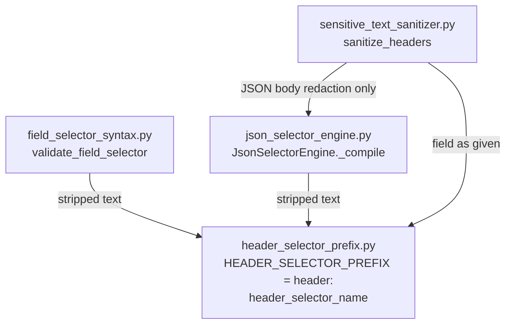

# PYPOST-1538: One header-selector prefix

## Research

Validation, response-data selection, and sensitive-header sanitization each
spell the header-selector prefix on their own. The three spellings are the
same characters, `header:`, and each match is case-insensitive. They are
still three definitions. Nothing in the repository makes a later edit of one
site follow the others.

Parent debt [PYPOST-1387](ai-tasks/PYPOST-1387/60-tech-debt.md) left this
fork open: compare the three spellings, or keep one shared spelling. The
accepted requirements close that fork. The ending is one shared prefix, and
a caught divergence. A comparison of three private spellings leaves three
agreements. A shared spelling that one use can bypass with no signal still
lets the split ship unnoticed.

### Current header prefixes

| Use | Module | Prefix site | How it matches |
| --- | --- | --- | --- |
| Validation | `pypost/core/field_selector_syntax.py` | Line 14, `_HEADER_RE = re.compile(r"(?i)^header:(.*)$")`, applied at line 95 | Import-time regex, case-insensitive, anchored at the start. The remainder is capture group 1. |
| Selection | `pypost/core/json_selector_engine.py` | Line 13, `_HEADER_PREFIX = "header:"`, applied at line 151 | Private constant. `cleaned.lower().startswith(_HEADER_PREFIX)` skips the selector from JSON body compilation. |
| Sanitization | `pypost/core/sensitive_text_sanitizer.py` | Line 68, `field.lower().startswith("header:")` | String literal. Line 69 takes the name with `field[7:]`, a second encoding of the same seven-character prefix. |

Selection here is `JsonSelectorEngine._compile`. A selector that matches the
prefix is left out of body matching so it stays a header selector. Header
values are redacted later by `sanitize_headers`. The engine does not extract
header names. Both sites still have to honor the same prefix: if the engine
stops recognizing it, `header:Authorization` becomes a body selector; if the
sanitizer stops recognizing it, that header's configured redaction stops.

Call-site preparation differs and stays as it is:

- Validation strips the selector (`field_selector_syntax.py` line 91) before
  the match.
- The engine strips the selector (`json_selector_engine.py` line 150) before
  the match.
- `sanitize_headers` does not strip the whole field before the match. It
  strips only the extracted name (`field[7:].strip().lower()`).

User-facing copy also contains the public example `header:Authorization`
(`field_selector_syntax.py` lines 21, 100, and 102). That copy is an example
of the spelling people write. It is not a recognizer.

`pypost/core/constants.py` holds `HIDDEN_MASK` only. It is not a home for
this agreement. `sensitive_text_sanitizer.py` already imports
`JsonSelectorEngine` for JSON body redaction. Header recognition does not
go through that engine.

Default sensitive header names (`authorization`, `cookie`, and the rest of
`_SENSITIVE_HEADER_NAMES`) are a separate list. This task does not change
which unnamed headers are sensitive.

### What a shared string still fails to catch

Pytest's `monkeypatch` replaces an attribute on the object where the running
code reads it
([monkeypatch](https://docs.pytest.org/en/stable/how-to/monkeypatch.html),
[where to patch](https://stackoverflow.com/questions/27252840/how-to-patch-a-constant-in-python)).
A function that looks up a module global on each call sees one patch of that
global. A `from module import HEADER_SELECTOR_PREFIX` binding, and a default
argument, snapshot the string when the function is defined and ignore a
later patch of the source module
([patching module globals](https://mathspp.com/blog/til/patching-module-globals-with-pytest)).

An AST scan that only requires the name `HEADER_SELECTOR_PREFIX` to appear
can pass while a leftover `startswith("header:")` still matches the old
spelling. The prebid capability-parity guard shows the useful AST slice:
flag the operand that must be derived from the one constant, and do not
treat every occurrence of the characters as a second definition
([constant parity](https://github.com/prebid/salesagent/blob/main/tests/unit/test_architecture_capability_constant_parity.py)).
Message text that mentions `header:Authorization` is that kind of
occurrence. A `startswith` argument, a regex pattern, and the slice `7` are
recognizers.

The check that matches the requirement is therefore both:

- the three recognition functions call one helper, and
- with the helper's prefix patched to a different spelling of a different
  length, validation, body selection, and header sanitization follow the
  patched spelling.

The length difference is what makes a leftover `field[7:]` fail.

## Implementation Plan

1. Step 3 writes the red test described below. It does not add the helper
   and does not edit the three consumers.
2. Step 4 adds `pypost/core/header_selector_prefix.py` and switches the
   three recognition sites to `header_selector_name`. The production value
   stays `header:`.
3. Step 4 reruns the test through `make test` until the red test is green.
   Existing `header:Authorization` checks stay green because the production
   prefix value does not change.
4. Later steps follow the top-down workflow. Dev docs that describe the
   prefix (`doc/dev/hidden_fields_table.md`,
   `doc/dev/json_selector_engine.md`, `doc/dev/hidden_response_fields.md`,
   `doc/dev/mcp.md`) are Step 8. This step does not edit them.

No new log line. Divergence is a failed test, which is the visible split in
NFR2. Observability in Step 6 records that choice.

### Failing Repro (next Step 3)

Step 3 writes a red test of the missing shared definition. It is not
`N/A — no behavioral change`.

The literals already match, so the meaning of `header:Authorization` is
unchanged: validation already accepts it, the engine already skips it for
body selection, and `sanitize_headers` already treats it as a header name.
A test that only re-asserts that meaning is already green. The acceptance
gap is that the three call sites do not use one definition, so a later
divergence is not caught. The red test asserts that use. The check is this
test. It is not a check added green beside the production edit in Step 4.

**File:** `tests/test_header_selector_prefix.py`

**Marker:** `pytestmark = pytest.mark.timeout(30)`

**Run:** `make test` only. The Makefile accepts `PYTEST_ARGS` for a
targeted run. No network, Qt, or other live dependency. The three functions
under test are pure.

**Do not** import `pypost.core.header_selector_prefix` at module import
time. On current code that module is absent, and a collection import error
is the wrong failure. Import it with `importlib` inside the test, after the
structural assertions.

**Test:** `test_three_call_sites_use_one_header_selector_prefix`

Structural assertions, evaluated first, on the current source of:

- `validate_field_selector` in `pypost/core/field_selector_syntax.py`
- `JsonSelectorEngine._compile` in `pypost/core/json_selector_engine.py`
- `sanitize_headers` in `pypost/core/sensitive_text_sanitizer.py`

1. Each function contains a call to `header_selector_name`.
2. That name is reached through `pypost.core.header_selector_prefix` (import
   of the function, or an attribute load on that module). A private
   `_HEADER_PREFIX` / `_HEADER_RE` in the consumer is not that name.
3. Inside those functions, and inside module-level values they use as the
   recognition operand, there is no private recognizer:
   - a `startswith` argument that is a string constant
   - a regex pattern that encodes `header:`
   - a slice bound of the integer `7` on the selector (`field[7:]`)

   Suggestion and error strings that mention `header:Authorization` or
   `'header:'` are not recognition operands. They stay, and the test must
   not flag them.

**Intended red failure on current code:** the structural assertion, naming
the three functions, because none of them call `header_selector_name`.
Current private recognizers are the regex on
`field_selector_syntax.py` line 14, the constant on
`json_selector_engine.py` line 13, and the literal plus slice on
`sensitive_text_sanitizer.py` lines 68-69. The test must fail for that
reason. It must not fail because a fixture is broken or because collection
could not import the new module.

**Runtime block in the same test, after those assertions:** import
`pypost.core.header_selector_prefix` with `importlib`, monkeypatch
`HEADER_SELECTOR_PREFIX` to `hdr:` (length 4, not 7), and assert the helper
reads that global on the call:

- `header_selector_name("hdr:X-Custom-Secret") == "X-Custom-Secret"`
- `header_selector_name("HdR:X-Custom-Secret") == "X-Custom-Secret"`
- `header_selector_name("header:X-Custom-Secret") is None`

Then the three public behaviors follow that same patched prefix. Use a
header name that is not in `_SENSITIVE_HEADER_NAMES`, so the result is the
selector and not the default name list. `X-Custom-Secret` qualifies.
Placeholder is the sanitizer's `HIDDEN_PLACEHOLDER` (`***`).

| Call | Patched prefix `hdr:` |
| --- | --- |
| `validate_field_selector("hdr:X-Custom-Secret")` | `ok` is true |
| `validate_field_selector("HdR:X-Custom-Secret")` | `ok` is true (same case rule) |
| `validate_field_selector("hdr:")` | `ok` is false, and the message is the existing non-empty header-name message |
| `validate_field_selector("header:X-Custom-Secret")` | `ok` is false |
| `JsonSelectorEngine(["hdr:X-Custom-Secret"]).matches([], "hdr:X-Custom-Secret")` | false (skipped as a header selector; engine stays empty) |
| `JsonSelectorEngine(["header:X-Custom-Secret"]).matches([], "header:X-Custom-Secret")` | true (compiled as a body bare key) |
| `sanitize_headers({"X-Custom-Secret": "visible-secret"}, hidden_response_fields=["hdr:X-Custom-Secret"])` | value is `***` |
| same with `hidden_response_fields=["HdR:X-Custom-Secret"]` | value is `***` |
| same with `hidden_response_fields=["header:X-Custom-Secret"]` | value stays `visible-secret` |

On current code this block does not run, because the structural assertion
fails first. After a partial Step 4 that adds the helper but leaves a
consumer on a private literal, a from-import snapshot, a default-argument
snapshot, or `field[7:]`, this block is what stays red.

**Stable meaning:** do not make `header:Authorization` the failing
assertion. Validation and engine coverage for that selector already exists
(`tests/test_field_selector_syntax.py`,
`tests/test_pypost_1394_failing_repro.py`,
`tests/test_pypost_1388_failing_repro.py`). Step 4 keeps the production
prefix equal to `header:`, so those tests stay green. A separate unpatched
test may lock `sanitize_headers` for `header:X-Custom-Secret`; that test is
already green today and is not the failing repro.

## Architecture

### Chosen design

One leaf module owns the prefix. The three uses recognize a header selector
only by calling that module's function. The function reads the prefix global
on every call. One test patches that global and requires all three public
behaviors to follow it, and it rejects a private recognizer left in any of
the three functions.



`sanitize_headers` keeps importing `JsonSelectorEngine` for JSON body
redaction. Header recognition is a direct call to the leaf, not a question
asked of the engine.

### Module: `pypost/core/header_selector_prefix.py`

New module. It imports none of the three consumers, so the dependency
direction stays one way and no cycle is introduced.

```python
HEADER_SELECTOR_PREFIX: str = "header:"

def header_selector_name(text: str) -> str | None:
    prefix = HEADER_SELECTOR_PREFIX
    if text.lower().startswith(prefix.lower()):
        return text[len(prefix):]
    return None
```

Contract:

- The body reads `HEADER_SELECTOR_PREFIX` as a module global on each call.
  The value is not bound in a default argument and not copied into the
  consumer with `from ... import HEADER_SELECTOR_PREFIX`.
- The match is case-insensitive. That is the one case rule. Letter case of
  the stored prefix stays `header:`, and `Header:` / `HEADER:` continue to
  match, which is what all three sites do today.
- The remainder is not stripped. `None` means the prefix did not match.
  `""` means the prefix matched and the remainder is empty.
- The slice length is `len(prefix)` of the value just read.

Export `HEADER_SELECTOR_PREFIX` and `header_selector_name` in `__all__`.

### Consumer responsibilities

Each consumer deletes its private prefix and calls the helper.

| Consumer | Call | Policy that stays local |
| --- | --- | --- |
| `validate_field_selector` | After `text.strip()`, `name = header_selector_name(cleaned)`. | `name is not None` and `name.strip()` empty: the existing invalid result (non-empty name required, example `header:Authorization`). Non-empty: the existing ok result. Delete `_HEADER_RE`. |
| `JsonSelectorEngine._compile` | After `s.strip()`, skip the selector when `header_selector_name(cleaned) is not None`. | Blank and non-string selectors still skipped. Other selectors still compile as today. Delete `_HEADER_PREFIX`. |
| `sanitize_headers` | `name = header_selector_name(field)` with no extra strip of `field`. On a hit, `extra_hidden.add(name.strip().lower())`. | Default `_SENSITIVE_HEADER_NAMES` unchanged. Delete the `"header:"` literal and `field[7:]`. |

Example strings in the validator stay literal public examples. They are not
built from the constant, and the patched-prefix test does not require the
message text to change when the prefix is patched.

### Patterns

- **Single source of truth.** One global and one function are the prefix
  agreement. The three sites keep their own empty-name, skip, and redact
  policies.
- **Call-time lookup.** The helper re-reads the global so one monkeypatch
  of `header_selector_prefix.HEADER_SELECTOR_PREFIX` is visible to every
  consumer. That is the catch for a from-import or default-argument bypass.
- **Leaf module.** The agreement does not live in the validator, the engine,
  or `pypost.core.constants`. Those homes would either couple syntax to
  redaction or mix this prefix into an unrelated mask constant.

### Closed fork

The parity test that reads three private literals and asserts they are
equal is closed. It stays green while the copies happen to match, and it
does not become one agreement.

A shared constant with no test that fails when a consumer stops calling the
helper is closed. An unused import, a from-import snapshot, or a leftover
`startswith("header:")` / `field[7:]` would still ship.

An AST scan that only searches for the constant's name, with no runtime
patch, is closed for the same bypass.

### Out of scope

Unchanged by this design: literal `..` rejection (PYPOST-1539), specialized
invalid messages (PYPOST-1540), open-edit warning (PYPOST-1537), the set of
supported selector forms, the default sensitive header names, autocomplete,
selector deduplication, and per-row enable controls. Leading-whitespace
handling stays per caller, as listed in Research.

### Interfaces

No UI, storage, or MCP signature changes. `validate_field_selector`,
`JsonSelectorEngine`, and `sanitize_headers` keep their public signatures.

The new internal interface is `header_selector_name(text: str) -> str | None`
plus the `HEADER_SELECTOR_PREFIX` global it reads.

### Quality gate

Step 4 and the closing gate run `make check` (NFR3). New tests enter only
through `make test`. This step edits no production code and no tests.

## Q&A

### Q1: Why is Step 3 a red test when `header:Authorization` already means the same thing in all three uses?

**A:** The shared definition does not exist, and the three call sites do
not use one. The red test asserts that they call `header_selector_name` and
that their public behavior follows a patched prefix. That fails today. The
meaning of `header:Authorization` under the production prefix is unchanged,
so a behavior-only test of that selector is already green and is not the
repro. The check is the Step 3 test, not a green check added in Step 4.
`N/A — no behavioral change` does not apply: Step 4 still adds the leaf
module and rewires the three sites, and the missing acceptance behavior is
that those sites use the one definition.

### Q2: Why a function that re-reads a global, instead of a constant imported by each consumer?

**A:** A `from module import HEADER_SELECTOR_PREFIX` name, and a default
argument, snapshot the string. Patching the defining module then changes
nothing those consumers do, so a leftover private comparison can keep
recognizing `header:` with no failure. The function looks up the global on
each call. One patch of `HEADER_SELECTOR_PREFIX` moves validation,
selection, and sanitization together.
[Where to patch](https://stackoverflow.com/questions/27252840/how-to-patch-a-constant-in-python),
[monkeypatch](https://docs.pytest.org/en/stable/how-to/monkeypatch.html),
[module globals](https://mathspp.com/blog/til/patching-module-globals-with-pytest).

### Q3: Why is the probe prefix `hdr:` rather than another `header:` value?

**A:** `hdr:` differs in spelling and in length (4, not 7). A consumer that
still slices at `7` extracts the wrong name. A consumer that still matches
the literal `header:` fails the assertions that `header:X-Custom-Secret` is
no longer a header selector and that `hdr:X-Custom-Secret` is.

### Q4: Why leave the example strings as literals?

**A:** `header:Authorization` in suggestions and in the empty-name message
is the public example people already see. It does not decide whether a
selector is a header selector. The recognizer is `header_selector_name`.
The structural scan ignores those message strings so the finished code
stays green.

### Q5: What programming language is used?

**A:** Python, as fixed in Step 1.
