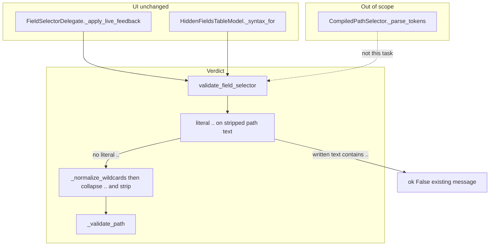

# PYPOST-1539: Reject a broken double-dot field selector

## Research

The verdict a person sees is `validate_field_selector` in
`pypost/core/field_selector_syntax.py`. The hidden-fields model and the
live editor both call that function and do not rewrite the text. A draft
is "acceptable" exactly when the result has `ok=True`.

`users..email` is acceptable today. The path checker already refuses a
double dot, but it never sees the text the person wrote.

Trace of `users..email`:

1. `validate_field_selector` strips the string (`field_selector_syntax.py`
   line 92). The value is still `users..email`. It is not a header selector
   and it contains `.`, so it is not a simple key (lines 96-111).
2. `_normalize_wildcards` (lines 59-61) replaces only `[*]` with `.*.`.
   This draft has no brackets, so the string is unchanged.
3. The collapse loop (lines 114-116) replaces every `..` with `.`.
   `users..email` becomes `users.email`.
4. `strip(".")` (line 117) does not change `users.email`.
5. `_validate_path("users.email")` (lines 82-87) splits into `users` and
   `email`, both identifiers, and returns ok.

The guard that would have rejected the draft is
`_validate_path` lines 75-76 (`if ".." in text`). It runs only after the
loop has removed the extra dot, so it cannot fire for a written `..`.

The same loop is what keeps the whole-element form readable.
`_normalize_wildcards` turns `[*]` into `.*.`, and the dot the person
already wrote after the brackets makes a second dot:

| Written text | After `[*]` → `.*.` | After `..` → `.` and `strip(".")` | Verdict today |
| --- | --- | --- | --- |
| `users[*].email` | `users.*..email` | `users.*.email` | ok |
| `[*].id` | `.*..id` | `*.id` | ok |
| `users..email` | `users..email` (no `[*]`) | `users.email` | ok (false) |

`[*].id` is already locked by `tests/test_field_selector_syntax.py`. The
collapse and the trailing `strip(".")` have to stay, or that form and
`users[*].email` stop being ok. Deleting the loop is not a fix.

`CompiledPathSelector._parse_tokens` (`pypost/core/json_selector_engine.py`
lines 26-30) does a related rewrite: `[*]` becomes `.*.`, then empty
pieces from `split(".")` are dropped. `users..email` therefore compiles
as `("users", "email")`. That is the masking engine, not the verdict.
PYPOST-1387 already keeps the engine more permissive than the vocabulary
check. This task does not change the engine.

RFC 9535 treats `..` as the start of a descendant segment, and a bare
`..` is not a segment by itself
([RFC 9535, section 2.5.2.1](https://www.rfc-editor.org/rfc/rfc9535.html)).
Jayway JsonPath compiles `..` as a recursive scan. This product's
selector vocabulary is not JSONPath. `$`, filters, and numeric indexes
are already unsupported. `users..email` is an empty step, not a
descendant query. The rejection copy stays the existing unsupported
message (PYPOST-1540 owns specialized wording).

## Implementation Plan

One production change, in `validate_field_selector`, on the path branch
only (after the header return and the simple-key return, before
`_normalize_wildcards`):

- If the stripped text contains `..`, return `_invalid(_UNSUPPORTED_MESSAGE)`.
- Do not change the message, the suggestions, the header check, the
  simple-key check, `_normalize_wildcards`, the collapse loop, or
  `strip(".")`.
- Do not change `JsonSelectorEngine`, the model, or
  `FieldSelectorDelegate`. They already display `ok`.

`users..email` hits the new check and is rejected. `users[*].email` has
no literal `..`, so the existing `[*]` rewrite and collapse still produce
`users.*.email`, which `_validate_path` accepts. `[*].id` stays on that
same path.

A header such as `header:X..Y` returns at the header branch (lines 96-104)
and is not part of this check.

**Mandatory — Failing Repro (next Step 3):**

Write the red test before the production check. No Qt, network, or MCP.

| Item | Plan |
| --- | --- |
| Module | `tests/test_pypost_1539_failing_repro.py` |
| Timeout | Module `pytestmark = pytest.mark.timeout(30)` |
| Asserts | `users..email` is not ok. `users[*].email` is ok. Both in one test. |
| Why red now | Collapse makes `users..email` into `users.email`, so `.ok` is True. |
| Run | `make test PYTEST_ARGS="tests/test_pypost_1539_failing_repro.py"` |
| Sequencing | Research, then the red module, then the check, then `make check`. |

Leave `tests/test_field_selector_syntax.py` unchanged. It already locks
the supported vocabulary, including `users[*].email` and `[*].id`, at
module timeout 10. The new module is the PYPOST-1539 repro and uses
timeout 30 as specified for this task.

## Architecture

### Modules



| Module | Responsibility | This task |
| --- | --- | --- |
| `validate_field_selector` | Classify one selector | Reject literal `..` first |
| `_normalize_wildcards` | Replace `[*]` with `.*.` | Unchanged |
| Collapse loop and `strip(".")` | Clean dots the `[*]` rewrite inserts | Unchanged |
| `_validate_path` | Segment grammar, including a late `..` check | Unchanged backstop |
| `HiddenFieldsTableModel` | Cache the result and paint from `ok` | Unchanged |
| `FieldSelectorDelegate` | Live style from the same result | Unchanged |
| `CompiledPathSelector` | Compile a selector for masking | Unchanged |

### Patterns

| Pattern | Why |
| --- | --- |
| Guard, then normalize | See the written `..` before the loop deletes it. |
| Pure function, same result type | Callers already branch on `ok`. |
| Advisory display | Invalid text is still saved. The verdict is what changes. |

### Interfaces

No signature change.

```python
def validate_field_selector(text: str) -> FieldSelectorSyntaxResult:
    """Return syntax evaluation for one selector string (strip-aware)."""
```

Path branch, after the simple-key return and before normalization:

- `..` in the stripped text → the existing invalid result
  (`ok=False`, `is_empty=False`, current unsupported message and
  suggestions).
- Otherwise the current normalize → collapse → `_validate_path` sequence.

| Call | Result |
| --- | --- |
| `validate_field_selector("users..email")` | `ok` is False |
| `validate_field_selector("users[*].email")` | `ok` is True |

### Rejected alternatives

- Remove the collapse loop. `_validate_path` line 75 would then reject
  `users[*].email` and `[*].id`, because substitution creates `..`.
- Collapse only dots counted from the substitution. Same outcome for
  these two examples, and more machinery. A written `[*]` never contains
  `.`, so a literal `..` in the stripped path was never produced by the
  substitution.
- Teach the masking engine to reject `..`. That changes which stored
  selectors match. The requirement is the verdict on the text the person
  wrote.

## Q&A

### Q1: Where does `users..email` become acceptable?

**A**: `pypost/core/field_selector_syntax.py` lines 113-118. Normalization
does not rewrite this draft. The loop at lines 115-116 replaces `..` with
`.`, and line 118 validates `users.email`. The `..` reject at lines 75-76
runs too late.

### Q2: Why does that loop exist?

**A**: `_normalize_wildcards` (lines 59-61) inserts `.*.` for `[*]`.
`users[*].email` becomes `users.*..email`, and `[*].id` becomes `.*..id`.
The loop and `strip(".")` turn those into `users.*.email` and `*.id`.
The loop stays.

### Q3: What is the chosen fix?

**A**: On the path branch, reject a literal `..` in the stripped text
before `_normalize_wildcards`. Use the current unsupported message.
Leave header selectors, the collapse loop, the UI, and the masking
engine alone.

### Q4: What does Step 3 write?

**A**: `tests/test_pypost_1539_failing_repro.py`, with
`pytestmark = pytest.mark.timeout(30)`. One test asserts
`users..email` is not ok and `users[*].email` is ok. It is written before
the production check and run only through `make test`.

### Q5: Is `..` JSONPath descendant syntax here?

**A**: No. RFC 9535 uses `..` for descendants, and this vocabulary does
not. The draft is an empty step. Specialized wording is PYPOST-1540.
