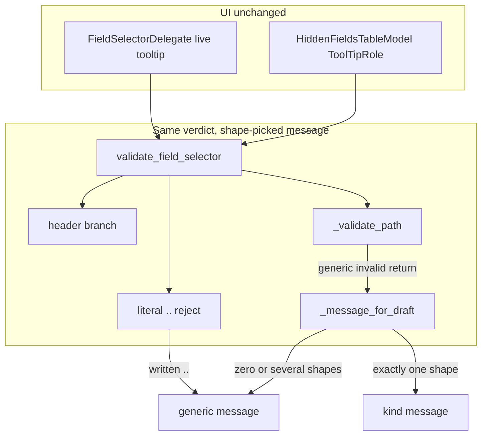

# PYPOST-1540: Name the unsupported field-selector kind

## Research

The warning a person sees is the `message` on `FieldSelectorSyntaxResult`.
`validate_field_selector` in `pypost/core/field_selector_syntax.py` is the
only place that chooses it. The hidden-fields model and the live editor
copy that string into the tooltip. They do not classify the draft.

The generic warning is one constant:

```25:28:pypost/core/field_selector_syntax.py
_UNSUPPORTED_MESSAGE = (
    "Unsupported or invalid field selector syntax. "
    "This expression is not accepted by response masking."
)
```

`_invalid` (lines 50-56) stores that string and the shared `_SUGGESTIONS`
block (lines 19-23). A valid result from `_ok` (lines 41-47) stores an
empty `message`. No test in the repository compares a selector to the
generic sentence. The sentence exists only in this constant.

### How the three drafts get that message

Each example is stripped (line 92), misses the header branch (lines
96-104), and misses the simple-key return (lines 106-111). None contains
a written `..`, so the double-dot reject (lines 114-115) does not run.
Wildcard normalization does not rewrite them. `_validate_path` then
returns `_invalid(_UNSUPPORTED_MESSAGE)`.

| Draft | Branch that returns the message | Line |
| --- | --- | --- |
| `$.token` | `"$" in text` inside `_validate_path` | 71-72 |
| `users[0].email` | `"[" in text` inside `_validate_path` | 79-80 |
| `users[?(@.active)].email` | `"?" in text` inside `_validate_path` | 71-72 |

`users[?(@.active)].email` hits line 71 because the filter carries `?`,
`(`, and `)`. It never reaches the bracket check. `users[0].email` has
none of those characters, so it falls through to the bracket check. The
two branches are different. The string they pass is the same constant.

`token` takes the simple-key return at line 111 and gets `_ok()`. Its
`message` is `""`. It gets no warning.

The same constant is also returned for other failures: a simple key that
contains `$` or fails the identifier check (lines 108 and 110), and the
remaining `_validate_path` failures (lines 70, 74, 76, 84, and 86). The
double-dot reject at line 115 uses it too. An empty header name does not.
That branch has its own message and suggestions (lines 99-102).

### What the person already sees

`HiddenFieldsTableModel.data` builds the committed tooltip from
`record.syntax.message` and `record.syntax.suggestions`
(`pypost/ui/models/hidden_fields_table_model.py` lines 144-146).
`FieldSelectorDelegate._apply_live_feedback` does the same for the open
editor (`pypost/ui/delegates/field_selector_delegate.py` lines 61-68).
Both already show whatever `message` the core returns. This task does not
need a second classifier in the UI.

`tests/test_field_selector_syntax.py` locks a different contract. Invalid
drafts must have a non-empty `message`, and `message` plus `suggestions`
must mention a supported form. It does not require the three drafts to
share one sentence. `_SUGGESTIONS` already contains `token`. Keeping that
block keeps those tests green after the three messages change.

### JSONPath shapes, and what this product does with them

[RFC 9535](https://www.rfc-editor.org/rfc/rfc9535.html) names the three
habits this task explains:

- `$` is the root identifier (section 2.2). `$.token` is that habit.
- An index selector is an integer in brackets (section 2.3.3).
  `users[0].email` is that habit. A leading minus, as in `[-1]`, is also
  an index. A leading zero is still digits in brackets.
- A filter selector is `?` plus a logical expression (section 2.3.5).
  `users[?(@.active)].email` is that habit. The marker in the draft is
  `[?`.

This vocabulary is not a JSONPath engine. `$`, filters, and numeric
indexes are already rejected. The masking compiler is intentionally more
permissive than the validator, and PYPOST-1387 left that split in place.
The warning stays guidance. The draft is still saved.

PYPOST-1539 rejects a written `..` with this same generic message and
left specialized wording to this task. PYPOST-1538 owns the shared
`header:` prefix. Neither reject changes in this task.

## Implementation Plan

One production change, in `pypost/core/field_selector_syntax.py` only,
and only after the red test exists.

Add three message constants and one private helper,
`_message_for_draft(draft: str) -> str`. The helper looks at the stripped
draft, the text the person wrote:

| Shape | Rule on the stripped draft | Explanation |
| --- | --- | --- |
| Filter | contains `[?` | filter message below |
| JSONPath dollar | starts with `$` | dollar message below |
| Numeric index | matches `\[-?\d+\]` | index message below |

If exactly one rule matches, return that explanation. If none match, or
more than one matches, return `_UNSUPPORTED_MESSAGE`.

Locked sentences:

- Dollar:
  `This field selector uses a JSONPath dollar. A dollar sign is not a supported field name.`
- Index:
  `This field selector uses a numeric index. A number in brackets is not a supported field name.`
- Filter:
  `This field selector uses a filter. A condition in brackets is not a supported field name.`

Each sentence names its kind. The three differ from each other. None of
them is the generic warning.

Use the helper as the message argument everywhere the file currently
passes `_UNSUPPORTED_MESSAGE`, except the double-dot return at line 115.
That return stays `_invalid(_UNSUPPORTED_MESSAGE)`.

`_validate_path` receives the stripped draft as well as the normalized
path, and uses the draft only to pick the message. Normalization can
rewrite `[*]` and collapse dots. The three examples are unchanged by
that rewrite. The helper still sees the original draft so the rule does
not depend on the rewrite.

Do not change:

- Which drafts are ok. No new early reject and no removed reject.
- The double-dot return at lines 114-115, including its message.
- The header branch at lines 96-104, including the empty-name message.
- `_SUGGESTIONS`, `_ok`, and the `ok` / `is_empty` flags.
- `header_selector_prefix`, `JsonSelectorEngine`, the model, and the
  delegate.

`$.users[0].name` matches both the leading `$` rule and the index rule,
so it keeps the generic warning. That draft is outside the one-kind
examples. `[?(@.x)]` matches only the filter. `users[0].name` matches
only the index. Both stay invalid. `users[*].email` stays ok. `[*]` is
not an integer index. `token` stays ok with an empty message.

**Mandatory — Failing Repro (next Step 3):**

Write the red test before any production message change. No Qt, network,
or MCP. Do not import a message constant. The three sentences live in
the test as literals, because the constants do not exist yet.

| Item | Plan |
| --- | --- |
| Module | `tests/test_pypost_1540_failing_repro.py` |
| Timeout | Module `pytestmark = pytest.mark.timeout(30)` |
| Test | `test_unsupported_kinds_explain_themselves` |
| Asserts | The three kind sentences above, each with `ok` False |
| Asserts | The three sentences differ and none is the generic warning |
| Asserts | `token` is ok and its `message` is `""` |
| Why red now | Lines 72 and 80 both return `_UNSUPPORTED_MESSAGE` |
| Run | `make test PYTEST_ARGS="tests/test_pypost_1540_failing_repro.py"` |
| Sequencing | Research, then the red module, then the helper, then `make check`. |

Leave `tests/test_field_selector_syntax.py` unchanged. It already locks
supported forms, empty input, and invalid guidance at module timeout 10.
The new module is the PYPOST-1540 repro and uses timeout 30.

The validator does not log. The repro does not need `caplog`.

Assert `message`, not the tooltip. The tooltip joins `message` and
`suggestions`. The shared suggestions would hide a test that only looks
for a supported-form word.

## Architecture

The explanation is chosen from the stripped draft's shape. The accept
and reject decision stays on the branches that exist today.

### Modules



| Module | Responsibility | This task |
| --- | --- | --- |
| `validate_field_selector` | Classify one selector | Pass the stripped draft into the helper |
| `_message_for_draft` | Map one draft shape to one sentence | New. Private to this module |
| `_validate_path` | Segment grammar after normalization | Same verdict. Message from the draft |
| Double-dot reject | Reject a written `..` before normalize | Same reject and generic message |
| Header branch | Accept `header:` or warn on an empty name | Unchanged |
| `HiddenFieldsTableModel` | Show `message` plus `suggestions` | Unchanged |
| `FieldSelectorDelegate` | Live tooltip from the same result | Unchanged |
| `CompiledPathSelector` | Compile a selector for masking | Unchanged |

### Patterns

| Pattern | Why |
| --- | --- |
| Pure function, same result type | Callers already read `message`. The signature stays. |
| Message chosen from the draft shape | The three kinds are visible in the text the person wrote. |
| Exactly one matching shape | A mixed draft stays on today's warning. No priority is invented. |
| Verdict stays put | The helper does not change `ok`. It only replaces the generic message. |

### Interfaces

No public signature change. `__all__` stays
`FieldSelectorSyntaxResult` and `validate_field_selector`.

```python
def validate_field_selector(text: str) -> FieldSelectorSyntaxResult:
    """Return syntax evaluation for one selector string (strip-aware)."""


def _message_for_draft(draft: str) -> str:
    """Return the kind sentence, or the generic warning."""
```

`_validate_path` gains the stripped draft as a second argument. Callers
outside this module do not see that parameter.

| Call | `ok` | `message` |
| --- | --- | --- |
| `validate_field_selector("$.token")` | False | dollar sentence |
| `validate_field_selector("users[0].email")` | False | index sentence |
| `validate_field_selector("users[?(@.active)].email")` | False | filter sentence |
| `validate_field_selector("token")` | True | `""` |
| `validate_field_selector("users..email")` | False | generic warning |
| `validate_field_selector("header:Authorization")` | True | `""` |

`suggestions` for the three kinds stay `_SUGGESTIONS`. The empty-header
suggestions stay `Example: header:Authorization`.

### Rejected alternatives

- Return invalid as soon as a shape matches, before the current checks.
  That adds a second verdict. A wide shape rule could reject a draft the
  grammar accepts. The helper only runs where the generic message is
  already being returned, and not on the double-dot return.
- First matching shape wins. `$.users[0].name` would then lose the
  generic warning even though it mixes a dollar and an index. Mixed
  drafts stay generic.
- Classify in the delegate or the model. The tooltip is already the core
  message. A second copy of the shape rules would drift.
- Teach `JsonSelectorEngine` the three sentences. The person reads the
  validator message. The engine does not choose it.
- Replace the generic warning for every invalid draft. A draft that is
  none of the three kinds keeps today's warning. A slice such as
  `users[0:1].email` matches none of the three rules.
- Put the kind only in `suggestions`. The explanation is `message`.
  Suggestions stay the supported-form list.

## Q&A

### Q1: Where do invalid selectors get their current message?

**A**: `pypost/core/field_selector_syntax.py` lines 25-28 define
`_UNSUPPORTED_MESSAGE`. `$.token` and `users[?(@.active)].email` return
it at lines 71-72. `users[0].email` returns it at lines 79-80. All three
share that one string today.

### Q2: What design was chosen?

**A**: Three explanations, chosen from the stripped draft's shape, and
only when exactly one shape matches. The shapes are a `[?` filter, a
leading `$`, and a `\[-?\d+\]` index. Anything else, including a mix,
keeps the generic warning. Accept and reject do not change. The
double-dot reject and the header branch stay as they are.

### Q3: What does Step 3 write?

**A**: The red test, before the production message change.
`tests/test_pypost_1540_failing_repro.py` with
`pytestmark = pytest.mark.timeout(30)`. It asserts the three sentences,
that they differ from each other and from the generic warning, and that
`token` has no warning. Run it only through `make test`.

### Q4: Why is a leading `$` the dollar shape, not any `$`?

**A**: RFC 9535 puts the root identifier at the start of the query.
`$.token` starts with `$`. `foo$bar` does not, and it keeps the generic
warning. A header such as `header:$token` still returns on the header
branch and never reaches the helper.

### Q5: Why does the double-dot return skip the helper?

**A**: PYPOST-1539 locked that reject to the generic warning. The three
examples do not contain `..`. Leaving line 115 on the constant keeps
that reject and that sentence.
