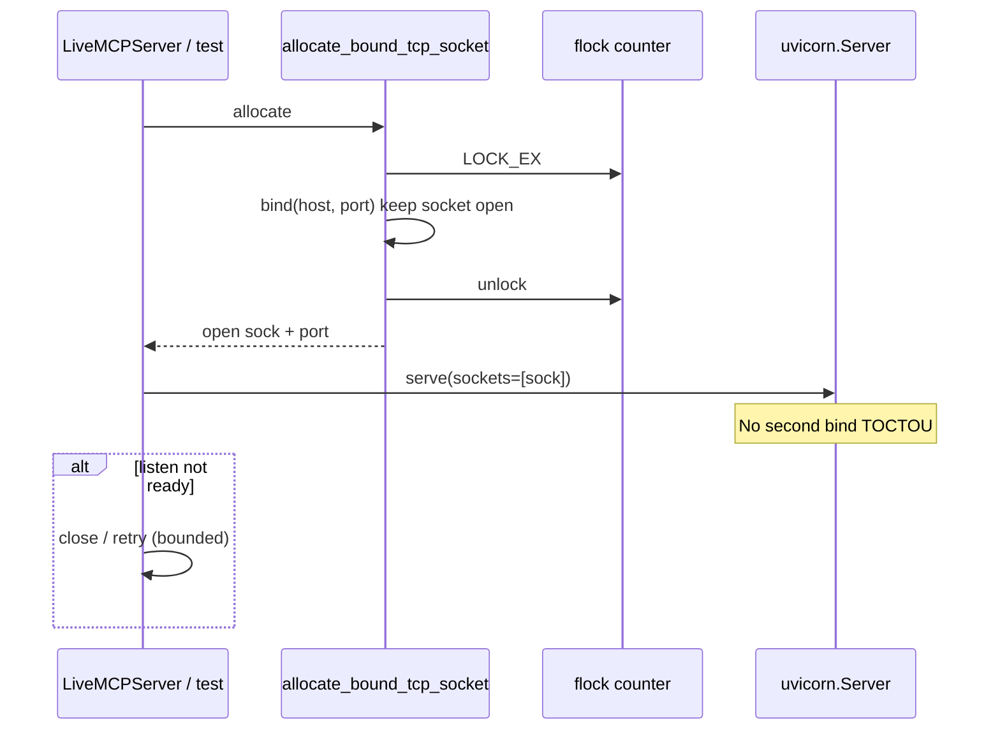

# PYPOST-1541: Stabilize flaky MCP integration port bind

## Research

### Failure class

| Item | Detail |
| --- | --- |
| Node id | `tests/test_mcp_server_integration.py::TestMCPServerIntegration::test_call_tool_substitutes_jira_mcp_json_body` |
| Symptom | `uvicorn` bind `('127.0.0.1', <ephemeral>): [Errno 98] address already in use` |
| Alone | Module / node passes |
| Parallel | Intermittent under `make test` workers |
| Related | PYPOST-1546, PYPOST-1508, PYPOST-1552 (same allocate-then-release class) |

### Current helpers

- `tests/helpers/port_allocation.py` — `allocate_tcp_port` under `fcntl.flock` + counter
  (base 35000, span 25000). Probe uses `_can_bind`, which **binds then closes** the
  socket before returning the port integer (TOCTOU window).
- Fallback path `bind(..., 0)` likewise closes before return.
- `tests/helpers/mcp_live_server.py` — `free_port()` → `allocate_tcp_port`;
  `LiveMCPServer` stores the integer in `__init__` and later asks uvicorn to bind
  the same port — classic allocate-then-release race under parallel workers.
- Production `MCPServerManager` already uses probe / `SO_REUSEADDR` readiness
  (`_wait_until_port_bindable`); this ticket is **test-harness** stabilization.

### Preferred pattern (industry + repo)

- Keep a bound socket open until the server takes ownership (Yelp
  ephemeral-port-reserve style; uvicorn `Server.serve(sockets=[sock])` accepts
  pre-bound sockets — verified locally).
- Optional bounded retry if listen readiness still fails.
- Prefer shared helper in `tests/helpers/port_allocation.py` over ad-hoc sleeps.

## Implementation Plan

1. Add `allocate_bound_tcp_socket(host)` in `port_allocation.py`: under the existing
   flock/counter, create socket, `SO_REUSEADDR`, bind chosen port (or `0`),
   **return the open socket** (caller owns close).
2. Implement `allocate_tcp_port` via bound allocation + immediate close (compat
   for callers that only need an int; document remaining TOCTOU for those paths).
3. Change `LiveMCPServer` to allocate a bound socket at start, pass it to
   `uvicorn.Server.serve(sockets=[...])`, and retry a small bounded number of
   times if listen readiness fails.
4. Keep `free_port()` as the int wrapper for stub HTTPServer call sites in the
   same module (follow-ups may migrate stubs to bind-0 servers).

**Failing Repro (Step 3):**

| Item | Plan |
| --- | --- |
| Desired behavior | `LiveMCPServer.start()` reaches a listening state even when the first allocated port is stolen before uvicorn listens (simulates parallel-worker race). |
| Where | `tests/test_mcp_live_server_port_bind_repro.py` |
| Force failure | Monkeypatch `allocate_tcp_port` / allocation used by `LiveMCPServer` so the first returned port is immediately bound+listened by a holder socket; assert `start()` still succeeds (and `stop()` cleans up). |
| Live deps | None (loopback only). |
| Sequencing | Red (TimeoutError / bind fail today) → held socket + retry → green. |
| Timeout | Module `pytestmark = pytest.mark.timeout(60)`. |

## Architecture

| Module | Responsibility |
| --- | --- |
| `tests/helpers/port_allocation.py` | Cross-process locked bound-socket allocation |
| `tests/helpers/mcp_live_server.py` | Live uvicorn harness uses held sockets + retry |
| `tests/test_mcp_live_server_port_bind_repro.py` | Deterministic steal-before-listen contract |
| Integration tests | Unchanged assertions; inherit stable harness |

### Patterns

- **Held bind** eliminates probe/release TOCTOU for the live MCP harness.
- **Bounded retry** absorbs residual races without unbounded sleeps.
- **Compat wrapper** keeps existing `allocate_tcp_port` / `free_port` call sites.

## Q&A

- **Q:** Why not only lengthen `wait_for_port`?
  **A:** A stolen port never becomes free for this server; waiting masks nothing.
- **Q:** Why not fix production `MCPServerManager` here?
  **A:** The filed failure is the test harness path via `LiveMCPServer`; production
  restart readiness is already covered by PYPOST-1178 / 1196.
