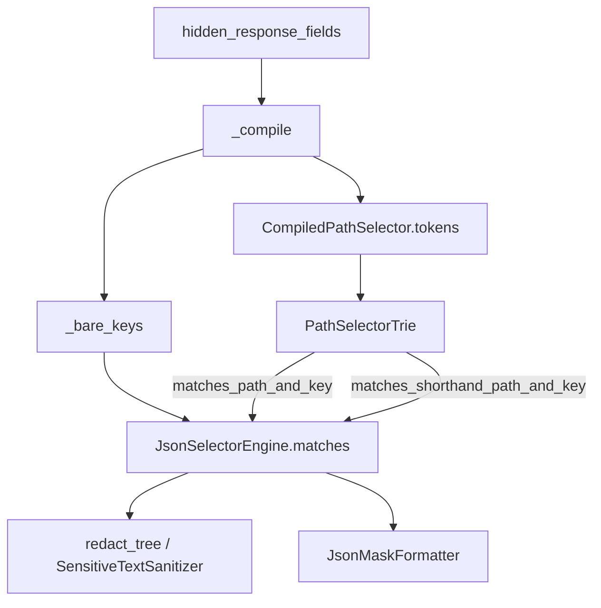

# PYPOST-1542: Remove unused selector match helpers

## Research

Response masking already has one live decision. `JsonSelectorEngine.matches`
in `pypost/core/json_selector_engine.py` answers it. Two extra helpers sit
beside that decision and have no production caller. This task removes those
two methods. Hierarchical compile and the live walks stay.

### Live decision

`JsonSelectorEngine.matches` (lines 170-188) is the production question:
given ancestor segments and a field name, should this field be hidden?

1. An empty engine returns false.
2. A bare key in `_bare_keys` returns true.
3. An empty trie returns false.
4. `PathSelectorTrie.matches_path_and_key` walks `path`, then `key`.
5. When any path segment is `*`, `matches_shorthand_path_and_key` walks
   again with those `*` segments skipped.

Production callers of that decision:

| Caller | Call |
| --- | --- |
| `JsonSelectorEngine._redact_node` | `self.matches(path, key_str)` at line 218, reached from `redact_tree` |
| `SensitiveTextSanitizer.redact_json_response_fields` | builds `JsonSelectorEngine` (line 91) and calls `redact_tree` (line 108) |
| `JsonMaskFormatter._format_dict` | `self.engine.matches(path, key_str)` at `pypost/ui/widgets/response_mask_controller.py` line 86 |

Neither redaction nor the response viewer calls the unused helpers.

### Unused helpers

`PathSelectorTrie.matches_tokens` (lines 97-103) walks one combined token
sequence through the same `_step` used by the live methods, then checks a
terminal. A repository search finds the definition and the developer guide.
No production module and no test calls it.

`CompiledPathSelector.matches` (lines 32-40) requires equal token length and
treats `*` as any one segment. `_compile` still constructs
`CompiledPathSelector` and inserts `compiled.tokens` into the trie (lines
158-160). It never calls `matches`. The only caller is
`test_compiled_path_selector_tokenization_and_matching` in
`tests/test_pypost_1394_failing_repro.py`:

| Rule | Candidate tokens | Expected |
| --- | --- | --- |
| `items[*].secret` | `["items", "*", "secret"]` | match |
| `items[*].secret` | `["items", "0", "other"]` | no match |
| `items[*].secret` | `["items", "secret"]` | no match (shorter than the rule) |
| `matrix[*][*].value` | `["matrix", "*", "*", "value"]` | match |
| `matrix[*][*].value` | `["matrix", "*", "value"]` | no match (shorter than the rule) |

The same function also locks compile segments:
`("items", "*", "secret")` and `("matrix", "*", "*", "value")`. Those
segment checks stay, because `_compile` still depends on that
tokenization.

Splitting each candidate into ancestors plus the last token and asking
`JsonSelectorEngine.matches` yields the same five booleans today:

| Moved call | Live call | Result today |
| --- | --- | --- |
| match `["items", "*", "secret"]` | `JsonSelectorEngine(["items[*].secret"]).matches(["items", "*"], "secret")` | true |
| no match `["items", "0", "other"]` | `.matches(["items", "0"], "other")` | false |
| no match `["items", "secret"]` | `.matches(["items"], "secret")` | false |
| match `["matrix", "*", "*", "value"]` | `JsonSelectorEngine(["matrix[*][*].value"]).matches(["matrix", "*", "*"], "value")` | true |
| no match `["matrix", "*", "value"]` | `.matches(["matrix", "*"], "value")` | false |

The short paths stay false on the live walk. `matches` only runs the
shorthand walk when the document path already contains `*`.
`["items"]` + `"secret"` has no wildcard, so shorthand does not run, and
`matches_path_and_key` stops because the next trie edge is `*`, not
`secret`. `["matrix", "*"]` + `"value"` is one wildcard short of the
terminal `value` edge, so both the direct walk and the shorthand walk
miss the terminal.

### Private helpers after the deletion

`_step` (lines 82-95) is called by `matches_tokens` and by both live
methods (lines 108, 111, 123, and 126). Deleting `matches_tokens` leaves
those live calls. `_step` stays.

`_parse_tokens` and `_BRACKET_WILDCARD_RE` exist to build `tokens` for
trie insert. `CompiledPathSelector.matches` only reads `self.tokens`.
Deleting `matches` leaves compile as the user of `tokens`. No private
helper becomes unused. The deletion is the two methods only.

These stay because other tickets own them:

- `_path_selectors` and its DEBUG `path_selectors_count` (PYPOST-1543).
- The linear `*` scan inside `JsonSelectorEngine.matches` before the
  shorthand walk (PYPOST-1544).
- A separate trie catalog or wildcard fan-out suite (PYPOST-1545).

### Developer guide

`doc/dev/json_selector_engine.md` still offers both helpers:

- The `CompiledPathSelector` component bullet (lines 69-73) says the
  instance `matches` helper is retained for older unit coverage.
- `PathSelectorTrie.matches_tokens` is documented at lines 194-196 as a
  sequence-oriented helper available for callers.
- `CompiledPathSelector.matches` is documented at lines 208-211.

`matches_path_and_key` and `matches_shorthand_path_and_key` (lines
188-192) describe the walks production still uses. Those sections stay.

### External practice

[python-jsonpath](https://jg-rp.github.io/python-jsonpath/api/) and
[jsonpath-ng](https://github.com/h2non/jsonpath-ng) compile one path
expression and match documents through that compiled object.
[dlt](https://github.com/dlt-hub/dlt/blob/94deeefe3c17f61278342973219d3c27afdb34e3/dlt/common/jsonpath.py)
does the same with `compile_path` before `find` or `filter`. PyPost does
not use those libraries. Its body language is the smaller selector set
already documented (bare key, dotted path, `[*]` / `.*`). The relevant
lesson is the one already in this engine: compile once, answer through
one match entry. A spare token walker next to
`JsonSelectorEngine.matches` is the second entry this ticket removes.
[RFC 9535](https://www.rfc-editor.org/rfc/rfc9535.html) is the JSONPath
standard; this task does not adopt it.

## Implementation Plan

Research is done in this step. Later steps follow this order. This step
does not edit production, tests, or the guide.

1. **Red test (Step 3).** Add
   `tests/test_pypost_1542_failing_repro.py` as specified under
   Failing Repro. Run
   `make test PYTEST_ARGS="tests/test_pypost_1542_failing_repro.py"`.
   Confirm `test_unused_match_helpers_are_absent` fails on the absence
   assertion while the live-outcome test passes.
2. **Point the older caller at the live decision (Step 4, before
   deletion).** In
   `test_compiled_path_selector_tokenization_and_matching`, keep both
   `tokens` assertions. Replace the five `CompiledPathSelector.matches`
   calls with the live `JsonSelectorEngine.matches` calls in the mapping
   table above, same expected booleans. Leave every other test in
   `tests/test_pypost_1394_failing_repro.py` unchanged, including that
   module's `pytest.mark.timeout(60)`.
3. **Deletion.** Remove `PathSelectorTrie.matches_tokens` and
   `CompiledPathSelector.matches`. Leave `_step`, `_parse_tokens`,
   `tokens`, `_path_selectors`, `matches_path_and_key`,
   `matches_shorthand_path_and_key`, and `JsonSelectorEngine.matches`
   as they are. Do not insert a call to a combined-token walk.
4. **Guide.** In `doc/dev/json_selector_engine.md`, drop the
   `matches_tokens` subsection, drop the `CompiledPathSelector.matches`
   subsection, and rewrite the `CompiledPathSelector` component bullet so
   it describes tokenization for trie insert only. Keep the live trie
   method sections.
5. **Verify.** `make lint`, then
   `make test PYTEST_ARGS="tests/test_pypost_1542_failing_repro.py tests/test_pypost_1394_failing_repro.py"`.
   The new absence test and the retargeted 1394 cases pass. Live results
   for the existing selector tests stay the same.

**Mandatory — Failing Repro (next Step 3):**

New module: `tests/test_pypost_1542_failing_repro.py`.

Module timeout: `pytestmark = pytest.mark.timeout(30)`.

Imports that exist before and after the deletion:
`PathSelectorTrie`, `CompiledPathSelector`, and `JsonSelectorEngine`
from `pypost.core.json_selector_engine`. The module does not import a
removed function name, so collection succeeds while the helpers are still
present. The first failure is an assertion, observed before any
production edit.

Red assertion, in `test_unused_match_helpers_are_absent`:

```python
assert not hasattr(PathSelectorTrie, "matches_tokens")
assert not hasattr(CompiledPathSelector, "matches")
```

While both methods are still defined, the first line fails with
`AssertionError`. After the deletion, both `hasattr` checks are false
and this test passes.

Live-outcome assertions live in the same module, in
`test_live_mask_decision_keeps_compiled_matcher_cases`. They call only
`JsonSelectorEngine.matches` and pass before the deletion and after it:

```python
items = JsonSelectorEngine(["items[*].secret"])
assert items.matches(["items", "*"], "secret")
assert not items.matches(["items", "0"], "other")
assert not items.matches(["items"], "secret")

matrix = JsonSelectorEngine(["matrix[*][*].value"])
assert matrix.matches(["matrix", "*", "*"], "value")
assert not matrix.matches(["matrix", "*"], "value")
```

No network, GUI, or external service. Sequence: this research, then the
red module, then the 1394 retarget and the production deletion, then the
guide, then `make lint` and the scoped `make test`.

## Architecture

The engine stays a compile-time trie behind one facade. The change
removes two unused query methods. Callers of the facade stay on
`matches`.



`matches_tokens` and `CompiledPathSelector.matches` are absent from this
graph. They are not wired in as another arrow.

### Modules

| Module | Responsibility after this task |
| --- | --- |
| `JsonSelectorEngine` | Compile rules, answer `matches(path, key)`, redact through that answer |
| `PathSelectorTrie` | Index token sequences; answer path-and-key and shorthand walks via `_step` |
| `CompiledPathSelector` | Normalize one hierarchical rule into `tokens` for insert |
| `SensitiveTextSanitizer` | MCP redaction through `redact_tree` |
| `JsonMaskFormatter` | Response-viewer masking through `engine.matches` |
| `tests/test_pypost_1394_failing_repro.py` | Existing selector locks; matcher cases retargeted to the live decision; segment checks kept |
| `tests/test_pypost_1542_failing_repro.py` | Absence of the two helpers, plus the same live outcomes |
| `doc/dev/json_selector_engine.md` | Documents the live walks and compile tokenization |

### Dependencies

- `JsonSelectorEngine._compile` depends on `CompiledPathSelector.tokens`
  and `PathSelectorTrie.insert`.
- `JsonSelectorEngine.matches` depends on `_bare_keys`,
  `matches_path_and_key`, and `matches_shorthand_path_and_key`.
- Both live trie methods depend on `_step`.
- Redaction and the response viewer depend on `JsonSelectorEngine.matches`.
- They do not depend on the removed methods.
- The 1394 tokenization test depends on `CompiledPathSelector.tokens`
  and, after the retarget, on `JsonSelectorEngine.matches`.

### Patterns

The existing pattern stays: a facade (`JsonSelectorEngine`) over a
segment trie, with compile-time partitioning of bare keys and
hierarchical paths. One facade method is the mask decision, which keeps
redaction and the response viewer on the same outcome. Removing the spare
query methods keeps that single entry. No second strategy, adapter, or
combined-token production API is added.

### Interfaces

Unchanged production interfaces:

- `JsonSelectorEngine.matches(path: Sequence[str], key: str) -> bool`
- `JsonSelectorEngine.redact_tree(node, placeholder="***") -> tuple[Any, int]`
- `PathSelectorTrie.matches_path_and_key(path: Sequence[str], key: str) -> bool`
- `PathSelectorTrie.matches_shorthand_path_and_key(path: Sequence[str], key: str) -> bool`
- `PathSelectorTrie.insert(tokens: Sequence[str]) -> None`
- `CompiledPathSelector(raw: str)` with public `tokens: tuple[str, ...]`

Removed:

- `PathSelectorTrie.matches_tokens(tokens: Sequence[str]) -> bool`
- `CompiledPathSelector.matches(candidate_tokens: Sequence[str]) -> bool`

Test interface after the retarget: the five booleans above are asked
through `JsonSelectorEngine.matches`. Segment equality stays on
`CompiledPathSelector.tokens`.

## Q&A

- **Q:** What is the decided outcome for the remove-or-wire choice?
  **A:** Remove both unused match helpers. Leave the sequence-oriented
  trie helper unwired. Move the older checks that still call the
  compiled-selector matcher onto the live mask decision, and keep the
  segment checks production compile still needs. Live mask results stay
  the same. See
  [10-requirements.md](ai-tasks/PYPOST-1542/10-requirements.md).
- **Q:** Which private helpers does the deletion pull out with it?
  **A:** None. `_step` still serves the two live trie walks.
  `_parse_tokens` still serves compile. The edit deletes the two methods
  only.
- **Q:** Why is the red assertion an absence check on classes that still
  import?
  **A:** The helpers are present today, so a test that expects them to be
  gone fails immediately, before production changes. Importing
  `PathSelectorTrie`, `CompiledPathSelector`, and `JsonSelectorEngine`
  succeeds both before and after. The live-outcome assertions in the same
  module already match current masking and stay in force after the
  methods are gone.
- **Q:** Why leave the `_path_selectors` list, the shorthand `*` scan, and
  a dedicated trie catalog alone?
  **A:** Those are PYPOST-1543, PYPOST-1544, and PYPOST-1545.
