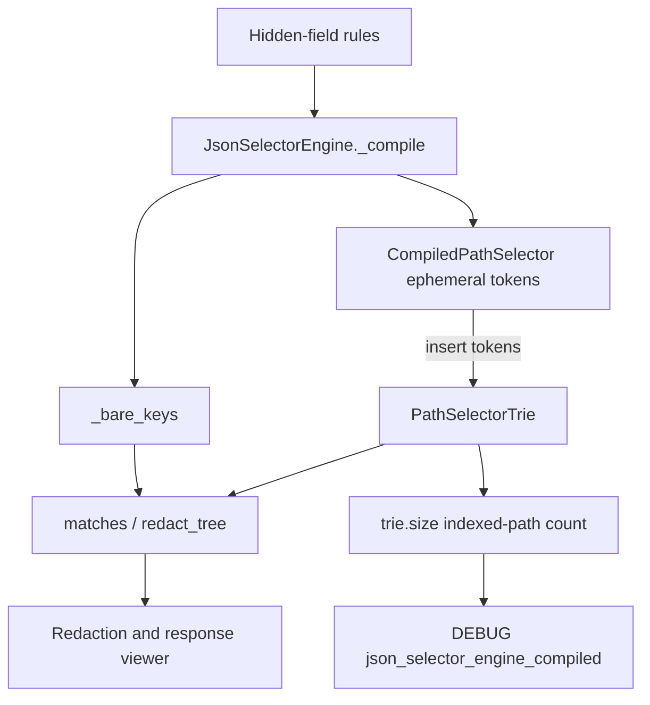

# PYPOST-1543: Drop the unused compiled-rule list

## Research

Hierarchical body rules are prepared in
`pypost/core/json_selector_engine.py`. `JsonSelectorEngine.__init__`
stores three compile products: `_raw_selectors`, `_bare_keys`, and
`_path_selectors: list[CompiledPathSelector]`, then builds a
`PathSelectorTrie` (`pypost/core/json_selector_engine.py` lines 117-123).

`_compile` (lines 129-150) is the only production writer of the list.
For each hierarchical rule it constructs a `CompiledPathSelector`,
appends that object, and inserts `compiled.tokens` into the trie:

```139:150:pypost/core/json_selector_engine.py
            else:
                compiled = CompiledPathSelector(cleaned)
                self._path_selectors.append(compiled)
                self._trie.insert(compiled.tokens)
        logger.debug(
            "json_selector_engine_compiled raw_count=%d bare_keys_count=%d "
            "path_selectors_count=%d trie_size=%d",
            len(self._raw_selectors),
            len(self._bare_keys),
            len(self._path_selectors),
            self._trie.size,
        )
```

Production readers of `_path_selectors` are that `len(...)` argument
and nothing else. `matches` (lines 152-170), `redact_tree`, and
`is_empty` do not read the list. `is_empty` already uses
`self._trie.is_empty` (lines 125-127). A repository search of `pypost/`
finds no other `_path_selectors` reference. Redaction
(`SensitiveTextSanitizer` / `redact_json_response_fields`) and the
response viewer (`JsonMaskFormatter`) call `matches` and `redact_tree`.

`PathSelectorTrie.size` (lines 54-57) is the indexed-path count.
`insert` (lines 59-69) increments `_size` only when the terminal flag
was clear, so two raw rules that share one token sequence count as one
path. `CompiledPathSelector._parse_tokens` (lines 25-30) maps `[*]` to
`*` and splits on `.`. These two inputs therefore share one terminal:

| Raw rule | Tokens |
| --- | --- |
| `items[*].secret` | `("items", "*", "secret")` |
| `items.*.secret` | `("items", "*", "secret")` |

Today that pair logs `path_selectors_count=2 trie_size=1`. Masking
follows the trie, so both rules hide the same locations.
`path_selectors_count` is the list length and can disagree with the
index. `raw_count` stays the count of distinct raw strings and is a
separate field.

The private list is also the subject of the hierarchical efficiency
lock in `tests/test_pypost_1388_failing_repro.py`.
`_CountingPathSelectors` (lines 131-150) counts iteration.
`test_hierarchical_lookup_scaling_bounded_by_depth_not_rule_count`
(lines 153-191) replaces `engine._path_selectors` with that wrapper
and asserts `item_reads` stays inside a depth budget. `matches` never
iterates the list, so `item_reads` is 0 and the test passes. This is
the PYPOST-1388 debt item recorded for PYPOST-1543: the probe exists
only while the list exists
(`ai-tasks/PYPOST-1388/60-tech-debt.md`).

The compile DEBUG line is locked by
`test_json_selector_engine_observability_and_zero_leak` in
`tests/test_pypost_1394_failing_repro.py` (lines 205-220). For
`["token", "items[*].secret", "header:Authorization"]` it requires
`raw_count=2`, `bare_keys_count=1`, `path_selectors_count=1`, and
`trie_size=1`. On that catalog the list length and the trie size are
both 1. The same test also locks `masked_count=2` and that secret
values stay out of the log.

`CompiledPathSelector` is still the tokenizer for insert.
`test_compiled_path_selector_tokenization_and_matching` in the 1394
module (lines 48-61) constructs it and asserts `tokens` for
`items[*].secret` and `matrix[*][*].value`, then locks the same cases
through `JsonSelectorEngine.matches`. PYPOST-1542 removed
`CompiledPathSelector.matches` and left `tokens` / `_parse_tokens`
because compile inserts those tokens. `self.raw` is still assigned in
`__init__` and is still unread. That attribute is a short-lived field
on the tokenizer object. It is a separate leftover from the retained
list.

The selector-engine guide still describes the duplicate list.
`doc/dev/json_selector_engine.md` lines 245-249 say a `_path_selectors`
list is built for DEBUG `path_selectors_count` and the FR-2 probe.
Line 302 tells operators to compare `trie_size` with
`path_selectors_count`. The `CompiledPathSelector` section (lines
69-72 and 195-201) describes tokenization for trie insert and does not
depend on the retained list.

Sibling tickets stay untouched. PYPOST-1544 owns the linear `*` scan
inside `matches` before the shorthand walk. PYPOST-1545 owns an
isolated trie catalog and wildcard fan-out stress. This design does
not change `matches`, `_step`, shorthand, or trie walk structure.

External practice matches the single prepared form already chosen here.
[python-jsonpath](https://jg-rp.github.io/python-jsonpath/convenience/)
compiles a path once and matches through that compiled object.
[Trie rule indexes](https://bruno.pacheco.lu/posts/optimizing-decision-making-with-trie-tree/)
store the decision in the tree, and equivalent branches collapse, so
the node count is smaller than the raw rule count.
[TrieSet](https://pypi.org/project/trieset/) treats key cardinality as
a property of the index; materializing a second key list is an extra
copy. PyPost does not take those libraries. `PathSelectorTrie.size` is
already the indexed-path count. Rebuilding a list from the trie to
preserve `path_selectors_count` would put the duplicate copy back.

## Implementation Plan

Research is this document. Step 3 writes the red module below and does
not edit production. Step 4 removes the retained list, points both
sizing sites at trie size, and retargets the two existing tests that
still read the list or the list length. `matches` and `redact_tree`
stay byte-for-byte in behavior. Step 8 updates the selector-engine
guide. PYPOST-1544 and PYPOST-1545 files and behaviors stay out of the
diff.

**Mandatory — Failing Repro (next Step 3):** Add
`tests/test_pypost_1543_failing_repro.py` with module scope
`pytestmark = pytest.mark.timeout(30)`. Import only symbols that
already exist (`JsonSelectorEngine`, and `logging` / `pytest` for the
debug case). Do not import a new helper. The first collected test
fails with `AssertionError` before any production edit.

1. **Red — private list still present.** Build an engine with at least
   one hierarchical rule. Assert
   `not hasattr(engine, "_path_selectors")`. Today `__init__` assigns
   that attribute (line 120), so the assertion fails with
   `AssertionError`. After Step 4 the attribute is gone and the
   assertion passes. This is the first failure. It is not an
   `ImportError` or `AttributeError`.
2. **Red — debug count is still the list length.** Compile
   `["items[*].secret", "items.*.secret"]` under `caplog` at DEBUG.
   Those strings share one terminal, so today's message contains
   `path_selectors_count=2` and `trie_size=1`. Assert the compiled
   record contains `trie_size=1` and does not contain
   `path_selectors_count=`. The missing-field assertion fails with
   `AssertionError` while the log still prints the list length. After
   Step 4 the line carries `trie_size=1` only.
3. **Already green — live masks.** In the same module, assert current
   `matches` results for a bare key, a dotted path, an array wildcard,
   shorthand (`items.secret` against `["items", "*"]`), a `header:`
   rule ignored for body matching, and an empty selector set
   (`is_empty` and a non-match). These pass before the production edit
   and must still pass after it. They are not the red assertion.

Leave `tests/test_pypost_1388_failing_repro.py` and
`tests/test_pypost_1394_failing_repro.py` unchanged in Step 3. Retarget
them in the same Step 4 change as the production edit so the suite does
not depend on a half-removed field.

Step 4 production edit, limited to `_compile` and the attribute:

- Delete `self._path_selectors` and the `append`.
- Keep the insert: `self._trie.insert(CompiledPathSelector(cleaned).tokens)`.
  The instance is ephemeral. Do not assign it to any instance attribute
  (no renamed replacement list).
- Change the DEBUG format to
  `json_selector_engine_compiled raw_count=%d bare_keys_count=%d trie_size=%d`
  with `len(self._raw_selectors)`, `len(self._bare_keys)`, and
  `self._trie.size`. Drop `path_selectors_count`. Do not log a second
  integer copied from trie size under the old name.

Step 4 test retarget:

- In `test_hierarchical_lookup_scaling_bounded_by_depth_not_rule_count`,
  delete `_CountingPathSelectors` and the assignment to
  `engine._path_selectors`. After compiling the 400 distinct
  `catalog{i}.branch{i}.leaf{i}` rules, read `engine._trie.size` and
  assert it equals 400. Keep the miss-heavy body, the `matches` call
  counter, and `redact_tree`. Assert `match_calls > 0` and a zero mask
  count. The catalog cardinality in that lock is trie size. Update the
  module docstring so it describes trie size as the efficiency lock.
- In `test_json_selector_engine_observability_and_zero_leak`, drop the
  `path_selectors_count=1` clause. Keep `raw_count=2`,
  `bare_keys_count=1`, `trie_size=1`, the redact completion line, and
  the secret-leak assertions. Leave
  `test_compiled_path_selector_tokenization_and_matching` as it is.

Step 8 guide edit in `doc/dev/json_selector_engine.md`:

- Performance item 2 (lines 245-249): hierarchical rules are indexed
  only in `PathSelectorTrie`. Compile DEBUG reports `trie_size`.
- Troubleshooting (line 302): operators read `trie_size` on
  `json_selector_engine_compiled`.
- Leave the `CompiledPathSelector` tokenization sections. They still
  describe the insert tokenizer.
- Do not edit the shorthand-scan wording (PYPOST-1544) or add a trie
  unit catalog (PYPOST-1545).

`make test` is the verification command once tests exist. This step
does not run it and does not edit production or tests.

## Architecture

One module changes: `pypost.core.json_selector_engine`. Callers stay on
the same public methods.



The retained `_path_selectors` box is removed from this flow. Compile
does not keep a second collection of rule objects.

### Modules

| Module | Responsibility |
| --- | --- |
| `CompiledPathSelector` | Normalize one hierarchical rule into `tokens` for trie insert. Kept. |
| `PathSelectorTrie` | Indexed prepared form. `size` is the distinct terminal count. Unchanged walk. |
| `JsonSelectorEngine` | Partition bare keys, insert hierarchical tokens, match, redact. Drops the stored compiled-rule list. |
| `SensitiveTextSanitizer` | Body redaction through `redact_tree`. Unchanged. |
| `JsonMaskFormatter` | Response-viewer masking through `matches`. Unchanged. |
| `doc/dev/json_selector_engine.md` | Guide text updated in Step 8 so it describes trie size as the compile sizing field. |

### `CompiledPathSelector` stays

Compile still needs the class. `_parse_tokens` is the only normalizer
that turns a hierarchical string into the sequence `insert` accepts.
Step 4 keeps this call shape:

```python
self._trie.insert(CompiledPathSelector(cleaned).tokens)
```

The object lives for that statement. It is not appended to engine
state. Deleting the class would remove the insert tokenizer and would
break the 1394 `tokens` lock, which is outside this deletion. Keep the
class. Keep `_parse_tokens`, `_BRACKET_WILDCARD_RE`, and `tokens`.
`raw` remains assigned on the ephemeral instance; this ticket does not
open a separate cleanup of that attribute.

### Interfaces

Public match surface is unchanged:

- `JsonSelectorEngine(selectors: Iterable[str] | None = None)`
- `is_empty -> bool` (already trie emptiness plus bare keys)
- `matches(path: Sequence[str], key: str) -> bool`
- `redact_tree(node, placeholder="***") -> tuple[Any, int]`
- `CompiledPathSelector(raw: str)` with `tokens: tuple[str, ...]`
- `PathSelectorTrie.insert(tokens: Sequence[str]) -> None`
- `PathSelectorTrie.size -> int`

No new public type, method, or import. The efficiency check and the
compile log read the existing `size` property.

DEBUG contract after Step 4, emitted once per `_compile`:

```text
json_selector_engine_compiled raw_count=%d bare_keys_count=%d trie_size=%d
```

`trie_size` is `self._trie.size`. For `items[*].secret` together with
`items.*.secret`, the value is 1. `raw_count` remains 2 because the raw
strings differ. Bare keys and `header:` skipping stay as they are.

### Patterns

Compile-once index, already in the engine. One tokenizer feeds one
trie; steady-state matching walks that trie. A retained list of
compiled objects is a second catalog. Trie insert already collapses
duplicate terminals, so the list length is the wrong sizing number when
raw rules share a path. Using `size` keeps the efficiency lock and the
debug line on the structure `matches` actually walks.

No new factory, repository, or matcher. `matches` control flow, the
shorthand walk, and `_step` stay in place for PYPOST-1544 and
PYPOST-1545.

### Dependencies

- `JsonSelectorEngine._compile` depends on `CompiledPathSelector.tokens`
  and `PathSelectorTrie.insert` / `size`.
- `matches` and `redact_tree` depend on `_bare_keys` and the trie.
  They gain no dependency on a compiled-rule list.
- The 1388 efficiency test depends on `engine._trie.size` after the
  retarget, and stops depending on `_path_selectors`.
- The 1394 tokenization test still depends on `CompiledPathSelector.tokens`.
- The 1394 observability test depends on `trie_size` and stops depending
  on `path_selectors_count`.
- The new 1543 module depends on `hasattr` for `_path_selectors` and on
  the DEBUG message text. Both are current behavior, so the red run
  fails with `AssertionError`.

## Q&A

- **Q:** Does compile still need `CompiledPathSelector` after the list
  is gone, or is the class unused and deleted?
  **A:** Keep the class. `_compile` still constructs it and inserts
  `compiled.tokens` into the trie. The instance is not stored. Delete
  only `_path_selectors`, its append, and the `path_selectors_count`
  log argument. The class would be unused only if insert stopped
  calling it. Insert still calls it.
- **Q:** Why does the red test assert `hasattr` and log text instead of
  a new symbol?
  **A:** The list and the list-length field exist today. Asserting they
  are gone fails with `AssertionError` before the production edit.
  Importing a symbol that does not exist yet would fail with
  `ImportError`, which is the wrong first failure.
- **Q:** What do the efficiency check and the debug line use for the
  count?
  **A:** `PathSelectorTrie.size` (`trie_size` in the log). Duplicate raw
  rules that share a terminal do not increase that count and do not
  change mask results.
- **Q:** Which tests are retargeted, and which stay?
  **A:** Retarget the 1388 probe that wraps `_path_selectors`, and drop
  `path_selectors_count=1` from the 1394 compile-log assertion. Leave
  the 1394 `tokens` test, the 1388 semantic mask locks, the breadcrumb
  tests, and the PYPOST-1542 `matches` deletion test in place.
- **Q:** What stays out of scope?
  **A:** The shorthand `*` scan (PYPOST-1544), a new isolated trie
  suite or wildcard fan-out stress (PYPOST-1545), and any change to
  which field `matches` or `redact_tree` hides.

Links: [python-jsonpath compile](https://jg-rp.github.io/python-jsonpath/convenience/),
[trie rule index](https://bruno.pacheco.lu/posts/optimizing-decision-making-with-trie-tree/),
[TrieSet cardinality versus a second key list](https://pypi.org/project/trieset/).
