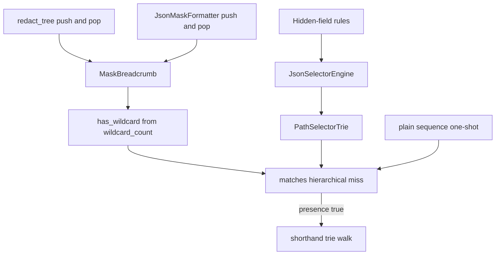

# PYPOST-1544: Know wildcard presence from the breadcrumb

## Research

Hierarchical miss handling lives in `JsonSelectorEngine.matches`
(`pypost/core/json_selector_engine.py`). After the trie walk misses, the
method scans every segment of the current location for `"*"` and only
then runs the shorthand walk:

```158:166:pypost/core/json_selector_engine.py
        if self._trie.matches_path_and_key(path, key_str):
            return True

        # Shorthand dot fallback (e.g. items.secret matching items.*.secret path)
        if any(str(t) == "*" for t in path):
            if self._trie.matches_shorthand_path_and_key(path, key_str):
                return True

        return False
```

That `any(...)` is the scan this ticket removes from the miss path. Bare
keys still return before the trie. An empty trie still returns false.
The shorthand walk itself (`matches_shorthand_path_and_key`, lines
98-111) is unchanged: it skips `"*"` segments and steps the rest.

The location is already a stack. Redaction creates one list in
`redact_tree` (line 177) and pushes on descent, popping in `finally`:

```200:217:pypost/core/json_selector_engine.py
                    path.append(key_str)
                    try:
                        res[key] = self._redact_node(
                            val, path, placeholder, masked_count
                        )
                    finally:
                        path.pop()
            return res
        if isinstance(node, list):
            result: list[Any] = []
            for item in node:
                path.append("*")
                try:
                    result.append(
                        self._redact_node(item, path, placeholder, masked_count)
                    )
                finally:
                    path.pop()
```

The response viewer does the same with its own list. `JsonMaskFormatter.format`
(line 64) creates `path: list[str] = []`. Object descent appends the field
name and pops it (`response_mask_controller.py` lines 103-107). List
descent appends `"*"` and pops it (lines 120-124). Both walks then call
`engine.matches(path, key)`. An object key whose name is `"*"` is pushed
as that string, so it is a wildcard segment in the same way a list index
is.

`SensitiveTextSanitizer.redact_json_response_fields` and
`mcp_response_sanitizer` call `redact_tree`. They do not keep a second
breadcrumb. No other production caller pushes this path.

`matches` is also a one-shot question. Existing locks pass a finished
list or tuple, for example `matches(["items", "*"], "secret")`, and never
call push or pop. Those calls must keep today's yes or no
(`10-requirements.md`). A flag that exists only while a walk is in
progress cannot answer them. A plain sequence has no count until something
looks at its segments.

Nested `"*"` segments make a bare boolean wrong. `matrix[*][*].value`
pushes two stars. Popping the inner star must leave the outer star in
force. The presence flag is therefore `wildcard_count > 0`. Push of `"*"`
increments. Pop of a popped `"*"` decrements. Push and pop of any other
segment leave the count alone.

The debt note
(`ai-tasks/PYPOST-1388/60-tech-debt.md`, shorthand miss path) describes
this as a boolean maintained by push and pop. The count is that boolean
under nesting. PYPOST-1545 (isolated trie catalog and wildcard fan-out)
stays out of this design. Trie `_step`, compile, and bare keys stay as
they are.

External practice matches a running total on the stack frame, not a
rescan of the path. TanStack Router keeps `depth` and `optionals` on
each match frame and updates them when the frame is pushed, instead of
walking the path again to recount. See
[stack frames](https://tanstack.com/blog/tanstack-router-route-matching-tree-rewrite).
RFC 9535 defines `*` as a child selector
([JSONPath wildcard](https://www.rfc-editor.org/rfc/rfc9535.html#name-wildcard-selector)).
This ticket does not adopt descendant syntax (`..`), a new matcher, or
that library. The PyPost trie and the two existing walks stay the
mechanism. The missing piece is the count those walks can maintain
because they already push and pop.

`doc/dev/json_selector_engine.md` (lines 132-133 and 151-153) still says
the shorthand fallback runs when the path contains `*`, and that
`_redact_node` uses a `list[str]` with `append` / `pop`. That wording is
updated in Step 8, not here.

## Implementation Plan

Research is this document. Step 3 writes the red module below and does
not edit production. Step 4 adds the breadcrumb count, points both walks
at `push` / `pop`, and makes the hierarchical miss read the flag. Match
booleans stay the same. Step 8 updates the two guide sentences above.
PYPOST-1545 files and behaviors stay out of the diff.

**Mandatory — Failing Repro (next Step 3):** Add
`tests/test_pypost_1544_failing_repro.py` with module scope
`pytestmark = pytest.mark.timeout(30)`. Import only symbols that already
exist (`JsonSelectorEngine`, `JsonMaskFormatter`, `inspect`, `pytest`).
Do not import `MaskBreadcrumb`. The first collected test fails with
`AssertionError` before any production edit.

1. **Red — miss path still scans.** Read
   `inspect.getsource(JsonSelectorEngine.matches)`. Assert
   `'any(str(t) == "*" for t in path)'` is absent, then assert
   `"has_wildcard"` is present. Today line 162 still has that `any(...)`
   call, so the first assertion fails with `AssertionError`. It is not
   an `ImportError`. After Step 4, `matches` reads `path.has_wildcard`
   for a breadcrumb and does not contain that scan.
2. **Red — walks still use bare append.** In the same module, read
   `JsonSelectorEngine._redact_node`, `JsonMaskFormatter._format_dict`,
   and `JsonMaskFormatter._format_list`. Assert each source contains
   `"path.push("`. Today they call `path.append`, so each assertion
   fails with `AssertionError`. After Step 4 the three push sites call
   `push`. `pop` stays the paired ascent.
3. **Already green — live masks.** Assert current results for a bare
   key, a dotted path, an array wildcard, one-shot shorthand
   (`items.secret` against `["items", "*"]`), a shorthand miss
   (`items.secret` against `["other", "*"]`), a `header:` rule ignored
   for body matching, and an empty selector set. Also assert
   `redact_tree` on `{"items": [{"secret": "x", "name": "n"}]}` with
   selector `items.secret` masks `secret` and leaves `name`, and on
   `{"rows": [{"cells": [1], "secret": "b"}]}` with selector
   `rows.secret` masks `secret` after the inner list is popped. Also
   assert an object key `"*"` (`{"wrap": {"*": {"secret": "z"}}}` with
   selector `wrap.secret`) stays masked. These pass before the
   production edit and must still pass after it. They are not the red
   assertion. A mask-only test would already be green, which is why the
   red checks are structural.

Leave `tests/test_pypost_1388_failing_repro.py` and
`tests/test_pypost_1394_failing_repro.py` unchanged. They lock today's
booleans and the single reused breadcrumb identity. One
`MaskBreadcrumb` instance per walk keeps that identity.

Step 4 production edit:

- Add `MaskBreadcrumb(list[str])` in `json_selector_engine.py` with
  `_wildcard_count`, `push`, `pop`, and `has_wildcard`.
- `push` appends through `super().append` and increments when
  `segment == "*"`. `pop` uses `super().pop` and decrements when the
  removed segment is `"*"`. `has_wildcard` is `self._wildcard_count > 0`.
- Override `append` so it calls `push`. Walks call `push` only. Do not
  add `extend` or `insert`.
- `redact_tree` and `JsonMaskFormatter.format` create one
  `MaskBreadcrumb` instead of `[]`. Dict descent `push(key_str)`; list
  descent `push("*")`; both `pop` in `finally`.
- In `matches`, after the hierarchical hit returns, set presence from
  `path.has_wildcard` when `isinstance(path, MaskBreadcrumb)`. Otherwise
  call a private `_sequence_has_wildcard` that keeps today's
  `any(str(t) == "*" for t in path)` for a one-shot sequence. Run
  `matches_shorthand_path_and_key` only when that presence is true.
- Do not change trie walks, bare keys, header skipping, placeholders, or
  log lines.

`make test` is the verification command once the red module exists. This
step does not run it and does not edit production or tests.

## Architecture

Two walk sites and one decision function change. Callers of
`redact_tree` and `format_masked_json` stay on the same methods. The
public `matches(path, key)` signature stays a `Sequence[str]`.



The `any(...)` scan is not on the walk's miss path. The walk reads the
flag. A plain sequence still resolves presence in
`_sequence_has_wildcard` so one-shot answers stay the same.

### Modules

| Module | Responsibility |
| --- | --- |
| `MaskBreadcrumb` | Location stack. Count updates on push and pop. |
| `JsonSelectorEngine.matches` | On a miss, read the flag before shorthand. |
| `JsonSelectorEngine._redact_node` | Redaction walk. Pushes names and list stars. |
| `JsonMaskFormatter` | Viewer walk. Same push and pop. |
| `PathSelectorTrie` | Unchanged exact and star edges. |
| `_sequence_has_wildcard` | One-shot plain sequences only. |
| `SensitiveTextSanitizer` | Calls `redact_tree` only. |

### `MaskBreadcrumb`

The class subclasses `list[str]` so it stays a `Sequence[str]` for
`matches` and the trie, and so one instance still satisfies the existing
identity locks.

```python
class MaskBreadcrumb(list[str]):
    def __init__(self) -> None:
        super().__init__()
        self._wildcard_count = 0

    def push(self, segment: str) -> None:
        super().append(segment)
        if segment == "*":
            self._wildcard_count += 1

    def pop(self, index: int = -1) -> str:
        segment = super().pop(index)
        if segment == "*":
            self._wildcard_count -= 1
        return segment

    @property
    def has_wildcard(self) -> bool:
        return self._wildcard_count > 0

    def append(self, segment: str) -> None:
        self.push(segment)
```

Walk sites call `push` and `pop` only. `append` is overridden so a
leftover `append` cannot leave the count behind. `extend` and `insert`
are not part of the walk.

List `"*"` and an object key `"*"` both go through `push`. Nested stars
share one count. After the inner `pop`, an outer star still reports
`has_wildcard`. An empty breadcrumb reports false, which is today's
answer for an empty path.

### Miss path

```python
if self._trie.matches_path_and_key(path, key_str):
    return True
if isinstance(path, MaskBreadcrumb):
    wildcard_present = path.has_wildcard
else:
    wildcard_present = _sequence_has_wildcard(path)
if wildcard_present:
    if self._trie.matches_shorthand_path_and_key(path, key_str):
        return True
return False
```

`_sequence_has_wildcard` is the old segment scan, used only when the
argument is not a `MaskBreadcrumb`. Redaction and the response viewer
pass the breadcrumb, so their miss path does not iterate segments to
discover `"*"`. Shorthand still runs only after a hierarchical miss and
only when presence is true. It still does not run when the count is 0.

### Interfaces

Unchanged for callers:

- `JsonSelectorEngine(selectors: Iterable[str] | None = None)`
- `matches(path: Sequence[str], key: str) -> bool`
- `redact_tree(node, placeholder="***") -> tuple[Any, int]`
- `JsonMaskFormatter.format(node) -> tuple[str, list[MaskedTokenSpan]]`
- `PathSelectorTrie.matches_path_and_key` and
  `matches_shorthand_path_and_key`

New, same module, used by the two walks:

- `MaskBreadcrumb.push(segment: str) -> None`
- `MaskBreadcrumb.pop(index: int = -1) -> str`
- `MaskBreadcrumb.has_wildcard -> bool`

No new log field. Compile and redact debug lines stay as they are.

### Patterns

Running total on the existing mutable breadcrumb. Push and pop already
bracket every child visit. The count is updated there, and the miss
path reads it in constant time. A second scan of the same stack repeats
a fact the walk just recorded.

No new trie, factory, or matcher. Shorthand is still a second trie walk
with `"*"` segments skipped. PYPOST-1545's fan-out work is not started
here.

### Dependencies

- `redact_tree` and `JsonMaskFormatter.format` depend on one
  `MaskBreadcrumb` each, created at the root of that walk.
- `_redact_node`, `_format_dict`, and `_format_list` depend on `push`
  and `pop` to keep `wildcard_count` aligned with the segments.
- `matches` depends on `MaskBreadcrumb.has_wildcard` for those walks,
  and on `_sequence_has_wildcard` for a plain sequence.
- The shorthand walk still depends on `PathSelectorTrie` only. It does
  not read the count; the gate in `matches` does.
- `SensitiveTextSanitizer` depends on `redact_tree` only.
- The new test module depends on `inspect.getsource` of `matches` and
  of the three walk methods, plus live `matches` / `redact_tree` calls.
  It does not depend on a symbol that does not exist yet.

## Q&A

- **Q:** Why a count instead of a boolean flipped on every star push and
  pop?
  **A:** Two stars can be on the stack (`matrix[*][*]`, or a list inside
  a list). Popping the inner `"*"` must leave `has_wildcard` true while
  the outer `"*"` remains. The flag callers read is `wildcard_count > 0`.
- **Q:** Why not store the flag only on the engine?
  **A:** `matches(path, key)` is also a one-shot call with a finished
  sequence. An engine flag would describe the walk in progress, or be
  zero, and would change those answers. The count belongs to the
  location that was pushed.
- **Q:** Does the one-shot path still scan?
  **A:** A plain list or tuple has no push or pop history.
  `_sequence_has_wildcard` keeps today's segment check so the yes or no
  stays the same. Redaction and the response viewer pass a
  `MaskBreadcrumb` and do not take that branch. The `any(...)` line
  leaves `matches`.
- **Q:** Can shorthand run on every hierarchical miss, since a path with
  no star makes that walk identical to the first?
  **A:** No. Shorthand stays gated on presence. Removing the gate is out
  of scope even where the boolean would match.
- **Q:** What stays out of scope?
  **A:** PYPOST-1545 (isolated trie catalog and wildcard fan-out), any
  change to which field is masked, and any new selector syntax.
- **Q:** Why is the red test a source assertion?
  **A:** Mask booleans are already correct. A live mask test passes
  before and after. The failure that exists before the edit is that
  `matches` still scans the path for `"*"`. Asserting that source fact
  raises `AssertionError` without importing a new symbol.

Links:

- [TanStack stack frames](https://tanstack.com/blog/tanstack-router-route-matching-tree-rewrite)
- [RFC 9535 wildcard selector](https://www.rfc-editor.org/rfc/rfc9535.html#name-wildcard-selector)
