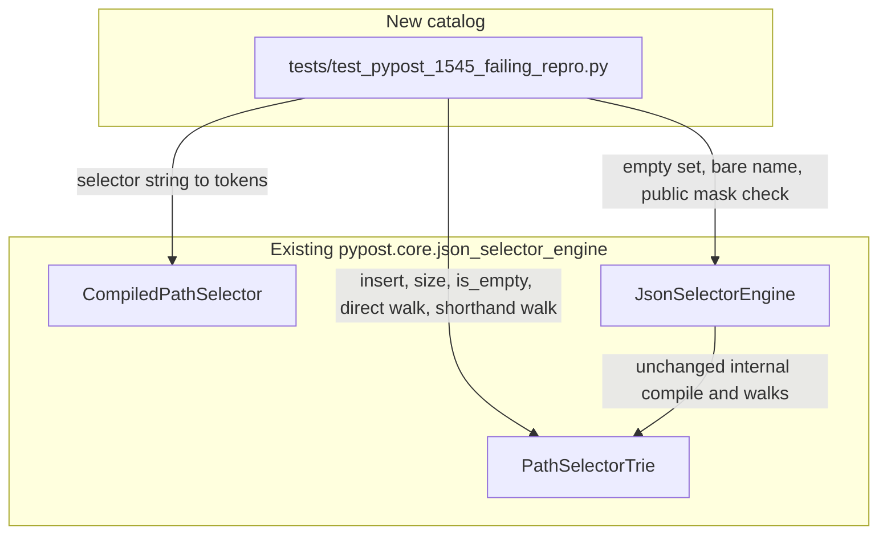

# PYPOST-1545: Isolated catalog for the hierarchical path index

## Research

This ticket adds a test catalog for the hierarchical path index that
already ships. It does not add a matcher, and it does not change which
fields are hidden. The classes under test live in
`pypost/core/json_selector_engine.py`.

### Existing index

`PathSelectorTrie` is a segment trie. `insert` walks the tokens and
creates a child only when that segment is missing. `size` increments
only when the node reached by the full token sequence was not already
a terminal. A second insert of the same complete path leaves `size`
unchanged. Two complete paths that share a prefix share the prefix
nodes and still count as two terminals.

Confirmed on the current class:

| Inserts | `size` afterward |
| --- | --- |
| none | 0 (`is_empty` is true) |
| `items.secret`, then `items.secret` again | 1 |
| those, then `items.other` | 2 |

An empty trie answers no for every location tried, on both
`matches_path_and_key` and `matches_shorthand_path_and_key`. Locations
checked: `secret` at the root, `secret` under `items`, `secret` under
`items` then `*`, and `secret` under `other`.

`CompiledPathSelector` turns a selector string into the tokens `insert`
already receives from compile. `items.secret` is `("items", "secret")`.
`items[*].secret` and `items.*.secret` are `("items", "*", "secret")`.
`*.*.secret` is `("*", "*", "secret")`. The catalog uses that
constructor and `.tokens`. It does not call `_parse_tokens`.

### Existing walks

`matches_path_and_key` starts at the root and walks each ancestor
segment, then the field name. At each segment the existing step keeps
the child reached by that exact segment and the child reached by `*`,
and drops duplicate nodes. A hit is a terminal node after the field
name. `matches_shorthand_path_and_key` does the same walk after
skipping `*` segments in the ancestor list. The field name is never
skipped.

`JsonSelectorEngine.matches` is the public mask check. An empty
selector set returns no, so every field stays visible. A bare name is
stored apart from the trie and hides that field on any ancestor list.
When the trie itself is empty, a name that is not bare is a miss. A
hierarchical hit on `matches_path_and_key` is a hit for the public
check. Only a hierarchical miss on a location that contains `*`
consults the shorthand walk. A one-shot list is the location shape
already used by the PYPOST-1388 semantic lock.

Confirmed shorthand-only case, sole rule `items.secret`:

| Ancestors | Field | Direct | Shorthand | Public check | Result |
| --- | --- | --- | --- | --- | --- |
| `items`, `*` | `secret` | no | yes | yes | hidden; this is the shorthand-only row |
| `other` | `secret` | no | no | no | visible |
| `items` | `secret` | yes | yes | yes | hidden; direct hit, not shorthand-only |

The same wildcard location with rule `items.*.secret` is a direct hit
(direct yes, public yes). Its shorthand walk is no, because dropping
the location's `*` lands on the rule's `*` node before the terminal
`secret` edge. The public check still hides the field, because the
direct walk already hit. That row is not the shorthand-only case.

Path-and-key agreement, rule `user.apiKey`:

| Ancestors | Field | Direct | Public check |
| --- | --- | --- | --- |
| `user` | `apiKey` | yes | yes |
| `user` | `name` | no | no |

Bare name `secret` is a separate case. The engine is not empty.
`secret` at `other` and `secret` under `items` / `*` are both hidden.
`name` at `other` stays visible. No hierarchical rule is required for
those answers.

`PathSelectorTrie.matches_tokens` and `CompiledPathSelector.matches`
are absent. Nothing in this catalog calls them or puts them back.

### Wildcard-heavy yes-or-no

The accepted catalog is a fixed rule set whose segments are mostly
`*`, not a new index and not a cursor counter. Four distinct paths:

- `*.*.secret`
- `*.*.*.pin`
- `items.*.*.token`
- `*.id`

Today's public check, which matches the direct walk on every row
below:

| Ancestors | Field | Hidden |
| --- | --- | --- |
| `orders`, `*` | `secret` | yes |
| `items`, `*`, `*` | `token` | yes |
| `a`, `b` | `secret` | yes |
| `x` | `id` | yes |
| `other` | `name` | no |
| `items`, `*` | `token` | no |
| `items` | `secret` | no |

`secret` under `orders` / `*` is a direct hit on `*.*.secret`. The
shorthand walk for that location is no. The public check follows the
direct hit. `name` at `other` never reaches a terminal. `token` under
`items` / `*` is one segment short of `items.*.*.token` and stays
visible. Those answers are the lock. The walk's per-segment node list
stays the list `_step` already builds.

### What this catalog does not restudy

`tests/test_pypost_1388_failing_repro.py` keeps the semantic locks and
the efficiency lock over many distinct exact paths, including its read
of `engine._trie.size` for that efficiency lock.
`tests/test_pypost_1542_failing_repro.py` keeps the absence check for
the removed helpers. Header rules, breadcrumb wildcard counts, and
redaction of a whole document stay on the tests that already own them.

### External notes

Pytest's parametrize decorator is the maintained way to put many
input rows on one test function
([parametrize](https://docs.pytest.org/en/8.4.x/how-to/parametrize.html)).
A module `pytest.mark.timeout` applies to each parametrized item
([pytest-timeout](https://github.com/pytest-dev/pytest-timeout)).
This repo still requires the marker on the test module. A global
timeout setting is not a substitute.

Elasticsearch `PathTrie` and the Hono trie router are route stores
with retrieval and parameter capture
([PathTrieTests](https://github.com/elastic/elasticsearch/blob/7aa66526/server/src/test/java/org/elasticsearch/common/path/PathTrieTests.java),
[Hono node tests](https://github.com/honojs/hono/blob/e50df014/src/router/trie-router/node.test.ts)).
They are not the matcher this catalog calls. The algorithm under test
is the trie already in `PathSelectorTrie`.

## Implementation Plan

1. Research is this document. The booleans above were read from the
   current `insert`, `size`, `matches_path_and_key`,
   `matches_shorthand_path_and_key`, and `JsonSelectorEngine.matches`.
2. **Mandatory — Failing Repro (next Step 3):** `N/A — no behavioral
   change`. The index and the public mask check already return the
   accepted outcomes. There is no production defect to show with a red
   assertion, and there is no production edit that would turn a red
   test green. Step 3 records that N/A. The characterization catalog
   is added in Step 4. If a row in that catalog fails, stop. That
   failure means current code disagrees with an accepted example.
   Do not answer it by changing the trie, adding a match method, or
   changing mask results.
3. Add `tests/test_pypost_1545_failing_repro.py`. The module is the
   isolated catalog. It imports `CompiledPathSelector`,
   `JsonSelectorEngine`, and `PathSelectorTrie` from
   `pypost.core.json_selector_engine`. After those imports it sets
   `pytestmark = pytest.mark.timeout(30)`. The timeout uses the
   default signal method.
4. Build hierarchical rows by constructing `CompiledPathSelector` and
   passing `.tokens` to `PathSelectorTrie.insert` on a trie the test
   creates. Assert `size` and `is_empty` on that trie. Assert direct
   and shorthand answers on that trie. Assert the public mask check
   with `JsonSelectorEngine(selectors).matches(path, key)` and
   `is_empty` for the empty selector set. Ancestor lists are plain
   lists, the same shape as the existing semantic lock.
5. Keep one sequential table for indexed size: no inserts is 0;
   `items.secret` twice is 1; `items.secret` plus `items.other` is 2.
   Use parametrized rows for the empty-index misses, the
   shorthand-only triple, the path-and-key agreement rows, the
   bare-name rows, and the wildcard-heavy yes-or-no table.
6. The shorthand-only row asserts direct no, shorthand yes, and public
   yes for `items` / `*` / `secret` under only `items.secret`. The
   same rule asserts `secret` at `other` is no on all three, and
   `secret` under `items` is yes on all three. The rule
   `items.*.secret` at `items` / `*` / `secret` asserts direct yes and
   public yes, and is not grouped with the shorthand-only row.
7. Agreement rows assert the direct answer and the public check are
   the same boolean. Covered rows: `user.apiKey` at `user` / `apiKey`
   (yes) and at `user` / `name` (no). Bare-name rows use
   `JsonSelectorEngine(["secret"])` only. They are not inserted into
   the trie and are not mixed into the hierarchical agreement rows.
8. The wildcard-heavy table uses the four rules and the seven
   locations in Research. Assert the public check, and assert the
   direct walk equals that check. Do not require the shorthand walk
   to equal the public check on that set. Do not count active nodes,
   do not time the walk, and do not add a fan-out structure.
9. Assert `matches_tokens` is absent on `PathSelectorTrie` and
   `matches` is absent on `CompiledPathSelector`. Call only
   `PathSelectorTrie.insert`, `size`, `is_empty`,
   `matches_path_and_key`, and `matches_shorthand_path_and_key`;
   `CompiledPathSelector` construction and `.tokens`;
   `JsonSelectorEngine` construction, `matches`, and `is_empty`.
   Do not call `_step`, `_compile`, `_parse_tokens`, or
   `_sequence_has_wildcard`. Do not read `_trie`, `_bare_keys`, or
   `_root`.
10. Run the new module with `make test`. Do not call pytest directly.
    Leave `tests/test_pypost_1388_failing_repro.py` and
    `tests/test_pypost_1542_failing_repro.py` unchanged.

## Architecture

### System module diagram

No production module is added. Redaction and the response viewer keep
calling `JsonSelectorEngine.matches`. They are not new callers in this
ticket.

### Modules

| Module | Responsibility in this ticket |
| --- | --- |
| `tests/test_pypost_1545_failing_repro.py` | Isolated catalog. Owns the tables, the timeout, and the assertions. |
| `PathSelectorTrie` | Existing index. Distinct complete paths, empty index, direct walk, shorthand walk. |
| `CompiledPathSelector` | Existing tokenizer. Supplies `.tokens` for trie inserts. Its removed `matches` stays absent. |
| `JsonSelectorEngine` | Existing public mask check. Empty selector set, bare-name rules, and agreement with the direct walk where that check is the direct walk. |

`_step` remains the private walk inside `PathSelectorTrie`. The catalog
observes it only through the two public match methods. `_compile`
remains the private way the engine fills `_bare_keys` and the trie.
The catalog does not replace either one.

### Interaction

1. The size table creates a `PathSelectorTrie`, tokenizes each selector
   with `CompiledPathSelector`, inserts, and reads `size`.
2. The empty-index table uses a trie with no inserts and expects no
   from both public match methods.
3. The empty selector set is a `JsonSelectorEngine` with no rules.
   `is_empty` is true and `matches` is no.
4. The bare-name table is a different engine, constructed with
   `secret` only. `matches` is yes for that field and no for another
   field. This case is not a trie insert.
5. The shorthand-only table asks the trie for the direct answer and
   the shorthand answer, then asks `JsonSelectorEngine.matches` for
   the public answer.
6. Agreement rows ask both the direct walk and `matches`, and require
   the same boolean.
7. The wildcard-heavy table builds one engine from the four rules and
   one trie from the same tokens, then checks each location's public
   answer and the matching direct answer.

### Patterns

The production shape stays the segment trie plus the engine facade.
`PathSelectorTrie` is the index. `JsonSelectorEngine.matches` is the
only mask question callers use. The new module is a table-driven
characterization catalog: pytest parametrize holds the repeated
location rows, and one sequential table holds the running `size`.
That is a test layout for an existing trie, not a second matcher and
not a new index shape.

### Interfaces

No method is added. The catalog uses these existing contracts:

| Caller | Call | Contract used here |
| --- | --- | --- |
| Catalog | `CompiledPathSelector(raw).tokens` | Tokens compile would insert for that selector string. |
| Catalog | `PathSelectorTrie.insert(tokens)` | Indexes one complete path. A repeated path does not increase `size`. |
| Catalog | `PathSelectorTrie.size` / `is_empty` | Count of distinct terminals. Zero before any insert. |
| Catalog | `matches_path_and_key(path, key)` | Direct yes-or-no for ancestors plus field name. |
| Catalog | `matches_shorthand_path_and_key(path, key)` | Yes-or-no after `*` ancestors are ignored. |
| Catalog | `JsonSelectorEngine(selectors).matches(path, key)` | Public mask check. |
| Catalog | `JsonSelectorEngine.is_empty` | True only when no bare name and no hierarchical path were compiled. |

`JsonSelectorEngine.matches` on a hierarchical decision follows
`matches_path_and_key`. It follows `matches_shorthand_path_and_key`
only after that direct walk missed and the ancestor list contains
`*`. Bare names are answered from the bare-name set before the trie
is consulted.

## Q&A

- **Q:** Should `PathSelectorTrie.matches_tokens` or
  `CompiledPathSelector.matches` come back so two walks can be
  compared?
  **A:** No. They stay absent. The comparison this catalog records is
  `matches_path_and_key` against `JsonSelectorEngine.matches` on
  locations where the public check is that direct walk. The
  shorthand-only row is separate because there the public check
  follows the shorthand walk.

- **Q:** Does the wildcard-heavy catalog need a new fan-out structure
  or a count of active nodes?
  **A:** No. It locks the yes-or-no the four rules already return,
  including one hidden location and one visible location. The
  per-segment walk stays the walk in `PathSelectorTrie`. No speed or
  memory target is added.

- **Q:** Do the PYPOST-1388 locks get replaced by this module?
  **A:** No. They stay, including the efficiency lock over many
  distinct exact paths. This module adds the index facts those locks
  do not state on their own.

- **Q:** Why is Step 3 not a red test?
  **A:** The accepted behavior is already what `insert`, `size`, and
  the match methods return. A red test would not fail for a missing
  behavior. Step 4 adds the catalog against that behavior. A failed
  row stops the task before any production edit.
