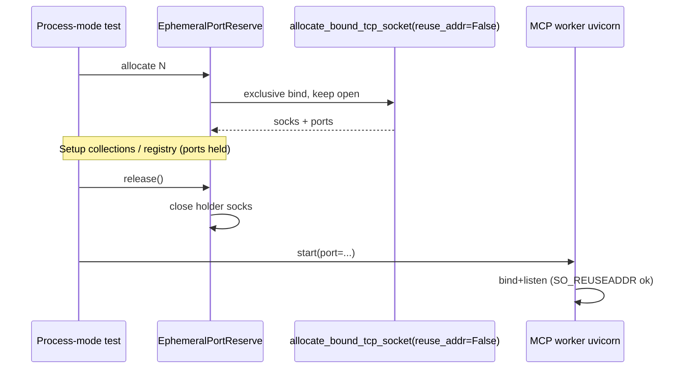

# PYPOST-1546: Stabilize flaky MCP process refresh neighbor isolation test (port bind)

## Research

### Failure class

| Item | Detail |
| --- | --- |
| Node id | `tests/test_mcp_process_tool_refresh_repro.py::test_process_mode_refresh_collection_isolates_neighbor_and_proxy_servers` |
| Symptom | uvicorn `[Errno 98] address already in use`; `wait_for_state('srv-neighbor', 'running')` False |
| Alone | Passes |
| Parallel | Intermittent under `make test` workers |
| Related | PYPOST-1541 (LiveMCPServer held socket — landed `076ab90e`); PYPOST-1508; PYPOST-1552 |

### Current helpers

- `allocate_bound_tcp_socket` (PYPOST-1541) — bind with `SO_REUSEADDR`, return open socket for
  in-process uvicorn `serve(sockets=[sock])`.
- `allocate_tcp_port` — bound alloc then **close** (compat TOCTOU).
- `EphemeralPortReserve` / `reserve_ephemeral_ports` — batch via `allocate_tcp_port`, yield
  integer ports with **no hold** during collection/registry setup. Process workers bind later →
  classic allocate-then-release race.
- Linux note: a holder with `SO_REUSEADDR` does **not** block another `SO_REUSEADDR` bind/listen
  (uvicorn). Exclusive bind (**no** `SO_REUSEADDR`) blocks reuse-addr thieves until close.

### Preferred pattern

1. Batch-allocate with **exclusive** bound sockets (no `SO_REUSEADDR`).
2. Keep sockets open through test setup (collections, registry upsert).
3. **`release()`** immediately before `registry.start` / runner start so the child can bind.
4. Context-manager `finally` releases any remaining holders.

Reuse flock/counter from `allocate_bound_tcp_socket`; add `reuse_addr` flag (default True for
LiveMCPServer; False for process-mode batch reserve).

## Implementation Plan

1. Extend `allocate_bound_tcp_socket(..., *, reuse_addr: bool = True)`.
2. Change `EphemeralPortReserve` to hold exclusive sockets; add `release()`.
3. Yield a list subclass (`EphemeralPorts`) with `.release()` from
   `reserve_ephemeral_ports`; `finally` releases leftovers.
4. Call `ports.release()` / `reserve.release()` immediately before process-mode server starts
   in suites using this helper (tool refresh, isolation, stress, proxy, reconfigure, IPC, etc.).
5. Document exclusive hold + release handoff in `doc/dev/testing.md`.

**Failing Repro (Step 3):**

| Item | Plan |
| --- | --- |
| Desired behavior | While `reserve_ephemeral_ports` holds a port, a peer with `SO_REUSEADDR` cannot bind it; after `release()`, the peer can bind+listen (process-mode handoff contract). |
| Where | `tests/test_ephemeral_port_reserve_hold_repro.py` |
| Force failure | Today ports are free after allocate → thief bind succeeds → `pytest.raises(OSError)` fails. |
| Live deps | None (loopback only). |
| Sequencing | Red (no exclusive hold) → exclusive hold + release API + call sites → green. |
| Timeout | Module `pytestmark = pytest.mark.timeout(30)`. |

## Architecture

| Module | Responsibility |
| --- | --- |
| `tests/helpers/port_allocation.py` | Exclusive batch hold + release handoff |
| Process-mode tests | Release immediately before server start |
| `tests/test_ephemeral_port_reserve_hold_repro.py` | Deterministic hold/release contract |
| Production MCP | Unchanged |

### Patterns

- **Exclusive held bind** blocks parallel-worker theft during setup.
- **Release-before-start** is the process-mode analogue of LiveMCPServer socket handoff.
- **Bounded** — no sleeps; flock attempts remain capped.

## Q&A

- **Q:** Why not pass pre-bound sockets into the worker process?
  **A:** Would require FD inheritance / production runner changes; out of scope for this debt
  ticket. Release-before-start shrinks the race to the spawn window.
- **Q:** Why not only fix the one flaky node id?
  **A:** All `reserve_ephemeral_ports` / `EphemeralPortReserve` process-mode users share the
  same TOCTOU; holding without updating call sites would block their binds.
