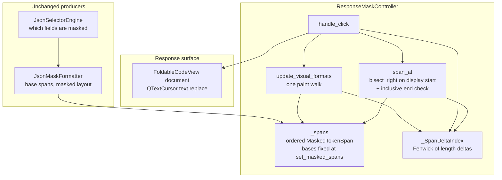
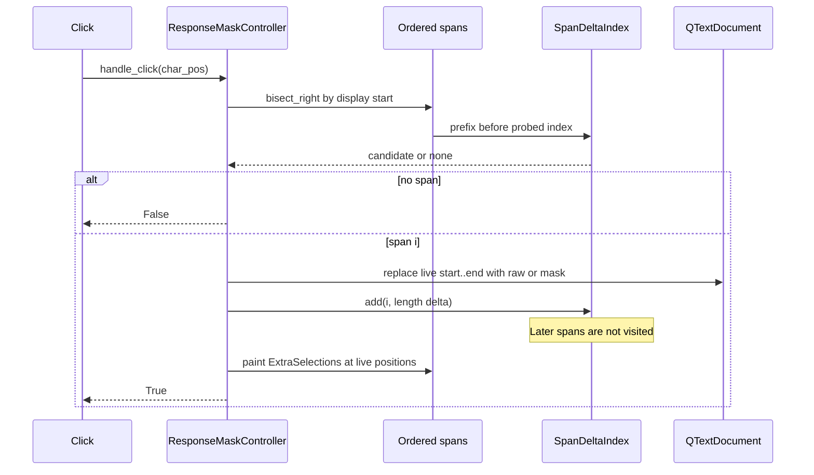

# PYPOST-1547: Fenwick prefix deltas for later click targets

## Research

### Origin and intent

[PYPOST-1547](https://pypost.atlassian.net/browse/PYPOST-1547) is the remaining
toggle cost left by
[PYPOST-1390](https://pypost.atlassian.net/browse/PYPOST-1390). Requirements in
`10-requirements.md` freeze the outcome: one reveal or one hide keeps every
later click target on the value now shown, click lookup stays ordered, reveal
shows the real value, hide shows the mask, and the set of masked fields stays
the same. The structure that keeps later targets correct is chosen here.

Pointer-motion throttling stays on
[PYPOST-1548](https://pypost.atlassian.net/browse/PYPOST-1548).

### Current code

`ResponseMaskController` in
`pypost/ui/widgets/response_mask_controller.py` owns an ordered
`list[MaskedTokenSpan]`. Spans do not overlap. `JsonMaskFormatter` appends
them in document order. A toggle does not insert, delete, or reorder spans.

`span_at` is already a `bisect_right` on `start_pos`, then an inclusive end
check (`start_pos <= char_pos <= end_pos`). That is the PYPOST-1390 lookup.
Hover and click both use it.

`handle_click` still repairs later coordinates by walking the list:

```280:283:pypost/ui/widgets/response_mask_controller.py
        for other in self._spans:
            if other.start_pos > span.start_pos:
                other.start_pos += delta
                other.end_pos += delta
```

The walk visits every span. It writes `start_pos` and `end_pos` on every span
that starts after the toggled value. The toggled span's own `end_pos` is
assigned on the line above the loop. `delta` is the change in shown length
(`len(new_text) - old_len`). Reveal and hide are that same path: the new text
is `raw_value` or `masked_value`.

The same inner walk lives in `_apply_persisted_reveals` (lines 225–228), which
runs when a newly formatted document restores path-keyed reveal memory. It is
the same coordinate rule. Both sites have to share one index. Leaving the
restore walk on absolute positions would apply the shift twice, or leave base
positions and display positions disagreeing.

`update_visual_formats` already walks every span once to build
`ExtraSelection`s. That walk paints. It does not add `delta`. Qt needs one
selection per span, so this ticket leaves that pass in place. The cost this
ticket removes is the extra coordinate walk.

Callers keep the `MaskedTokenSpan` objects that `spans()` returns and read
`start_pos` after an earlier toggle. Existing suites do this, including the
second click in
`tests/test_hidden_response_fields_integration_edge_cases.py` (reveal span 0,
then click `spans[1].start_pos + 1`). After a length change, those attributes
have to be the live document positions. `QTextCursor` replacement uses the
same live range: select `[start_pos, end_pos)`, insert the new text.

### What a toggle changes

Spans stay in document order. A length change at index `i` by `delta`:

- moves the toggled span's end by `delta`
- moves every later span's start and end by `delta`
- leaves earlier spans where they are
- leaves the gap after each span the same size, so starts stay strictly
  increasing and intervals stay non-overlapping

So the live position of span `i` is its formatted base position plus the sum
of length deltas of spans `0 .. i-1` (the start) or `0 .. i` (the end).

Base positions are the coordinates `set_masked_spans` receives from the
formatter, before persisted reveals and before clicks. Formatter spans are
masked layout (`is_revealed` is false). Reveal memory and clicks are deltas
on top of that base.

### Structures considered

| Structure | Toggle coordinate work | Ordered click lookup | Fit for this controller |
| --- | --- | --- | --- |
| Flat piece table / piece chain | O(1) length change on the edited piece once the piece is known | Walk that sums piece lengths, O(spans) | Drops the ordered lookup PYPOST-1390 made logarithmic |
| Tree of offsets (rope, sum tree, piece tree, order-statistic tree) | O(log n) subtree-length update | Descend by subtree size, O(log n) | Meets the asymptotics; replaces the stable list and `bisect_right` |
| Flat prefix array of deltas | Rewriting the suffix of prefixes is O(later spans) | O(1) prefix, then bisect | Same later-span visit this ticket removes |
| **Fenwick tree of per-span deltas (chosen)** | One point `add`, O(log n) | `bisect_right` on display starts; each probe is one prefix, O(log² n) | Point update plus prefix sum on a fixed ordered index |

#### Piece table

A piece chain stores pieces that point into an original buffer and an add
buffer. Pieces do not store a logical position. A coordinate is the sum of
piece lengths from the head of the chain, so finding the piece under a
character walks the chain
([Piece Chains](https://www.catch22.net/tuts/neatpad/piece-chains/)).

That is the wrong repair here. `QTextDocument` already owns the response
text. `handle_click` already applies the edit with `QTextCursor.insertText`.
The controller only tracks a sparse set of non-overlapping masked spans. A
flat piece table of those spans makes the length change local and pushes the
linear cost into `span_at`, which hover still calls on pointer motion.
PYPOST-1548 owns throttling; this ticket keeps lookup ordered and
logarithmic in the number of probes.

A piece table that stores subtree lengths so lookup stays logarithmic is a
tree of offsets. It is judged with that option below. Editor piece trees
([enhanced piece tree](https://patents.google.com/patent/US11243745),
[AxlPieceTree](https://axl.aximcode.com/modules/piece-tree)) exist to edit the
buffer itself. This ticket does not replace Qt's buffer.

#### Tree of offsets

A balanced tree (rope, sum tree, or order-statistic tree) whose nodes carry
subtree length answers "which span contains this character" by descending
size fields, and a length change bubbles one path. Zed's sum tree is this
shape: the cursor walks until the aggregated length covers the offset
([Rope & SumTree](https://zed.dev/blog/zed-decoded-rope-sumtree)). Lookup and
update are both O(log n).

The tree meets FR-1, FR-2, and FR-3. It is the wrong structure for this
list:

- Toggle does not insert or delete spans. The index is a dense array that
  `set_masked_spans` replaces wholesale. A balanced tree's rotations and
  middle inserts serve a workload this controller does not have.
- PYPOST-1390's lookup is `bisect_right` plus the inclusive end check,
  including the frozen case where a boundary position is covered by two
  abutting spans and the rightmost start wins. Keeping that function, and
  changing only the key to the display start, preserves the contract the
  existing oracle tests lock.
- A sum tree is a second copy of document order. The list is already that
  order. Two structures would have to move together on every
  `set_masked_spans`, `clear`, and `clear_spans`.

O(log n) descent is a real lookup advantage over O(log² n) bisect probes.
At the span counts this UI sees (hundreds, the PYPOST-1390 fixture uses
512), a probe budget of about log₂(512)² integer adds is still a small
prefix walk beside `QTextCursor` and the selection pass. The simpler
structure wins.

#### Fenwick / prefix deltas

A Fenwick tree (binary indexed tree) stores partial sums so a point update
and a prefix sum are each O(log n), with an implicit tree in an integer
array
([Fenwick tree](https://en.wikipedia.org/wiki/Fenwick_tree)). The classic
shape is point update plus prefix query. A flat prefix array answers the
query in O(1) and repairs a suffix in O(n), which is the loop this ticket
removes. Range-update / point-query (a Fenwick over a difference array) can
also add `delta` onto a suffix of stored coordinates. That is the same
family with two boundary writes and a harder inclusive-end invariant. The
direct model is one scalar per span: how much that span's shown length has
changed since the formatted base.

Python's `bisect_right(..., key=)` does not apply the key to the query
value, and the key may be a property
([bisect](https://docs.python.org/3/library/bisect.html)). Display start as
that key keeps the PYPOST-1390 search. Each key call is one Fenwick prefix,
so a search is O(log² n). The Fenwick rank walk (longest prefix whose sum is
at most a value) does not replace this bisect: the search key is
`base_start + prefix(deltas)`, and the end check is a separate inclusive
comparison.

Stdlib only. No new package. Python `int` prefix sums do not overflow on
long revealed values.

### Decision

**Chosen structure: a Fenwick tree of per-span length deltas over the stable
ordered span list, with live display coordinates equal to base position plus
the prefix of those deltas. `span_at` stays `bisect_right` on display
starts.**

| Concern | Decision |
| --- | --- |
| Coordinate repair | Point-add the toggled span's length `delta` into the Fenwick. Do not walk later spans and do not assign their positions. |
| Live `start_pos` / `end_pos` | Properties. Start uses the prefix strictly before the span. End uses the prefix through the span. Unbound spans (formatter output, delta index missing) return the base. |
| Click lookup | Existing `bisect_right` plus inclusive `end_pos` check. The key reads display start. |
| Document edit | Read the live range, `insertText` the real value or the mask, then `add` the delta. Adding first would move the toggled end before the cursor selection. |
| Persisted reveals | Same `add` after each restored insert, in list order. The inner later-span walk goes away. |
| Paint | `update_visual_formats` still walks every span once. |
| Masked fields, mask text, raw text, hover copy | Unchanged. `JsonMaskFormatter` and selectors stay as they are. |
| Mouse-move throttling | Unchanged. PYPOST-1548. |

## Implementation Plan

Step 4 changes only
`pypost/ui/widgets/response_mask_controller.py`. No new package. No change to
`JsonMaskFormatter` output, selector matching, hover cursor, tooltip copy, or
the viewport event filter except that `span_at` and `handle_click` use
display coordinates.

1. Add a small Fenwick type in that module (see interfaces). Build it empty
   in `__init__`. Rebuild it to `len(spans)` zeros in `set_masked_spans`,
   `clear`, and `clear_spans`.
2. Change `MaskedTokenSpan` so the coordinates passed at construction are the
   base. `start_pos` and `end_pos` become live properties once the controller
   binds `(index, delta index)`. Constructor keyword arguments stay
   `start_pos`, `end_pos`, `raw_value`, `masked_value`, `is_revealed`, and
   `path`, so formatter and test call sites keep working. Equality stays on
   the public span data; the binding is excluded from compare and repr.
3. `set_masked_spans` stores the spans, snapshots bases from those
   constructor coordinates, binds each span to its index and the new zeroed
   tree, then runs persisted reveals through `add` (no later-span
   assignment).
4. `handle_click` resolves the span with `span_at`, flips `is_revealed` and
   path reveal memory, replaces `[start_pos, end_pos)` in the document, then
   `add`s `len(new_text) - old_len` at that span's index. It does not assign
   `start_pos` or `end_pos` and does not iterate `_spans` to apply `delta`.
   Visual refresh, fold rescan, and search refresh stay after the `add`.
5. `span_at` keeps the current control flow. `attrgetter("start_pos")` reads
   the property.
6. `clear` / `clear_spans` drop the tree and unbind spans they release so a
   held span falls back to its base. Unbind is O(n) at clear, which is
   outside the toggle budget.

Existing PYPOST-1390 and PYPOST-1392 suites stay green: display coordinates
remain visible on the span objects, inclusive ends stay inclusive, and
reveal memory still expands the document. Run the suite with `make test`.

**Mandatory — Failing Repro (next Step 3):**

Write this test before any production change. Do not add it in Step 2.

- **File**: `tests/test_pypost_1547_failing_repro.py`
- **Timeout**: module `pytestmark = pytest.mark.timeout(30)`. Signal-based
  default. Do not set `method="thread"`. No inner unbounded wait. The module
  is a Qt document fixture of the same kind as
  `tests/test_pypost_1390_failing_repro.py`, not a GUI-thread timeout case.
- **Run**: `make test` (Step 3 / Step 4). No live network or Jira.
- **Fixture**: `QApplication`, `FoldableCodeView`, `ResponseMaskController`,
  `N = 512` ordered non-overlapping spans. Leading unmasked prefix and a gap
  of at least two characters between spans. `end_pos = start_pos +
  len(masked_value)` so `document[start:end]` is the token and hit-testing
  still includes `end_pos`. Each `raw_value` is longer than `masked_value`
  (`"***"`). No persisted reveal memory, so setup does not enter the restore
  walk. Reset counters immediately before each `handle_click`.
- **Behavioral assertions** (desired behavior; the current linear walk
  already satisfies these, so they lock correctness for the fast
  structure):
  - Reveal span 0. `is_revealed` is true. The live slice
    `document[start_pos:end_pos]` equals `raw_value`. Span count and paths
    are unchanged. Every later span: `span_at` at the live start, the
    midpoint, and the inclusive end returns that span; a position in the
    following gap returns `None`; that span's live slice is still its
    mask; `is_revealed` is false. A position in the leading prefix and a
    position past the last end return `None`, and `handle_click` there
    returns `False`.
  - Reveal a middle span. Spans before it still hit at the same positions.
    Spans after it hit at their new live positions. The middle slice is
    that span's `raw_value`.
  - Hide span 0. Its slice is the mask again. Later spans hit at the
    positions that follow from the remaining deltas. A later span that is
    still revealed still shows its real value.
  - Re-read `start_pos` / `end_pos` after each toggle. Positions cached
    from before the toggle are stale for later spans and must not be used
    as the expected targets.
- **Bound** (this is what fails on the current loop and passes after the
  Fenwick). Count both of the following around one `handle_click` on span 0
  of the 512, and again around the hide and the middle reveal:
  - Assignments to `start_pos` or `end_pos` on any span other than the
    toggled span: **0**. Today the loop writes both fields on each of the
    511 later spans (1022 writes) when span 0 is revealed.
  - Calls to `_spans.__iter__` during that `handle_click`: **at most 1**.
    The one allowed walk is `update_visual_formats`. Today `handle_click`
    walks the list to add `delta` and walks it again to paint, so the count
    is 2.
  - Do not budget `bisect` `__getitem__` probes. Lookup may keep probing
    O(log n) entries. Do not use a wall-clock limit.
- **Why the bound matches the structure**: the Fenwick `add` does not
  iterate `_spans` and does not assign later coordinates. The paint pass
  still iterates once and only reads display positions. A structure that
  skips the shift and leaves later targets stale fails the behavioral
  assertions. A structure that still walks and writes later positions fails
  the bound.
- **Sequencing**: research and this design → red test → implement the
  Fenwick path until the new test and the existing mask click suites are
  green.

## Architecture

### Module diagram



### Module responsibilities

| Module / piece | Responsibility |
| --- | --- |
| **`MaskedTokenSpan`** | One masked field: base coordinates, `raw_value`, `masked_value`, `is_revealed`, `path`. Live `start_pos` and `end_pos` are base plus the bound Fenwick prefix. Unbound spans report the base. |
| **`_SpanDeltaIndex`** | Fenwick array. `add(index, delta)` and `prefix(count)`. No span objects, no document, no Qt. |
| **`ResponseMaskController`** | Binds spans to the index, applies document edits, records one delta per toggle or restored reveal, serves `span_at`. |
| **`span_at`** | Ordered point query. Same inclusive predicate as PYPOST-1390, keyed by display start. |
| **`handle_click`** | Reveal or hide one span. Coordinate repair is one `add`. |
| **`_apply_persisted_reveals`** | Replays reveal memory with the same `add`, in index order, so bases stay formatter positions. |
| **`update_visual_formats`** | One pass of `ExtraSelection`s at live ranges. Does not repair coordinates. |
| **`JsonMaskFormatter` / selectors** | Still decide masked fields and the original base ranges. No Fenwick awareness. |
| **`QTextDocument`** | Still stores the shown text. The Fenwick does not duplicate the buffer. |

### Interaction scheme



A later click repeats `span_at`. Display start of a later span includes the
delta just added, so the hit is the value now shown at that place.

### Selected patterns

| Pattern | Use |
| --- | --- |
| **Fenwick point update and prefix sum** | One length delta per span. A toggle updates one index. Later positions are the prefix, so they move without a visit. |
| **Derived coordinates** | Base is fixed for the life of the span set. Live document position is a pure function of base and prefix. Repeated reveal and hide add and subtract at the same index. |
| **Ordered array plus `bisect_right`** | Document order stays the list order. Click lookup stays the PYPOST-1390 search. The key becomes the display start. |
| **Single lookup API** | Hover and click both call `span_at`. |
| **Stdlib only** | `bisect` and an integer array. No new dependency. |

### Main interfaces

```python
class _SpanDeltaIndex:
    """Point-update prefix sums of per-span length deltas.

    ``prefix(count)`` is the sum of deltas at indexes ``[0, count)``.
    ``add(index, delta)`` adds ``delta`` at ``index`` in O(log n).
    """

    def __init__(self, count: int) -> None: ...

    def add(self, index: int, delta: int) -> None: ...

    def prefix(self, count: int) -> int: ...


class MaskedTokenSpan:
    """Base coordinates at construction; live coordinates after bind.

    Display start = base_start + deltas.prefix(index)
    Display end = base_end + deltas.prefix(index + 1)

    The toggled span's own delta moves its end and every later span.
    It does not move its start.
    """

    @property
    def start_pos(self) -> int: ...

    @property
    def end_pos(self) -> int: ...


class ResponseMaskController(QObject):
    def span_at(self, char_pos: int) -> MaskedTokenSpan | None:
        """bisect_right on display start_pos, then inclusive end check."""

    def handle_click(self, char_pos: int) -> bool:
        """Toggle shown text, then add one length delta. No later-span walk."""
```

Index convention: the Fenwick storage is 1-based internally
(`i += i & -i` on update, `i -= i & -i` on query) and the public methods are
0-based span indexes. `prefix(0) == 0`. `add` on an empty index is a no-op.
An index outside `[0, count)` raises `IndexError`.

Invariants:

- List order is document order for the whole life of a span set.
- Display starts stay strictly increasing because each shown value is
  non-empty and gaps are unchanged by a delta.
- `start_pos <= end_pos` for every span, and `span_at(start_pos)` and
  `span_at(end_pos)` return that span when a gap follows it.
- A gap position and any position outside all display ranges return `None`.
- Reveal stores `raw_value` in the document and sets `is_revealed` true.
  Hide stores `masked_value` and sets `is_revealed` false.
- Path keys in reveal memory and the span list's paths are the masked-field
  set. Toggle does not add or drop spans.

### Complexity

| Operation | After this change |
| --- | --- |
| `handle_click` coordinate repair | O(log n) `add`. Independent of how many spans follow. |
| `span_at` | O(log n) probes, O(log n) per probe. Probe count stays logarithmic, which is what the PYPOST-1390 visit budget measures. |
| Read one live `start_pos` or `end_pos` | O(log n) |
| `update_visual_formats` | One pass, O(n log n) because each read takes a prefix |
| `set_masked_spans` | O(n) to bind, plus O(k log n) for `k` persisted reveals |
| Toggle with no later span | One `add`. That span still reveals or hides. |

## Q&A

**Q1: Which structure is selected?**
**A:** A Fenwick tree of per-span length deltas. Live coordinates are base
plus prefix. `span_at` stays `bisect_right` on those display starts. The
piece table and the tree of offsets are not used.

**Q2: Why is a flat piece table out?**
**A:** Pieces do not store logical positions, so the click lookup becomes a
length walk
([Piece Chains](https://www.catch22.net/tuts/neatpad/piece-chains/)). Qt
already holds the text. A piece tree with subtree lengths is the offset-tree
option, which this design does not adopt.

**Q3: Why is a tree of offsets out?**
**A:** It does give O(log n) update and O(log n) ordered lookup
([Rope & SumTree](https://zed.dev/blog/zed-decoded-rope-sumtree)). Toggle
does not insert or delete spans, and click lookup already has a correct
`bisect_right` on a stable list. A second tree would have to track that list
on every span-set replacement. O(log² n) prefix probes are the accepted
lookup cost.

**Q4: Why a Fenwick and not a flat prefix array?**
**A:** A flat prefix array rewrites every later prefix on update, which is
the same later-span visit. The Fenwick point update touches O(log n) integer
slots
([Fenwick tree](https://en.wikipedia.org/wiki/Fenwick_tree)).

**Q5: Does `span_at` stay ordered?**
**A:** Yes. The list order is document order. `bisect_right` still selects
the rightmost display start that is `<= char_pos`, then the inclusive end
check accepts or rejects it
([bisect](https://docs.python.org/3/library/bisect.html)). Gaps and positions
outside every span still return `None`.

**Q6: Why must persisted reveals use the same index?**
**A:** `_apply_persisted_reveals` has the same later-span assignment as
`handle_click`. Bases are formatter positions. Restore is a set of deltas.
A second absolute shift would move later spans twice.

**Q7: Why do `start_pos` and `end_pos` stay live attributes?**
**A:** Callers and existing tests read them on the objects `spans()`
returned and then click a later span. The attributes have to follow the
document after an earlier length change. A property does that with one
prefix, without writing every later span inside the toggle.

**Q8: Does the paint walk violate the toggle budget?**
**A:** The budget in the Step 3 test allows one `_spans` iteration per
`handle_click`, the existing `ExtraSelection` pass, and zero coordinate
writes on later spans. The pass reads positions. It does not add `delta`.
Removing the selection pass is outside this ticket.

**Q9: Is pointer-motion throttling in this design?**
**A:** No. It stays on
[PYPOST-1548](https://pypost.atlassian.net/browse/PYPOST-1548).

**Q10: What language is the change in?**
**A:** Python. Types on the new index and on the coordinate properties.
Stdlib only.
