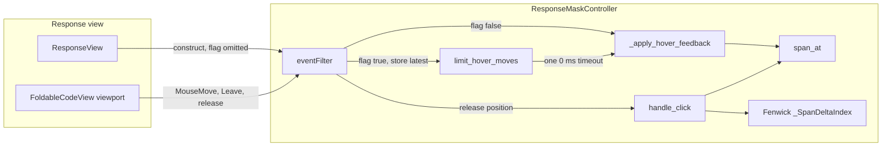
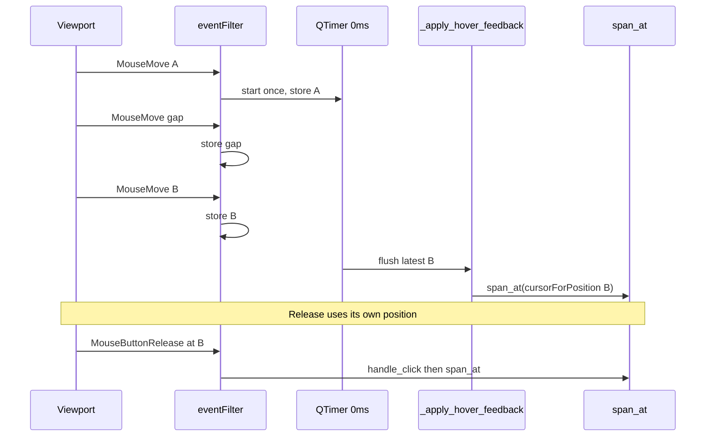

# PYPOST-1548: Optional limit on mask hover feedback

## Research

### Current mouse-move path

`ResponseMaskController` in
`pypost/ui/widgets/response_mask_controller.py` is the mask interaction
coordinator. The constructor installs an event filter on
`FoldableCodeView.viewport()` and turns mouse tracking on, so a move is
delivered with no button held:

```244:260:pypost/ui/widgets/response_mask_controller.py
    def __init__(
        self,
        code_view: FoldableCodeView,
        response_view: Any = None,
    ) -> None:
        super().__init__(code_view)
        self.code_view = code_view
        self.response_view = response_view
        self._spans: list[MaskedTokenSpan] = []
        self._deltas: _SpanDeltaIndex = _SpanDeltaIndex(0)
        self._reveal_state: dict[str, bool] = {}
        self._force_viewport_clicks: bool = False

        self.code_view.viewport().installEventFilter(self)
        self.code_view.viewport().setMouseTracking(True)
```

The only production caller is `ResponseView`, and it passes no extra
argument:

```125:125:pypost/ui/widgets/response_view.py
        self.mask_controller = ResponseMaskController(self.body_view, self)
```

There is no settings key, environment flag, or product control for how
often mask hover runs. A new public setting would be a new surface. The
optional limit belongs on the constructor.

`span_at` is the PYPOST-1390 lookup: `bisect_right` on display
`start_pos`, then an inclusive end check. Display coordinates come from
the PYPOST-1547 Fenwick prefix (`_SpanDeltaIndex`). Hover and click both
ask `span_at` for the character under the pointer.

On `QEvent.Type.MouseMove` the filter does that lookup and then updates
the viewport cursor and `QToolTip` before it returns:

```431:445:pypost/ui/widgets/response_mask_controller.py
            if event.type() == QEvent.Type.MouseMove and isinstance(event, QMouseEvent):
                pos = event.position().toPoint()
                char_pos = self.code_view.cursorForPosition(pos).position()
                span = self.span_at(char_pos)
                if span is not None:
                    self.code_view.viewport().setCursor(Qt.CursorShape.PointingHandCursor)
                    tooltip_text = "Click to re-mask" if span.is_revealed else "Click to reveal"
                    QToolTip.showText(
                        event.globalPosition().toPoint(),
                        tooltip_text,
                        self.code_view.viewport(),
                    )
                else:
                    self.code_view.viewport().setCursor(Qt.CursorShape.IBeamCursor)
                    QToolTip.hideText()
```

A left release with no text selection maps the release position the same
way and calls `handle_click`, which calls `span_at` again and toggles
that span. `Leave` restores the I-beam cursor and hides the tooltip.
`MouseMove` does not accept the event. The filter returns the base
`eventFilter` result.

The per-move cost left after PYPOST-1390 is this cursor and tooltip work.
[PYPOST-1390 tech debt TD-2](ai-tasks/PYPOST-1390/60-tech-debt.md) records
that event volume on purpose and points it at this ticket. `span_at`
stays O(log N) probes. The Fenwick index stays the PYPOST-1547 index.
Which fields `JsonMaskFormatter` masks stays the current selector set.

### Qt delivery of pointer motion

Qt 6 documents a zero-interval `QTimer` as firing once the window-system
queue has been processed. `QTimer.singleShot` schedules one callback per
call. It does not merge those calls. Coalescing is the caller's job:
keep the latest point, and arm one timer
([QTimer](https://doc.qt.io/qt-6/qtimer.html), Qt 6.12).

`QApplication` compresses some posted events (`Resize`, `Move`,
`UpdateRequest`, layout, language change). `MouseMove` is outside that
set, so each move the filter receives is still a separate event
([qapplication.cpp](https://codebrowser.dev/qt6/qtbase/src/widgets/kernel/qapplication.cpp.html)).

`Qt.AA_CompressHighFrequencyEvents` can merge spontaneous `MouseMove`
events on X11, where it defaults on. On Windows it applies to touch, and
mouse moves stay uncompressed. Other platforms default the attribute
off. Wayland support landed later and flushes the last pending move with
a 0 ms timer
([ApplicationAttribute](https://doc.qt.io/qt-6/qt.html#ApplicationAttribute-enum),
[Wayland compress](https://github.com/qt/qtbase/commit/095759818854e5a011aa8f859e566bbc6368ab76)).
The attribute is process-wide. `QCoreApplication.sendEvent` in a test
delivers the event immediately and does not go through that platform
compress. The mask controller has to apply its own limit.

`QToolTip.showText` during mouse tracking is Qt's immediate-tooltip path.
This filter already calls it on every move
([QWidget.mouseMoveEvent](https://doc.qt.io/qt-6/qwidget.html#mouseMoveEvent)).

### Closed choice

The limit is a trailing coalesce of viewport `MouseMove` hover feedback,
armed only when `limit_hover_moves=True`.

While a single-shot 0 ms timer is idle, the first move stores the local
point and the global point and starts the timer. Further moves before
that timer fires replace those two points and do not start another
timer. When the timer fires, hover feedback runs once for the stored
latest point, through the same `cursorForPosition` and `span_at` steps
the click uses. The click path keeps reading the release event. It does
not read the stored hover point.

These candidates were compared, and the first one is the limit:

- **Trailing 0 ms coalesce, arm once (chosen).** A burst keeps the
  newest point and runs one cursor and tooltip pass on the next turn.
  That pass calls `span_at`. There is no millisecond constant. One
  `processEvents` flushes it.
- **Fixed millisecond throttle.** A chosen wait would cap the rate.
  [NFR-5](10-requirements.md) fixes no interval, and the red test would
  sleep.
- **Restart the 0 ms timer on every move.** The pass waits until the
  queue is idle, so hover stays on an older place for the whole drag.
- **Every Nth move.** The last move is kept only when it is the Nth, so
  stopping elsewhere leaves hover on an older place.
- **Skip when the span is unchanged.** A sweep across many values still
  runs feedback once per move.
- **`AA_CompressHighFrequencyEvents`.** This attribute is process-wide.
  Windows mouse moves stay uncompressed, and `sendEvent` bypasses it.

The flag defaults to false. With it false, `MouseMove` still applies
cursor and tooltip inside the filter before the filter returns. No timer
is created. `ResponseView` keeps the two-argument constructor call, so
today's hover and click results stay.

## Implementation Plan

1. Step 3 writes the red test below. It does not edit production code.
2. Step 4 adds the keyword-only constructor flag and the trailing
   coalesce on `ResponseMaskController`. The default branch stays a
   synchronous hover apply. `span_at`, the Fenwick index, click toggle
   text, and `JsonMaskFormatter` stay as they are.
3. The enabled path shares one hover-apply helper with the default path,
   so both call `span_at` and then the same cursor and tooltip updates.
4. `make test` is the suite command. The new module uses timeout 30.

**Mandatory — Failing Repro (next Step 3):** The default path stays
synchronous, so the red test is the enabled limit.

- **File:** `tests/test_pypost_1548_failing_repro.py`
- **Test:** `test_enabled_hover_limit_coalesces_rapid_moves_and_keeps_latest_span`
- **Timeout:** module `pytestmark = pytest.mark.timeout(30)`. Signal
  timeout. No `method="thread"`. No `threading.Event`. No `QTest.qWait`.
- **Harness:** request the `qapp` fixture from `tests/conftest.py`.
  `make test` already sets `QT_QPA_PLATFORM=offscreen`.
- **Fixture:** a `FoldableCodeView` plus
  `ResponseMaskController(view, limit_hover_moves=True)`. Two
  non-overlapping spans in the PYPOST-1547 layout at count 2: a prefix,
  a mask, a gap of at least two characters, a second mask, and a tail.
  `setPlainText` the matching document, then `set_masked_spans`. Resize
  and `show` the view. Call `qapp.processEvents()` once so layout exists
  before any move. That drain happens before the timer is armed.
- **Points:** for span A and span B use `start_pos + 1`. For the gap use
  a character where `span_at` returns `None` (the inclusive end is still
  a hit; the next character in a gap of length at least 2 is a miss).
  Build each viewport point from `cursorRect`. Accept the center or one
  of the four inset corners of that rect, a fixed set of five
  candidates, and require `cursorForPosition` to round-trip to the
  intended character. Fail the fixture when none do.
- **Burst:** three `QMouseEvent` values of type `MouseMove`, button
  `NoButton`, distinct global positions. Deliver each with
  `QCoreApplication.sendEvent` on the viewport. Do not call
  `processEvents` between them. `sendEvent` runs the filter before it
  returns and leaves a posted 0 ms timer unprocessed.
- **Assert before the flush:** patched
  `pypost.ui.widgets.response_mask_controller.QToolTip.showText` and
  `viewport.setCursor` were not called. Three moves produced zero hover
  feedback passes.
- **Flush:** one `qapp.processEvents()` call. That is a single drain, not
  a poll.
- **Assert after the flush:** `showText` ran once, and its global point
  is the third move's global point. `setCursor` ran once with
  `PointingHandCursor`. `span_at` at the third character is span B.
  `handle_click` at that character toggles span B and leaves span A
  masked. The click reads that character through `span_at`. It does not
  read the stored hover point.
- **Cleanup:** `viewport.removeEventFilter(controller)`, `clear()`,
  `view.close()`, matching the 1390 and 1547 controller tests, so
  teardown does not re-enter the filter.
- **Red today:** the constructor has no `limit_hover_moves` parameter, so
  construction raises `TypeError`. A flag that is accepted and ignored
  still fails, because each `sendEvent` would apply hover immediately and
  the pre-flush count would be above zero.
- **Sequencing:** this research is done. Next is the red test. The
  production coalesce waits until that test fails for the reason above.
  Step 4 turns the same test green.

The default constructor and the `ResponseView` call site stay on today's
path. Step 3 does not add a second test for that path. Existing hover
and click suites already cover it.

## Architecture

### Modules

| Module | Responsibility |
| --- | --- |
| `ResponseMaskController` | Spans, reveal memory, hover, click, and the optional move limit |
| `FoldableCodeView` viewport | `MouseMove`, release, and `Leave`. Tracking stays on |
| `span_at` | Inclusive hit test for hover apply and `handle_click` |
| `_SpanDeltaIndex` | Fenwick prefix from PYPOST-1547. Stays |
| Cursor and `QToolTip` | Hover sinks. Once per move, or once per armed turn |
| `ResponseView` | Builds the controller with the limit off |
| `JsonMaskFormatter` | Which fields are masked. Stays |

### Diagram



### Interactions

Default flag (`limit_hover_moves=False`):

1. `MouseMove` on the viewport enters `eventFilter`.
2. The filter calls `_apply_hover_feedback` with the event's local point
   and global point before it returns.
3. The helper maps the local point with `cursorForPosition`, calls
   `span_at`, then sets the pointing-hand cursor and shows
   `"Click to reveal"` or `"Click to re-mask"`, or sets the I-beam and
   hides the tooltip.
4. No timer exists. A burst still produces one helper call per move.

Enabled flag (`limit_hover_moves=True`):

1. The constructor creates one single-shot `QTimer` parented to the
   controller, interval 0, connected to `_flush_limited_hover`.
2. `MouseMove` stores the local point and the global point. When
   `_hover_move_waiting` is false, it sets that flag and starts the
   timer. When the flag is true, it leaves the timer alone.
3. The move handler does not call `span_at`, `setCursor`, or
   `QToolTip`.
4. `_flush_limited_hover` returns immediately when the waiting flag is
   false. Otherwise it clears the flag, reads the stored points, and
   calls `_apply_hover_feedback` once.
5. A later move during that wait overwrites the points, so the single
   pass names the newest place.
6. `MouseButtonRelease` is unchanged. It maps the release position and
   calls `handle_click`. `handle_click` calls `span_at` on that
   character. Extra stored moves are not an input.
7. `Leave`, `clear`, and `clear_spans` set the waiting flag false, stop
   the timer, and drop the stored points, then perform today's cursor
   and tooltip reset. A timeout that was already posted finds the flag
   clear and does not apply a stale point.



### Patterns

- **Opt-in flag.** Two behaviors, one boolean, default false. The
  product caller omits it. That keeps today's results and avoids a new
  settings key.
- **Trailing coalesce.** Store the latest sample and arm one zero timer.
  Qt uses that shape to publish the last pending pointer sample after a
  backlog. Here it is scoped to mask hover feedback.
- **One apply helper.** Default moves and the timer both call
  `_apply_hover_feedback`. Click keeps its own `span_at` call inside
  `handle_click`, so skipped moves cannot retarget a click.

A separate coalescer type would only forward two points and one boolean.
The controller already owns the filter, so the timer and the pending
point stay on `ResponseMaskController`.

### Interfaces

Constructor, keyword-only flag after the existing positional arguments:

```python
def __init__(
    self,
    code_view: FoldableCodeView,
    response_view: Any = None,
    *,
    limit_hover_moves: bool = False,
) -> None:
```

`ResponseMaskController(view)` and `ResponseMaskController(view, self)`
keep today's meaning. `limit_hover_moves=True` is the only way to enable
the limit.

Hover apply, used by the default move branch and by the timer:

```python
def _apply_hover_feedback(self, local_pos: QPoint, global_pos: QPoint) -> None:
```

The body is the current move branch: `cursorForPosition`, `span_at`,
pointing hand plus `QToolTip.showText`, or I-beam plus
`QToolTip.hideText`. Tooltip wording stays `"Click to reveal"` and
`"Click to re-mask"`.

Timer slot, present in behavior only when the flag is true:

```python
def _flush_limited_hover(self) -> None:
```

State when the flag is true:

| Field | Type | Role |
| --- | --- | --- |
| `_limit_hover_moves` | `bool` | Copy of the constructor flag |
| `_hover_move_timer` | `QTimer` | Single-shot, interval 0, child of the controller |
| `_hover_move_waiting` | `bool` | True after arming, until flush, leave, or clear |
| `_hover_move_local` | `QPoint` or `None` | Latest viewport point |
| `_hover_move_global` | `QPoint` or `None` | Latest global point for `QToolTip.showText` |

When the flag is false those timer fields are absent. The move branch
calls `_apply_hover_feedback` and returns through `super().eventFilter`.
`MouseMove` still does not consume the event.

Unchanged signatures: `span_at(char_pos: int)`,
`handle_click(char_pos: int)`, `eventFilter(watched, event)`,
`set_masked_spans`, `clear`, `clear_spans`. `clear` and `clear_spans`
gain a cancel of a pending hover only when the flag is true, then keep
their current cursor, tooltip, span, and reveal-memory behavior.

### Stays in place

- `_SpanDeltaIndex`, span bind and unbind, and `_replace_span_text`.
- The `bisect_right` body of `span_at`.
- Reveal and hide text: `raw_value` and `masked_value`.
- The selector set inside `JsonMaskFormatter` and `format_masked_json`.
- Later click targets after a toggle, as delivered by PYPOST-1547.
- `ResponseView` construction of the controller.

## Q&A

- **Q:** Which optional limit is the design?
  **A:** Trailing coalesce of mask `MouseMove` hover feedback to the
  latest pointer point, one apply per armed event-loop turn, behind
  `limit_hover_moves=False` by default. The timer interval is 0.
  Further moves while it is armed replace the stored point and do not
  restart it.
- **Q:** Where does the caller turn it on?
  **A:** The constructor keyword. There is no existing product setting
  for this rate, so none is added. `ResponseView` keeps
  `ResponseMaskController(self.body_view, self)`.
- **Q:** What does a click hit while moves are being coalesced?
  **A:** The character under the release event, through `handle_click`
  and `span_at`. The stored hover point is not an input. After the
  timer fires, hover feedback for that latest point uses `span_at` on
  the same helper the default path uses, so the place it describes is
  the click target for that place.
- **Q:** What happens to the Fenwick index and to masked fields?
  **A:** Both stay. This ticket limits how often cursor and tooltip work
  runs. It does not change hit coordinates or which fields are masked.
- **Q:** What is the Step 3 red test?
  **A:** `tests/test_pypost_1548_failing_repro.py`. With the flag on,
  three synchronous viewport moves apply hover feedback zero times until
  one `processEvents`, then once, for the latest global point, and
  `handle_click` at that character toggles that span. Timeout 30.
  `make test`.
