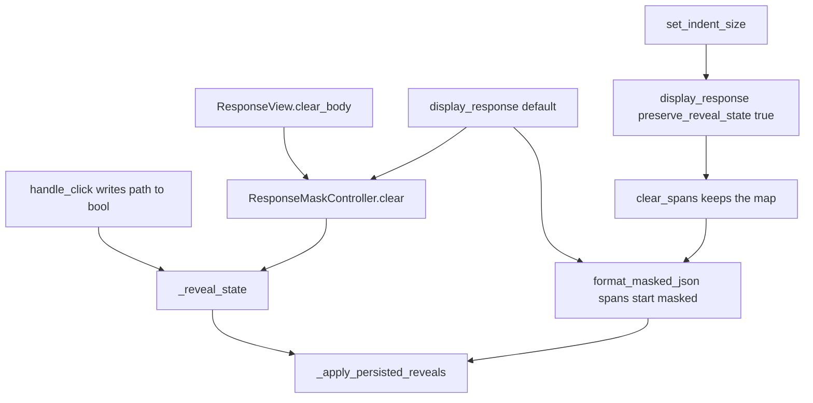

# PYPOST-1549: Clear forgets a reveal; hide-again survives indent

## Research

### What the product already does

Reveal choices live on `ResponseMaskController` as `_reveal_state`, a
`dict[str, bool]` keyed by the canonical selector path. `handle_click`
writes that map after every toggle, including a click that masks a value
again. `JsonMaskFormatter.format` always builds new `MaskedTokenSpan`
objects with `is_revealed=False`. `set_masked_spans` then runs
`_apply_persisted_reveals`, which expands a span to `raw_value` only when
the map stores true for that path.

`ResponseView.clear_body` calls `mask_controller.clear()`, which empties
`_reveal_state`, and it drops `_last_response` and `_last_hidden_fields`.
The next `display_response` uses the default `preserve_reveal_state=False`,
so it calls `clear()` again and paints formatter spans that start masked.
An empty map restores nothing. The same body text does not refill the map:
there is no content comparison on this path. `TabsPresenter` reaches this
through `response_view.clear_body()`.

`ResponseView.set_indent_size` calls `display_response` on `_last_response`
with `preserve_reveal_state=True`. That call uses `clear_spans()`, which
keeps the map, then formats the same response again. A path stored as
false is skipped by `_apply_persisted_reveals`. A path stored as true is
expanded. A path that was never written stays masked because the lookup
defaults to false. Each field keeps its own entry.

The synchronous branch is `format_masked_json` inside `display_response`
for a small JSON body. That is the branch
`tests/test_pypost_1392_failing_repro.py` already drives. The background
`ResponseMaskWorker` path is PYPOST-1550. Pruning unused map keys is
PYPOST-1551.

### Coverage that already exists

`tests/test_pypost_1392_failing_repro.py` shows two outcomes:

- One revealed field stays visible after `set_indent_size`, and a sibling
  that was never revealed stays masked.
- A different response body starts masked.

Those tests do not call `clear_body`. They do not mask a revealed field
again before the indent change. Parent
[PYPOST-1392 tech debt TD-1](ai-tasks/PYPOST-1392/60-tech-debt.md) records
that missing demonstration. The parent design already assigned the wipe to
`clear()` and the restore rule to the path map
([PYPOST-1392 architecture](ai-tasks/PYPOST-1392/20-architecture.md),
[hidden response fields](doc/dev/hidden_response_fields.md)).

### Characterization tests

A characterization test records behavior the code already has, so later
edits can see when that behavior moves
([Michael Feathers, Characterization Testing](https://michaelfeathers.silvrback.com/characterization-testing)).
Holding the code still and writing the test against it is the matching
move when the implementation is already the contract
([Fixity and Intention](https://michaelfeathers.substack.com/p/fixity-and-intention)).

Feathers's scratch assertion, the one written to fail so the failure can
report an unknown result, is a discovery trick. It is the wrong Step 3
here. The required results were read off the existing calls: `clear_body`
empties the map, and a stored false survives indent because restore
honors only true. A red test of those outcomes would pass on current code.

## Implementation Plan

1. Leave production modules as they are. `ResponseView.clear_body`,
   `ResponseView.set_indent_size`, `ResponseView.display_response`,
   `ResponseMaskController.clear`, `clear_spans`, `handle_click`,
   `set_masked_spans`, and `_apply_persisted_reveals` already implement
   the clear outcome and the hide-again outcome.
2. Step 4 adds a characterization module that is green on current code.
   It sits beside `tests/test_pypost_1392_failing_repro.py` and does not
   edit that file. Harness matches that file: module
   `pytestmark = pytest.mark.timeout(60)`, the `qapp` fixture, one
   `ResponseView(indent_size=2)`, `ResponseData` JSON bodies,
   `handle_click` at a span's current `start_pos + 1`, and `view.close()`
   in `finally`. Bodies stay small so display uses `format_masked_json`
   on the calling thread. No network and no `ResponseMaskWorker`.
3. Clear demonstration. Display two hidden fields. Reveal one with
   `handle_click`. Call `clear_body()`. Call `display_response` again
   with a new `ResponseData` whose body text equals the cleared body and
   with the same hidden-field names, leaving `preserve_reveal_state` at
   its default. Both spans are `is_revealed is False`. Neither secret
   appears in `body_view.toPlainText()`. The mask text `"***"` does.
4. Hide-again demonstration. Display three hidden fields. Reveal the
   first, then click it again so the map stores false. Reveal the second
   and leave it. Leave the third untouched. Look up each span by path
   immediately before its click, because a reveal changes later offsets.
   Call `set_indent_size(4)`. After the reformat, the first span is
   masked and its secret is absent, the second is revealed and its secret
   is visible, and the third is masked and its secret is absent.
5. Later quality gates use `make test` with `PYTEST_ARGS` pointed at the
   new module, then `make check`. This step runs neither.

**Mandatory — Failing Repro (next Step 3):** `N/A — no behavioral change`.
`clear_body` already discards reveal memory, and a re-mask is already
stored as false so an indent reformat of the same response leaves that
field masked, a field left revealed visible, and a field never revealed
masked. Step 4 writes those two demonstrations as characterization tests
that pass on the current code. A red test would be green immediately, so
it is not a failing repro.

## Architecture

No new module, interface, or pattern. The tests call the view and the
controller the product already uses.



### Modules and responsibilities

| Module | Responsibility |
| --- | --- |
| `ResponseView` | `clear_body` wipes the controller and the last-response cache. `set_indent_size` redisplays `_last_response` with reveal memory kept. `display_response` chooses `clear` or `clear_spans`. |
| `ResponseMaskController` | Owns `_reveal_state`. `handle_click` stores the toggled bool. `clear` drops the map. `clear_spans` keeps it. `set_masked_spans` restores only paths stored as true. |
| `JsonMaskFormatter` / `format_masked_json` | Emits a new masked span per matched field, `is_revealed=False`, path from `JsonSelectorEngine.canonical_path`. |
| `TabsPresenter` | Calls `response_view.clear_body()` for the open tab. Unchanged. The new tests call `ResponseView` directly, as the existing indent tests do. |
| `tests/test_pypost_1549_clear_and_remask.py` | Step 4 characterization only. Two cases: clear then the same body text, and re-mask plus a left-revealed field plus a never-revealed field across `set_indent_size`. |

### Patterns already in use

- **Identity-keyed store.** The bool is stored by canonical path. Indent
  rebuilds character offsets; the path does not change for the same field.
- **Explicit preserve flag.** Indent opts in with
  `preserve_reveal_state=True`. `clear_body` and a later
  `display_response` take the full `clear()`.
- **Restore only stored reveals.** New spans start masked.
  `_apply_persisted_reveals` writes `raw_value` only for a true entry.
  False and a missing key both leave the mask in place.

### Interfaces

These signatures stay as they are:

```text
ResponseMaskController.clear() -> None
ResponseMaskController.clear_spans() -> None
ResponseMaskController.handle_click(char_pos: int) -> bool
ResponseMaskController.set_masked_spans(spans) -> None

ResponseView.clear_body() -> None
ResponseView.set_indent_size(size: int) -> None
ResponseView.display_response(
    response, hidden_fields=None, *, preserve_reveal_state=False
) -> None
```

`handle_click` assigns `_reveal_state[span.path] = span.is_revealed`
after the toggle when `span.path` is non-empty. Restore continues past a
span when `_reveal_state.get(span.path, False)` is false.

## Q&A

**Q:** Why is Step 3 `N/A — no behavioral change`?

**A:** The clear wipe and the false entry for a re-mask are already in
`ResponseView` and `ResponseMaskController`. The missing piece is a test
that exercises them. Step 4 adds that test and expects it to pass.
[Characterization Testing](https://michaelfeathers.silvrback.com/characterization-testing)
describes tests that lock behavior the code already shows.

**Q:** After a clear, can the same JSON text bring the reveal back?

**A:** The next `display_response` starts from an empty map and from
spans whose `is_revealed` is false. Matching body text is not a key in
`_reveal_state`. The characterization uses a new `ResponseData` with the
same body text so that case is the one the test runs.

**Q:** Why does a re-mask stay masked when indent rebuilds the document?

**A:** The second click stores false for that path. `set_indent_size`
keeps the map and asks `_apply_persisted_reveals` to expand only true
paths. The re-masked field is painted from the new masked span. A field
left revealed stays on true and is expanded. A field never clicked has
no entry and stays masked.

**Q:** Why three hidden fields in the indent test?

**A:** One refresh has to show the re-mask, the value left revealed, and
a value never revealed. The existing indent test already covers a single
reveal beside a never-revealed sibling. It does not click a revealed
field a second time.

**Q:** Does this change which fields start masked, hover, or click
targets?

**A:** The characterization uses the same hidden-field names, the same
`"***"` mask, and `handle_click` on the controller. Hover feedback,
`span_at`, and the formatter's field set stay as they are.

**Q:** Does this include the background reformat or map pruning?

**A:** Background reformat of a longer response stays on
[PYPOST-1550](https://pypost.atlassian.net/browse/PYPOST-1550).
Cleanup of leftover reveal keys stays on
[PYPOST-1551](https://pypost.atlassian.net/browse/PYPOST-1551).
The new tests stay on the small synchronous `format_masked_json` path.
