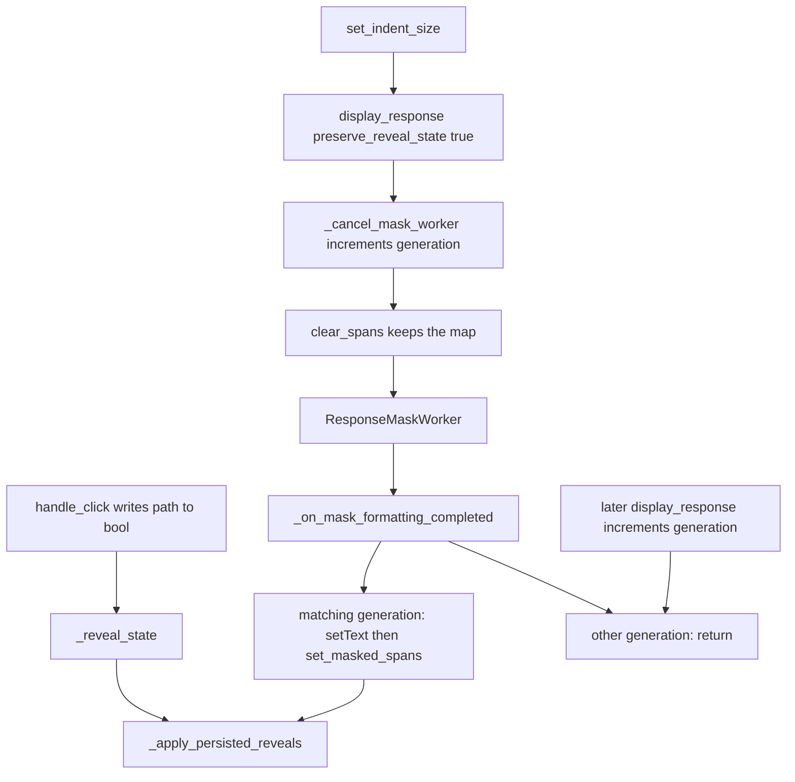

# PYPOST-1550: Longer-response indent keeps reveal choices

## Research

### What the product already does

A longer response is a JSON body at or above `MEDIUM_DOC_CHAR_THRESHOLD`
(50 × 1024 characters) and at or below `LARGE_DOC_CHAR_THRESHOLD`
(100 × 1024). `ResponseView.display_response` sends that body, when it
has hidden fields, to `ResponseMaskWorker`. The worker calls
`format_masked_json` off the UI thread and emits
`formatting_completed(generation, formatted_text, spans)`.
`JsonMaskFormatter.format` builds each `MaskedTokenSpan` with
`is_revealed=False` and a canonical `path`.

`ResponseView.set_indent_size` stores the new size and, when
`_last_response` is set, calls `display_response` on that same response
with `preserve_reveal_state=True`. That call always starts with
`_cancel_mask_worker`, which increments `_mask_format_generation` and
asks any running worker to stop. Preserve then calls
`mask_controller.clear_spans()`, which drops the old spans and keeps
`_reveal_state`. The new worker is constructed with the generation value
after that increment and with the new `indent`.

When that worker's completion matches `_mask_format_generation`,
`_on_mask_formatting_completed` clears the placeholder, `setText`s the
formatted body, and calls `set_masked_spans`. `set_masked_spans` runs
`_apply_persisted_reveals`. A path stored as true is expanded to
`raw_value` and marked revealed. A path stored as false, and a path
with no entry, stays on the formatter's mask. `handle_click` writes
`_reveal_state[span.path] = span.is_revealed` after every toggle, so the
value the person revealed is the true entry and the value they left
hidden is either false or absent.

A newer `display_response` or `clear_body` increments the generation
again before it paints. `_on_mask_formatting_completed` returns when
`generation != self._mask_format_generation`, before `setText` and
before `set_masked_spans`. The newer document and the reveal choices
already on it stay as they are. `_on_mask_formatting_failed` uses the
same comparison. Cooperative `requestInterruption` often stops the old
worker from emitting; the generation check is what drops a completion
that was already emitted.

Each `ResponseView` owns its controller, its `_reveal_state`, and its
`_mask_format_generation`. `TabsPresenter` still calls
`response_view.set_indent_size` per tab. The signal is connected to the
view that started the worker.

While a longer format is in flight, `display_response` clears the editor
and shows the placeholder `Formatting masked response...`. That wait is
the medium-document display from PYPOST-1396. The outcomes in this
ticket are the document after the current completion applies spans, and
a late completion whose generation is no longer current.

### Coverage that already exists

`tests/test_pypost_1392_failing_repro.py` drives the short path: one
revealed field stays visible after `set_indent_size`, and a sibling
never revealed stays masked. Those bodies stay under the medium
threshold, so `format_masked_json` runs on the calling thread.

`tests/test_response_mask_worker.py` already shows medium dispatch,
click-to-reveal after a background format, preemption when a second
medium response arrives while the first worker is running, and
`clear_body` leaving an empty document after a late worker. It does not
change indent after a reveal on a medium body. It does not reveal a
value on the newer display and then deliver a finished result for the
older generation.

`tests/test_pypost_1549_clear_and_remask.py` stays on the short path.
Pruning unused `_reveal_state` keys stays on PYPOST-1551.

Parent
[PYPOST-1392 architecture](ai-tasks/PYPOST-1392/20-architecture.md)
already assigned restore to `set_masked_spans` and told the worker
completion to use that hook. Parent TD-2 records the missing
medium-document demonstration
([PYPOST-1392 tech debt](ai-tasks/PYPOST-1392/60-tech-debt.md)).
The generation gate is the one
[PYPOST-1396](doc/dev/response_mask_worker.md) added so a superseded
worker cannot paint the view.

### Characterization tests

A characterization test records behavior the code already has, so later
edits can see when that behavior moves
([Michael Feathers, Characterization Testing][feathers-char]).
Holding the code still and writing the test against it is the matching
move when the implementation is already the contract
([Fixity and Intention](https://michaelfeathers.substack.com/p/fixity-and-intention)).

[feathers-char]: https://michaelfeathers.silvrback.com/characterization-testing

The required results were read off the existing calls. Indent preserve
on a longer body uses the same `clear_spans` plus `set_masked_spans`
restore as the short path, and a late completion hits the generation
return before it touches the document. A red test of those outcomes
would pass on current code.

## Implementation Plan

1. Leave production modules as they are. `ResponseView.set_indent_size`,
   `display_response`, `_cancel_mask_worker`, and
   `_on_mask_formatting_completed`, together with
   `ResponseMaskWorker` and `ResponseMaskController.set_masked_spans` /
   `_apply_persisted_reveals`, already implement both outcomes.
2. Step 4 adds one characterization module, green on current code. It
   sits beside the existing response tests and does not edit
   `tests/test_pypost_1392_failing_repro.py`,
   `tests/test_response_mask_worker.py`, or
   `tests/test_pypost_1549_clear_and_remask.py`. Harness: module
   `pytestmark = pytest.mark.timeout(60)` (GUI test that pumps the event
   loop), the `qapp` fixture, `ResponseView(indent_size=2)`,
   `ResponseData` JSON bodies, `handle_click` at the current span's
   `start_pos + 1`, `tests.helpers.process_until.process_until` with a
   10 second bound, and `view.close()` in `finally`. No network.
3. Longer-response indent. Build one JSON object with two hidden
   fields, `token` and `password`, plus padding so
   `MEDIUM_DOC_CHAR_THRESHOLD <= len(body) <= LARGE_DOC_CHAR_THRESHOLD`.
   `display_response` with those hidden fields, then wait until
   `_mask_worker` is `None` and both spans exist. Reveal `token` only.
   Call `set_indent_size(4)`. Wait until the new worker is `None` and
   spans exist again. The `token` span is `is_revealed is True` and its
   secret is in `body_view.toPlainText()`. The `password` span is
   `is_revealed is False`, its secret is absent, and `"***"` is present.
   The applied text uses indent 4 (`{\n    "`), so the assertion is the
   completion for the new indent, not an older indent-2 document that
   merely still contains the secret.
4. Stale background result. Display a longer body and keep the worker
   and the generation captured after that call. Immediately display a
   different, short JSON response with two hidden fields so the second
   `display_response` increments the generation and applies on the
   calling thread. Reveal one field and leave the other hidden.
   Snapshot status, plain text, and both `is_revealed` flags. Call
   `_on_mask_formatting_completed` with the captured older generation,
   a formatted string that contains a marker absent from the snapshot,
   and an empty span list. Wait for the superseded worker with a
   bounded `wait`. Status, plain text, both flags, and both secrets
   match the snapshot. The marker is absent.
5. The characterization reads visible text and `is_revealed` on the
   spans `spans()` returns. It does not assert the size of
   `_reveal_state` and does not delete leftover keys. It does not call
   `clear_body`, and it does not re-mask a short response.
6. Later quality gates use `make test` with `PYTEST_ARGS` pointed at the
   new module, then `make check`. This step runs neither.

**Mandatory — Failing Repro (next Step 3):** `N/A — no behavioral change`.
An indent change of a longer response already redisplays that response
with reveal memory kept, and the worker completion already restores
revealed paths and leaves hidden paths masked. A completion whose
generation is no longer current already returns before it replaces the
document or the reveal choices on it. Step 4 writes those two
demonstrations as characterization tests that pass on the current code.
A red test would be green immediately, so it is not a failing repro.

## Architecture

The product modules stay as they are. The tests call the view, the
worker, and the controller the product already uses.



### Modules and responsibilities

- `ResponseView`: `set_indent_size` redisplays `_last_response` with
  `preserve_reveal_state=True`. `display_response` bumps the generation,
  chooses `clear_spans` or `clear`, and starts `ResponseMaskWorker` for
  a longer masked JSON body. `_on_mask_formatting_completed` applies
  text and spans only when the generation matches.
- `ResponseMaskController`: Owns `_reveal_state`. `handle_click` stores
  the toggled bool. `clear_spans` keeps the map. `set_masked_spans`
  restores only paths stored as true.
- `ResponseMaskWorker`: Runs `format_masked_json` for one generation
  and indent. Emits `formatting_completed` with that generation. Drops
  the emit when interruption was requested first.
- `JsonMaskFormatter` / `format_masked_json`: Emits a new masked span
  per matched field, `is_revealed=False`, path from
  `JsonSelectorEngine.canonical_path`.
- `TabsPresenter`: Still calls `response_view.set_indent_size` on each
  tab. Unchanged. The new tests call `ResponseView` directly, as the
  existing indent tests do.
- `tests/test_pypost_1550_medium_indent_preserve.py`: Step 4
  characterization only. One case: reveal and hide survive indent after
  the worker applies the new indent. One case: a finished older
  generation leaves the newer display and its reveal choices.

### Patterns already in use

- **Identity-keyed store.** The bool is stored by canonical path. Indent
  rebuilds character offsets; the path does not change for the same
  field.
- **Explicit preserve flag.** Indent opts in with
  `preserve_reveal_state=True`. A different response uses the default
  and takes a full `clear()`.
- **Restore only stored reveals.** New spans start masked.
  `_apply_persisted_reveals` writes `raw_value` only for a true entry.
  False and a missing key both leave the mask in place.
- **Monotonic generation gate.** `_mask_format_generation` advances on
  every `display_response` and `clear_body`. The worker carries the
  value from the call that started it. The completion slot applies a
  result only when that value is still current.

### Interfaces

These signatures stay as they are:

```text
ResponseMaskController.clear() -> None
ResponseMaskController.clear_spans() -> None
ResponseMaskController.handle_click(char_pos: int) -> bool
ResponseMaskController.set_masked_spans(spans) -> None

ResponseView.set_indent_size(size: int) -> None
ResponseView.display_response(
    response, hidden_fields=None, *, preserve_reveal_state=False
) -> None
ResponseView._cancel_mask_worker() -> None
ResponseView._on_mask_formatting_completed(
    generation: int, formatted_text: str, spans: list
) -> None

ResponseMaskWorker(
    generation: int, raw_body: str, hidden_fields, indent: int = 2
)
ResponseMaskWorker.formatting_completed: Signal(int, str, list)
ResponseMaskWorker.formatting_failed: Signal(int, str)
```

`handle_click` assigns `_reveal_state[span.path] = span.is_revealed`
after the toggle when `span.path` is non-empty. Restore continues past a
span when `_reveal_state.get(span.path, False)` is false. The completion
slot returns before `setText` when `generation` differs from
`_mask_format_generation`.

## Q&A

**Q:** Why is Step 3 `N/A — no behavioral change`?

**A:** Both outcomes are already in `ResponseView`,
`ResponseMaskWorker`, and `ResponseMaskController`. The missing piece is
a test that exercises the longer-response indent and a late completion
against a newer display that has its own reveal choices. Step 4 adds
that test and expects it to pass.
[Characterization Testing](https://michaelfeathers.silvrback.com/characterization-testing)
describes tests that lock behavior the code already shows.

**Q:** What happens to a revealed value when the longer indent finishes?

**A:** `set_indent_size` keeps `_reveal_state` and starts a worker with
the new indent. The matching completion calls `set_masked_spans`, which
expands every path stored as true. The value left hidden has no true
entry, so it stays on the mask the formatter emitted.

**Q:** The editor is cleared while the worker runs. Is that a missing reveal?

**A:** That placeholder is the existing medium-document wait. This
ticket's indent outcome is the document after the current completion
applies spans. The characterization waits for that apply, then checks
the revealed value and the hidden value.

**Q:** How does a late older format leave a newer display alone?

**A:** The newer `display_response` increments `_mask_format_generation`
before it paints. A completion that still carries the older generation
returns in `_on_mask_formatting_completed` before `setText` and before
`set_masked_spans`. Status, text, and reveal flags on the newer display
stay as they were. The characterization delivers that older generation
after a reveal on the newer display so the check is the one under test.
`tests/test_response_mask_worker.py` already covers a second medium
response arriving while the first worker is still running.

**Q:** Why is the newer display in the stale test a short response?

**A:** The older work is the longer response's background format. The
short second body is applied before that completion is delivered, and
it has spans the test can reveal immediately. The generation check is
the same slot the medium path uses.

**Q:** Does this change which fields start masked, hover, or click targets?

**A:** The characterization uses the same hidden-field names, the same
`"***"` mask, and `handle_click` on the controller. Hover feedback,
`span_at`, and the formatter's field set stay as they are.

**Q:** Does this include clearing the body, the short indent path, or leftover keys?

**A:** Clearing the body and short-response re-mask stay as already
promised on
[PYPOST-1549](https://pypost.atlassian.net/browse/PYPOST-1549).
Indent persistence for a short response stays demonstrated by
`tests/test_pypost_1392_failing_repro.py`. Cleanup of leftover reveal
keys stays on
[PYPOST-1551](https://pypost.atlassian.net/browse/PYPOST-1551).
The new tests do not assert map size.
