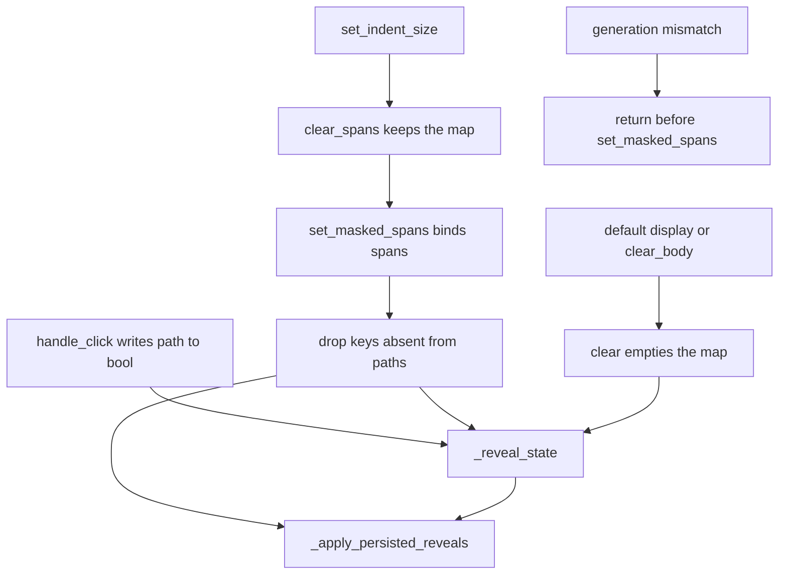

# PYPOST-1551: Forget reveal choices for fields that have left

## Research

### What the product already does

Reveal choices live on `ResponseMaskController` as `_reveal_state`, a
`dict[str, bool]` keyed by canonical path. `handle_click` writes
`_reveal_state[span.path] = span.is_revealed` when `span.path` is
non-empty. A click that reveals stores true. A click that masks again
stores false. `JsonMaskFormatter` builds each new `MaskedTokenSpan` with
`is_revealed=False` and a path from
`JsonSelectorEngine.canonical_path`. A flat field name is that path.

`set_masked_spans` copies the new spans, binds the delta index, calls
`_apply_persisted_reveals`, paints highlights, and logs `memory_size`
as `len(self._reveal_state)`. Nothing in that method deletes a key.

`_apply_persisted_reveals` walks only the spans just stored. It reads
`_reveal_state.get(span.path, False)`. True expands that span to
`raw_value` and marks it revealed. False, and a missing key, leave the
formatter mask. The loop does not remove a key that matches no span.

`clear` empties the whole map. `clear_spans` keeps every key.
`ResponseView.display_response` calls `clear` unless
`preserve_reveal_state` is true, in which case it calls `clear_spans`
and later `set_masked_spans` on the sync path or from the worker
completion. `set_indent_size` is the preserve caller. It passes the
same `_last_hidden_fields`. A different response uses the default, so
it starts from an empty map and formatter spans that are masked.
`clear_body` calls `clear` after it bumps the generation.

`_on_mask_formatting_completed` returns when `generation` differs from
`_mask_format_generation`, before `setText` and before
`set_masked_spans`. That return does not read or edit the map. The
same comparison guards a failed format.

Parent TD-3 records the gap: paths absent from the new span set stay
in `_reveal_state` until `clear()`
([PYPOST-1392 tech debt](ai-tasks/PYPOST-1392/60-tech-debt.md)).
The parent design treated those unused paths as cleared only by a full
`clear()`
([PYPOST-1392 architecture](ai-tasks/PYPOST-1392/20-architecture.md)).
PYPOST-1549 and PYPOST-1550 left that prune on this ticket.

### Decision

Keys for fields that are not in the current span set are not dropped.
`set_masked_spans` and `_reveal_state` show a read-and-restore map.
Step 3 is a red test, written before the production prune.

The miss is visible if the map is kept and a later span set brings a
left field back. Preserve the map, apply spans that omit a path stored
as true, then apply spans that include that path again. Today's restore
expands it. The accepted requirements say that choice was forgotten, so
the field starts masked.

A path that is still on the spans keeps its bool. Indent already keeps
the map and applies spans for the same fields, so dropping only absent
keys leaves those bools for the existing restore. `clear`, the default
display path, and the stale-generation return stay as they are. They
do not need a second wipe.

### Sources

Removing keys that are absent from a keep-set, and leaving the entries
whose keys are in that set, is the usual in-place dict update. Copy
the key set first, then delete `set(mapping) - keep`, so the loop does
not change the dict it is walking
([Remove entries of a dictionary that are not in a set][drop-keys]).
`dict` key views support that difference directly
([Dictionary views and set operations][dict-views]).

[drop-keys]: https://stackoverflow.com/questions/9735504
[dict-views]: https://www.martinfitzpatrick.com/python-dictionary-sets/

A red test states the result this ticket requires and fails on the
code as it is. That failure is the construction step before the edit.
A characterization test would lock the leftover keys this ticket has
to forget
([Characterization Testing](https://michaelfeathers.silvrback.com/characterization-testing)).
Holding today's map would fight the accepted requirements
([Fixity and Intention](https://michaelfeathers.substack.com/p/fixity-and-intention)).

## Implementation Plan

Research is this document. Step 3 writes the red module below and does
not edit production. Step 4 adds only the absent-key drop inside
`set_masked_spans`, then makes that module green. Indent preserve,
`clear`, and the stale-generation return stay as they are. PYPOST-1549
and PYPOST-1550 files stay out of the diff.

**Mandatory — Failing Repro (next Step 3):** Add
`tests/test_pypost_1551_forget_absent_reveal.py`. The module fails on
current code with `AssertionError` before any production edit.

Harness, same shape as the short reveal tests: module
`pytestmark = pytest.mark.timeout(60)`, the `qapp` fixture, one
`ResponseView(indent_size=2)`, a `ResponseData` JSON body under the
medium threshold, `handle_click` at the current span's
`start_pos + 1`, and `view.close()` in `finally`. No network and no
`ResponseMaskWorker`. Resolve each span by path immediately before its
click. A reveal changes later offsets.

One test. One small object with three hidden fields, `token`,
`password`, and `session`, plus a plain `status` field. Secrets are
distinct strings.

1. `display_response` with those three hidden fields, preserve left
   at its default. All three spans start masked, and none of the
   secrets are in `body_view.toPlainText()`. Reveal `token`. Reveal
   `password`. Reveal `session`, then click it again so the map stores
   false for `session`.
2. `display_response` on that same response with
   `preserve_reveal_state=True` and
   `hidden_fields=["password", "session"]`. This applies a span set
   that no longer includes `token`, without `clear()`. `password` is
   `is_revealed is True` and its secret is in the plain text.
   `session` is `is_revealed is False`, its secret is absent, and
   `"***"` is present. No span path contains `token`. While `token`
   is outside that hidden-field list, the formatter prints its value
   as ordinary JSON. The forgotten choice shows up when `token` is
   masked again.
3. `set_indent_size(4)`. `password` stays revealed and its secret
   stays visible. `session` stays hidden and its secret stays absent.
   The plain text uses indent 4 (`{\n    "`), so the check is the
   refreshed document. `display_response` already stored the shorter
   hidden-field list on the view, so this indent refreshes that list.
4. `display_response` on that same response with
   `preserve_reveal_state=True` and all three hidden fields again.
   `token` is `is_revealed is False`, its secret is absent, and
   `"***"` is present. This assertion fails today: the true entry is
   still in the map, so `_apply_persisted_reveals` expands `token`.
   `password` stays revealed. `session` stays hidden.

The red condition is the returned `token` starting masked. Earlier
asserts pass on current code. The test does not read `_reveal_state`
and does not assert the map's size. It does not call `clear_body`. It
does not show a different response. It does not build a longer body
or deliver a stale generation. Those stay on
[PYPOST-1549](https://pypost.atlassian.net/browse/PYPOST-1549)
and
[PYPOST-1550](https://pypost.atlassian.net/browse/PYPOST-1550).

Step 4 production edit, and nothing beyond it:

In `set_masked_spans`, after the new spans are bound and before
`_apply_persisted_reveals`, delete every `_reveal_state` key that is
not among the non-empty `path` values of those spans. Keep the stored
bool for every path that is still present, whether true or false.
Then the existing restore runs. A missing key stays masked. A kept
true is expanded. A kept false is not. An empty path is not a kept
key. `handle_click` does not store one.

Do not add a public prune method. Do not replace the dict with another
store. Do not change `clear`, `clear_spans`, `handle_click`,
`_apply_persisted_reveals`, `set_indent_size`, the preserve flag, the
formatter, hover, or `span_at`. The unmasked branch of
`display_response` still does not call `set_masked_spans`. A stale
completion still returns before that call, so it does not drop keys
on the newer view. Both the sync caller and the worker completion
already go through `set_masked_spans`, so one drop covers both. The
red test drives only the sync caller.

`make test` with `PYTEST_ARGS` pointed at the new module is the check
once that file exists. This step runs neither that nor `make check`.

## Architecture

One in-place drop inside the method that already applies spans. The
view, the worker, and the presenter stay on their current calls.



### Modules and responsibilities

- `ResponseMaskController`: Owns `_reveal_state`. `handle_click` still
  stores the toggled bool. `set_masked_spans` drops keys whose paths
  are not on the spans just bound, then restores remaining true paths.
  `clear` still empties the map. `clear_spans` still keeps it.
- `ResponseView`: Unchanged. Preserve still uses `clear_spans` and then
  the same `set_masked_spans`. The default path and `clear_body` still
  use `clear`. The generation check still returns before spans are
  applied. `set_indent_size` still passes `_last_hidden_fields`.
- `ResponseMaskWorker`: Unchanged. A current completion still calls
  `set_masked_spans`. A superseded completion still does not.
- `JsonMaskFormatter` / `format_masked_json`: Unchanged. Each matched
  field is a new span, `is_revealed=False`, path from
  `canonical_path`.
- `TabsPresenter`: Unchanged. It still calls `display_response` without
  preserve, and `set_indent_size` per tab. The new test calls
  `ResponseView` directly, as the existing reveal tests do.
- `tests/test_pypost_1551_forget_absent_reveal.py`: Step 3 red test
  only. One case: a field that left is masked when it is applied
  again, and a field still present keeps its reveal or its hide
  across that apply and across indent.

### Patterns

- **Identity-keyed store.** The bool stays keyed by canonical path.
  Indent rebuilds offsets. The path does not change for the same field.
- **Explicit preserve flag.** Indent opts in with
  `preserve_reveal_state=True`. A different response and `clear_body`
  take `clear()`. This ticket does not change that split.
- **Restore only stored reveals.** New spans start masked.
  `_apply_persisted_reveals` writes `raw_value` only for a true entry.
  False and a missing key both leave the mask.
- **Absent-key drop.** After the new spans are bound, delete map keys
  that are not among those spans' non-empty paths. A path still
  present keeps true or false. The same dict remains. This is the only
  new rule.
- **Monotonic generation gate.** The worker completion applies spans
  only when its generation is still current. The drop runs only inside
  that apply. A stale return does not prune the newer view.

### Interfaces

These signatures stay as they are:

```text
ResponseMaskController.clear() -> None
ResponseMaskController.clear_spans() -> None
ResponseMaskController.handle_click(char_pos: int) -> bool
ResponseMaskController.set_masked_spans(spans) -> None

ResponseView.set_indent_size(size: int) -> None
ResponseView.clear_body() -> None
ResponseView.display_response(
    response, hidden_fields=None, *, preserve_reveal_state=False
) -> None
ResponseView._on_mask_formatting_completed(
    generation: int, formatted_text: str, spans: list
) -> None
```

`set_masked_spans` gains one post-condition. Once the spans are bound,
every `_reveal_state` key whose path is not a non-empty path on those
spans is gone. Keys that remain keep the bool they had. Restore then
expands only a remaining true. The existing `memory_size` logs in that
call count the map after the drop. No new log line.

`handle_click` still assigns `_reveal_state[span.path]` when the path
is non-empty. `clear` still removes every key. `clear_spans` still
removes none. The completion slot still returns before `setText` when
`generation` differs from `_mask_format_generation`.

## Q&A

**Q:** Why is Step 3 a red test rather than `N/A — no behavioral change`?

**A:** `set_masked_spans` does not drop keys, and `_apply_persisted_reveals`
only reads the map. A path stored as true is expanded again when that
field is among the spans, even if an earlier apply had omitted it.
The requirements say that leftover choice is forgotten. The red test
brings the omitted field back and expects it to start masked. That
assertion fails on current code. The production drop comes in Step 4,
after the test exists.

**Q:** Why is the drop only inside `set_masked_spans`?

**A:** That is the call that applies the current spans, on the sync
path and on a current worker completion. Deleting absent keys there
covers both. `clear` already forgets every choice. The generation
mismatch already returns before this call. A second prune on those
paths would be a rewrite this ticket does not need.

**Q:** Why does the red test pass `preserve_reveal_state=True` with a
shorter hidden-field list?

**A:** That flag is the existing apply that keeps the map.
`set_indent_size` already uses it, with the same hidden fields.
`display_response` already accepts the flag and the field list.
Passing a shorter list applies spans that omit `token` without
`clear()`, so a field that stayed can keep its choice. Production
`set_indent_size` still passes `_last_hidden_fields`. There is no new
control.

**Q:** Why three fields?

**A:** `token` is the choice that must be forgotten, and it is stored
as true so the return is visible. `password` is a true choice that
must stay visible, including after indent. `session` is a false choice
that must stay hidden, including after indent. One apply that drops
`token` has to show both of those stays. A test that only watched a
field left hidden would pass today, because a missing key is already
masked.

**Q:** If the forgotten field is among the masked fields again, does
the old choice return?

**A:** No. The key was deleted. The formatter span starts masked, and
restore finds no true entry. The field stays masked until the person
reveals it again.

**Q:** Does a field that is still present lose a hide?

**A:** No. A false entry whose path is on the new spans is kept.
Restore does not expand false. The value stays on the mask. Indent
uses the same apply, so that hide survives the refresh.

**Q:** What do clear and a different response do?

**A:** `clear_body` still calls `clear`, which forgets every choice.
A different response still uses the default preserve flag, so it also
calls `clear` and starts masked. This ticket does not add those
demonstrations. PYPOST-1549 already owns them.

**Q:** What does a stale background result do?

**A:** It still returns before `set_masked_spans`, so it does not drop
keys and does not replace the document. PYPOST-1550 already owns that
demonstration. This ticket does not add a longer-response test.

**Q:** Does this change which fields start masked, hover, or pointer
lookup?

**A:** No. The formatter's field set, the `"***"` mask, hover
feedback, and `span_at` stay as they are. The red test uses
`handle_click` on the controller, as the existing reveal tests do.
