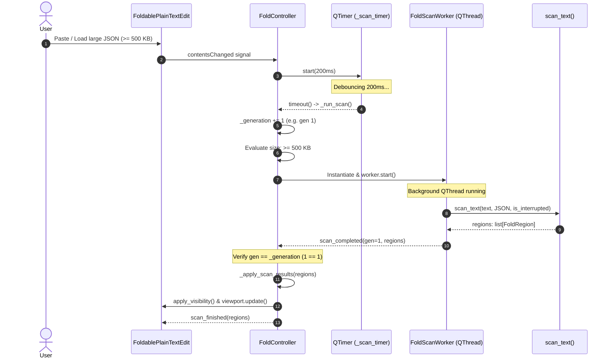
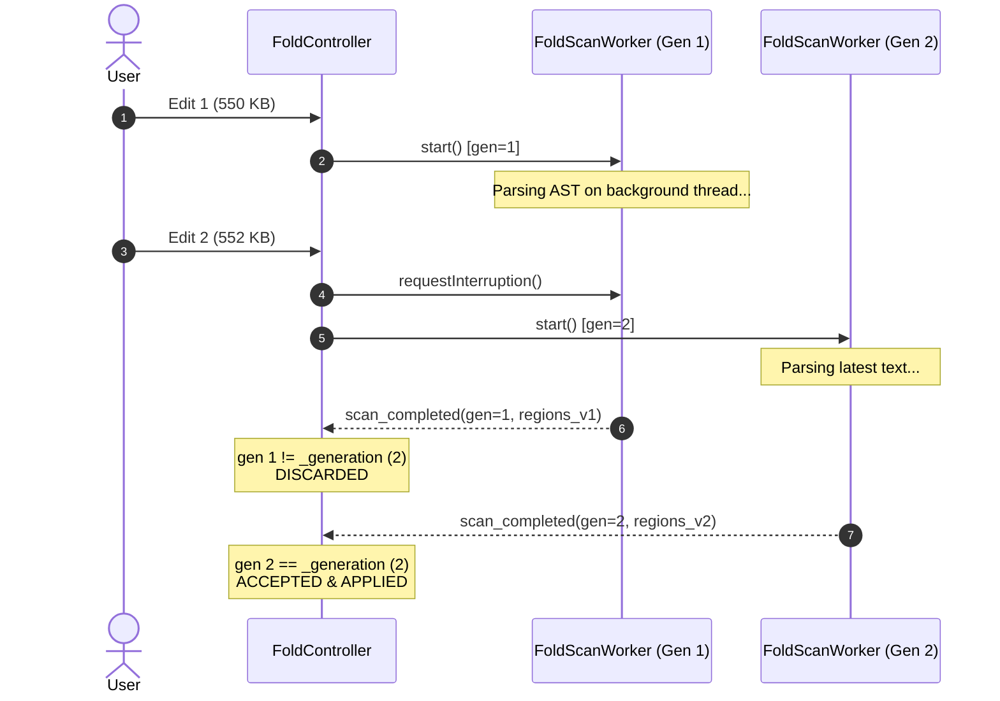

# Background Folding Scanner for Large Documents

## Overview

In PyPost, hierarchical code folding allows developers to collapse and expand nested data blocks
(objects, arrays, elements) in structured payloads (JSON, YAML, XML) across interactive editors and
read-only viewers:
- [`CodeEditor`](file:///home/src/pypost/ui/widgets/code_editor.py) (Request body editor)
- [`FoldableCodeView`](file:///home/src/pypost/ui/widgets/foldable_code_view.py) (Response viewer, WebSocket stream inspector, MCP tool results)
- [`FoldablePlainTextEdit`](file:///home/src/pypost/ui/widgets/foldable_plain_text_edit.py) (Shared base class unifying line-number gutter and folding)

### The Large Document Challenge

When inspecting or editing large structured payloads (e.g., 500 KB to 50+ MB API response bodies or
data dumps), constructing an Abstract Syntax Tree (AST) or token stream and calculating nested fold
boundaries can take hundreds of milliseconds or even seconds. If executed synchronously on the main
Qt event loop, this parsing blocks user interaction, dropping frame rates and causing the user interface
to freeze during typing, scrolling, or tab switching.

### The Solution: Asynchronous Background Offloading

Introduced in **PYPOST-1365 / PYPOST-1370**, the background folding subsystem decouples document
structure parsing from the UI thread for large payloads:
- **Fast Synchronous Path (`< 500 KB`)**: Small-to-medium documents are parsed synchronously on the UI
  thread with zero thread-dispatch overhead or latency.
- **Asynchronous Worker Thread (`>= 500 KB`)**: Documents meeting or exceeding the 500 KB threshold
  are extracted as immutable string snapshots and dispatched to [`FoldScanWorker`](file:///home/src/pypost/ui/widgets/fold/fold_worker.py),
  a dedicated `QThread`. The UI thread remains completely fluid and interactive.

---

## Architecture & Concurrency Design

### System Architecture Diagram

```mermaid
flowchart TD
    subgraph UI Thread (Main Event Loop)
        Host["Host Widget (FoldablePlainTextEdit / CodeEditor / FoldableCodeView)"]
        Doc["QTextDocument"]
        FC["FoldController (QObject)"]
        Timer["QTimer (_scan_timer: 200ms debounce)"]
        Gutter["LineNumberArea (Gutter Chevrons)"]
    end

    subgraph Background Execution
        Worker["FoldScanWorker (QThread)"]
        ScannerEntry["scan_text(text, body_format, is_interrupted)"]
        JSONScan["JsonStructureScanner"]
        YAMLScan["YamlStructureScanner"]
        XMLScan["XmlStructureScanner"]
    end

    Doc -->|"contentsChanged"| FC
    FC -->|"start(200ms)"| Timer
    Timer -->|"timeout -> _run_scan()"| FC

    FC -->|"Size < 500 KB (Synchronous)"| ScannerEntry
    FC -->|"Size >= 500 KB (Dispatch Worker)"| Worker

    Worker -->|"run() on worker thread"| ScannerEntry
    ScannerEntry --> JSONScan
    ScannerEntry --> YAMLScan
    ScannerEntry --> XMLScan

    Worker -.->|"scan_completed(generation, regions)<br/>Qt.QueuedConnection"| FC
    Worker -.->|"scan_failed(generation, error_msg)<br/>Qt.QueuedConnection"| FC

    FC -->|"apply_visibility()"| Doc
    FC -->|"viewport().update()"| Gutter
    FC -->>|"scan_finished(regions)"| Host
```

### Core Components

1. **[`FoldController`](file:///home/src/pypost/ui/widgets/fold/fold_controller.py)** (`QObject`):
   - Attached to a host `QPlainTextEdit` host widget as a child `QObject`.
   - Listens to document `contentsChanged` events and debounces scans via `QTimer` (`_DEBOUNCE_MS = 200`).
   - Manages the monotonically increasing revision counter (`_generation`).
   - Evaluates payload size against `LARGE_DOCUMENT_THRESHOLD_BYTES = 500 * 1024`.
   - Coordinates worker lifecycle, cooperative cancellation of superseded workers, and discarding of stale results.
   - Reconciles fold state retention across document edits.
   - Queues and executes pending bulk actions (`_pending_fold_all`, `_pending_unfold_all`).
   - Emits the public `scan_finished(list)` signal when regions are updated and applied.

2. **[`FoldScanWorker`](file:///home/src/pypost/ui/widgets/fold/fold_worker.py)** (`QThread`):
   - Background worker offloading CPU-intensive AST parsing.
   - Receives an immutable string snapshot `text: str`, `body_format: BodyFormat`, and `generation: int`.
   - Periodically checks `isInterruptionRequested()` to abort work cooperatively if a newer edit supersedes the task.
   - Tracks active worker instances in `_LIVE_WORKERS` to guarantee safe teardown and avoid dangling C++ objects.
   - Automatically cleans up via `worker.finished.connect(worker.deleteLater)`.

3. **[`StructureScanner` Registry & `scan_text`](file:///home/src/pypost/ui/widgets/fold/structure_scanner.py)**:
   - Defines the `StructureScanner` protocol:
     - `scan(document: QTextDocument) -> list[FoldRegion]` (backward-compatible legacy interface)
     - `scan_text(text: str, is_interrupted: Callable[[], bool] | None = None) -> list[FoldRegion]`
   - Pure function `scan_text(text, body_format, is_interrupted)` routes text parsing to the registered scanner without touching any Qt UI objects.

---

## Thread Safety and Qt Constraints

### Why `QTextDocument` is Never Passed to Worker Threads

Qt's `QTextDocument`, `QTextCursor`, and `QTextBlock` classes are reentrant but **strictly not thread-safe**.
Attempting to inspect blocks, read layouts, or iterate over a `QTextDocument` from a background worker thread
while the user types, selects text, or scrolls on the main UI thread results in concurrent read/write data races,
memory corruption, and fatal segmentation faults.

**Key Rule**:
> `FoldScanWorker` never touches `QTextDocument`, `QPlainTextEdit`, or any `QWidget`.

Instead, `FoldController` on the main UI thread snapshots the document text as an immutable Python string
(`text = self._editor.toPlainText()`) and passes the string to the worker. String slicing and AST parsing in
pure Python are completely decoupled from Qt GUI objects.

---

## Signal Flow and Lifecycle Management

### Signal Specifications

| Signal | Source | Destination | Arguments | Semantics |
| --- | --- | --- | --- | --- |
| `scan_completed` | `FoldScanWorker` | `FoldController` | `generation: int`, `regions: list[FoldRegion]` | Emitted when background parsing completes successfully. |
| `scan_failed` | `FoldScanWorker` | `FoldController` | `generation: int`, `error_message: str` | Emitted when background parsing encounters an unhandled exception. |
| `scan_finished` | `FoldController` | Listeners / Tests | `regions: list[FoldRegion]` | Emitted whenever a scan (synchronous or asynchronous) finishes and regions are applied. |

All inter-thread signals (`scan_completed` and `scan_failed`) use Qt's queued connections (`Qt.QueuedConnection`),
marshaling parameters safely across thread boundaries into the main event loop.

### Lifecycle Sequence: Asynchronous Background Scan



---

## Generation Tracking and Cooperative Cancellation

### Rapid Keystroke Handling

When a user edits a large document rapidly, multiple scans could potentially be triggered in quick succession.
To prevent wasted CPU cycles and ensure outdated results never overwrite newer edits, the system employs
two coordinating mechanisms:

1. **Generation Counter (`_generation: int`)**:
   - `FoldController` maintains a monotonically increasing integer.
   - Every invocation of `_run_scan()` increments `self._generation += 1`.
   - When `_on_background_scan_completed(generation, regions)` or `_on_background_scan_failed(generation, error)`
     fires, `FoldController` compares `generation` with `self._generation`. If `generation != self._generation`,
     the result is obsolete and discarded immediately without updating the UI.

2. **Cooperative Cancellation (`requestInterruption`)**:
   - When a new scan is dispatched while an active worker is already running:
     ```python
     if self._active_worker is not None:
         self._active_worker.requestInterruption()
     ```
   - Scanners check `is_interrupted()` at frequent intervals:
     - **JSON Scanner**: Evaluates `is_interrupted()` every 1,024 characters during character iteration (`(i & 1023 == 0)`).
     - **YAML Scanner**: Evaluates `is_interrupted()` after composing each document in multi-document streams.
     - **XML Scanner**: Evaluates `is_interrupted()` every 1,024 characters in tag/attribute scanning.
   - When interrupted, the scanner immediately returns an empty list, and `FoldScanWorker.run()` exits cleanly
     without emitting `scan_completed`.

### Cancellation Sequence Diagram



---

## Fold State Retention

When a document is re-scanned after an edit, users expect existing collapsed sections to remain collapsed
if their structure has not changed:

- `FoldController` retains a set of collapsed region IDs (`_collapsed_ids: set[str]`).
- In `_apply_scan_results()`, the controller evaluates each previously collapsed region using
  [`_region_unchanged`](file:///home/src/pypost/ui/widgets/fold/fold_controller.py#L298):
  ```python
  def _region_unchanged(old: FoldRegion | None, new_regions: list[FoldRegion]) -> bool:
      if old is None:
          return False
      for region in new_regions:
          if region.region_id == old.region_id:
              return (
                  region.start_block == old.start_block
                  and region.end_block == old.end_block
              )
      return False
  ```
- If a region's ID, start block, and end block are identical in the new scan, its collapsed state is preserved.
- Any orphaned IDs (regions modified or deleted by edits) are discarded from `_collapsed_ids`.

---

## Pending Bulk Fold Coordination

Users can click "Fold All" or "Unfold All" before a background scan finishes. To avoid race conditions:

- **"Fold All" while scan is pending or active**:
  - Sets `_pending_fold_all = True` and clears `_pending_unfold_all = False`.
  - If `_scan_timer` is running, stops the timer and launches `_run_scan()` immediately.
  - When `_on_background_scan_completed()` arrives, it checks `if self._pending_fold_all:` and collapses
    all newly discovered regions at once.
- **"Unfold All" while scan is pending or active**:
  - Immediately expands all existing blocks on the UI thread and clears `_collapsed_ids`.
  - If a worker is running, sets `_pending_unfold_all = True` to guarantee any delayed scan results
    do not re-collapse blocks.

---

## AST Scanners and Pure-Text Scanning

The scanning logic in [`pypost/ui/widgets/fold/`](file:///home/src/pypost/ui/widgets/fold/) supports
four body formats:

```python
class BodyFormat(Enum):
    JSON = "json"
    YAML = "yaml"
    XML = "xml"
    PLAIN = "plain"
```

### Pure-Text Entry Point: `scan_text`

```python
def scan_text(
    text: str,
    body_format: BodyFormat,
    is_interrupted: Callable[[], bool] | None = None,
) -> list[FoldRegion]:
    if body_format is BodyFormat.PLAIN:
        return []
    scanner = _SCANNERS.get(body_format)
    if scanner is None:
        return []
    return scanner.scan_text(text, is_interrupted=is_interrupted)
```

### Supported Format Scanners

1. **[`JsonStructureScanner`](file:///home/src/pypost/ui/widgets/fold/json_structure_scanner.py)**:
   - Validates syntax using standard `json.loads(text)`.
   - Iterates through characters to build JSON Pointer-like hierarchical paths (e.g. `"/users/0/address"`).
   - Records multiline curly braces `{}` and square brackets `[]` as collapsible regions.
   - Checks `is_interrupted()` every 1,024 characters.

2. **[`YamlStructureScanner`](file:///home/src/pypost/ui/widgets/fold/yaml_structure_scanner.py)**:
   - Parses YAML documents using `yaml.compose_all(stream, Loader=yaml.SafeLoader)`.
   - Extracts line ranges from `MappingNode` and `SequenceNode` start/end marks.
   - Checks `is_interrupted()` before and between composed documents.

3. **[`XmlStructureScanner`](file:///home/src/pypost/ui/widgets/fold/xml_structure_scanner.py)**:
   - Parses XML tags, attributes, CDATA, comments, and nesting depth using streaming character offsets.
   - Ignores inline elements that start and end on the same line.
   - Checks `is_interrupted()` every 1,024 characters.

4. **`_PlainScanner`**:
   - Always returns an empty list `[]` with no overhead.

---

## Configuration and Thresholds

| Setting / Constant | Value | Location | Description |
| --- | --- | --- | --- |
| `LARGE_DOCUMENT_THRESHOLD_BYTES` | `500 * 1024` (512,000 bytes) | [`FoldController`](file:///home/src/pypost/ui/widgets/fold/fold_controller.py#L20) | Payload size threshold determining whether to scan synchronously or spawn `FoldScanWorker`. |
| `_DEBOUNCE_MS` | `200` ms | [`FoldController`](file:///home/src/pypost/ui/widgets/fold/fold_controller.py#L14) | Keystroke debounce interval before initiating a document scan. |
| Teardown Timeout | `500` ms | [`FoldController._cleanup_worker`](file:///home/src/pypost/ui/widgets/fold/fold_controller.py#L288) | Maximum time to wait for a running worker thread during editor destruction. |

### Size Threshold Evaluation

In `FoldController._run_scan()`:
```python
text = self._editor.toPlainText()
byte_size = len(text.encode("utf-8"))
is_large = (
    len(text) >= self.LARGE_DOCUMENT_THRESHOLD_BYTES
    or byte_size >= self.LARGE_DOCUMENT_THRESHOLD_BYTES
)
```
Evaluating both character length (`len(text)`) and UTF-8 encoded byte size (`len(text.encode("utf-8"))`)
ensures correct threshold behavior across both ASCII payloads and multi-byte Unicode documents.

---

## API Usage & Examples

### Basic Usage with `FoldablePlainTextEdit`

```python
from pypost.ui.widgets.fold import BodyFormat
from pypost.ui.widgets.foldable_plain_text_edit import FoldablePlainTextEdit

# Create editor with JSON folding
editor = FoldablePlainTextEdit(indent_size=2)
editor.set_body_format(BodyFormat.JSON)

# Setting text triggers debounced scan
editor.setPlainText(large_json_string)

# Programmatic folding controls
editor.fold_all()    # Collapses all regions (or schedules pending collapse if scanning)
editor.unfold_all()  # Expands all regions
```

### Waiting for Scan Completion in Asynchronous Workflows / Tests

In test suites or asynchronous automation, use the `scan_finished` signal to wait for background
workers without busy loops or arbitrary `sleep` calls:

```python
from PySide6.QtTest import QSignalSpy
import pytest

@pytest.mark.timeout(10)
def test_background_scan(qtbot):
    editor = FoldablePlainTextEdit()
    editor.set_body_format(BodyFormat.JSON)
    fc = editor.fold_controller()

    spy = QSignalSpy(fc.scan_finished)
    editor.setPlainText(large_500kb_json_payload)

    # Force immediate scan dispatch if desired
    fc.ensure_scanned()

    # Wait for the background worker to emit scan_finished
    assert spy.wait(timeout=5000)
    regions = spy.at(0)[0]
    assert len(regions) > 0
```

### Standalone Text Scanning (No GUI / Headless)

You can call `scan_text` directly in CLI scripts, tests, or background workers without instantiating
any Qt widgets:

```python
from pypost.ui.widgets.fold import BodyFormat, scan_text

payload = '{"id": 1, "metadata": {"tags": ["a", "b"]}}'
regions = scan_text(payload, BodyFormat.JSON)

for r in regions:
    print(f"Region {r.region_id}: lines {r.start_block}..{r.end_block} ({r.kind})")
```

---

## Observability & Logging

All background scanner events use structured logging under Python's `logging` module.

### Loggers

- `pypost.ui.widgets.fold.fold_controller`: Dispatch, generation supersession, stale discard, and region mapping.
- `pypost.ui.widgets.fold.fold_worker`: Worker thread start, cancellation, completion timing, and error handling.
- `pypost.ui.widgets.fold.json_structure_scanner`: JSON syntax skip notifications.
- `pypost.ui.widgets.fold.yaml_structure_scanner`: YAML syntax skip notifications.
- `pypost.ui.widgets.fold.xml_structure_scanner`: XML syntax skip notifications.

### Key Log Events

| Event Name | Level | Sample Log Message | Context Fields |
| --- | --- | --- | --- |
| `synchronous_fold_scan_dispatched` | `DEBUG` | `synchronous_fold_scan_dispatched size_bytes=24150 format=json` | `size_bytes`, `format` |
| `background_fold_scan_dispatched` | `DEBUG` | `background_fold_scan_dispatched generation=1 size_bytes=614400 format=json` | `generation`, `size_bytes`, `format` |
| `superseding_active_fold_worker` | `DEBUG` | `superseding_active_fold_worker next_generation=2` | `next_generation` |
| `fold_scan_worker_completed` | `DEBUG` | `fold_scan_worker_completed generation=1 format=json regions=42 duration=0.0452s` | `generation`, `format`, `regions`, `duration` |
| `fold_scan_worker_cancelled` | `DEBUG` | `fold_scan_worker_cancelled generation=1 format=json duration=0.0120s` | `generation`, `format`, `duration` |
| `background_fold_scan_stale_discarded` | `DEBUG` | `background_fold_scan_stale_discarded generation=1 current_generation=2` | `generation`, `current_generation` |
| `fold_scan_completed` | `DEBUG` | `fold_scan_completed format=json regions=42 collapsed=2` | `format`, `regions`, `collapsed` |
| `background_fold_scan_failed` | `WARNING` | `background_fold_scan_failed generation=1 error=RecursionError` | `generation`, `error` |

> [!NOTE]
> To comply with security policies and prevent memory bloat, raw document text is **never** included in log messages. Only generation IDs, byte sizes, durations, region counts, and error descriptions are logged.

---

## Troubleshooting & Maintenance Notes

### 1. Worker Threads Lingering After Editor Destruction
- **Symptom**: Warnings about threads running during application exit or Qt teardown crashes.
- **Cause**: The host editor was closed or destroyed while a background `FoldScanWorker` was in flight.
- **Resolution**: `FoldController` connects `editor.destroyed.connect(self._cleanup_worker)`. In `_cleanup_worker()`, `requestInterruption()` is invoked and `worker.wait(500)` allows the worker to terminate cooperatively. Furthermore, `FoldScanWorker.__del__()` contains fallback interruption guards.

### 2. Discarded Stale Scans During Fast Typing
- **Symptom**: Log shows `background_fold_scan_stale_discarded generation=N current_generation=N+1`.
- **Cause**: Normal operation. A background thread finished parsing an older document revision after the user already typed new characters.
- **Resolution**: No action required. Discarding superseded results guarantees that outdated ASTs never overwrite the current editor structure.

### 3. Syntax Errors in Document
- **Symptom**: No fold chevrons appear on large documents.
- **Cause**: The document contains invalid JSON, YAML, or XML syntax. The scanners safely handle syntax errors and return an empty region list.
- **Resolution**: Inspect `DEBUG` logs for `json_scan_parse_skipped`, `yaml_scan_parse_skipped`, or `xml_scan_parse_skipped`.

---

## Related Files & Classes

- [`FoldController`](file:///home/src/pypost/ui/widgets/fold/fold_controller.py) — Coordinator managing scan timers, thresholds, worker lifecycle, and block visibility.
- [`FoldScanWorker`](file:///home/src/pypost/ui/widgets/fold/fold_worker.py) — `QThread` executing AST parsing off the UI thread.
- [`StructureScanner`](file:///home/src/pypost/ui/widgets/fold/structure_scanner.py) — Protocol and registry for format-specific scanners.
- [`FoldRegion` & `BodyFormat`](file:///home/src/pypost/ui/widgets/fold/fold_region.py) — Data models representing collapsible code ranges.
- [`JsonStructureScanner`](file:///home/src/pypost/ui/widgets/fold/json_structure_scanner.py) — Character and path scanner for JSON documents.
- [`YamlStructureScanner`](file:///home/src/pypost/ui/widgets/fold/yaml_structure_scanner.py) — Safe AST composer for YAML documents.
- [`XmlStructureScanner`](file:///home/src/pypost/ui/widgets/fold/xml_structure_scanner.py) — Tag and element hierarchy scanner for XML documents.
- [`FoldablePlainTextEdit`](file:///home/src/pypost/ui/widgets/foldable_plain_text_edit.py) — Unified base editor class integrating gutter chevrons.
- [`tests/test_background_fold_scanner.py`](file:///home/src/tests/test_background_fold_scanner.py) — Comprehensive automated test suite for background fold scanning.
