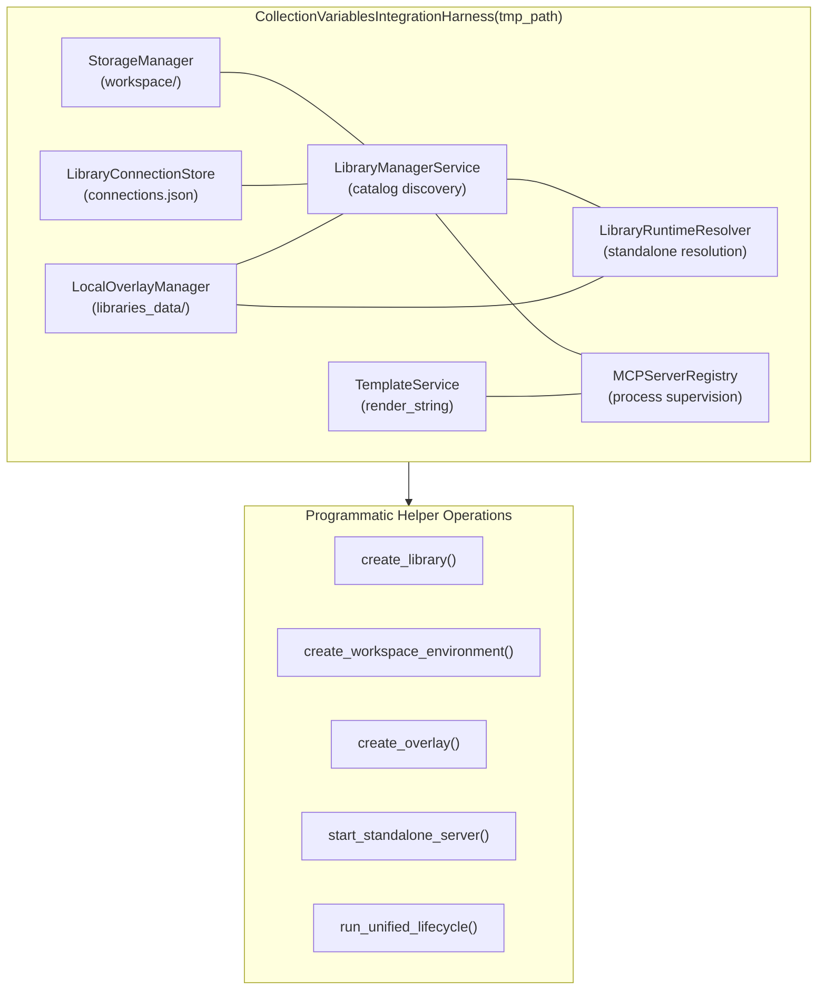

# Reusable Collection Integration Test Harness

## Overview

The `tests.helpers.collection_integration_harness` module provides a reusable, self-contained
integration test harness helper and pytest fixture bindings for PyPost's collection-scoped
variables, standalone MCP servers, workspace environment synchronization, and template substitution
subsystems.

Established under [PYPOST-1417](https://pypost.atlassian.net/browse/PYPOST-1417) as an architectural
extraction from [PYPOST-1412](https://pypost.atlassian.net/browse/PYPOST-1412), this harness
eliminates copy-paste boilerplate across integration test suites, isolates ephemeral filesystem
state under pytest's `tmp_path`, and provides safe, idempotent lifecycle and teardown contracts.

---

## Architecture

The harness coordinates seven core domain services in memory and maps their state to dedicated
subdirectories under an isolated root directory (`tmp_path`):

```
tmp_path/
├── libraries/                # Local library roots and catalog/legacy manifests
│   └── <manifest_id>/
│       ├── pypost-library.json
│       └── collections/
│           └── <collection_id>.json
├── workspace/                # Workspace storage (collections, environments, requests)
│   └── environments/
│       └── environments.json
├── libraries_data/           # Machine-local overlays (mode 0o600)
│   └── <manifest_id>/
│       └── overlay.json
└── connections.json          # Library connection registry metadata
```



### Coordinated Services

1. **[`StorageManager`](file:///home/src/pypost/core/storage.py)**:
   Persists collections, workspace environments, and request definitions under `tmp_path/workspace/`.
2. **[`LibraryConnectionStore`](file:///home/src/pypost/core/library_connection_store.py)**:
   Tracks connected local directory libraries via `tmp_path/connections.json`.
3. **[`LocalOverlayManager`](file:///home/src/pypost/core/local_overlay_manager.py)**:
   Reads and writes machine-local overlays with `0o600` permissions under `tmp_path/libraries_data/`.
4. **[`TemplateService`](file:///home/src/pypost/core/template_service.py)**:
   Renders mustache expressions (`{{ variable }}`) across URLs, headers, and request bodies.
5. **[`LibraryManagerService`](file:///home/src/pypost/core/library_manager_service.py)**:
   Discovers libraries, parses manifests (v2 catalog or v1 legacy), and loads collections.
6. **[`LibraryRuntimeResolver`](file:///home/src/pypost/core/library_runtime_resolver.py)**:
   Resolves effective variables using the 3-tier precedence hierarchy and masks secrets.
7. **[`MCPServerRegistry`](file:///home/src/pypost/core/mcp_server_registry.py)**:
   Registers, validates, starts, and supervises standalone and local MCP server background daemons.

---

## API & Usage

### 1. Pytest Fixture Bindings

The module exposes two pytest fixture bindings:
- `collection_integration_harness`: Canonical fixture yielding an initialized harness.
- `collection_harness`: Convenient short alias.

```python
from tests.helpers.collection_integration_harness import collection_integration_harness

def test_collection_workflow(collection_integration_harness):
    harness = collection_integration_harness
    lib_dir = harness.create_library("demo-lib", collections_data={...})
    assert lib_dir.is_dir()
```

Both fixtures automatically invoke `harness.teardown()` inside a `finally` block when the test
completes.

### 2. Context Manager Usage

For tests or utilities that do not use the pytest fixture injection mechanism, the class implements
the standard context manager protocol (`__enter__` and `__exit__`):

```python
from tests.helpers.collection_integration_harness import CollectionVariablesIntegrationHarness

def test_standalone_flow(tmp_path):
    with CollectionVariablesIntegrationHarness(tmp_path) as harness:
        harness.create_library("sample-lib", collections_data={...})
        server_id, port, status = harness.start_standalone_server("sample-lib", "col1")
        assert status == "running"
    # All background servers and resources are guaranteed stopped upon exit
```

### 3. Explicit Lifecycle Methods

- **`teardown() -> None`**:
  Calls `registry.stop_all()` to terminate all running background MCP servers, cancels background
  threads, and frees allocated ports. Idempotent: safe to invoke multiple times without error.
- **`close() -> None`**:
  Alias for `teardown()`.

---

## Programmatic Helper Methods

### `create_library`

Synthesizes a complete library directory with collections and manifest metadata:

```python
def create_library(
    manifest_id: str,
    is_legacy_manifest: bool = False,
    collections_data: dict[str, dict[str, Any]] | None = None,
    manifest_variables: list[CollectionVariable] | None = None,
    manifest_presets: dict[str, dict[str, Any]] | None = None,
) -> Path:
```

- **`manifest_id`**: Unique library ID.
- **`is_legacy_manifest`**: If `True`, writes a v1 manifest (`version: "1.0.0"`) with root
  `variables` and `presets`. If `False`, writes a modern v2 catalog manifest (`version: "2.0.0"`).
- **`collections_data`**: Mapping of filenames (e.g. `"api.json"`) to collection dictionaries.
- **`manifest_variables`**: Optional manifest-level variables (for legacy v1 testing).
- **`manifest_presets`**: Optional manifest-level presets (for legacy v1 testing).
- **Returns**: `Path` pointing to the created library root directory.

### `create_workspace_environment`

Creates and saves an isolated workspace environment:

```python
def create_workspace_environment(
    name: str = "Test Env",
    variables: dict[str, str] | None = None,
    hidden_keys: set[str] | None = None,
) -> Environment:
```

- **Returns**: Instantiated and persisted [`Environment`](file:///home/src/pypost/models/models.py).

### `create_overlay`

Creates and persists a machine-local overlay file with `0o600` permissions:

```python
def create_overlay(
    library_id: str,
    active_profile: str = "",
    secrets: dict[str, str] | None = None,
) -> LocalLibraryOverlay:
```

- **Returns**: Persisted [`LocalLibraryOverlay`](file:///home/src/pypost/models/library_manifest.py).

### `start_standalone_server`

Configures, validates, and starts a standalone MCP server with automatic dynamic port allocation:

```python
def start_standalone_server(
    manifest_id: str,
    collection_id: str,
    collection_filename: str | None = None,
    collection_name: str | None = None,
    host: str = "127.0.0.1",
    port: int | None = None,
) -> tuple[str, int, str]:
```

- If `port` is omitted, allocates a safe collision-free ephemeral port using `allocate_tcp_port()`.
- Validates candidate configuration via `registry.validate_library_candidate()`.
- Transitions server to `"running"` state and waits for listening confirmation.
- **Returns**: Tuple of `(server_id, allocated_port, state_str)`.

### `run_unified_lifecycle`

Executes the complete 5-step integration lifecycle in a single coordinated call:

```python
def run_unified_lifecycle(
    *,
    manifest_id: str,
    collection_data: dict[str, Any],
    active_profile: str,
    overlay_secrets: dict[str, str],
    workspace_env_name: str,
    conflict_strategy: ConflictStrategy,
) -> UnifiedLifecycleResult:
```

Pipeline steps:
1. Connects library via `create_library()`.
2. Persists overlay secrets and active profile via `create_overlay()`.
3. Starts standalone MCP server without a workspace environment.
4. Copies collection into workspace and imports variables via `import_collection_variables_to_environment()`.
5. Substitutes variables in request URLs, headers, and request bodies using [`TemplateService`](file:///home/src/pypost/core/template_service.py).

---

## Data Contracts

### `UnifiedLifecycleResult`

Dataclass encapsulating the outputs of `run_unified_lifecycle()`:

```python
@dataclass
class UnifiedLifecycleResult:
    """Outcome of end-to-end multi-subsystem workflow execution."""
    status: str                         # "success" or error status
    standalone_server_id: str           # Unique server ID in registry
    standalone_status: str              # Server lifecycle state ("running")
    imported_summary: ImportSummary     # Variable import statistics
    rendered_request_url: str           # Rendered request URL with variables
    rendered_auth_header: str           # Rendered Authorization header
    rendered_body: str                  # Rendered request payload
```

---

## Resource Teardown & Invariants

1. **Zero Global Leakage**:
   Each harness instance operates within an isolated `tmp_path`. No environment variables, temporary
   files, or configuration settings touch the user's `~/.pypost` directory.
2. **Safe Port Allocation**:
   All local MCP server instances request ports from `tests.helpers.port_allocation.allocate_tcp_port()`,
   preventing TCP bind collisions in parallel test runs.
3. **Graceful Subprocess Cleanup**:
   `teardown()` ensures background runners and daemon processes are terminated and joined promptly.
4. **Idempotence**:
   Calling `teardown()` repeatedly or calling both `__exit__` and `teardown()` produces no errors.
5. **Exception Traceability**:
   Context manager `__exit__` logs any active exception before teardown, preserving root cause logs.

---

## Testing Guidance & Reference Suites

When authoring new integration tests or extending variable resolution workflows:

- **Harness Repro & Unit Verification**:
  [`tests/test_collection_integration_harness_repro.py`](file:///home/src/tests/test_collection_integration_harness_repro.py)
  verifies harness importability, context manager protocol, fixture bindings, and lifecycle execution.
- **End-to-End Compatibility Matrix**:
  [`tests/test_collection_scoped_variables_integration.py`](file:///home/src/tests/test_collection_scoped_variables_integration.py)
  tests all 4 quadrants of the backward compatibility matrix, cross-collection namespace isolation,
  and conflict resolution strategies.
- **Related Documentation**:
  - [Collection-Scoped Variables and Standalone MCP Servers](collection_scoped_variables.md)
  - [Workspace Environment Variable Import](workspace_environment_variable_import.md)
  - [Library Manifest and Local Secrets Overlay Manager](library_manifest_and_overlay.md)
