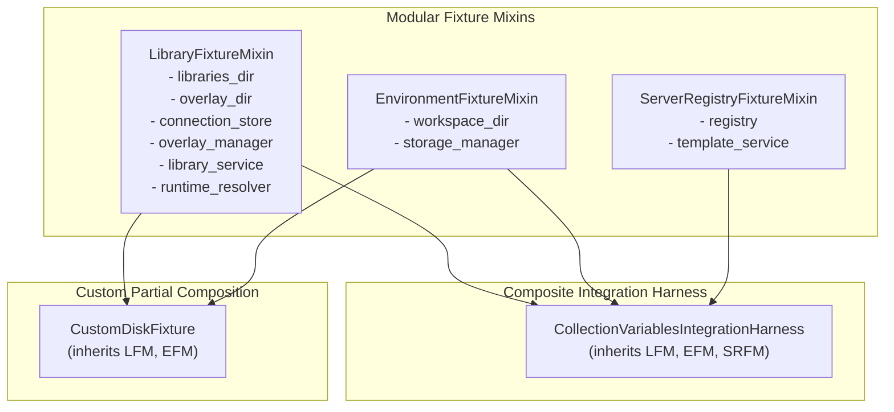

# Reusable Collection Integration Test Harness

## Overview

The `tests.helpers.collection_integration_harness` module provides a modular, composable
integration test harness and pytest fixture bindings for PyPost's collection-scoped
variables, standalone MCP servers, workspace environment synchronization, and template substitution
subsystems.

Originally established under [PYPOST-1417](https://pypost.atlassian.net/browse/PYPOST-1417) as an
architectural extraction from [PYPOST-1412](https://pypost.atlassian.net/browse/PYPOST-1412), the
harness was refactored under [PYPOST-1433](https://pypost.atlassian.net/browse/PYPOST-1433) into a
modular mixin architecture. This decomposition decouples filesystem catalog management and
workspace storage from background MCP server process supervision, allowing integration tests to
compose only the fixture capabilities they need.

---

## Modular Architecture

The harness is decomposed into three orthogonal, independently usable mixin classes and a unified
composite harness class:



### Filesystem Layout

The mixins manage isolated directories under pytest's ephemeral `tmp_path`:

```
tmp_path/
├── libraries/                # LibraryFixtureMixin: Catalog manifests and collections
│   └── <manifest_id>/
│       ├── pypost-library.json
│       └── collections/
│           └── <collection_id>.json
├── libraries_data/           # LibraryFixtureMixin: Local overlays (mode 0o600)
│   └── <manifest_id>/
│       └── overlay.json
├── connections.json          # LibraryFixtureMixin: Connection registry metadata
└── workspace/                # EnvironmentFixtureMixin: StorageManager root
    └── environments/
        └── environments.json
```

---

## Decomposed Mixin Reference

### 1. `LibraryFixtureMixin`

The `LibraryFixtureMixin` manages catalog manifests, collection JSON files, machine-local
secret overlays, and library runtime resolution in an isolated temporary directory.

#### Responsibilities

- Initializes isolated `libraries/` and `libraries_data/` directories under `tmp_path`.
- Instantiates [`LibraryConnectionStore`](file:///home/src/pypost/core/library_connection_store.py)
  backed by `tmp_path/connections.json`.
- Instantiates [`LocalOverlayManager`](file:///home/src/pypost/core/local_overlay_manager.py)
  with secure `0o600` file permissions.
- Instantiates [`LibraryManagerService`](file:///home/src/pypost/core/library_manager_service.py)
  and [`LibraryRuntimeResolver`](file:///home/src/pypost/core/library_runtime_resolver.py).
- Synthesizes v1 legacy manifests or modern v2 catalog manifests.

#### Properties

- `tmp_path: Path`: Root temporary directory.
- `libraries_dir: Path`: Root directory for local libraries (`tmp_path/libraries`).
- `overlay_dir: Path`: Root directory for local secret overlays (`tmp_path/libraries_data`).
- `connection_store: LibraryConnectionStore`: Store managing connected local directories.
- `overlay_manager: LocalOverlayManager`: Manager reading/writing machine-local overlays.
- `library_service: LibraryManagerService`: Service discovering libraries and manifests.
- `runtime_resolver: LibraryRuntimeResolver`: Resolver executing 3-tier variable precedence.

#### Key Methods

- `init_library_fixture(tmp_path: Path) -> None`:
  Initializes directories and library domain services.
- `create_library(...) -> Path`:
  Synthesizes a library directory with manifest and collections, connecting it to
  `library_service`. Supports catalog (v2) and legacy (v1) formats.
- `create_overlay(...) -> LocalLibraryOverlay`:
  Saves a machine-local overlay file with `0o600` permissions.

#### Standalone Usage Example

```python
from pathlib import Path
from tests.helpers.collection_integration_harness import LibraryFixtureMixin

def test_library_discovery(tmp_path: Path):
    lib_fix = LibraryFixtureMixin(tmp_path)

    # Create library with collection
    lib_path = lib_fix.create_library(
        manifest_id="catalog-demo",
        is_legacy_manifest=False,
        collections_data={
            "col1.json": {
                "id": "col1",
                "name": "Collection 1",
                "variables": [{"key": "BASE_URL", "value": "https://api.example.com"}],
                "requests": [],
            }
        },
    )

    # Persist secrets in local overlay
    overlay = lib_fix.create_overlay(
        library_id="catalog-demo",
        active_profile="production",
        secrets={"api_token": "secret-token-123"},
    )

    assert lib_path.is_dir()
    assert (lib_path / "pypost-library.json").is_file()
    assert overlay.secrets["api_token"] == "secret-token-123"
```

---

### 2. `EnvironmentFixtureMixin`

The `EnvironmentFixtureMixin` manages workspace storage and isolated workspace environments
without requiring library discovery or MCP process infrastructure.

#### Responsibilities

- Initializes isolated `workspace/` directory under `tmp_path`.
- Instantiates [`StorageManager`](file:///home/src/pypost/core/storage.py) targeting
  `tmp_path/workspace/`.
- Creates and persists workspace [`Environment`](file:///home/src/pypost/models/models.py)
  definitions.

#### Properties

- `tmp_path: Path`: Root temporary directory.
- `workspace_dir: Path`: Directory for workspace storage (`tmp_path/workspace`).
- `storage_manager: StorageManager`: Instance managing persistence of workspace environments.

#### Key Methods

- `init_environment_fixture(tmp_path: Path) -> None`:
  Initializes workspace directory and `StorageManager`.
- `create_workspace_environment(...) -> Environment`:
  Constructs, persists, and returns a new workspace `Environment`.

#### Standalone Usage Example

```python
from pathlib import Path
from tests.helpers.collection_integration_harness import EnvironmentFixtureMixin

def test_workspace_environment(tmp_path: Path):
    env_fix = EnvironmentFixtureMixin(tmp_path)

    env = env_fix.create_workspace_environment(
        name="Staging",
        variables={"API_KEY": "staging-key", "PORT": "8080"},
        hidden_keys={"API_KEY"},
    )

    assert env.name == "Staging"
    assert env.get_value("API_KEY") == "staging-key"
    assert env_fix.workspace_dir.is_dir()

    # Verify persistence via storage manager
    saved = env_fix.storage_manager.load_environments()
    assert any(e.name == "Staging" for e in saved)
```

---

### 3. `ServerRegistryFixtureMixin`

The `ServerRegistryFixtureMixin` manages standalone MCP server candidate startup, dynamic
port allocation, readiness polling, lifecycle supervision, and clean teardown.

#### Responsibilities

- Instantiates [`MCPServerRegistry`](file:///home/src/pypost/core/mcp_server_registry.py)
  and [`TemplateService`](file:///home/src/pypost/core/template_service.py).
- Allocates collision-free ephemeral TCP ports via `allocate_tcp_port()`.
- Validates candidate configuration and initiates daemon server startup.
- Polls for server readiness or early startup errors.
- Provides idempotent resource teardown via `teardown()`, `close()`, or context management.

#### Properties

- `registry: MCPServerRegistry`: Registry managing background server processes.
- `template_service: TemplateService`: Service for rendering template expressions.

#### Key Methods

- `init_server_registry_fixture(...) -> None`:
  Initializes registry and template service bindings.
- `start_standalone_server(...) -> tuple[str, int, str]`:
  Validates, starts, and polls a standalone MCP server until running.
- `teardown() -> None`:
  Stops all registered servers via `registry.stop_all()`. Safe and idempotent.
- `close() -> None`:
  Alias for `teardown()`.
- `__enter__() -> ServerRegistryFixtureMixin`:
  Enters context manager scope.
- `__exit__(exc_type, exc_val, exc_tb) -> None`:
  Exits context manager scope, logging exceptions and calling `teardown()`.

#### Standalone Usage Example

```python
from pypost.models.settings import McpServerConfiguration
from tests.helpers.collection_integration_harness import ServerRegistryFixtureMixin

def test_server_registry_lifecycle():
    with ServerRegistryFixtureMixin() as server_fix:
        config = McpServerConfiguration.model_construct(
            id="standalone-candidate-1",
            name="Standalone Candidate",
            host="127.0.0.1",
            port=9999,
            server_type="local",
            enabled=True,
        )
        server_fix.registry.upsert(config)
        assert server_fix.registry.get_config("standalone-candidate-1") is not None

    # Servers automatically stopped upon exiting with-block
    # Teardown is safe to invoke repeatedly
    server_fix.teardown()
```

---

## Composite Class: `CollectionVariablesIntegrationHarness`

`CollectionVariablesIntegrationHarness` integrates all three mixins through cooperative multiple
inheritance:

```python
class CollectionVariablesIntegrationHarness(
    LibraryFixtureMixin,
    EnvironmentFixtureMixin,
    ServerRegistryFixtureMixin,
):
    def __init__(self, tmp_path: Path) -> None:
        self.tmp_path = tmp_path
        self.init_library_fixture(tmp_path)
        self.init_environment_fixture(tmp_path)
        self.template_service = TemplateService()
        self.init_server_registry_fixture(
            library_service=self.library_service,
            template_service=self.template_service,
        )
```

### Backward Compatibility Contract

`CollectionVariablesIntegrationHarness` retains 100% backward compatibility with tests written
against the original monolithic harness:
- All properties (`tmp_path`, `libraries_dir`, `workspace_dir`, `overlay_dir`, `connection_store`,
  `overlay_manager`, `storage_manager`, `template_service`, `library_service`,
  `runtime_resolver`, `registry`) are present at the exact same attribute locations.
- All helper methods (`create_library`, `create_workspace_environment`, `create_overlay`,
  `start_standalone_server`, `teardown`, `close`, `__enter__`, `__exit__`) are preserved.
- The high-level multi-subsystem orchestration method `run_unified_lifecycle()` remains
  available on the composite class.

### Pytest Fixture Bindings

The module exposes two pytest fixture bindings:
- `collection_integration_harness`: Canonical fixture yielding an initialized harness.
- `collection_harness`: Short alias for `collection_integration_harness`.

```python
from tests.helpers.collection_integration_harness import collection_integration_harness

def test_full_workflow(collection_integration_harness):
    harness = collection_integration_harness
    lib_dir = harness.create_library("demo-lib", collections_data={...})
    assert lib_dir.is_dir()
```

---

## Custom Partial Composition

Developers can compose subsets of mixins to build tailored fixtures for specific test scenarios,
avoiding unnecessary background service startup or filesystem directories.

### Example: Disk-Only Variable Resolution Fixture

When testing collection variable import and variable resolution without MCP process management,
compose `LibraryFixtureMixin` and `EnvironmentFixtureMixin`:

```python
from pathlib import Path
from tests.helpers.collection_integration_harness import (
    LibraryFixtureMixin,
    EnvironmentFixtureMixin,
)

class CustomLibraryAndStorageFixture(LibraryFixtureMixin, EnvironmentFixtureMixin):
    """Composed fixture for catalog and workspace tests without MCP server registry."""

    def __init__(self, path: Path) -> None:
        self.init_library_fixture(path)
        self.init_environment_fixture(path)

def test_disk_only_resolution(tmp_path: Path):
    fixture = CustomLibraryAndStorageFixture(tmp_path)

    # Filesystem and storage available
    assert fixture.libraries_dir.is_dir()
    assert fixture.workspace_dir.is_dir()
    assert fixture.library_service is not None
    assert fixture.storage_manager is not None

    # Server registry is omitted completely
    assert not hasattr(fixture, "registry")
```

---

## Programmatic Helper Methods

### `create_library`

Synthesizes a complete library directory with collections and manifest metadata:

```python
def create_library(
    manifest_id: str,
    is_legacy_manifest: bool = False,
    collections_data: dict[str, dict[str, Any]] | None = None,
    manifest_variables: list[CollectionVariable] | None = None,
    manifest_presets: dict[str, dict[str, Any]] | None = None,
) -> Path:
```

- **`manifest_id`**: Unique library ID.
- **`is_legacy_manifest`**: If `True`, writes a v1 manifest (`version: "1.0.0"`).
  If `False`, writes a modern v2 catalog manifest (`version: "2.0.0"`).
- **`collections_data`**: Mapping of filenames (e.g. `"api.json"`) to collection dictionaries.
- **`manifest_variables`**: Optional manifest-level variables (for legacy v1 testing).
- **`manifest_presets`**: Optional manifest-level presets (for legacy v1 testing).
- **Returns**: `Path` pointing to the created library root directory.

### `create_workspace_environment`

Creates and saves an isolated workspace environment:

```python
def create_workspace_environment(
    name: str = "Test Env",
    variables: dict[str, str] | None = None,
    hidden_keys: set[str] | None = None,
) -> Environment:
```

- **Returns**: Instantiated and persisted [`Environment`](file:///home/src/pypost/models/models.py).

### `create_overlay`

Creates and persists a machine-local overlay file with `0o600` permissions:

```python
def create_overlay(
    library_id: str,
    active_profile: str = "",
    secrets: dict[str, str] | None = None,
) -> LocalLibraryOverlay:
```

- **Returns**: Persisted
  [`LocalLibraryOverlay`](file:///home/src/pypost/models/library_manifest.py).

### `start_standalone_server`

Configures, validates, and starts a standalone MCP server with automatic dynamic port allocation:

```python
def start_standalone_server(
    manifest_id: str,
    collection_id: str,
    collection_filename: str | None = None,
    collection_name: str | None = None,
    host: str = "127.0.0.1",
    port: int | None = None,
) -> tuple[str, int, str]:
```

- If `port` is omitted, allocates a safe collision-free ephemeral port using `allocate_tcp_port()`.
- Validates candidate configuration via `registry.validate_library_candidate()`.
- Transitions server to `"running"` state and waits for listening confirmation.
- **Returns**: Tuple of `(server_id, allocated_port, state_str)`.

### `run_unified_lifecycle`

Executes the complete 5-step integration lifecycle in a single coordinated call:

```python
def run_unified_lifecycle(
    *,
    manifest_id: str,
    collection_data: dict[str, Any],
    active_profile: str,
    overlay_secrets: dict[str, str],
    workspace_env_name: str,
    conflict_strategy: ConflictStrategy,
) -> UnifiedLifecycleResult:
```

Pipeline steps:
1. Connects library via `create_library()`.
2. Persists overlay secrets and active profile via `create_overlay()`.
3. Starts standalone MCP server without a workspace environment.
4. Copies collection into workspace and imports variables via
   `import_collection_variables_to_environment()`.
5. Substitutes variables in request URLs, headers, and request bodies using
   [`TemplateService`](file:///home/src/pypost/core/template_service.py).

---

## Data Contracts

### `UnifiedLifecycleResult`

Dataclass encapsulating the outputs of `run_unified_lifecycle()`:

```python
@dataclass
class UnifiedLifecycleResult:
    """Outcome of end-to-end multi-subsystem workflow execution."""
    status: str                         # "success" or error status
    standalone_server_id: str           # Unique server ID in registry
    standalone_status: str              # Server lifecycle state ("running")
    imported_summary: ImportSummary     # Variable import statistics
    rendered_request_url: str           # Rendered request URL with variables
    rendered_auth_header: str           # Rendered Authorization header
    rendered_body: str                  # Rendered request payload
```

---

## Resource Teardown & Invariants

1. **Zero Global Leakage**:
   Each harness instance operates within an isolated `tmp_path`. No environment variables, temporary
   files, or configuration settings touch the user's `~/.pypost` directory.
2. **Safe Port Allocation**:
   All local MCP server instances request ports from
   `tests.helpers.port_allocation.allocate_tcp_port()`, preventing TCP collisions.
3. **Graceful Subprocess Cleanup**:
   `teardown()` ensures background runners and daemon processes are terminated and joined promptly.
4. **Idempotence**:
   Calling `teardown()` repeatedly or calling both `__exit__` and `teardown()` produces no errors.
5. **Exception Traceability**:
   Context manager `__exit__` logs any active exception before teardown, preserving root cause logs.

---

## Testing Guidance & Reference Suites

When authoring new integration tests or extending variable resolution workflows:

- **Modular Mixin Tests**:
  `tests/test_collection_harness_mixins.py` validates standalone mixin behavior,
  custom composition, and backward compatibility.
- **Harness Repro & Unit Verification**:
  `tests/test_collection_integration_harness_repro.py` verifies context manager
  protocol, fixture bindings, and unified lifecycle execution.
- **End-to-End Compatibility Matrix**:
  `tests/test_collection_scoped_variables_integration.py` tests the 4-quadrant
  backward compatibility matrix and conflict resolution strategies.
- **Related Documentation**:
  - [Collection-Scoped Variables and Standalone MCP Servers](collection_scoped_variables.md)
  - [Workspace Environment Variable Import](workspace_environment_variable_import.md)
  - [Library Manifest and Local Secrets Overlay Manager](library_manifest_and_overlay.md)
