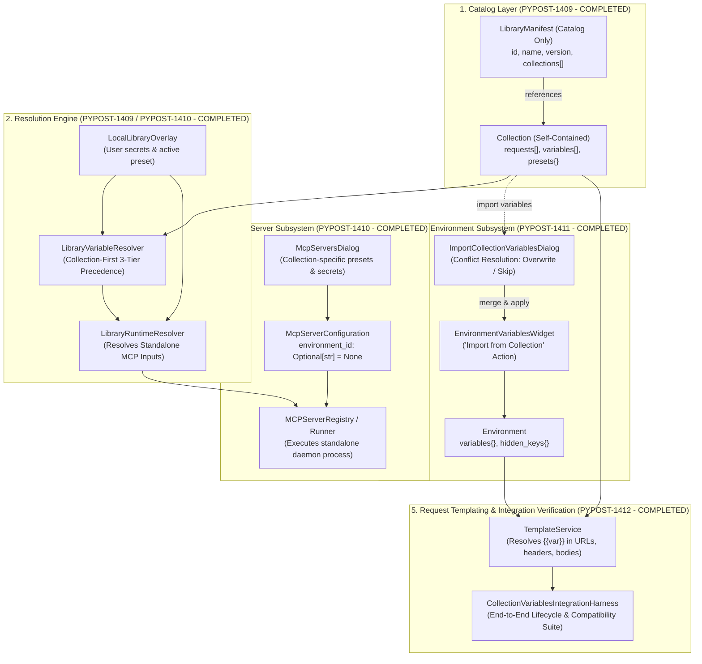
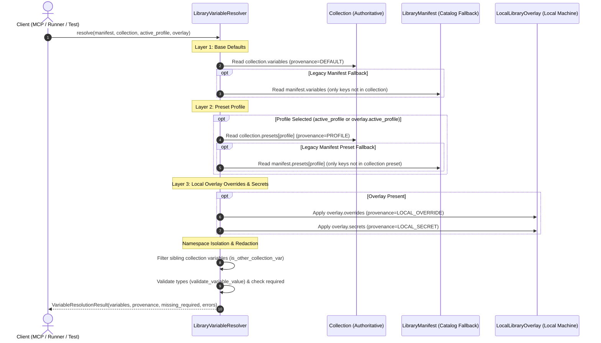
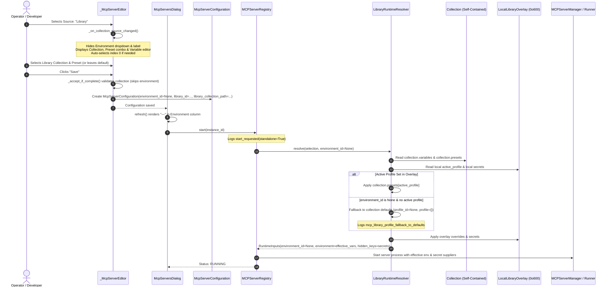
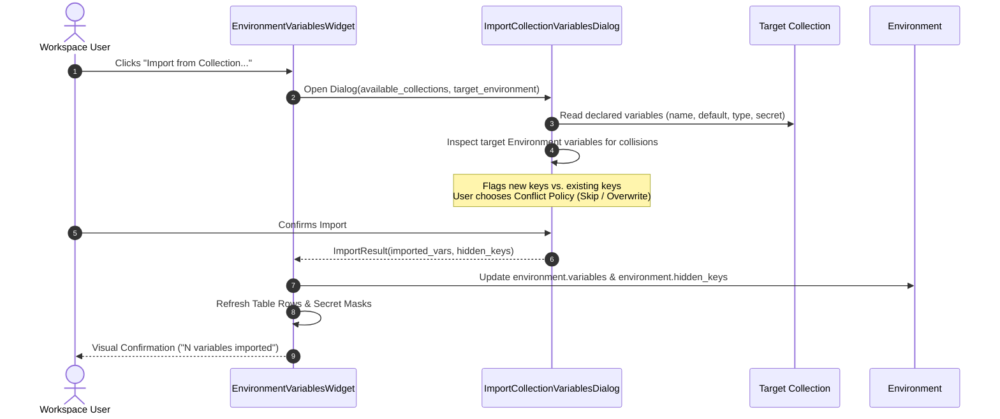
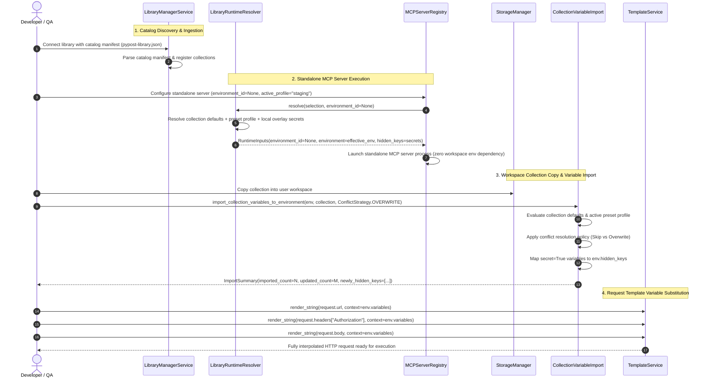
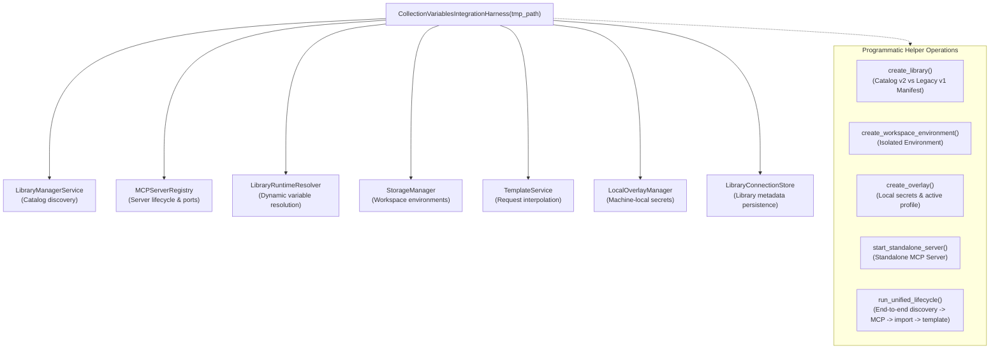
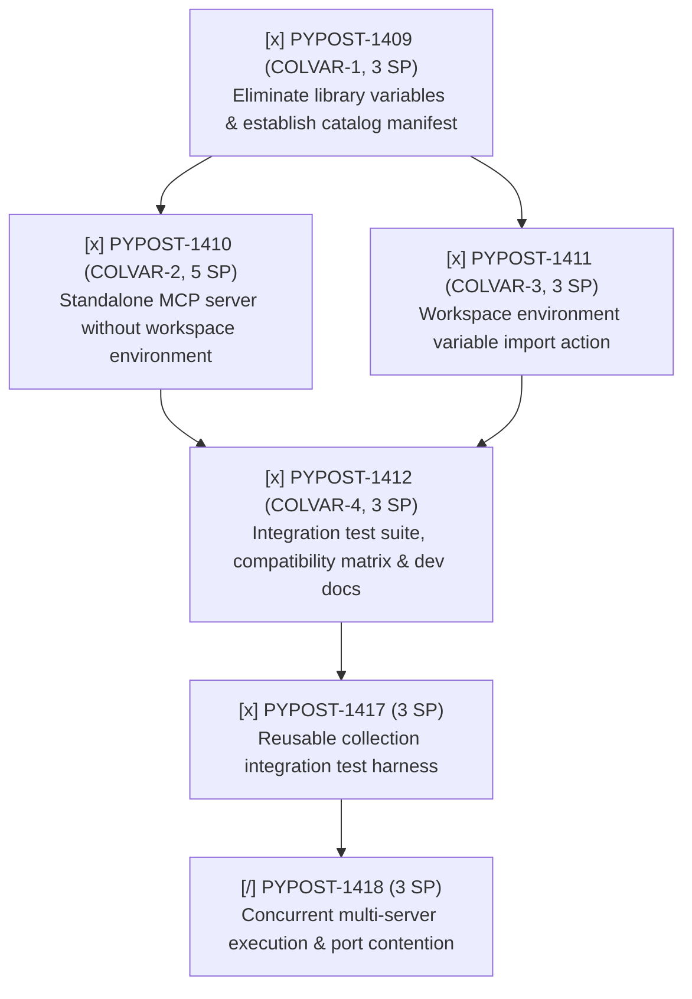

# Collection-Scoped Variables, Standalone MCP Servers, and Workspace Import

## Overview

As part of parent epic [PYPOST-1407](https://pypost.atlassian.net/browse/PYPOST-1407) (*Collection-scoped variables for standalone MCP servers and workspace collection import*) and architectural decomposition [PYPOST-1408](https://pypost.atlassian.net/browse/PYPOST-1408), this document details the architectural evolution from hybrid library-level variable management to self-contained collection-scoped variables.

With the completed implementation of [PYPOST-1409](https://pypost.atlassian.net/browse/PYPOST-1409) (*Eliminate library-level variables and establish collection-scoped variables and catalog manifest*), [PYPOST-1410](https://pypost.atlassian.net/browse/PYPOST-1410) (*Standalone MCP server configuration and execution without workspace environment*), [PYPOST-1411](https://pypost.atlassian.net/browse/PYPOST-1411) (*Workspace environment variable import action from collections*), and [PYPOST-1412](https://pypost.atlassian.net/browse/PYPOST-1412) (*Integration test suite, compatibility matrix, and developer documentation*), the collection library system transitions to a clean, catalog-only model where each [`Collection`](file:///home/src/pypost/models/models.py) serves as the authoritative single source of truth for its variable declarations and environment presets, MCP servers execute standalone without requiring phantom workspace environments, and collections copied to user workspaces seamlessly synchronize variables into workspace environments.

In the legacy design, collection libraries declared variable schemas and preset profiles at the overall library manifest level (`manifest.variables` and `manifest.presets`). While functional for single-collection repositories, this design introduced significant architectural drawbacks:
1. **Global Variable Pollution**: Unrelated collections within a single library (such as Jira, GitLab, and GitHub MCP servers) pooled their variables into a unified namespace, creating naming conflicts and cognitive overhead.
2. **Forced Workspace Environment for MCP Servers**: Launching an MCP server from a library collection required users to create or bind a workspace [`Environment`](file:///home/src/pypost/models/models.py), generating phantom environments solely to satisfy schema constraints.
3. **Missing Variable Bridge on Collection Copy**: Copying a collection from a connected library into a user workspace provided no mechanism in the environment variables view to import declared variables.
4. **Dual Variable Authority**: Both [`LibraryManifest`](file:///home/src/pypost/models/library_manifest.py) and [`Collection`](file:///home/src/pypost/models/models.py) declared variables and presets, obscuring data provenance.

Under the updated architecture, collection libraries act strictly as lightweight catalogs. Each collection is self-contained, owning its declared variables, types, secrets, descriptions, and presets. MCP servers execute standalone without requiring workspace environments, and the environment variables interface provides a dedicated import workflow for workspace synchronization.

---

## Architecture & Data Models

### Architectural Layers



### Core Domain Models

1. **Catalog Manifest ([`LibraryManifest`](file:///home/src/pypost/models/library_manifest.py))**:
   - `LibraryManifest` serves solely as an index of collection file references.
   - `variables` and `presets` fields are deprecated (`deprecated=True`), defaulting to empty structures. Incoming manifests declaring them trigger non-fatal deprecation warnings.
   - Serialization via [`serialize_manifest_to_dict`](file:///home/src/pypost/core/library_manifest.py) automatically strips empty `variables` and `presets` fields so saved catalog manifests remain clean indexes.
   ```python
   class LibraryManifest(BaseModel):
       id: str = Field(default_factory=lambda: str(uuid.uuid4()))
       name: str
       version: str = "1.0.0"
       description: str = ""
       collections: List[str] = Field(default_factory=list)
       # Deprecated fields retained for backward compatibility only
       variables: List[CollectionVariable] = Field(
           default_factory=list,
           deprecated=True,
           description="Deprecated: Use Collection.variables instead.",
       )
       presets: Dict[str, Dict[str, Any]] = Field(
           default_factory=dict,
           deprecated=True,
           description="Deprecated: Use Collection.presets instead.",
       )
   ```

2. **Self-Contained Collection ([`Collection`](file:///home/src/pypost/models/models.py))**:
   - Sole authority for variable declarations, typing, and presets:
     - `variables: List[CollectionVariable]` ([`CollectionVariable`](file:///home/src/pypost/models/collection_variable.py))
     - `presets: Dict[str, Dict[str, Any]]` (mapping preset names to key-value maps)
     - `requests: List[RequestData]`
     - `websockets: List[WebSocketConnection]`
     - `mcp_clients: List[McpClientConnection]`

3. **Standalone Server Configuration ([`McpServerConfiguration`](file:///home/src/pypost/models/settings.py))**:
   - `environment_id` is made optional (`Optional[str] = None`):
   ```python
   class McpServerConfiguration(BaseModel):
       id: str
       name: Optional[str] = None
       host: str = "127.0.0.1"
       port: int = Field(ge=1024, le=65535)
       collection_id: Optional[str] = None
       library_id: Optional[str] = None
       manifest_id: Optional[str] = None
       library_collection_path: Optional[str] = None
       library_collection_index: Optional[int] = None
       environment_id: Optional[str] = None  # Decoupled: Optional for standalone library servers
       server_type: Literal["local", "proxy"] = "local"
       upstream_url: Optional[str] = None
       upstream_transport: Literal["streamable_http", "sse"] = "streamable_http"
       custom_headers: list[CustomHeaderEntry] = Field(default_factory=list)
       bundled_library: bool = False
       enabled: bool = True
   ```
   - **Validation Rules (`validate_server_type_requirements`)**:
     - **Library-backed local servers** (`library_id` present or `bundled_library=True`): `environment_id` is optional and defaults to `None`. The server resolves execution parameters entirely from collection defaults, collection presets, and the machine-local overlay without requiring a workspace environment.
     - **Workspace local servers** (`collection_id` present and not a library server): both `collection_id` and `environment_id` remain strictly mandatory and validated to be non-empty strings, guaranteeing backward compatibility.
     - **Proxy servers** (`server_type == "proxy"`): `upstream_url` is required; `environment_id` and `collection_id` are not required.

4. **Local Secrets Overlay ([`LocalLibraryOverlay`](file:///home/src/pypost/models/library_manifest.py))**:
   - Stores machine-local active presets, non-versioned secret overrides, and parameter configurations outside version control at `~/.pypost/libraries_data/<library_id>/overlay.json` with `0o600` file permissions via [`LocalOverlayManager`](file:///home/src/pypost/core/local_overlay_manager.py).

---

## Variable Resolution Engine & Precedence (PYPOST-1409)

The resolution engine in [`LibraryVariableResolver`](file:///home/src/pypost/core/variable_resolver.py) implements collection-scoped variable authority and a strict 3-tier precedence hierarchy.



### 1. 3-Tier Precedence Hierarchy

Effective variable values are evaluated in order of ascending priority:

1. **Layer 1 (Base Defaults)**:
   - Primary: Default values declared in `collection.variables` (`var.default`).
   - Fallback: Default values in `manifest.variables` are utilized strictly if the key is not declared in `collection.variables`.
   - Provenance: [`VariableProvenance.DEFAULT`](file:///home/src/pypost/models/library_manifest.py).
2. **Layer 2 (Active Preset Profile)**:
   - Evaluated when an active profile is specified (`active_profile` argument or `overlay.active_profile`).
   - Primary: Preset values declared in `collection.presets[profile_name]`.
   - Fallback: Preset values in `manifest.presets[profile_name]` are applied only for keys not declared in the collection preset.
   - Provenance: [`VariableProvenance.PROFILE`](file:///home/src/pypost/models/library_manifest.py).
3. **Layer 3 (Local Overlay - Highest Priority)**:
   - Applied from [`LocalLibraryOverlay`](file:///home/src/pypost/models/library_manifest.py) stored on the local machine.
   - User overrides: `overlay.overrides` applied with provenance [`VariableProvenance.LOCAL_OVERRIDE`](file:///home/src/pypost/models/library_manifest.py).
   - User secrets: `overlay.secrets` applied with provenance [`VariableProvenance.LOCAL_SECRET`](file:///home/src/pypost/models/library_manifest.py).

### 2. Cross-Collection Namespace Isolation

In multi-collection libraries (e.g. bundling Jira, GitHub, and GitLab MCP tools), declaring variables at the catalog root formerly caused cross-collection namespace pollution.

[`LibraryVariableResolver`](file:///home/src/pypost/core/variable_resolver.py) enforces strict cross-collection namespace isolation:
- **Collection Prefix Identification**: Calculates stem prefixes from the target collection's file path, collection name, and ID (`collection_prefixes`).
- **Sibling Prefix Identification**: Computes prefixes belonging to sibling collections declared in `manifest.collections` (`other_collection_prefixes`).
- **Prefix Filtering Contract (`is_other_collection_var`)**:
  - Excludes variables with dot prefixes matching sibling collections (e.g., `github.api_key` is discarded when resolving a Jira collection).
  - Excludes sibling underscore/hyphen prefixed keys (e.g., `github_token` when resolving Jira).
  - Permits un-namespaced variables defined directly in the target collection without forcing awkward manual prefixes.

### 3. Type Validation & Diagnostic Redaction

- Variable values are type-checked against declared schema types (`string`, `integer`, `number`, `boolean`, `array`, `object`) via `validate_variable_value`.
- **Sensitive Redaction**: If a variable is marked `secret=True` on [`CollectionVariable`](file:///home/src/pypost/models/collection_variable.py), its value is masked as `[REDACTED]` in validation error strings and diagnostic logs, preventing credential leaks.
- Under strict mode (`strict_required=True`), unfulfilled required variables without default values are reported in `result.missing_required`.

---

## MCP Runtime Resolution & Secret Masking (PYPOST-1409)

When executing MCP servers from library collections, [`LibraryRuntimeResolver`](file:///home/src/pypost/core/library_runtime_resolver.py) prepares runtime inputs and coordinates secret masking:

### 1. Dynamic Profile Resolution without Manifest Mutation

- Prior to PYPOST-1409, `LibraryRuntimeResolver` mutated `manifest.presets` in-place to inject collection profiles.
- Under the updated contract, profiles are resolved dynamically by reading directly from `collection.presets` and `manifest.presets`, preserving catalog immutability.

### 2. Comprehensive Secret Masking

[`LibraryRuntimeResolver`](file:///home/src/pypost/core/library_runtime_resolver.py) aggregates `hidden_keys` from all contributing layers:
- Declared collection secrets: `{var.name for var in collection.variables if var.secret}`
- Legacy manifest secrets: `{var.name for var in manifest.variables if var.secret}`
- Machine-local overlay secrets: `set(overlay.secrets.keys())`
- Attached workspace environment secrets: `set(environment.hidden_keys)` if an environment is bound.

The aggregated `hidden_keys` set is passed into the MCP server runner, guaranteeing that process environment logs and diagnostic exports mask sensitive parameters.

### 3. Graceful Missing Secret Handling on Initialization

During initial MCP server inspection and catalog loading:
- Missing non-secret required variables raise immediate errors:
  ```
  ValueError("profile_invalid: required library variables are missing")
  ```
- Missing secret variables are handled gracefully without raising fatal errors during server registration and inspection. This allows headless initialization routines, test suites, and catalog dialogs to load and inspect MCP servers before a user has configured machine-local secret overrides in [`LocalLibraryOverlay`](file:///home/src/pypost/models/library_manifest.py).

### 4. Observability & Performance Metrics

- **Latency Tracking**: Runtime resolution records duration using `time.monotonic()` and logs `mcp_library_runtime_validation_completed duration_seconds=...`.
- **Prometheus Metrics**: Validation outcomes are tracked via `track_mcp_library_validation(category)`:
  - Recorded with category `"success"` on completion.
  - Recorded with error categories (e.g. `"profile_missing"`, `"profile_invalid"`, `"manifest_invalid"`) upon failures.

---

## Standalone MCP Server Configuration and Execution (PYPOST-1410)

With the completion of [PYPOST-1410](https://pypost.atlassian.net/browse/PYPOST-1410) (COLVAR-2), MCP servers backed by collection libraries execute completely autonomously as standalone processes without requiring a workspace [`Environment`](file:///home/src/pypost/models/models.py). This eliminates the legacy requirement for phantom workspace environments and provides seamless lifecycle management, variable resolution, reference reconciliation, and UI configuration.



### 1. Data Model Decoupling (`McpServerConfiguration`)

In [`McpServerConfiguration`](file:///home/src/pypost/models/settings.py):
- The `environment_id` field is optional: `environment_id: Optional[str] = None`.
- The root validator [`validate_server_type_requirements`](file:///home/src/pypost/models/settings.py) enforces:
  - **Workspace local servers** (`collection_id` present and not a library server): strictly require a non-empty `collection_id` and non-empty `environment_id`.
  - **Library-backed local servers** (`library_id` present or `bundled_library=True`): `environment_id` is optional and defaults to `None`. Library identity (`library_id`) is required, but workspace environments are completely bypassed.
  - **Proxy servers** (`server_type == "proxy"`): require `upstream_url`; do not require workspace collections or environments.

### 2. Runtime Resolution Decoupling (`LibraryRuntimeResolver`)

In [`LibraryRuntimeResolver`](file:///home/src/pypost/core/library_runtime_resolver.py):
- The resolution entry point is decoupled:
  ```python
  def resolve(
      self,
      selection: dict[str, Any],
      environment_id: Optional[str] = None,
      candidate_overlay=None,
  ) -> RuntimeInputs:
  ```
- [`RuntimeInputs`](file:///home/src/pypost/core/library_runtime_resolver.py) declares `environment_id: Optional[str]`, accommodating standalone servers.
- **Dynamic Profile and Default Fallback**:
  - When `environment_id is None`:
    - If `active_profile` is configured in `overlay.active_profile` (or `candidate_overlay`), the resolver loads preset values from `collection.presets[active_profile]` and `manifest.presets[active_profile]`.
    - If no `active_profile` is configured and `environment_id is None`, the resolver cleanly falls back to collection defaults:
      ```python
      elif environment_id is None:
          profile_id = None
          profile = {}
          logger.debug(
              "mcp_library_profile_fallback_to_defaults "
              "library_id=%s manifest_id=%s active_profile=%s",
              selection.get("library_id", "unknown"),
              selection.get("manifest_id", "unknown"),
              active_profile,
          )
      ```
    - The profile is injected into the collection copy only if `profile_id is not None`.
  - **Precedence & Secrets Evaluation**:
    - Variable values are evaluated using [`LibraryVariableResolver`](file:///home/src/pypost/core/variable_resolver.py) using the 3-tier precedence hierarchy (defaults → preset profile → overlay overrides/secrets).
    - `overridable_keys` is set to an empty set (`set()`), since there is no workspace environment to override collection keys.
    - `hidden_keys` aggregates declared collection secrets, legacy manifest secrets, and overlay secrets.
    - Non-secret missing required variables raise `ValueError("profile_invalid: required library variables are missing")`, while missing secrets are handled gracefully during initialization.

### 3. Server Registry Lifecycle & Reference Reconciliation (`MCPServerRegistry`)

In [`MCPServerRegistry`](file:///home/src/pypost/core/mcp_server_registry.py):
- **Standalone Reference Reconciliation (`reconcile_references`)**:
  - Previously, `reconcile_references()` assumed all local servers require workspace collections and workspace environments, stopping library servers without workspace environments with `"cannot run: missing environment"`.
  - Under the standalone architecture, `reconcile_references()` introduces dedicated branches:
    - **Library servers (`configuration.library_id`)**: checks if the library connection exists via `self.library_service.get_connection(configuration.library_id)`. If `configuration.environment_id is None`, it logs `mcp_registry_reconcile_standalone_library_server` (`skipping_environment_check=True`) and skips the workspace environment check. If `environment_id` is explicitly set, it validates existence against valid environment IDs.
    - **Bundled library servers (`configuration.bundled_library`)**: if `configuration.environment_id is None`, it logs `mcp_registry_reconcile_standalone_bundled_server` and skips workspace environment verification.
  - **Architectural Invariant**: Standalone MCP servers remain preserved and operational across workspace environment deletions, pruning, and modifications.
- **Server Startup & Supervision**:
  - `start(instance_id)`: logs `mcp_registry_start_requested` with `environment_id` and `standalone=True/False`.
  - `_runtime_inputs(configuration)`: delegates to `LibraryRuntimeResolver.resolve` with `configuration.environment_id` (`None` for standalone servers). Returns `None` only if a workspace collection server is missing its required `collection_id` or `environment_id`.
  - `_start_manager()`: logs `mcp_registry_manager_starting` with `standalone=True/False` and registered tool count. Configures variable and secret suppliers for runtime resolution.
  - `_verify_references(instance_id)`: verifies library connection existence via `library_service.get_connection()` without requiring a workspace environment or collection ID.
  - `refresh_environment(environment_id)`: standalone servers (`environment_id is None`) are safely filtered out, avoiding spurious server restarts when workspace environments change.

### 4. User Interface Behavior (`_McpServerEditor` and `McpServersDialog`)

In [`pypost/ui/dialogs/mcp_servers_dialog.py`](file:///home/src/pypost/ui/dialogs/mcp_servers_dialog.py):
- **Dynamic Field Visibility in `_McpServerEditor`**:
  - In `_on_collection_source_changed()`:
    - When the source is `"library"` (`is_local and is_library`):
      - The `Environment` combobox and its form layout label are hidden:
        ```python
        show_env = not (is_local and is_library)
        self._environment.setVisible(show_env)
        env_label = self._layout.labelForField(self._environment)
        if env_label:
            env_label.setVisible(show_env)
        ```
      - Library collection picker, profile combobox, and collection variable widgets are shown.
      - Default collection auto-selection: if `_library_collection.currentIndex() < 0` and collections are available, it automatically selects index 0.
- **Form Validation & Save Contract**:
  - In `_accept_if_complete()`: for library collections, validates that `self._library_collection.currentData()` is selected (`"Collection is required."`), completely bypassing workspace environment validation.
  - In `configuration()`: generates `McpServerConfiguration` with:
    ```python
    env_id = (
        str(self._environment.currentData())
        if (self._environment.isVisible() and self._environment.currentData())
        else None
    )
    ```
    Storing `environment_id = None` when the environment field is hidden.
- **Table View Presentation in `McpServersDialog`**:
  - In `refresh()`: when populating the server list table, checks `configuration.environment_id`:
    ```python
    env_display = (
        "—"
        if configuration.environment_id is None
        else environment_names.get(
            configuration.environment_id, configuration.environment_id
        )
    )
    ```
    Rendering an em-dash (`"—"`) for standalone servers. This prevents `TypeError` in `QTableWidgetItem` and gives operators an immediate visual cue that the server runs standalone.

---

## Workspace Environment Variable Import Flow

When a user copies a library collection into their workspace or works with an existing collection, declared variables can be imported directly into a workspace [`Environment`](file:///home/src/pypost/models/models.py).



### Import Policies and Secret Protection

- **Trigger Location**: A dedicated `Import from Collection...` button is embedded in [`EnvironmentVariablesWidget`](file:///home/src/pypost/ui/widgets/environments/environment_variables_widget.py).
- **Conflict Resolution Strategies**:
  - `Skip`: Preserves existing environment variable values; adds only newly declared collection variables.
  - `Overwrite`: Replaces existing values with collection default values.
- **Automatic Secret Mapping**: Any variable with `secret=True` on [`CollectionVariable`](file:///home/src/pypost/models/collection_variable.py) is automatically added to `Environment.hidden_keys`, guaranteeing masking in UI tables and encryption at rest via the secure storage manager.
- **Pure Domain Helper**: Variable synchronization logic is encapsulated in a pure helper function:
  ```python
  def import_collection_variables_to_environment(
      environment: Environment,
      collection: Collection,
      overwrite: bool = False,
      selected_keys: Optional[Set[str]] = None,
  ) -> ImportSummary:
      ...
  ```

---

## End-to-End Integration Architecture & Unified Lifecycle (PYPOST-1412)

With the completion of [PYPOST-1412](https://pypost.atlassian.net/browse/PYPOST-1412) (COLVAR-4), all four components of epic [PYPOST-1407](https://pypost.atlassian.net/browse/PYPOST-1407) operate as a cohesive, end-to-end integration pipeline connecting catalog discovery, standalone MCP execution, workspace variable synchronization, and template substitution.



### Integrated Subsystem Interactions

1. **Catalog Discovery ([`LibraryManagerService`](file:///home/src/pypost/core/library_manager_service.py))**:
   - Discovers and loads `pypost-library.json` (or `.yaml`) catalog files.
   - Treats catalog manifests purely as collection indices, decoupling collection schemas from root manifest structures.
2. **Standalone MCP Execution ([`MCPServerRegistry`](file:///home/src/pypost/core/mcp_server_registry.py))**:
   - Runs MCP server processes with `environment_id=None`.
   - Uses [`LibraryRuntimeResolver`](file:///home/src/pypost/core/library_runtime_resolver.py) and [`LibraryVariableResolver`](file:///home/src/pypost/core/variable_resolver.py) to resolve runtime inputs directly from self-contained collection presets and local overlays (`~/.pypost/libraries_data/<library_id>/overlay.json`).
3. **Workspace Environment Import ([`import_collection_variables_to_environment`](file:///home/src/pypost/core/collection_variable_import.py))**:
   - Imports declared collection variables directly into workspace environments without altering existing request definitions.
   - Enforces conflict resolution policies ([`ConflictStrategy.SKIP`](file:///home/src/pypost/core/collection_variable_import.py) or [`ConflictStrategy.OVERWRITE`](file:///home/src/pypost/core/collection_variable_import.py)).
   - Automatically populates `Environment.hidden_keys` for all variables with `secret=True`.
4. **Template Substitution ([`TemplateService`](file:///home/src/pypost/core/template_service.py))**:
   - Resolves mustache-style `{{ variable }}` expressions across request URLs, authentication headers, and JSON/YAML/text payloads using the synchronized environment variables.

---

## 4-Quadrant Backward Compatibility Matrix & Migration Strategy

To guarantee seamless backward compatibility across existing libraries and collections created in earlier PyPost iterations, the resolution engine and catalog deserializer adhere to a formal 4-quadrant compatibility contract.

### 1. 4-Quadrant Compatibility Matrix

| Matrix Quadrant | Manifest Format | Collection Format | Resolution Behavior | Provenance & Precedence | Deprecation Notice | Operational Status |
| :---: | :--- | :--- | :--- | :--- | :--- | :--- |
| **Q1** | **Modern Catalog Manifest (v2)**<br/>`version: "2.0.0"`<br/>Pure catalog index (no root `variables`/`presets`) | **Modern Collection (v2)**<br/>Self-contained `variables[]` & `presets{}` | Collection variables and presets resolve 100% autonomously. | `DEFAULT` (Collection) → `PROFILE` (Collection) → `LOCAL_OVERLAY` | None (Clean modern operation). | **Supported (Golden Standard)** |
| **Q2** | **Legacy Library Manifest (v1)**<br/>`version: "1.0.0"`<br/>Declares root `variables[]` & `presets{}` | **Modern Collection (v2)**<br/>Self-contained `variables[]` & `presets{}` | Collection variables take precedence for all defined keys. Legacy manifest variables serve as fallback for un-declared keys. | `DEFAULT` (Collection wins over Manifest) → `PROFILE` (Collection wins over Manifest) → `LOCAL_OVERLAY` | `DeprecationWarning` & `logger.warning("legacy_manifest_variables_detected")` | **Supported (Backward Compatible)** |
| **Q3** | **Legacy Library Manifest (v1)**<br/>`version: "1.0.0"`<br/>Declares root `variables[]` & `presets{}` | **Legacy Collection (v1)**<br/>Empty `variables: []` & `presets: {}` | Legacy manifest root variables and presets resolve as fallback defaults for the collection. | `DEFAULT` (Manifest fallback) → `PROFILE` (Manifest fallback) → `LOCAL_OVERLAY` | `DeprecationWarning` & `logger.warning("legacy_manifest_variables_detected")` | **Supported (Backward Compatible)** |
| **Q4** | **Modern Catalog Manifest (v2)**<br/>`version: "2.0.0"`<br/>Pure catalog index | **Legacy Collection (v1)**<br/>Empty `variables: []` & `presets: {}` | No variables resolved (empty variable dictionary). Collection defaults empty. Required variable checks fail gracefully with diagnostic error. | Empty resolution (`{}`) | None (Empty manifest). | **Supported (Degraded / Empty defaults)** |

### 2. Precedence Resolution Hierarchy & Degraded Fallback

Effective variable values are evaluated by [`LibraryVariableResolver`](file:///home/src/pypost/core/variable_resolver.py) in ascending order of priority:

1. **Tier 1 (Base Defaults)**:
   - Primary: Values declared in `collection.variables` (`var.default`), assigned [`VariableProvenance.DEFAULT`](file:///home/src/pypost/models/library_manifest.py).
   - Fallback (Q2 & Q3): Values declared in `manifest.variables` are used **only if the key is not defined in `collection.variables`**.
2. **Tier 2 (Active Preset Profile)**:
   - Evaluated when an active profile is requested (`active_profile` argument or `overlay.active_profile`).
   - Primary: Preset values declared in `collection.presets[profile_name]`, assigned [`VariableProvenance.PROFILE`](file:///home/src/pypost/models/library_manifest.py).
   - Fallback (Q2 & Q3): Values in `manifest.presets[profile_name]` are applied **only for keys omitted from the collection preset**.
3. **Tier 3 (Local Overlay - Highest Priority)**:
   - Evaluated from [`LocalLibraryOverlay`](file:///home/src/pypost/models/library_manifest.py) on the local machine (`~/.pypost/libraries_data/<library_id>/overlay.json`).
   - `overlay.overrides` applied with [`VariableProvenance.LOCAL_OVERRIDE`](file:///home/src/pypost/models/library_manifest.py).
   - `overlay.secrets` applied with [`VariableProvenance.LOCAL_SECRET`](file:///home/src/pypost/models/library_manifest.py).

### 3. Mixed Multi-Tool Library Support

Libraries often bundle multiple distinct MCP tools (e.g. Jira, GitHub, and GitLab) within a single repository:
- **Namespace Isolation**: [`LibraryVariableResolver`](file:///home/src/pypost/core/variable_resolver.py) uses prefix matching (`collection_prefixes` vs `other_collection_prefixes`) via `is_other_collection_var()`. Sibling collection variables (e.g. `github.api_key` when resolving Jira) are excluded, preventing cross-tool variable leakage.
- **Heterogeneous Collections**: A single library catalog can reference both Modern (v2) and Legacy (v1) collections. Modern collections resolve self-contained variables independently, while legacy sibling collections leverage manifest fallback without mutual interference.

### 4. Migration Blueprint for Library Maintainers

To migrate legacy v1 library manifests to modern v2 catalog manifests:
1. **Relocate Variable Declarations**: Copy `manifest.variables` into the target `collection.json` under `variables: List[CollectionVariable]`.
2. **Relocate Preset Profiles**: Copy `manifest.presets` into the target `collection.json` under `presets: Dict[str, Dict[str, Any]]`.
3. **Cleanse Catalog Manifest**: Remove top-level `variables` and `presets` fields from `pypost-library.json` (or `.yaml`), and set `version: "2.0.0"`. Deserialization via [`serialize_manifest_to_dict`](file:///home/src/pypost/core/library_manifest.py) automatically strips empty variable and preset fields.

---

## Secret Safety, Diagnostic Redaction, and Missing Variable Contracts

The integration architecture establishes strict security and diagnostic boundaries to ensure secrets remain safe across all operational flows:

### 1. Unified Secret Masking Boundaries

Sensitive credentials are automatically masked across all layers:
- **Declared Collection Secrets**: Any variable declared with `secret=True` on [`CollectionVariable`](file:///home/src/pypost/models/collection_variable.py).
- **Legacy Manifest Secrets**: Any fallback variable with `secret=True` on [`LibraryManifest`](file:///home/src/pypost/models/library_manifest.py).
- **Machine-Local Overlay Secrets**: All keys defined in `LocalLibraryOverlay.secrets`.
- **Workspace Environment Hidden Keys**: Any variable tracked in `Environment.hidden_keys`.

When a collection is imported into a workspace environment via [`import_collection_variables_to_environment`](file:///home/src/pypost/core/collection_variable_import.py), all variables marked `secret=True` are automatically added to `target_environment.hidden_keys`, guaranteeing masking in UI tables and secure encryption at rest via the secure storage manager.

### 2. Zero Plaintext Redaction Contract

Secrets are strictly protected from accidental exposure in failure paths:
- **Validation Errors**: [`LibraryVariableResolver`](file:///home/src/pypost/core/variable_resolver.py) masks secret values as `[REDACTED]` in validation error messages.
- **Structured Logs**: Log statements across [`LibraryRuntimeResolver`](file:///home/src/pypost/core/library_runtime_resolver.py) and [`MCPServerRegistry`](file:///home/src/pypost/core/mcp_server_registry.py) omit raw secret payloads.
- **Import Summaries**: The `format_summary()` method of [`ImportSummary`](file:///home/src/pypost/core/collection_variable_import.py) reports only counts and masked key names, never plaintext values.

### 3. Missing Variable Diagnostic Handling

The runtime resolution engine distinguishes between non-secret and secret missing variables:
- **Missing Non-Secret Required Variables**: If a required non-secret variable has no default value and is not supplied in presets or overlays, [`LibraryRuntimeResolver.resolve`](file:///home/src/pypost/core/library_runtime_resolver.py) immediately raises a fatal diagnostic error:
  ```python
  ValueError("profile_invalid: required library variables are missing: ['missing_host']")
  ```
- **Missing Secret Required Variables**: Missing secret variables are gracefully tolerated during initial MCP server registration and catalog inspection. This allows headless initialization, automated catalog tests, and UI inspection routines to register MCP servers before a user has configured local secret overrides in [`LocalLibraryOverlay`](file:///home/src/pypost/models/library_manifest.py).

---

## Integration Test Harness Architecture (`CollectionVariablesIntegrationHarness`)

Automated end-to-end integration and compatibility matrix verification is encapsulated in [`CollectionVariablesIntegrationHarness`](file:///home/src/tests/helpers/collection_integration_harness.py) under `tests.helpers.collection_integration_harness` (established in [PYPOST-1412](https://pypost.atlassian.net/browse/PYPOST-1412) and extracted as a shared helper in [PYPOST-1417](https://pypost.atlassian.net/browse/PYPOST-1417)). For complete helper details, see the dedicated guide [Reusable Collection Integration Test Harness](collection_integration_harness.md).



### Coordinated Multi-Subsystem Services

The harness constructs and synchronizes an isolated instance of all core subsystem services rooted under a dedicated `tmp_path`:
- [`StorageManager`](file:///home/src/pypost/core/storage.py): Manages isolated workspace environments under `tmp_path/workspace/`.
- [`LibraryConnectionStore`](file:///home/src/pypost/core/library_connection_store.py): Persists library connection metadata at `tmp_path/connections.json`.
- [`LocalOverlayManager`](file:///home/src/pypost/core/local_overlay_manager.py): Persists machine-local secret overrides under `tmp_path/libraries_data/` with `0o600` file permissions.
- [`TemplateService`](file:///home/src/pypost/core/template_service.py): Evaluates template expressions in URLs, headers, and request bodies.
- [`LibraryManagerService`](file:///home/src/pypost/core/library_manager_service.py): Discovers catalog and legacy manifests and registers collections.
- [`LibraryRuntimeResolver`](file:///home/src/pypost/core/library_runtime_resolver.py): Implements 3-tier precedence and standalone environment resolution.
- [`MCPServerRegistry`](file:///home/src/pypost/core/mcp_server_registry.py): Oversees local and standalone MCP server lifecycles, states, and process supervision.

### Context Manager Usage & Resource Teardown Guarantees

The harness implements the Python context manager protocol (`__enter__` and `__exit__`), guaranteeing that all started MCP server background threads, sub-processes, and connections are cleaned up safely even when assertion errors or exceptions occur during test execution:

```python
from tests.helpers.collection_integration_harness import CollectionVariablesIntegrationHarness

def test_custom_scenario(tmp_path):
    with CollectionVariablesIntegrationHarness(tmp_path) as harness:
        lib_dir = harness.create_library("my-lib", collections_data={...})
        server_id, port, status = harness.start_standalone_server("my-lib", "col1")
        assert status == "running"
    # Guaranteed: harness.teardown() stops all servers and releases ports
```

- **Idempotent Teardown**: `harness.teardown()` (and its alias `harness.close()`) safely invokes `registry.stop_all()`. Multiple invocations do not raise errors or double-close resources.
- **Exception Logging**: `__exit__` catches and logs unhandled exceptions during test execution at `ERROR` level before invoking `teardown()`.

### Pytest Fixture Bindings

The helper module exports standard pytest fixture bindings so test suites do not need manual instantiation or teardown logic:

```python
from tests.helpers.collection_integration_harness import (
    collection_integration_harness,
    collection_harness,
)

def test_with_fixture(collection_integration_harness):
    result = collection_integration_harness.run_unified_lifecycle(...)
    assert result.status == "success"

def test_with_alias(collection_harness):
    env = collection_harness.create_workspace_environment(name="Dev")
    assert env.name == "Dev"
```

Both `collection_integration_harness` and `collection_harness` automatically yield the harness and execute `teardown()` in a `finally` block upon test completion.

### Core Programmatic Helper Methods

1. **`create_library(manifest_id, is_legacy_manifest, collections_data, manifest_variables, manifest_presets) -> Path`**:
   - Synthesizes an isolated library directory under `tmp_path/libraries/<manifest_id>`.
   - Generates either a pure catalog manifest (`version: "2.0.0"`) or a legacy manifest (`version: "1.0.0"` with root variables and presets).
   - Automatically connects the directory to `LibraryManagerService`.
2. **`create_workspace_environment(name, variables, hidden_keys) -> Environment`**:
   - Persists an isolated workspace environment under `tmp_path/workspace/environments/` using [`StorageManager`](file:///home/src/pypost/core/storage.py).
3. **`create_overlay(library_id, active_profile, secrets) -> LocalLibraryOverlay`**:
   - Persists a machine-local overlay under `tmp_path/libraries_data/<library_id>/overlay.json` with active profile and encrypted secrets.
4. **`start_standalone_server(manifest_id, collection_id, collection_filename, collection_name, host, port) -> tuple[str, int, str]`**:
   - Allocates an ephemeral collision-free port via `allocate_tcp_port()`, configures `McpServerConfiguration(environment_id=None)`, validates the candidate, starts the server in `MCPServerRegistry`, and waits for the `"running"` state.
5. **`run_unified_lifecycle(manifest_id, collection_data, active_profile, overlay_secrets, workspace_env_name, conflict_strategy) -> UnifiedLifecycleResult`**:
   - Orchestrates the complete 5-step integration lifecycle in a single call:
     1. Discovers and connects catalog library.
     2. Configures machine-local overlay secrets and active profile.
     3. Starts standalone MCP server without a workspace environment.
     4. Copies collection into workspace environment with conflict resolution.
     5. Renders request URLs, headers, and request body via [`TemplateService`](file:///home/src/pypost/core/template_service.py).

### Unified Lifecycle Result Dataclass

```python
@dataclass
class UnifiedLifecycleResult:
    """Outcome of end-to-end multi-subsystem workflow execution."""
    status: str
    standalone_server_id: str
    standalone_status: str
    imported_summary: ImportSummary
    rendered_request_url: str
    rendered_auth_header: str
    rendered_body: str
```

### Test Guardrails & Invariants

- **Zero Global State**: All stores and service singletons are bound to isolated temporary directories (`tmp_path`).
- **Safe Port Allocation**: Local test servers use `tests.helpers.port_allocation.allocate_tcp_port()` to prevent TCP bind collisions.
- **Strict Timeout Contracts**: All integration tests declare explicit timeout markers (`pytestmark = [pytest.mark.timeout(30)]`).
- **Offline Execution**: 100% offline; requires zero network connectivity or external mock servers.
- **Reference Test Suites**:
  - `tests/test_collection_integration_harness_repro.py`: Validates harness imports, context manager lifecycle, pytest fixture bindings, and unified orchestration.
  - `tests/test_collection_scoped_variables_integration.py`: End-to-end compatibility matrix and multi-subsystem integration test suite.

---

## Concurrent Multi-Server Lifecycle Execution and Port Contention (PYPOST-1418)

Following the implementation of standalone server execution ([PYPOST-1410](https://pypost.atlassian.net/browse/PYPOST-1410)) and the shared integration harness ([PYPOST-1417](https://pypost.atlassian.net/browse/PYPOST-1417)), [PYPOST-1418](https://pypost.atlassian.net/browse/PYPOST-1418) establishes rigorous concurrency, lifecycle synchronization, and port contention guarantees for running multiple independent standalone MCP servers simultaneously.

For complete architectural details and sequence diagrams, see the dedicated developer guide: [Concurrent Multi-Server Lifecycle Execution and Port Contention](mcp_concurrent_multiserver.md).

### 1. Concurrency Model & Lifecycle Guarantees

In [`MCPServerRegistry`](file:///home/src/pypost/core/mcp_server_registry.py), each registered endpoint configuration maps to an independent [`MCPServerManager`](file:///home/src/pypost/core/qt/mcp_server.py) and [`MCPServerImpl`](file:///home/src/pypost/core/mcp_server_impl.py).

- **Independent Worker Threads**: Every server runs its own `uvicorn.Server` instance within a dedicated daemon thread and private `asyncio` event loop.
- **Reentrancy Protection**: State transitions, reconfigurations, and deletions are synchronized via `_reconfiguration_lock` (`threading.RLock()`), preventing deadlocks during concurrent operations.
- **Deep-Copy Isolation**: Configurations and collection payloads are cloned using `model_copy(deep=True)` before reaching server managers, preventing mutable data leaks.

### 2. Parallel Startup with Barrier Synchronization

- **Simultaneous Startup**: When multiple standalone servers are launched concurrently across worker threads, the registry processes start requests without deadlocks or startup race conditions.
- **Barrier Verification**: Validated in `test_concurrent_multi_server_startup_parallel` using `threading.Barrier(3)` across 3 worker threads. All servers simultaneously transition to `state="running"`, report `is_listening == True`, and concurrently answer JSON-RPC `tools/list` requests.

### 3. Collection Variable Isolation Across Overlapping Namespaces

When distinct collections share identical variable keys (e.g. `base_url`, `api_token`), their values resolve with complete isolation:
- **Supplier Closures**: The registry binds per-instance variable suppliers (`manager.set_variable_supplier(lambda: dict(variables))`) using unique dictionary snapshots generated by [`LibraryRuntimeResolver`](file:///home/src/pypost/core/library_runtime_resolver.py).
- **Zero Cross-Talk**: Validated in `test_shared_and_overlapping_collection_variables_isolation` across 60 parallel tool calls to three servers (Server Alpha with `base_url="https://alpha.internal.net"`, Server Beta with `base_url="https://beta.internal.net"`, and Server Gamma with `base_url="https://gamma.internal.net"`). Every response echoes the exact server-specific value with zero leakage.

### 4. Hot Reload Under Active Load

- **Zero-Downtime Reconfiguration**: Modifying variables on a running server via [`MCPServerRegistry.reconfigure`](file:///home/src/pypost/core/mcp_server_registry.py) performs an atomic swap once the candidate server binds.
- **Continuous Peer Throughput**: Validated in `test_concurrent_hot_reload_under_active_execution`. Background worker threads continuously executing requests against Servers 2 and 3 experience zero dropped connections, zero failures, and zero latency regressions while Server 1 is actively hot-reloaded with updated variable values.

### 5. Port Collision Handling & Graceful Recovery

- **Preflight & Runtime Detection**: In-registry port duplicates are rejected synchronously by `_validate_available_port()`. If an external socket holds the configured port, the uvicorn bind attempt raises `OSError(errno.EADDRINUSE)`.
- **Graceful Failure State**: [`MCPServerManager._run_uvicorn`](file:///home/src/pypost/core/qt/mcp_server.py) intercepts `OSError`, logs `mcp_server_start_failed` at `ERROR` level, and notifies the registry to set `state="failed"`. Peer servers continue serving requests unaffected.
- **Clean Recovery**: Validated in `test_port_collision_detection_and_graceful_recovery`. Updating the configuration with a free port allows the failed server to restart and transition to `state="running"` smoothly.

### 6. Concurrent Multi-Server Teardown & Socket Hygiene

- **Orderly Termination**: Concurrent `stop(instance_id)` or `stop_all()` signals worker threads via `should_exit = True` and joins threads with bounded 2.0s timeouts.
- **Immediate Socket Re-binding**: Operating system sockets are cleanly released with `SO_REUSEADDR`. Validated in `test_concurrent_multi_server_teardown_and_socket_hygiene`: raw TCP sockets and new server instances re-bind to the exact same ports immediately after shutdown without encountering `EADDRINUSE`.

### 7. Automated Test Suite

All concurrency and contention guarantees are verified in [`tests/test_mcp_concurrent_multiserver_repro.py`](file:///home/src/tests/test_mcp_concurrent_multiserver_repro.py):

```bash
make test PYTEST_ARGS='tests/test_mcp_concurrent_multiserver_repro.py'
```

---

## Child Task Execution Sequence

Epic [PYPOST-1407](https://pypost.atlassian.net/browse/PYPOST-1407) is partitioned into four focused child stories under Sprint 2033, followed by live testing and concurrency follow-ups:



| Jira Key | Identifier | SP | Status | Focus Area | Downstream Deliverables |
| --- | --- | :---: | :---: | --- | --- |
| [PYPOST-1409](https://pypost.atlassian.net/browse/PYPOST-1409) | `COLVAR-1` | 3 | **Completed** | Catalog manifest & collection authority | Deprecate manifest variables; update `LibraryManifest`, `LibraryVariableResolver`, and `LibraryRuntimeResolver`. |
| [PYPOST-1410](https://pypost.atlassian.net/browse/PYPOST-1410) | `COLVAR-2` | 5 | **Completed** | Standalone MCP server execution | Optional `environment_id` in `McpServerConfiguration`; `_McpServerEditor` & `McpServersDialog` decoupling; standalone runtime resolution in `LibraryRuntimeResolver`; server registry preservation in `MCPServerRegistry`. |
| [PYPOST-1411](https://pypost.atlassian.net/browse/PYPOST-1411) | `COLVAR-3` | 3 | **Completed** | Workspace variable import action | `EnvironmentVariablesWidget` import trigger; selection dialog; conflict resolution; secret masking; [Workspace Environment Variable Import](workspace_environment_variable_import.md). |
| [PYPOST-1412](https://pypost.atlassian.net/browse/PYPOST-1412) | `COLVAR-4` | 3 | **Completed** | Integration tests & documentation | End-to-end integration test suite; 4-quadrant compatibility matrix; diagnostic safety; developer documentation consolidation. |
| [PYPOST-1417](https://pypost.atlassian.net/browse/PYPOST-1417) | — | 3 | **Completed** | Reusable Integration Harness | Extracted `tests.helpers.collection_integration_harness` module; pytest fixtures; [Reusable Collection Integration Test Harness](collection_integration_harness.md). |
| [PYPOST-1418](https://pypost.atlassian.net/browse/PYPOST-1418) | — | 3 | **In Progress** | Concurrency & Port Contention | Multi-server parallel startup; variable isolation; active hot reload; port collision resilience; teardown hygiene; [Concurrent Multi-Server Lifecycle Execution](mcp_concurrent_multiserver.md). |

### Phased Roadmap

1. **Phase 1 (Foundation - COMPLETED)**: Executed [PYPOST-1409](https://pypost.atlassian.net/browse/PYPOST-1409) to establish the catalog-only manifest model, deprecate library-level variables, and anchor 3-tier variable resolution within collections.
2. **Phase 2 (Parallel Feature Tracks - COMPLETED)**:
   - **Completed [PYPOST-1410](https://pypost.atlassian.net/browse/PYPOST-1410)**: Standalone MCP server configuration and execution decoupled from workspace environments.
   - **Completed [PYPOST-1411](https://pypost.atlassian.net/browse/PYPOST-1411)**: Workspace environment variable import action and UI conflict resolution workflow.
3. **Phase 3 (Consolidation & Verification - COMPLETED)**: Executed [PYPOST-1412](https://pypost.atlassian.net/browse/PYPOST-1412) to validate end-to-end integration contracts across all components, assert the 4-quadrant compatibility matrix, and consolidate developer documentation.
4. **Phase 4 (Harness Extraction & Concurrency Verification)**:
   - **Completed [PYPOST-1417](https://pypost.atlassian.net/browse/PYPOST-1417)**: Reusable integration harness extracted to `tests.helpers.collection_integration_harness`.
   - **Executed [PYPOST-1418](https://pypost.atlassian.net/browse/PYPOST-1418)**: Concurrent multi-server lifecycle execution and port contention verification.

---

## Traceability & References

- **Parent Epic**: [PYPOST-1407](https://pypost.atlassian.net/browse/PYPOST-1407)
- **Decomposition Task**: [PYPOST-1408](https://pypost.atlassian.net/browse/PYPOST-1408)
- **Foundation Implementation Task**: [PYPOST-1409](https://pypost.atlassian.net/browse/PYPOST-1409)
  - Architecture Specification: [`ai-tasks/PYPOST-1409/20-architecture.md`](file:///home/src/ai-tasks/PYPOST-1409/20-architecture.md)
  - Observability Report: [`ai-tasks/PYPOST-1409/50-observability.md`](file:///home/src/ai-tasks/PYPOST-1409/50-observability.md)
  - Technical Debt Report: [`ai-tasks/PYPOST-1409/60-tech-debt.md`](file:///home/src/ai-tasks/PYPOST-1409/60-tech-debt.md)
  - Automated Repro & Regression Tests: [`tests/test_collection_scoped_variables_repro.py`](file:///home/src/tests/test_collection_scoped_variables_repro.py)
- **Standalone MCP Server Implementation Task**: [PYPOST-1410](https://pypost.atlassian.net/browse/PYPOST-1410)
  - Requirements Document: [`ai-tasks/PYPOST-1410/10-requirements.md`](file:///home/src/ai-tasks/PYPOST-1410/10-requirements.md)
  - Architecture Specification: [`ai-tasks/PYPOST-1410/20-architecture.md`](file:///home/src/ai-tasks/PYPOST-1410/20-architecture.md)
  - Code Cleanup Report: [`ai-tasks/PYPOST-1410/40-code-cleanup.md`](file:///home/src/ai-tasks/PYPOST-1410/40-code-cleanup.md)
  - Observability Report: [`ai-tasks/PYPOST-1410/50-observability.md`](file:///home/src/ai-tasks/PYPOST-1410/50-observability.md)
  - Technical Debt Report: [`ai-tasks/PYPOST-1410/60-tech-debt.md`](file:///home/src/ai-tasks/PYPOST-1410/60-tech-debt.md)
  - Developer Documentation Report: [`ai-tasks/PYPOST-1410/70-dev-docs.md`](file:///home/src/ai-tasks/PYPOST-1410/70-dev-docs.md)
  - Automated Repro & Regression Tests: [`tests/test_mcp_standalone_execution_repro.py`](file:///home/src/tests/test_mcp_standalone_execution_repro.py)
- **Workspace Variable Import Implementation Task**: [PYPOST-1411](https://pypost.atlassian.net/browse/PYPOST-1411)
  - Requirements Document: [`ai-tasks/PYPOST-1411/10-requirements.md`](file:///home/src/ai-tasks/PYPOST-1411/10-requirements.md)
  - Architecture Specification: [`ai-tasks/PYPOST-1411/20-architecture.md`](file:///home/src/ai-tasks/PYPOST-1411/20-architecture.md)
  - Code Cleanup Report: [`ai-tasks/PYPOST-1411/40-code-cleanup.md`](file:///home/src/ai-tasks/PYPOST-1411/40-code-cleanup.md)
  - Observability Report: [`ai-tasks/PYPOST-1411/50-observability.md`](file:///home/src/ai-tasks/PYPOST-1411/50-observability.md)
  - Technical Debt Report: [`ai-tasks/PYPOST-1411/60-tech-debt.md`](file:///home/src/ai-tasks/PYPOST-1411/60-tech-debt.md)
  - Developer Documentation: [`doc/dev/workspace_environment_variable_import.md`](file:///home/src/doc/dev/workspace_environment_variable_import.md)
  - Automated Repro & Regression Tests: [`tests/test_workspace_environment_import_repro.py`](file:///home/src/tests/test_workspace_environment_import_repro.py)
- **Integration Test Suite & Documentation Task**: [PYPOST-1412](https://pypost.atlassian.net/browse/PYPOST-1412)
  - Requirements Document: [`ai-tasks/PYPOST-1412/10-requirements.md`](file:///home/src/ai-tasks/PYPOST-1412/10-requirements.md)
  - Architecture Specification: [`ai-tasks/PYPOST-1412/20-architecture.md`](file:///home/src/ai-tasks/PYPOST-1412/20-architecture.md)
  - Code Cleanup Report: [`ai-tasks/PYPOST-1412/40-code-cleanup.md`](file:///home/src/ai-tasks/PYPOST-1412/40-code-cleanup.md)
  - Observability Report: [`ai-tasks/PYPOST-1412/50-observability.md`](file:///home/src/ai-tasks/PYPOST-1412/50-observability.md)
  - Technical Debt Report: [`ai-tasks/PYPOST-1412/60-tech-debt.md`](file:///home/src/ai-tasks/PYPOST-1412/60-tech-debt.md)
  - Developer Documentation Report: [`ai-tasks/PYPOST-1412/70-dev-docs.md`](file:///home/src/ai-tasks/PYPOST-1412/70-dev-docs.md)
  - Automated Integration & Compatibility Test Suite: [`tests/test_collection_scoped_variables_integration.py`](file:///home/src/tests/test_collection_scoped_variables_integration.py)
- **Reusable Integration Harness Helper Task**: [PYPOST-1417](https://pypost.atlassian.net/browse/PYPOST-1417)
  - Requirements Document: [`ai-tasks/PYPOST-1417/10-requirements.md`](file:///home/src/ai-tasks/PYPOST-1417/10-requirements.md)
  - Architecture Specification: [`ai-tasks/PYPOST-1417/20-architecture.md`](file:///home/src/ai-tasks/PYPOST-1417/20-architecture.md)
  - Code Cleanup Report: [`ai-tasks/PYPOST-1417/40-code-cleanup.md`](file:///home/src/ai-tasks/PYPOST-1417/40-code-cleanup.md)
  - Observability Report: [`ai-tasks/PYPOST-1417/50-observability.md`](file:///home/src/ai-tasks/PYPOST-1417/50-observability.md)
  - Technical Debt Report: [`ai-tasks/PYPOST-1417/60-tech-debt.md`](file:///home/src/ai-tasks/PYPOST-1417/60-tech-debt.md)
  - Automated Harness Repro & Regression Tests: [`tests/test_collection_integration_harness_repro.py`](file:///home/src/tests/test_collection_integration_harness_repro.py)
- **Concurrent Multi-Server & Port Contention Task**: [PYPOST-1418](https://pypost.atlassian.net/browse/PYPOST-1418)
  - Requirements Document: [`ai-tasks/PYPOST-1418/10-requirements.md`](file:///home/src/ai-tasks/PYPOST-1418/10-requirements.md)
  - Architecture Specification: [`ai-tasks/PYPOST-1418/20-architecture.md`](file:///home/src/ai-tasks/PYPOST-1418/20-architecture.md)
  - Code Cleanup Report: [`ai-tasks/PYPOST-1418/40-code-cleanup.md`](file:///home/src/ai-tasks/PYPOST-1418/40-code-cleanup.md)
  - Observability Report: [`ai-tasks/PYPOST-1418/50-observability.md`](file:///home/src/ai-tasks/PYPOST-1418/50-observability.md)
  - Technical Debt Report: [`ai-tasks/PYPOST-1418/60-tech-debt.md`](file:///home/src/ai-tasks/PYPOST-1418/60-tech-debt.md)
  - Developer Documentation: [`doc/dev/mcp_concurrent_multiserver.md`](file:///home/src/doc/dev/mcp_concurrent_multiserver.md)
  - Automated Concurrency & Contention Repro Tests: [`tests/test_mcp_concurrent_multiserver_repro.py`](file:///home/src/tests/test_mcp_concurrent_multiserver_repro.py)
- **Related Developer Guides**:
  - [Concurrent Multi-Server Lifecycle Execution and Port Contention](mcp_concurrent_multiserver.md)
  - [Reusable Collection Integration Test Harness](collection_integration_harness.md)
  - [Library Manifest and Local Secrets Overlay Manager](library_manifest_and_overlay.md)
  - [Collection Format v2](collection_format_v2.md)
  - [Collection Variable Setup Guidance](collection_variable_guidance.md)
  - [Environment Management and Variable Display](environments.md)


