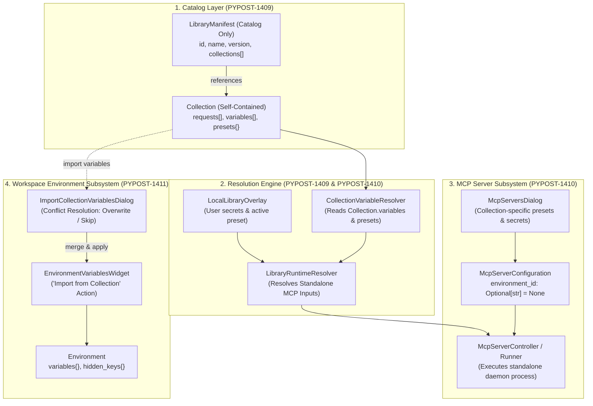
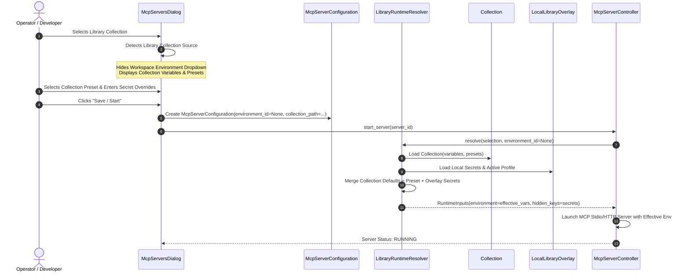
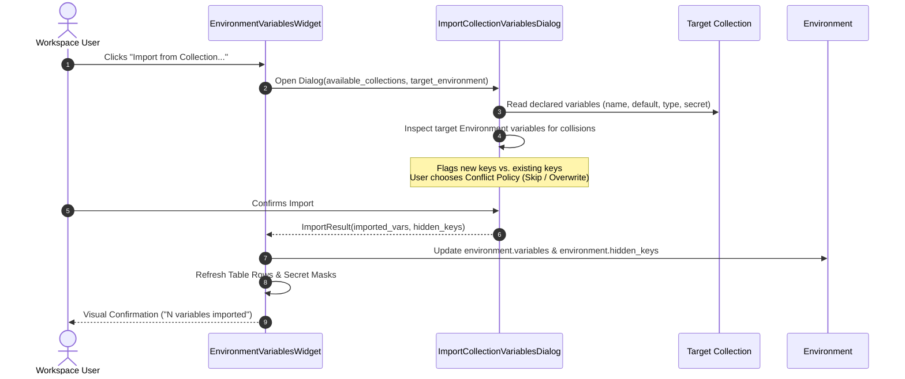
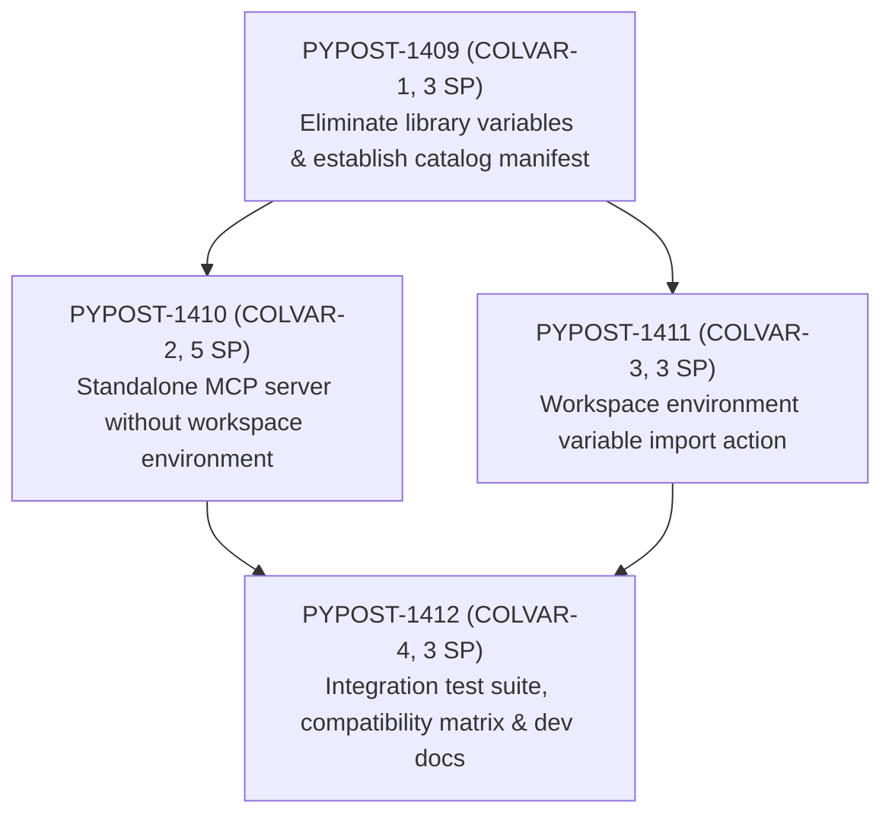

# Collection-Scoped Variables, Standalone MCP Servers, and Workspace Import

## Overview

As part of parent epic [PYPOST-1407](https://pypost.atlassian.net/browse/PYPOST-1407) (*Collection-scoped variables for standalone MCP servers and workspace collection import*) and architectural decomposition [PYPOST-1408](https://pypost.atlassian.net/browse/PYPOST-1408), this document details the architectural evolution from hybrid library-level variable management to self-contained collection-scoped variables.

In the legacy design, collection libraries declared variable schemas and preset profiles at the overall library manifest level (`manifest.variables` and `manifest.presets`). While functional for single-collection repositories, this design introduced significant architectural drawbacks:
1. **Global Variable Pollution**: Unrelated collections within a single library (such as Jira, GitLab, and GitHub MCP servers) pooled their variables into a unified namespace, creating naming conflicts and cognitive overhead.
2. **Forced Workspace Environment for MCP Servers**: Launching an MCP server from a library collection required users to create or bind a workspace [`Environment`](file:///home/src/pypost/models/models.py), generating phantom environments solely to satisfy schema constraints.
3. **Missing Variable Bridge on Collection Copy**: Copying a collection from a connected library into a user workspace provided no mechanism in the environment variables view to import declared variables.
4. **Dual Variable Authority**: Both [`LibraryManifest`](file:///home/src/pypost/models/library_manifest.py) and [`Collection`](file:///home/src/pypost/models/models.py) declared variables and presets, obscuring data provenance.

Under the updated architecture, collection libraries act strictly as lightweight catalogs. Each collection is self-contained, owning its declared variables, types, secrets, descriptions, and presets. MCP servers execute standalone without requiring workspace environments, and the environment variables interface provides a dedicated import workflow for workspace synchronization.

---

## Architecture & Data Models

### Architectural Layers



### Core Domain Models

1. **Catalog Manifest ([`LibraryManifest`](file:///home/src/pypost/models/library_manifest.py))**:
   - `LibraryManifest` serves solely as an index of collection file references.
   - `variables` and `presets` fields are deprecated, defaulting to empty structures. Incoming manifests declaring them trigger non-fatal deprecation warnings.
   ```python
   class LibraryManifest(BaseModel):
       id: str = Field(default_factory=lambda: str(uuid.uuid4()))
       name: str
       version: str = "1.0.0"
       description: str = ""
       collections: List[str] = Field(default_factory=list)
       # Deprecated fields retained for backward-compatibility only
       variables: List[CollectionVariable] = Field(default_factory=list, deprecated=True)
       presets: Dict[str, Dict[str, Any]] = Field(default_factory=dict, deprecated=True)
   ```

2. **Self-Contained Collection ([`Collection`](file:///home/src/pypost/models/models.py))**:
   - Sole authority for variable declarations, typing, and presets:
     - `variables: List[CollectionVariable]` ([`CollectionVariable`](file:///home/src/pypost/models/collection_variable.py))
     - `presets: Dict[str, Dict[str, Any]]` (mapping preset names to key-value maps)
     - `requests: List[RequestData]`
     - `websockets: List[WebSocketConnection]`
     - `mcp_clients: List[McpClientConnection]`

3. **Standalone Server Configuration ([`McpServerConfiguration`](file:///home/src/pypost/models/settings.py))**:
   - `environment_id` is made optional:
   ```python
   class McpServerConfiguration(BaseModel):
       # ...
       environment_id: Optional[str] = None
       library_id: Optional[str] = None
       manifest_id: Optional[str] = None
       library_collection_path: Optional[str] = None
   ```
   - When `library_id` is set, `environment_id` may be `None`. The server resolves inputs entirely from collection presets and local overlays.

4. **Local Secrets Overlay ([`LocalLibraryOverlay`](file:///home/src/pypost/models/library_manifest.py))**:
   - Stores machine-local active presets, non-versioned secret overrides, and parameter configurations at `~/.pypost/libraries_data/<library_id>/overlay.json`.

---

## Standalone MCP Server Execution Flow

When an MCP server is configured from a library collection, it executes as a standalone process without referencing or modifying workspace environments.



### Key Execution Highlights

- **Dynamic UI Presentation**: In [`McpServersDialog`](file:///home/src/pypost/ui/dialogs/mcp_servers_dialog.py), the workspace environment combobox is hidden when a library collection is chosen. The dialog displays only variables declared by that specific collection.
- **Direct Variable Resolution**: [`LibraryRuntimeResolver`](file:///home/src/pypost/core/library_runtime_resolver.py) merges:
  1. Base default values from `Collection.variables`.
  2. Selected profile values from `Collection.presets[profile_name]`.
  3. Machine-local user overrides and secrets from `LocalLibraryOverlay`.
- **Process Isolation**: The resolved variables are passed to the spawned server process environment. Sensitive values flagged as secrets are automatically masked in logging and diagnostics.

---

## Workspace Environment Variable Import Flow

When a user copies a library collection into their workspace or works with an existing collection, declared variables can be imported directly into a workspace [`Environment`](file:///home/src/pypost/models/models.py).



### Import Policies and Secret Protection

- **Trigger Location**: A dedicated `Import from Collection...` button is embedded in [`EnvironmentVariablesWidget`](file:///home/src/pypost/ui/widgets/environments/environment_variables_widget.py).
- **Conflict Resolution Strategies**:
  - `Skip`: Preserves existing environment variable values; adds only newly declared collection variables.
  - `Overwrite`: Replaces existing values with collection default values.
- **Automatic Secret Mapping**: Any variable with `secret=True` on [`CollectionVariable`](file:///home/src/pypost/models/collection_variable.py) is automatically added to `Environment.hidden_keys`, guaranteeing masking in UI tables and encryption at rest via the secure storage manager.
- **Pure Domain Helper**: Variable synchronization logic is encapsulated in a pure helper function:
  ```python
  def import_collection_variables_to_environment(
      environment: Environment,
      collection: Collection,
      overwrite: bool = False,
      selected_keys: Optional[Set[str]] = None,
  ) -> ImportSummary:
      ...
  ```

---

## Backward Compatibility & Migration Strategy

To ensure seamless operation across existing repositories and saved state, the system adheres to strict compatibility rules:

1. **Legacy Manifest Ingestion**:
   - Manifests containing root `variables` or `presets` are accepted without error.
   - Deprecation warnings are emitted via standard logger channels.
   - Core resolvers use collection-scoped variables primarily, falling back to legacy manifest variables only if undefined in the collection.
2. **Existing Workspace Environments**:
   - Workspace collections that explicitly link to workspace environments continue to operate without regression.
   - Standalone execution is opt-in for library collections where `environment_id is None`.
3. **Data Integrity**:
   - Adding collection-scoped variables or importing them into environments does not alter existing request definitions, authentication headers, or script bindings.

---

## Child Task Execution Sequence

Epic [PYPOST-1407](https://pypost.atlassian.net/browse/PYPOST-1407) is partitioned into four focused child stories under Sprint 2033:



| Jira Key | Identifier | SP | Focus Area | Downstream Deliverables |
| --- | --- | --- | --- | --- |
| [PYPOST-1409](https://pypost.atlassian.net/browse/PYPOST-1409) | `COLVAR-1` | 3 | Catalog manifest & collection authority | Deprecate manifest variables; update `LibraryManifest`, `CollectionVariableResolver`, and `LibraryRuntimeResolver`. |
| [PYPOST-1410](https://pypost.atlassian.net/browse/PYPOST-1410) | `COLVAR-2` | 5 | Standalone MCP server execution | Optional `environment_id` in `McpServerConfiguration`; dialog UI refactor; standalone runtime launch. |
| [PYPOST-1411](https://pypost.atlassian.net/browse/PYPOST-1411) | `COLVAR-3` | 3 | Workspace variable import action | `EnvironmentVariablesWidget` import trigger; selection dialog; conflict resolution; secret masking. |
| [PYPOST-1412](https://pypost.atlassian.net/browse/PYPOST-1412) | `COLVAR-4` | 3 | Integration tests & documentation | End-to-end test suite; legacy manifest compatibility matrix; user guide documentation updates. |

### Phased Roadmap

1. **Phase 1 (Foundation)**: Execute [PYPOST-1409](https://pypost.atlassian.net/browse/PYPOST-1409) to establish the catalog-only manifest model and anchor variable resolution within collections.
2. **Phase 2 (Parallel Feature Tracks)**:
   - Execute [PYPOST-1410](https://pypost.atlassian.net/browse/PYPOST-1410) for standalone MCP server execution.
   - Execute [PYPOST-1411](https://pypost.atlassian.net/browse/PYPOST-1411) for the environment variable import UI and core helper.
3. **Phase 3 (Consolidation & Verification)**: Execute [PYPOST-1412](https://pypost.atlassian.net/browse/PYPOST-1412) to validate end-to-end integration contracts across all components and update user-facing documentation.

---

## Traceability & References

- **Parent Epic**: [PYPOST-1407](https://pypost.atlassian.net/browse/PYPOST-1407)
- **Decomposition Task**: [PYPOST-1408](https://pypost.atlassian.net/browse/PYPOST-1408)
- **Architecture Specification**: [`ai-tasks/PYPOST-1408/20-architecture.md`](file:///home/src/ai-tasks/PYPOST-1408/20-architecture.md)
- **Requirements Specification**: [`ai-tasks/PYPOST-1408/10-requirements.md`](file:///home/src/ai-tasks/PYPOST-1408/10-requirements.md)
- **Related Developer Guides**:
  - [Library Manifest and Local Secrets Overlay Manager](library_manifest_and_overlay.md)
  - [Collection Format v2](collection_format_v2.md)
  - [Collection Variable Setup Guidance](collection_variable_guidance.md)
  - [Environment Management and Variable Display](environments.md)
