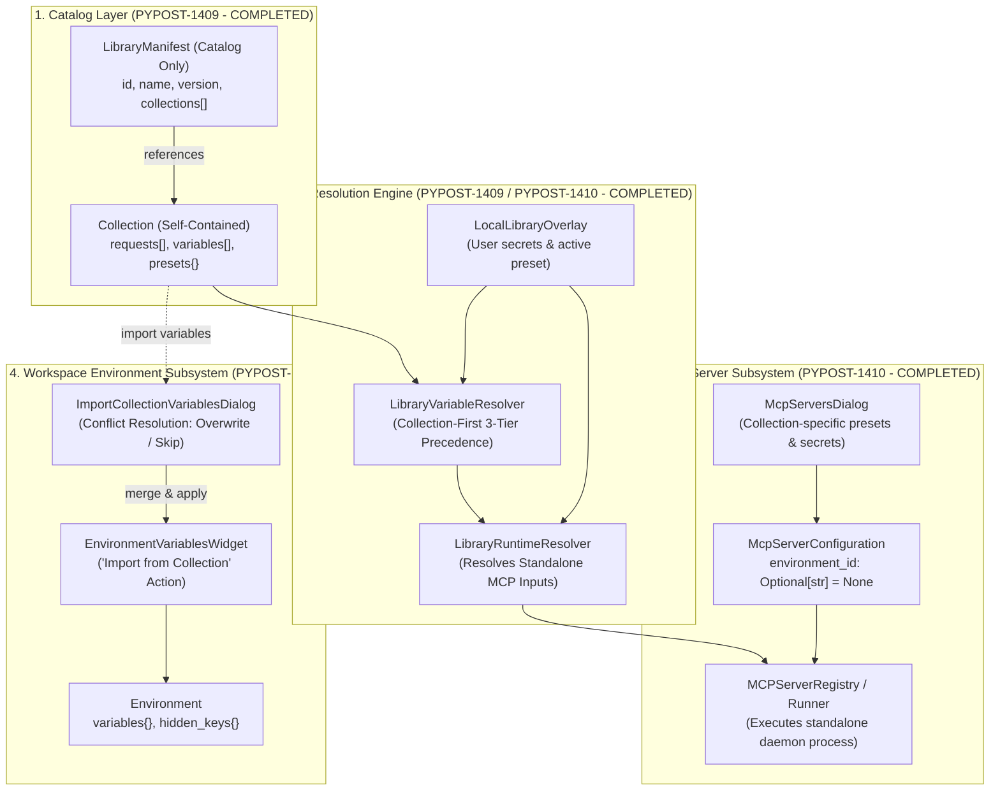
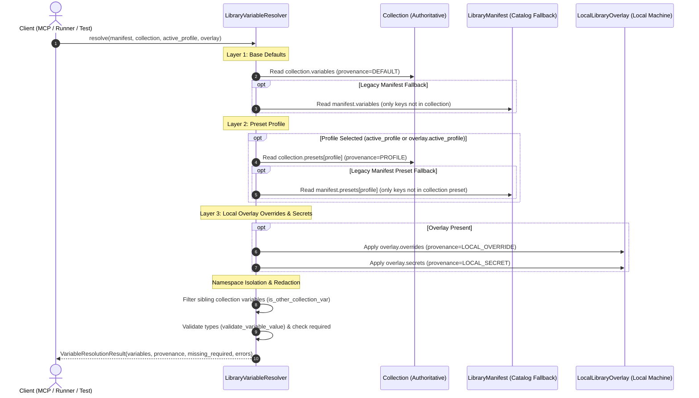
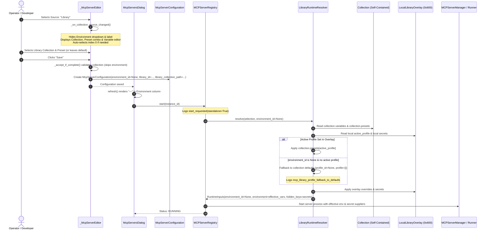
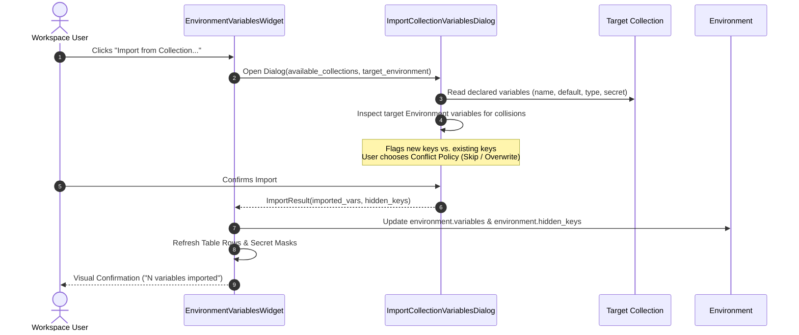
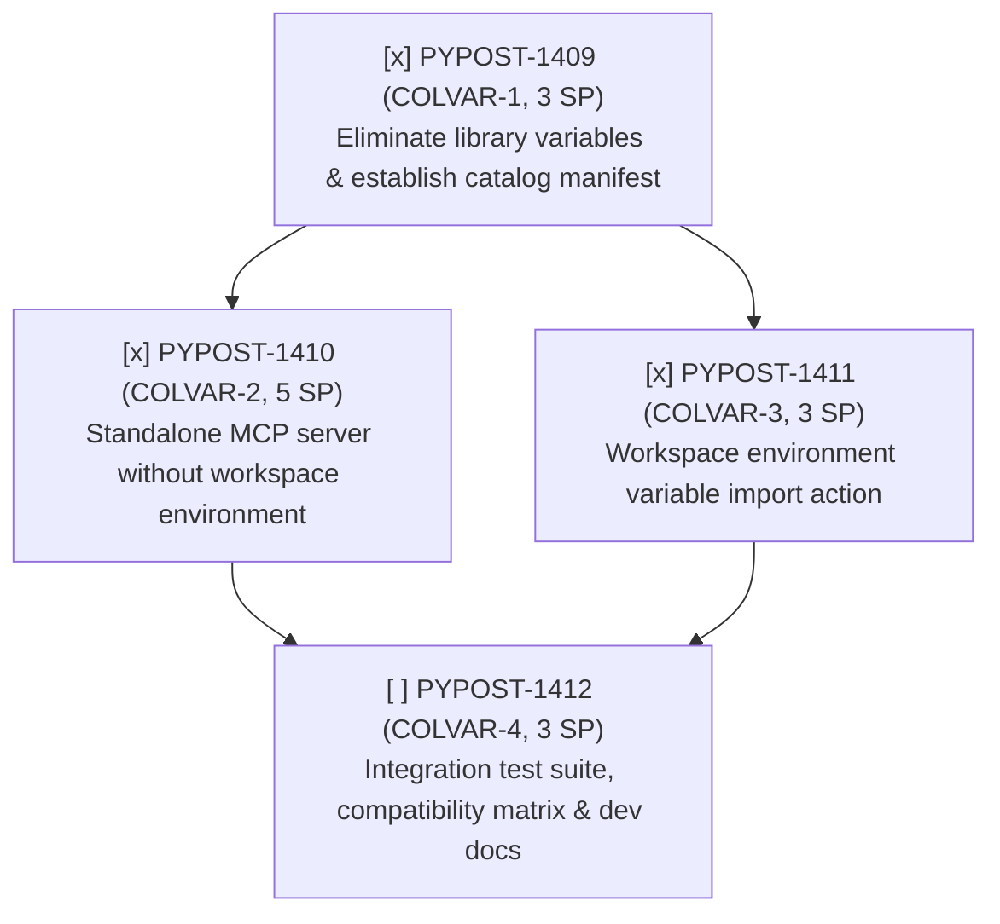

# Collection-Scoped Variables, Standalone MCP Servers, and Workspace Import

## Overview

As part of parent epic [PYPOST-1407](https://pypost.atlassian.net/browse/PYPOST-1407) (*Collection-scoped variables for standalone MCP servers and workspace collection import*) and architectural decomposition [PYPOST-1408](https://pypost.atlassian.net/browse/PYPOST-1408), this document details the architectural evolution from hybrid library-level variable management to self-contained collection-scoped variables.

With the completed implementation of [PYPOST-1409](https://pypost.atlassian.net/browse/PYPOST-1409) (*Eliminate library-level variables and establish collection-scoped variables and catalog manifest*) and [PYPOST-1410](https://pypost.atlassian.net/browse/PYPOST-1410) (*Standalone MCP server configuration and execution without workspace environment*), the collection library system transitions to a clean, catalog-only model where each [`Collection`](file:///home/src/pypost/models/models.py) serves as the authoritative single source of truth for its variable declarations and environment presets, and MCP servers execute standalone without requiring phantom workspace environments.

In the legacy design, collection libraries declared variable schemas and preset profiles at the overall library manifest level (`manifest.variables` and `manifest.presets`). While functional for single-collection repositories, this design introduced significant architectural drawbacks:
1. **Global Variable Pollution**: Unrelated collections within a single library (such as Jira, GitLab, and GitHub MCP servers) pooled their variables into a unified namespace, creating naming conflicts and cognitive overhead.
2. **Forced Workspace Environment for MCP Servers**: Launching an MCP server from a library collection required users to create or bind a workspace [`Environment`](file:///home/src/pypost/models/models.py), generating phantom environments solely to satisfy schema constraints.
3. **Missing Variable Bridge on Collection Copy**: Copying a collection from a connected library into a user workspace provided no mechanism in the environment variables view to import declared variables.
4. **Dual Variable Authority**: Both [`LibraryManifest`](file:///home/src/pypost/models/library_manifest.py) and [`Collection`](file:///home/src/pypost/models/models.py) declared variables and presets, obscuring data provenance.

Under the updated architecture, collection libraries act strictly as lightweight catalogs. Each collection is self-contained, owning its declared variables, types, secrets, descriptions, and presets. MCP servers execute standalone without requiring workspace environments, and the environment variables interface provides a dedicated import workflow for workspace synchronization.

---

## Architecture & Data Models

### Architectural Layers



### Core Domain Models

1. **Catalog Manifest ([`LibraryManifest`](file:///home/src/pypost/models/library_manifest.py))**:
   - `LibraryManifest` serves solely as an index of collection file references.
   - `variables` and `presets` fields are deprecated (`deprecated=True`), defaulting to empty structures. Incoming manifests declaring them trigger non-fatal deprecation warnings.
   - Serialization via [`serialize_manifest_to_dict`](file:///home/src/pypost/core/library_manifest.py) automatically strips empty `variables` and `presets` fields so saved catalog manifests remain clean indexes.
   ```python
   class LibraryManifest(BaseModel):
       id: str = Field(default_factory=lambda: str(uuid.uuid4()))
       name: str
       version: str = "1.0.0"
       description: str = ""
       collections: List[str] = Field(default_factory=list)
       # Deprecated fields retained for backward compatibility only
       variables: List[CollectionVariable] = Field(
           default_factory=list,
           deprecated=True,
           description="Deprecated: Use Collection.variables instead.",
       )
       presets: Dict[str, Dict[str, Any]] = Field(
           default_factory=dict,
           deprecated=True,
           description="Deprecated: Use Collection.presets instead.",
       )
   ```

2. **Self-Contained Collection ([`Collection`](file:///home/src/pypost/models/models.py))**:
   - Sole authority for variable declarations, typing, and presets:
     - `variables: List[CollectionVariable]` ([`CollectionVariable`](file:///home/src/pypost/models/collection_variable.py))
     - `presets: Dict[str, Dict[str, Any]]` (mapping preset names to key-value maps)
     - `requests: List[RequestData]`
     - `websockets: List[WebSocketConnection]`
     - `mcp_clients: List[McpClientConnection]`

3. **Standalone Server Configuration ([`McpServerConfiguration`](file:///home/src/pypost/models/settings.py))**:
   - `environment_id` is made optional (`Optional[str] = None`):
   ```python
   class McpServerConfiguration(BaseModel):
       id: str
       name: Optional[str] = None
       host: str = "127.0.0.1"
       port: int = Field(ge=1024, le=65535)
       collection_id: Optional[str] = None
       library_id: Optional[str] = None
       manifest_id: Optional[str] = None
       library_collection_path: Optional[str] = None
       library_collection_index: Optional[int] = None
       environment_id: Optional[str] = None  # Decoupled: Optional for standalone library servers
       server_type: Literal["local", "proxy"] = "local"
       upstream_url: Optional[str] = None
       upstream_transport: Literal["streamable_http", "sse"] = "streamable_http"
       custom_headers: list[CustomHeaderEntry] = Field(default_factory=list)
       bundled_library: bool = False
       enabled: bool = True
   ```
   - **Validation Rules (`validate_server_type_requirements`)**:
     - **Library-backed local servers** (`library_id` present or `bundled_library=True`): `environment_id` is optional and defaults to `None`. The server resolves execution parameters entirely from collection defaults, collection presets, and the machine-local overlay without requiring a workspace environment.
     - **Workspace local servers** (`collection_id` present and not a library server): both `collection_id` and `environment_id` remain strictly mandatory and validated to be non-empty strings, guaranteeing backward compatibility.
     - **Proxy servers** (`server_type == "proxy"`): `upstream_url` is required; `environment_id` and `collection_id` are not required.

4. **Local Secrets Overlay ([`LocalLibraryOverlay`](file:///home/src/pypost/models/library_manifest.py))**:
   - Stores machine-local active presets, non-versioned secret overrides, and parameter configurations outside version control at `~/.pypost/libraries_data/<library_id>/overlay.json` with `0o600` file permissions via [`LocalOverlayManager`](file:///home/src/pypost/core/local_overlay_manager.py).

---

## Variable Resolution Engine & Precedence (PYPOST-1409)

The resolution engine in [`LibraryVariableResolver`](file:///home/src/pypost/core/variable_resolver.py) implements collection-scoped variable authority and a strict 3-tier precedence hierarchy.



### 1. 3-Tier Precedence Hierarchy

Effective variable values are evaluated in order of ascending priority:

1. **Layer 1 (Base Defaults)**:
   - Primary: Default values declared in `collection.variables` (`var.default`).
   - Fallback: Default values in `manifest.variables` are utilized strictly if the key is not declared in `collection.variables`.
   - Provenance: [`VariableProvenance.DEFAULT`](file:///home/src/pypost/models/library_manifest.py).
2. **Layer 2 (Active Preset Profile)**:
   - Evaluated when an active profile is specified (`active_profile` argument or `overlay.active_profile`).
   - Primary: Preset values declared in `collection.presets[profile_name]`.
   - Fallback: Preset values in `manifest.presets[profile_name]` are applied only for keys not declared in the collection preset.
   - Provenance: [`VariableProvenance.PROFILE`](file:///home/src/pypost/models/library_manifest.py).
3. **Layer 3 (Local Overlay - Highest Priority)**:
   - Applied from [`LocalLibraryOverlay`](file:///home/src/pypost/models/library_manifest.py) stored on the local machine.
   - User overrides: `overlay.overrides` applied with provenance [`VariableProvenance.LOCAL_OVERRIDE`](file:///home/src/pypost/models/library_manifest.py).
   - User secrets: `overlay.secrets` applied with provenance [`VariableProvenance.LOCAL_SECRET`](file:///home/src/pypost/models/library_manifest.py).

### 2. Cross-Collection Namespace Isolation

In multi-collection libraries (e.g. bundling Jira, GitHub, and GitLab MCP tools), declaring variables at the catalog root formerly caused cross-collection namespace pollution.

[`LibraryVariableResolver`](file:///home/src/pypost/core/variable_resolver.py) enforces strict cross-collection namespace isolation:
- **Collection Prefix Identification**: Calculates stem prefixes from the target collection's file path, collection name, and ID (`collection_prefixes`).
- **Sibling Prefix Identification**: Computes prefixes belonging to sibling collections declared in `manifest.collections` (`other_collection_prefixes`).
- **Prefix Filtering Contract (`is_other_collection_var`)**:
  - Excludes variables with dot prefixes matching sibling collections (e.g., `github.api_key` is discarded when resolving a Jira collection).
  - Excludes sibling underscore/hyphen prefixed keys (e.g., `github_token` when resolving Jira).
  - Permits un-namespaced variables defined directly in the target collection without forcing awkward manual prefixes.

### 3. Type Validation & Diagnostic Redaction

- Variable values are type-checked against declared schema types (`string`, `integer`, `number`, `boolean`, `array`, `object`) via `validate_variable_value`.
- **Sensitive Redaction**: If a variable is marked `secret=True` on [`CollectionVariable`](file:///home/src/pypost/models/collection_variable.py), its value is masked as `[REDACTED]` in validation error strings and diagnostic logs, preventing credential leaks.
- Under strict mode (`strict_required=True`), unfulfilled required variables without default values are reported in `result.missing_required`.

---

## MCP Runtime Resolution & Secret Masking (PYPOST-1409)

When executing MCP servers from library collections, [`LibraryRuntimeResolver`](file:///home/src/pypost/core/library_runtime_resolver.py) prepares runtime inputs and coordinates secret masking:

### 1. Dynamic Profile Resolution without Manifest Mutation

- Prior to PYPOST-1409, `LibraryRuntimeResolver` mutated `manifest.presets` in-place to inject collection profiles.
- Under the updated contract, profiles are resolved dynamically by reading directly from `collection.presets` and `manifest.presets`, preserving catalog immutability.

### 2. Comprehensive Secret Masking

[`LibraryRuntimeResolver`](file:///home/src/pypost/core/library_runtime_resolver.py) aggregates `hidden_keys` from all contributing layers:
- Declared collection secrets: `{var.name for var in collection.variables if var.secret}`
- Legacy manifest secrets: `{var.name for var in manifest.variables if var.secret}`
- Machine-local overlay secrets: `set(overlay.secrets.keys())`
- Attached workspace environment secrets: `set(environment.hidden_keys)` if an environment is bound.

The aggregated `hidden_keys` set is passed into the MCP server runner, guaranteeing that process environment logs and diagnostic exports mask sensitive parameters.

### 3. Graceful Missing Secret Handling on Initialization

During initial MCP server inspection and catalog loading:
- Missing non-secret required variables raise immediate errors:
  ```
  ValueError("profile_invalid: required library variables are missing")
  ```
- Missing secret variables are handled gracefully without raising fatal errors during server registration and inspection. This allows headless initialization routines, test suites, and catalog dialogs to load and inspect MCP servers before a user has configured machine-local secret overrides in [`LocalLibraryOverlay`](file:///home/src/pypost/models/library_manifest.py).

### 4. Observability & Performance Metrics

- **Latency Tracking**: Runtime resolution records duration using `time.monotonic()` and logs `mcp_library_runtime_validation_completed duration_seconds=...`.
- **Prometheus Metrics**: Validation outcomes are tracked via `track_mcp_library_validation(category)`:
  - Recorded with category `"success"` on completion.
  - Recorded with error categories (e.g. `"profile_missing"`, `"profile_invalid"`, `"manifest_invalid"`) upon failures.

---

## Standalone MCP Server Configuration and Execution (PYPOST-1410)

With the completion of [PYPOST-1410](https://pypost.atlassian.net/browse/PYPOST-1410) (COLVAR-2), MCP servers backed by collection libraries execute completely autonomously as standalone processes without requiring a workspace [`Environment`](file:///home/src/pypost/models/models.py). This eliminates the legacy requirement for phantom workspace environments and provides seamless lifecycle management, variable resolution, reference reconciliation, and UI configuration.



### 1. Data Model Decoupling (`McpServerConfiguration`)

In [`McpServerConfiguration`](file:///home/src/pypost/models/settings.py):
- The `environment_id` field is optional: `environment_id: Optional[str] = None`.
- The root validator [`validate_server_type_requirements`](file:///home/src/pypost/models/settings.py) enforces:
  - **Workspace local servers** (`collection_id` present and not a library server): strictly require a non-empty `collection_id` and non-empty `environment_id`.
  - **Library-backed local servers** (`library_id` present or `bundled_library=True`): `environment_id` is optional and defaults to `None`. Library identity (`library_id`) is required, but workspace environments are completely bypassed.
  - **Proxy servers** (`server_type == "proxy"`): require `upstream_url`; do not require workspace collections or environments.

### 2. Runtime Resolution Decoupling (`LibraryRuntimeResolver`)

In [`LibraryRuntimeResolver`](file:///home/src/pypost/core/library_runtime_resolver.py):
- The resolution entry point is decoupled:
  ```python
  def resolve(
      self,
      selection: dict[str, Any],
      environment_id: Optional[str] = None,
      candidate_overlay=None,
  ) -> RuntimeInputs:
  ```
- [`RuntimeInputs`](file:///home/src/pypost/core/library_runtime_resolver.py) declares `environment_id: Optional[str]`, accommodating standalone servers.
- **Dynamic Profile and Default Fallback**:
  - When `environment_id is None`:
    - If `active_profile` is configured in `overlay.active_profile` (or `candidate_overlay`), the resolver loads preset values from `collection.presets[active_profile]` and `manifest.presets[active_profile]`.
    - If no `active_profile` is configured and `environment_id is None`, the resolver cleanly falls back to collection defaults:
      ```python
      elif environment_id is None:
          profile_id = None
          profile = {}
          logger.debug(
              "mcp_library_profile_fallback_to_defaults "
              "library_id=%s manifest_id=%s active_profile=%s",
              selection.get("library_id", "unknown"),
              selection.get("manifest_id", "unknown"),
              active_profile,
          )
      ```
    - The profile is injected into the collection copy only if `profile_id is not None`.
  - **Precedence & Secrets Evaluation**:
    - Variable values are evaluated using [`LibraryVariableResolver`](file:///home/src/pypost/core/variable_resolver.py) using the 3-tier precedence hierarchy (defaults → preset profile → overlay overrides/secrets).
    - `overridable_keys` is set to an empty set (`set()`), since there is no workspace environment to override collection keys.
    - `hidden_keys` aggregates declared collection secrets, legacy manifest secrets, and overlay secrets.
    - Non-secret missing required variables raise `ValueError("profile_invalid: required library variables are missing")`, while missing secrets are handled gracefully during initialization.

### 3. Server Registry Lifecycle & Reference Reconciliation (`MCPServerRegistry`)

In [`MCPServerRegistry`](file:///home/src/pypost/core/mcp_server_registry.py):
- **Standalone Reference Reconciliation (`reconcile_references`)**:
  - Previously, `reconcile_references()` assumed all local servers require workspace collections and workspace environments, stopping library servers without workspace environments with `"cannot run: missing environment"`.
  - Under the standalone architecture, `reconcile_references()` introduces dedicated branches:
    - **Library servers (`configuration.library_id`)**: checks if the library connection exists via `self.library_service.get_connection(configuration.library_id)`. If `configuration.environment_id is None`, it logs `mcp_registry_reconcile_standalone_library_server` (`skipping_environment_check=True`) and skips the workspace environment check. If `environment_id` is explicitly set, it validates existence against valid environment IDs.
    - **Bundled library servers (`configuration.bundled_library`)**: if `configuration.environment_id is None`, it logs `mcp_registry_reconcile_standalone_bundled_server` and skips workspace environment verification.
  - **Architectural Invariant**: Standalone MCP servers remain preserved and operational across workspace environment deletions, pruning, and modifications.
- **Server Startup & Supervision**:
  - `start(instance_id)`: logs `mcp_registry_start_requested` with `environment_id` and `standalone=True/False`.
  - `_runtime_inputs(configuration)`: delegates to `LibraryRuntimeResolver.resolve` with `configuration.environment_id` (`None` for standalone servers). Returns `None` only if a workspace collection server is missing its required `collection_id` or `environment_id`.
  - `_start_manager()`: logs `mcp_registry_manager_starting` with `standalone=True/False` and registered tool count. Configures variable and secret suppliers for runtime resolution.
  - `_verify_references(instance_id)`: verifies library connection existence via `library_service.get_connection()` without requiring a workspace environment or collection ID.
  - `refresh_environment(environment_id)`: standalone servers (`environment_id is None`) are safely filtered out, avoiding spurious server restarts when workspace environments change.

### 4. User Interface Behavior (`_McpServerEditor` and `McpServersDialog`)

In [`pypost/ui/dialogs/mcp_servers_dialog.py`](file:///home/src/pypost/ui/dialogs/mcp_servers_dialog.py):
- **Dynamic Field Visibility in `_McpServerEditor`**:
  - In `_on_collection_source_changed()`:
    - When the source is `"library"` (`is_local and is_library`):
      - The `Environment` combobox and its form layout label are hidden:
        ```python
        show_env = not (is_local and is_library)
        self._environment.setVisible(show_env)
        env_label = self._layout.labelForField(self._environment)
        if env_label:
            env_label.setVisible(show_env)
        ```
      - Library collection picker, profile combobox, and collection variable widgets are shown.
      - Default collection auto-selection: if `_library_collection.currentIndex() < 0` and collections are available, it automatically selects index 0.
- **Form Validation & Save Contract**:
  - In `_accept_if_complete()`: for library collections, validates that `self._library_collection.currentData()` is selected (`"Collection is required."`), completely bypassing workspace environment validation.
  - In `configuration()`: generates `McpServerConfiguration` with:
    ```python
    env_id = (
        str(self._environment.currentData())
        if (self._environment.isVisible() and self._environment.currentData())
        else None
    )
    ```
    Storing `environment_id = None` when the environment field is hidden.
- **Table View Presentation in `McpServersDialog`**:
  - In `refresh()`: when populating the server list table, checks `configuration.environment_id`:
    ```python
    env_display = (
        "—"
        if configuration.environment_id is None
        else environment_names.get(
            configuration.environment_id, configuration.environment_id
        )
    )
    ```
    Rendering an em-dash (`"—"`) for standalone servers. This prevents `TypeError` in `QTableWidgetItem` and gives operators an immediate visual cue that the server runs standalone.

---

## Workspace Environment Variable Import Flow

When a user copies a library collection into their workspace or works with an existing collection, declared variables can be imported directly into a workspace [`Environment`](file:///home/src/pypost/models/models.py).



### Import Policies and Secret Protection

- **Trigger Location**: A dedicated `Import from Collection...` button is embedded in [`EnvironmentVariablesWidget`](file:///home/src/pypost/ui/widgets/environments/environment_variables_widget.py).
- **Conflict Resolution Strategies**:
  - `Skip`: Preserves existing environment variable values; adds only newly declared collection variables.
  - `Overwrite`: Replaces existing values with collection default values.
- **Automatic Secret Mapping**: Any variable with `secret=True` on [`CollectionVariable`](file:///home/src/pypost/models/collection_variable.py) is automatically added to `Environment.hidden_keys`, guaranteeing masking in UI tables and encryption at rest via the secure storage manager.
- **Pure Domain Helper**: Variable synchronization logic is encapsulated in a pure helper function:
  ```python
  def import_collection_variables_to_environment(
      environment: Environment,
      collection: Collection,
      overwrite: bool = False,
      selected_keys: Optional[Set[str]] = None,
  ) -> ImportSummary:
      ...
  ```

---

## Backward Compatibility & Migration Strategy

To ensure seamless operation across existing repositories and saved state, the system adheres to strict compatibility rules:

1. **Legacy Manifest Ingestion**:
   - Manifests containing root `variables` or `presets` are accepted without error.
   - Non-fatal structured warning logs (`legacy_manifest_variables_detected`, `legacy_manifest_presets_detected`) and `DeprecationWarning` exceptions are emitted.
   - Deserialization continues to succeed, and resolvers use collection-scoped variables primarily, falling back to legacy manifest variables only if undefined in the collection.
2. **Catalog Serialization Cleanliness**:
   - Serializing a `LibraryManifest` with empty `variables` or `presets` strips those fields from the output dictionary, generating clean catalog files.
3. **Existing Workspace Environments**:
   - Workspace collections that explicitly link to workspace environments continue to operate without regression.
   - Standalone execution is opt-in for library collections where `environment_id is None`.
4. **Data Integrity**:
   - Adding collection-scoped variables or importing them into environments does not alter existing request definitions, authentication headers, or script bindings.

---

## Child Task Execution Sequence

Epic [PYPOST-1407](https://pypost.atlassian.net/browse/PYPOST-1407) is partitioned into four focused child stories under Sprint 2033:



| Jira Key | Identifier | SP | Status | Focus Area | Downstream Deliverables |
| --- | --- | :---: | :---: | --- | --- |
| [PYPOST-1409](https://pypost.atlassian.net/browse/PYPOST-1409) | `COLVAR-1` | 3 | **Completed** | Catalog manifest & collection authority | Deprecate manifest variables; update `LibraryManifest`, `LibraryVariableResolver`, and `LibraryRuntimeResolver`. |
| [PYPOST-1410](https://pypost.atlassian.net/browse/PYPOST-1410) | `COLVAR-2` | 5 | **Completed** | Standalone MCP server execution | Optional `environment_id` in `McpServerConfiguration`; `_McpServerEditor` & `McpServersDialog` decoupling; standalone runtime resolution in `LibraryRuntimeResolver`; server registry preservation in `MCPServerRegistry`. |
| [PYPOST-1411](https://pypost.atlassian.net/browse/PYPOST-1411) | `COLVAR-3` | 3 | **Completed** | Workspace variable import action | `EnvironmentVariablesWidget` import trigger; selection dialog; conflict resolution; secret masking; [Workspace Environment Variable Import](workspace_environment_variable_import.md). |
| [PYPOST-1412](https://pypost.atlassian.net/browse/PYPOST-1412) | `COLVAR-4` | 3 | To Do | Integration tests & documentation | End-to-end test suite; legacy manifest compatibility matrix; user guide documentation updates. |

### Phased Roadmap

1. **Phase 1 (Foundation - COMPLETED)**: Executed [PYPOST-1409](https://pypost.atlassian.net/browse/PYPOST-1409) to establish the catalog-only manifest model, deprecate library-level variables, and anchor 3-tier variable resolution within collections.
2. **Phase 2 (Parallel Feature Tracks)**:
   - **Completed [PYPOST-1410](https://pypost.atlassian.net/browse/PYPOST-1410)**: Standalone MCP server configuration and execution decoupled from workspace environments.
   - **Execute [PYPOST-1411](https://pypost.atlassian.net/browse/PYPOST-1411)**: Workspace environment variable import action and UI conflict resolution workflow.
3. **Phase 3 (Consolidation & Verification)**: Execute [PYPOST-1412](https://pypost.atlassian.net/browse/PYPOST-1412) to validate end-to-end integration contracts across all components and update user-facing documentation.

---

## Traceability & References

- **Parent Epic**: [PYPOST-1407](https://pypost.atlassian.net/browse/PYPOST-1407)
- **Decomposition Task**: [PYPOST-1408](https://pypost.atlassian.net/browse/PYPOST-1408)
- **Foundation Implementation Task**: [PYPOST-1409](https://pypost.atlassian.net/browse/PYPOST-1409)
  - Architecture Specification: [`ai-tasks/PYPOST-1409/20-architecture.md`](file:///home/src/ai-tasks/PYPOST-1409/20-architecture.md)
  - Observability Report: [`ai-tasks/PYPOST-1409/50-observability.md`](file:///home/src/ai-tasks/PYPOST-1409/50-observability.md)
  - Technical Debt Report: [`ai-tasks/PYPOST-1409/60-tech-debt.md`](file:///home/src/ai-tasks/PYPOST-1409/60-tech-debt.md)
  - Automated Repro & Regression Tests: [`tests/test_collection_scoped_variables_repro.py`](file:///home/src/tests/test_collection_scoped_variables_repro.py)
- **Standalone MCP Server Implementation Task**: [PYPOST-1410](https://pypost.atlassian.net/browse/PYPOST-1410)
  - Requirements Document: [`ai-tasks/PYPOST-1410/10-requirements.md`](file:///home/src/ai-tasks/PYPOST-1410/10-requirements.md)
  - Architecture Specification: [`ai-tasks/PYPOST-1410/20-architecture.md`](file:///home/src/ai-tasks/PYPOST-1410/20-architecture.md)
  - Code Cleanup Report: [`ai-tasks/PYPOST-1410/40-code-cleanup.md`](file:///home/src/ai-tasks/PYPOST-1410/40-code-cleanup.md)
  - Observability Report: [`ai-tasks/PYPOST-1410/50-observability.md`](file:///home/src/ai-tasks/PYPOST-1410/50-observability.md)
  - Technical Debt Report: [`ai-tasks/PYPOST-1410/60-tech-debt.md`](file:///home/src/ai-tasks/PYPOST-1410/60-tech-debt.md)
  - Developer Documentation Report: [`ai-tasks/PYPOST-1410/70-dev-docs.md`](file:///home/src/ai-tasks/PYPOST-1410/70-dev-docs.md)
  - Automated Repro & Regression Tests: [`tests/test_mcp_standalone_execution_repro.py`](file:///home/src/tests/test_mcp_standalone_execution_repro.py)
- **Workspace Variable Import Implementation Task**: [PYPOST-1411](https://pypost.atlassian.net/browse/PYPOST-1411)
  - Requirements Document: [`ai-tasks/PYPOST-1411/10-requirements.md`](file:///home/src/ai-tasks/PYPOST-1411/10-requirements.md)
  - Architecture Specification: [`ai-tasks/PYPOST-1411/20-architecture.md`](file:///home/src/ai-tasks/PYPOST-1411/20-architecture.md)
  - Code Cleanup Report: [`ai-tasks/PYPOST-1411/40-code-cleanup.md`](file:///home/src/ai-tasks/PYPOST-1411/40-code-cleanup.md)
  - Observability Report: [`ai-tasks/PYPOST-1411/50-observability.md`](file:///home/src/ai-tasks/PYPOST-1411/50-observability.md)
  - Technical Debt Report: [`ai-tasks/PYPOST-1411/60-tech-debt.md`](file:///home/src/ai-tasks/PYPOST-1411/60-tech-debt.md)
  - Developer Documentation: [`doc/dev/workspace_environment_variable_import.md`](file:///home/src/doc/dev/workspace_environment_variable_import.md)
  - Automated Repro & Regression Tests: [`tests/test_workspace_environment_import_repro.py`](file:///home/src/tests/test_workspace_environment_import_repro.py)
- **Related Developer Guides**:
  - [Library Manifest and Local Secrets Overlay Manager](library_manifest_and_overlay.md)
  - [Collection Format v2](collection_format_v2.md)
  - [Collection Variable Setup Guidance](collection_variable_guidance.md)
  - [Environment Management and Variable Display](environments.md)
