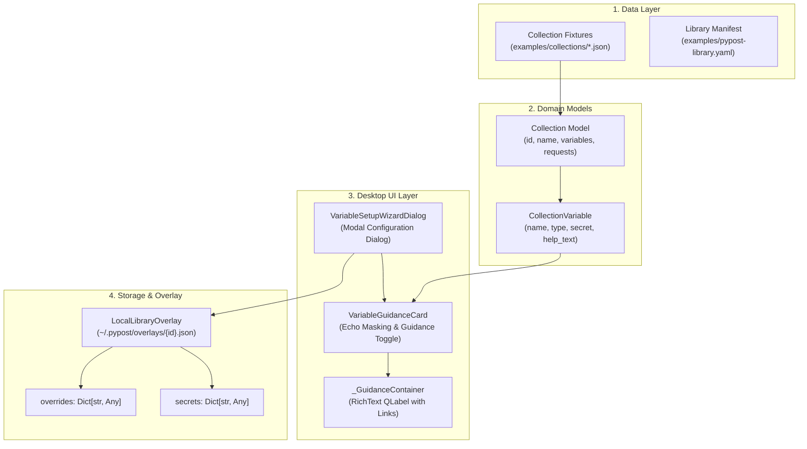

# Collection Variable Setup Guidance

## Overview

The PyPost predefined collection library and MCP server integration support rich, contextual setup guidance for collection variables. When configuring a server from a library collection via the MCP Server Editor, users encounter variables requiring authentication credentials, endpoints, or environment-specific values.

To streamline onboarding and eliminate configuration errors, `CollectionVariable` models include an optional `help_text` attribute. This enables collection authors to embed actionable, step-by-step instructions, links to cloud provider developer consoles, and credential creation procedures directly within the variable setup workflow.

This capability was introduced across the 4-layer architecture of parent epic [PYPOST-1284](https://pypost.atlassian.net/browse/PYPOST-1284) and completed in [PYPOST-1375](https://pypost.atlassian.net/browse/PYPOST-1375) (Layer 4: Reference Collections, Contract Test Suite, and Collection Author Guidance).

## Architecture

The variable guidance subsystem spans data fixtures, domain models, desktop UI presentation, and persistence overlays:



### Component Roles

1. **`CollectionVariable` ([`pypost.models.collection_variable`](file:///home/src/pypost/models/collection_variable.py))**:
   - Represents a configurable variable declared in a collection.
   - Declares `help_text: Optional[str] = Field(default=None, ...)`.
   - Normalizes boundary whitespace and coerces empty or whitespace-only strings to `None`.
   - Preserves additive backward compatibility: legacy collections without `help_text` deserialize cleanly with `help_text=None`.

2. **`VariableGuidanceCard` ([`pypost.ui.variable_setup_wizard_dialog`](file:///home/src/pypost/ui/variable_setup_wizard_dialog.py))**:
   - Encapsulates an individual variable's label, type badge, input field, and guidance container into an autonomous widget.
   - Evaluates `bool(variable.help_text)`. When present, generates a collapsible `QPushButton("Show Guidance")` and `_GuidanceContainer(QFrame)`.
   - Collapses guidance by default (`setVisible(False)`) to maintain a compact dialog height. Toggling alternates between `"Show Guidance"` and `"Hide Guidance"`.
   - Automatically initializes `QLineEdit.EchoMode.Password` and an eye toggle button (`"Show"` / `"Hide"`) for variables with `secret: true`.

3. **`VariableSetupWizardDialog` ([`pypost.ui.variable_setup_wizard_dialog`](file:///home/src/pypost/ui/variable_setup_wizard_dialog.py))**:
   - Orchestrates the collection of variables within a scrollable layout.
   - Partitions accepted variable inputs into non-sensitive configuration values (`overrides`) and sensitive authentication values (`secrets`).
   - Validates required inputs prior to dialog acceptance.

4. **`_McpServerEditor` ([`pypost.ui.dialogs.mcp_servers_dialog`](file:///home/src/pypost/ui/dialogs/mcp_servers_dialog.py))**:
   - Hosts the `"Configure Variables in Wizard..."` action button.
   - Synchronizes accepted wizard outcomes into draft `LocalLibraryOverlay` instances and updates editor forms.

## Authoring Variable Guidance

### 1. Schema Definition

Collection authors specify `help_text` inside the `variables` array of the collection JSON file.

```json
{
  "name": "api_access_token",
  "type": "string",
  "default": "",
  "description": "Short one-line description for summary views and tooltips",
  "help_text": "### Access Token Setup\n\nFollow these steps to generate your token:\n\n1. **Console**: Navigate to the provider developer console.\n2. **Permissions**: Request required scopes.\n3. **Token**: Copy and paste your token here.",
  "required": true,
  "secret": true
}
```

### 2. Distinction Between `description` and `help_text`

| Attribute | Purpose | Scope & Length | UI Presentation |
| :--- | :--- | :--- | :--- |
| `description` | Quick identification | Single concise sentence (10–100 chars) | Input tooltips, table column descriptions, CLI help text |
| `help_text` | Actionable setup walkthrough | Multi-step guide, links, caveats, scopes | Expandable `VariableGuidanceCard` panel in Wizard dialog |

### 3. Markdown Formatting Standards

The guidance container renders rich text using Qt RichText engine (`setTextFormat(Qt.TextFormat.RichText)`). Authors should adhere to the following formatting standards:

- **Headings**: Use Level 3 headings (`### Heading Title`) for section headers within guidance cards. Avoid `#` (H1) or `##` (H2) as they overpower card headers.
- **Numbered Steps**: Structure procedures as sequential steps (`1. **Action Name**: Description`).
- **Bullet Lists**: Use bullet points for scopes, options, or caveats (`- Full access: ...`).
- **Code & Scopes**: Enclose URIs, scopes, CLI commands, and environment variable names in inline code backticks (e.g. `` `https://www.googleapis.com/auth/drive` ``).
- **External Links**: Use standard Markdown link syntax: `[Google Cloud Console](https://console.cloud.google.com/)`. The UI card configures `setOpenExternalLinks(True)` and `TextBrowserInteraction`, allowing users to open documentation links in their default desktop browser without leaving PyPost.
- **Emphasis**: Use bold (`**text**`) for console button names, menu navigation paths, and critical terms (e.g. **APIs & Services > Credentials**).

### 4. Zero Credential Leakage & Security Rules

To protect users and repositories from credential exposure, collection authors must follow strict security policies:

> [!IMPORTANT]
> **Zero Credential Leakage Rule**: Reference collection files and public library manifests must **NEVER** contain real credentials, live API keys, OAuth refresh tokens, or valid bearer tokens.

1. **Never Hardcode Secrets**: Always supply an empty default string (`"default": ""`) for sensitive variables.
2. **Flag Sensitive Variables**: Any variable accepting passwords, private keys, API secrets, or bearer tokens must declare `"secret": true`.
3. **Automatic UI Masking**: In the UI, `VariableGuidanceCard` automatically sets `echoMode = QLineEdit.EchoMode.Password` when `secret: true`. Users must explicitly click the eye toggle (`"Show"`) to reveal characters.
4. **Partitioning**: When saving through the wizard, values are cleanly partitioned. Sensitive fields are written to `overlay.secrets` (protected under restrictive file permissions), while non-sensitive fields are written to `overlay.overrides`.
5. **Masking in Logs**: Telemetry and logs record only non-sensitive variable metadata (e.g. name, type, character length) and never log raw token values.

## Reference Example: Google Drive API v3

The reference collection [`examples/collections/google_drive.json`](file:///home/src/examples/collections/google_drive.json) showcases comprehensive OAuth 2.0 setup guidance on `google_drive_access_token`:

```json
{
  "name": "google_drive_access_token",
  "type": "string",
  "default": "",
  "description": "OAuth 2.0 Bearer access token for Google APIs",
  "help_text": "### Google Drive OAuth 2.0 Access Token Setup\n\nTo interact with Google Drive API v3, you must generate an OAuth 2.0 Bearer access token with appropriate permissions:\n\n1. **Open Google Cloud Console**:\n   Navigate to the [Google Cloud Console](https://console.cloud.google.com/) and create a new project (or select an existing one).\n2. **Enable Google Drive API**:\n   Go to **APIs & Services > Library**, search for **Google Drive API**, and click **Enable**.\n3. **Configure OAuth Consent Screen**:\n   Go to **APIs & Services > OAuth consent screen**, select **External** (or **Internal** for Workspace domains), and fill in required application details.\n4. **Add Scopes**:\n   Under **Scopes**, add the required scopes for your use case:\n   - Full access: `https://www.googleapis.com/auth/drive`\n   - Read-only access: `https://www.googleapis.com/auth/drive.readonly`\n   - File metadata / creation: `https://www.googleapis.com/auth/drive.file`\n5. **Create Credentials**:\n   Go to **APIs & Services > Credentials > Create Credentials > OAuth client ID**.\n   - Choose **Desktop App** or **Web application**.\n6. **Obtain Access Token**:\n   - Use Google OAuth 2.0 Playground (https://developers.google.com/oauthplayground) or your OAuth client flow to exchange authorization code for an access token.\n   - Paste the resulting bearer token here.\n\n*Note: Access tokens expire after 1 hour. Keep this token confidential.*",
  "required": true,
  "secret": true
}
```

## Contract Testing & Verification Standards

When authoring or modifying collections with variable guidance, authors must adhere to the contract testing patterns established in `tests/test_reference_collection_variable_guidance_contract.py`.

### 1. Contract Testing Pattern

Collection guidance contracts verify five foundational guarantees:

1. **Fixture Integrity**: The JSON fixture is valid, parses without error, and includes rich `help_text` containing required setup keywords and scopes.
2. **Model Deserialization Fidelity**: Loading via `read_collection_file` populates `CollectionVariable.help_text` verbatim without truncation or whitespace corruption. Round-trip serialization (`model_dump()`) preserves `help_text`.
3. **Card Initialization & Interactivity**: `VariableGuidanceCard` instantiates guidance panels, toggle buttons, and echo masking without GUI crashes in offscreen mode.
4. **Wizard Dialog Partitioning**: `VariableSetupWizardDialog` instantiates cards for all declared variables and partitions secrets into `secrets` and endpoints into `overrides`.
5. **Backward Compatibility**: Variables lacking `help_text` parse cleanly with `help_text=None` and instantiate cards without guidance toggle buttons.

### 2. Packaging Integrity

All bundled reference collections under `examples/collections/` must be packaged properly into wheel and source distributions.

- Enforced by [`tests/test_bundled_examples_packaging.py`](file:///home/src/tests/test_bundled_examples_packaging.py).
- Verifies that `examples/collections/*.json` and `examples/pypost-library.yaml` are declared in `pyproject.toml` package data.

### 3. Execution Commands

Run verification exclusively through Make targets:

```bash
# Run the contract test suite
make test PYTEST_ARGS="tests/test_reference_collection_variable_guidance_contract.py"

# Verify packaging integrity
make test PYTEST_ARGS="tests/test_bundled_examples_packaging.py"

# Verify combined quality gate (lint, test, artifact verification)
make check
```

## Troubleshooting

- **Guidance Button Not Visible**: Verify that `help_text` is non-empty. Strings consisting only of whitespace are normalized to `None` by the Pydantic validator, causing `VariableGuidanceCard` to omit the guidance toggle.
- **External Links Not Opening**: Ensure URLs include full protocol schemes (`https://` or `http://`). Relative paths or missing schemes are not recognized as external web links.
- **Secret Input Plain Text Visible**: Verify that `"secret": true` is explicitly declared on the variable in the collection JSON. When `secret` is `false`, the input defaults to `QLineEdit.EchoMode.Normal`.
