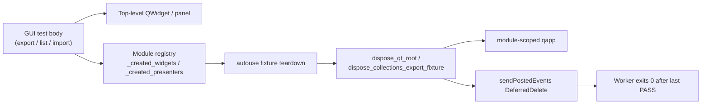

# Qt Dispose / Teardown for Export UI and Environment List (PYPOST-1315 / PYPOST-1357 / PYPOST-1358)

## Overview

Environment export, collection export, and environment list/import tests build
unparented Qt roots (`EnvironmentListWidget`, collections panel + tree). Closing
those widgets alone is not enough: pending `QObject.deleteLater` work must run
**while** the module-scoped `qapp` is still alive. If DeferredDelete is never
drained, Shiboken wrappers can survive until worker process exit and cause a
post-PASS native crash (`SIGSEGV` / `exit_code=-11`, sometimes `SIGBUS` / `-7`)
under parallel load.

Shared helpers in `tests/helpers/qt_widget_dispose.py` implement the dispose
contract used by:

- `tests/test_environment_export_ui.py`
- `tests/test_collection_export_ui.py`
- `tests/test_environment_list_widget.py` (list + import; PYPOST-1358)

Production paths under `pypost/` are unchanged.

| Ticket | Scope |
| --- | --- |
| PYPOST-1315 | Shared `dispose_qt_root` / collections wrapper; env-export registry + autouse; env teardown repro |
| PYPOST-1357 | Collections registry + autouse (missed-`finally` guard); collections teardown repro (A / R-autouse / B) |
| PYPOST-1358 | Environment list/import registry + autouse on the same `EnvironmentListWidget` type; list teardown repro (A / R-dispose / B) |

Related crash classes (do not conflate):

| Class | Doc / ticket | Relation |
| --- | --- | --- |
| Incomplete dispose (export / list UI) | This page / PYPOST-1315 / PYPOST-1357 / PYPOST-1358 | Post-PASS worker death after green assertions |
| Large-batch `apply_theme` | [gui_batch_segfault.md](gui_batch_segfault.md) / PYPOST-1212 | Mid-batch style engine; reuse subprocess evidence patterns only |
| Presenter async lifecycle | [presenter_teardown.md](presenter_teardown.md) / PYPOST-1256 | Collections `teardown()` fences import; still needs widget dispose after |
| Window activation harness | [qt_activation_helper.md](qt_activation_helper.md) | Uses `processEvents` only; weaker than dispose (see Troubleshooting) |

## Architecture

| Component | Location | Role |
| --- | --- | --- |
| `dispose_qt_root` | `tests/helpers/qt_widget_dispose.py` | Close → pump → `deleteLater` → drain DeferredDelete → pump |
| `dispose_collections_export_fixture` | same | Presenter `teardown` → detach tree model → dispose panel |
| Env export fixture | `tests/test_environment_export_ui.py` | `_created_widgets` registry + autouse `dispose_qt_root` |
| Env list/import suite | `tests/test_environment_list_widget.py` | Same registry + autouse pattern; product tests still `close()` in `finally` (belt-and-suspenders) |
| Collection export suite | `tests/test_collection_export_ui.py` | `_created_presenters` registry + autouse `dispose_collections_export_fixture`; product tests still call dispose in `finally` |
| Env export contract repro | `tests/test_environment_export_ui_teardown_repro.py` | Asserts disposed roots are invalid / not in `topLevelWidgets()` |
| Env list contract repro | `tests/test_environment_list_widget_teardown_repro.py` | A-complete / A-incomplete / R-dispose / B (see below) |
| Collections contract repro | `tests/test_collection_export_ui_teardown_repro.py` | A-complete / A-incomplete / R-autouse / B (see below) |
| Module `qapp` | `tests/conftest.py` | Must remain alive for the whole dispose sequence |



**Why `sendPostedEvents(DeferredDelete)`:** `QApplication.processEvents()` alone does not
process DeferredDelete for roots such as `EnvironmentListWidget`. After `deleteLater`, call
`QCoreApplication.sendPostedEvents(None, QEvent.Type.DeferredDelete)` so `shiboken6.isValid`
becomes false before process exit.

**Why registry + autouse (not `finally` alone):** a missed `finally` leaves the close-only
path and is a classic post-PASS SIGSEGV class (PYPOST-1315 TD-5 / PYPOST-1357 R-autouse /
PYPOST-1358 H1). Export and list/import suites register roots at construction and dispose
from an autouse fixture so omit-dispose still reaches the contract while `qapp` is alive.

## API / Usage

### `dispose_qt_root(widget, qapp)`

Destroy a top-level Qt root while `qapp` is alive. Idempotent if `widget` is `None` or the C++
object is already gone.

```python
from tests.helpers.qt_widget_dispose import dispose_qt_root

dispose_qt_root(widget, qapp)
```

Sequence:

1. `widget.close()`
2. `qapp.processEvents()`
3. `widget.deleteLater()` (if still valid)
4. `QCoreApplication.sendPostedEvents(None, QEvent.Type.DeferredDelete)`
5. `qapp.processEvents()`

### `dispose_collections_export_fixture(presenter, qapp)`

Fence collections presenter lifecycle, detach the tree model if still attached, then dispose the
panel root.

```python
from tests.helpers.qt_widget_dispose import dispose_collections_export_fixture

dispose_collections_export_fixture(presenter, qapp)
```

Order inside the helper:

1. `presenter.teardown(timeout_ms=50)` when callable (admission fence + panel close)
2. `tree.setModel(None)` when the presenter's widget is a live `QAbstractItemView`
3. `dispose_qt_root(presenter.panel, qapp)`

### Environment export / list-import registry + autouse pattern

Register created roots and dispose them from an autouse fixture (do not rely on `close()` alone
in `finally`):

```python
from tests.helpers.qt_widget_dispose import dispose_qt_root

_created_widgets: list[QWidget] = []


def _make_widget(...):
    w = EnvironmentListWidget(...)
    _created_widgets.append(w)
    return w


@pytest.fixture(autouse=True)
def _cleanup_widgets(qapp):
    yield
    while _created_widgets:
        dispose_qt_root(_created_widgets.pop(), qapp)
```

Used in:

- `tests/test_environment_export_ui.py`
- `tests/test_environment_list_widget.py` (PYPOST-1358)

The list/import suite still ends many tests with `finally: widget.close()` as belt-and-suspenders;
full C++ teardown comes from autouse `dispose_qt_root` (idempotent with the earlier close).

### Collection export registry + autouse pattern

Same shape as env export: `_make_presenter` appends to `_created_presenters`; autouse drains the
registry with `dispose_collections_export_fixture`. Product suite tests still dispose in
`finally` as well (idempotent double dispose); the durable missed-`finally` guard is the
autouse path.

```python
from tests.helpers.qt_widget_dispose import dispose_collections_export_fixture

_created_presenters: list[CollectionsPresenter] = []


def _make_presenter(...):
    presenter = CollectionsPresenter(...)
    presenter.refresh_tree()
    _created_presenters.append(presenter)
    return presenter, manager


@pytest.fixture(autouse=True)
def _cleanup_collections_export_presenters(qapp):
    yield
    while _created_presenters:
        dispose_collections_export_fixture(_created_presenters.pop(), qapp)
```

Used in `tests/test_collection_export_ui.py` and
`tests/test_collection_export_ui_teardown_repro.py`.

### Contract after dispose

- `shiboken6.isValid(root)` is false for disposed roots
- No disposed export / list UI root types remain in `qapp.topLevelWidgets()`
- Existing product assertions and `pytest.mark.timeout(60)` markers stay unchanged

Validate with:

```bash
make test PYTEST_ARGS="tests/test_environment_export_ui_teardown_repro.py \
  tests/test_environment_export_ui.py \
  tests/test_collection_export_ui_teardown_repro.py \
  tests/test_collection_export_ui.py \
  tests/test_environment_list_widget_teardown_repro.py \
  tests/test_environment_list_widget.py"
```

## Environment list teardown repro (PYPOST-1358)

Module: `tests/test_environment_list_widget_teardown_repro.py`.

| Member | Role | Polarity |
| --- | --- | --- |
| **A-complete** | Full `dispose_qt_root` → desired end-state | Positive guard: root invalid; no leftover `EnvironmentListWidget` |
| **A-incomplete** | Close-only (no DeferredDelete drain) | **Green** negative control: asserts residual liveness *in the test body*, then disposes in `finally` so later tests stay clean. Does **not** mirror the product suite's full teardown (registry + autouse) |
| **R-dispose** | Applies suite dispose helper (`dispose_qt_root`) | Desired end-state; durable suite-teardown contract (was RED under close-only in Step 3) |
| **B** | Bounded subprocess of the thirteen-node list/import file | Fails only on native-crash exit codes; zero-crash matrix + dependency versions is an accepted diagnostic when live SIGSEGV is unavailable |

Cause fork: **R-dispose** (H1) — list/import close-only left live `EnvironmentListWidget` C++
roots; same widget type / dispose helper family as env export (PYPOST-1315). Step 4 wired
registry + autouse into `tests/test_environment_list_widget.py`.

## Collections teardown repro (PYPOST-1357)

Module: `tests/test_collection_export_ui_teardown_repro.py`.

| Member | Role | Polarity |
| --- | --- | --- |
| **A-complete** | Full `dispose_collections_export_fixture` → desired end-state | Positive guard: panel invalid; no leftover panel / top-level `QTreeView` |
| **A-incomplete** | Production `teardown` / close-only (no DeferredDelete drain) | **Green** negative control: asserts residual liveness *in the test body*, then disposes in `finally` so later tests stay clean |
| **R-autouse** | Omits dispose in the test body (missed-`finally`) | Desired end-state after registry autouse; durable “missed finally still safe” guard |
| **B** | Bounded subprocess of the nineteen-node collection export UI file | Fails only on native-crash exit codes; zero-crash matrix + dependency versions is an accepted diagnostic when live SIGSEGV is unavailable |

Cause fork on the restored host was **R-autouse** (not residual incomplete dispose, not live
env crash): A-complete and B were already green; the red→green driver was omitted dispose
until Step 4 landed registry + autouse.

### Why end-state asserts run in a separate fixture teardown (LIFO)

Pytest tears fixtures down in **LIFO** order relative to setup. R-autouse must assert the
desired end-state **after** autouse dispose has run. If the test body asserted
`not shiboken6.isValid(panel)` immediately, the panel would still be live (dispose has not
happened yet) and the guard would be meaningless or falsely red.

The repro therefore uses two fixtures:

1. `_collections_export_end_state_checks` — yields a list of callables; on teardown, runs them.
2. `_cleanup_collections_export_presenters` (**autouse**) — **depends on** the end-state
   fixture, so it is set up *after* and torn down *before* those checks.

```text
setup:   end_state_checks  →  autouse cleanup
teardown (LIFO):  autouse dispose registry  →  run queued end-state asserts
```

R-autouse appends `_assert_desired_collections_dispose_end_state` to the end-state list and
deliberately skips `dispose_collections_export_fixture` in the body. Autouse dispose runs first;
then the queued assert confirms the panel is C++-dead.

A-incomplete must **not** rely on that post-autouse assert path for its polarity: it checks
residual liveness in the test body (before any full dispose) so the negative control stays
meaningful after autouse exists.

## Configuration

No environment variables or product settings. Dispose runs only inside pytest workers that
already use `QT_QPA_PLATFORM=offscreen` and the shared `qapp` fixture (see
[gui_testing.md](gui_testing.md)).

## Troubleshooting

- **Worker dies with `exit_code=-11` / `-7` after all tests PASSED**  
  Suspect leftover top-level widgets or undrained DeferredDelete. Confirm teardown uses
  `dispose_qt_root` (or the collections wrapper) via registry autouse (and/or `finally`), not
  `close()` / single `processEvents` only. The parallel runner records this as a file failure —
  see [parallel_test_runner.md](parallel_test_runner.md).

- **`shiboken6.isValid(widget)` stays True after cleanup**  
  `processEvents` alone is insufficient for DeferredDelete on some roots. Use
  `sendPostedEvents(..., DeferredDelete)` as in `dispose_qt_root`; do not weaken the helper back
  to close + one `processEvents`.

- **New GUI test creates unparented export- or list-style roots**  
  Prefer `dispose_qt_root` over inventing another close sequence. Register on
  `_created_widgets` (or an equivalent autouse registry). For a full
  `CollectionsPresenter`, register on `_created_presenters` (or call
  `dispose_collections_export_fixture` so production `teardown()` runs before widget
  destruction). Do not rely on `finally` alone.

- **List/import suite still has `finally: widget.close()`**  
  That close is redundant with autouse `dispose_qt_root` (which starts with `close()`). It is
  intentional belt-and-suspenders until redundant finallys are dropped (tracked with export
  TD-4 / [PYPOST-1481](https://pypost.atlassian.net/browse/PYPOST-1481)). Do not treat
  close-only as the suite's full teardown when writing repros or docs.

- **R-autouse / end-state assert fails with “still valid”**  
  Asserting desired end-state in the test body runs *before* autouse dispose. Queue the assert
  through `_collections_export_end_state_checks` (or an equivalent fixture that tears down
  *after* the dispose autouse via LIFO dependency).

- **`ActivatedWindow` / `qt_activation` still uses `processEvents` only**  
  That harness is a different helper; aligning it with DeferredDelete drain is tracked
  separately ([PYPOST-1478](https://pypost.atlassian.net/browse/PYPOST-1478)). Prefer
  `dispose_qt_root` for export / list UI and other top-level widget teardown that must be
  C++-dead before process exit.

- **Do not “fix” with `os._exit` in session finish, skips, or timeout removal**  
  Those mask lifetime bugs and are out of scope for this dispose class.
