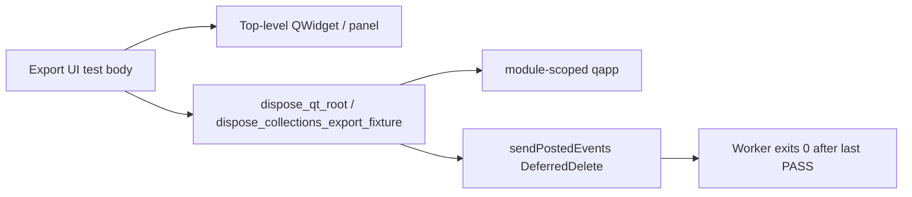

# Export UI Qt Dispose / Teardown (PYPOST-1315)

## Overview

Environment and collection export UI tests build unparented Qt roots (`EnvironmentListWidget`,
collections panel + tree). Closing those widgets alone is not enough: pending
`QObject.deleteLater` work must run **while** the module-scoped `qapp` is still alive. If
DeferredDelete is never drained, Shiboken wrappers can survive until worker process exit and
cause a post-PASS native crash (`SIGSEGV` / `exit_code=-11`, sometimes `SIGBUS` / `-7`) under
parallel load.

Shared helpers in `tests/helpers/qt_widget_dispose.py` implement the dispose contract used by
`tests/test_environment_export_ui.py` and `tests/test_collection_export_ui.py`. Production
export paths under `pypost/` are unchanged.

Related crash classes (do not conflate):

| Class | Doc / ticket | Relation |
| --- | --- | --- |
| Export UI incomplete dispose | This page / PYPOST-1315 | Post-PASS worker death after green assertions |
| Large-batch `apply_theme` | [gui_batch_segfault.md](gui_batch_segfault.md) / PYPOST-1212 | Mid-batch style engine; reuse subprocess evidence patterns only |
| Presenter async lifecycle | [presenter_teardown.md](presenter_teardown.md) / PYPOST-1256 | Collections `teardown()` fences import; still needs widget dispose after |
| Window activation harness | [qt_activation_helper.md](qt_activation_helper.md) | Uses `processEvents` only; weaker than export dispose (see Troubleshooting) |

## Architecture

| Component | Location | Role |
| --- | --- | --- |
| `dispose_qt_root` | `tests/helpers/qt_widget_dispose.py` | Close → pump → `deleteLater` → drain DeferredDelete → pump |
| `dispose_collections_export_fixture` | same | Presenter `teardown` → detach tree model → dispose panel |
| Env export fixture | `tests/test_environment_export_ui.py` | Autouse cleanup calls `dispose_qt_root` on created roots |
| Collection export tests | `tests/test_collection_export_ui.py` | `finally` calls `dispose_collections_export_fixture` |
| Contract repro | `tests/test_environment_export_ui_teardown_repro.py` | Asserts disposed roots are invalid / not in `topLevelWidgets()` |
| Module `qapp` | `tests/conftest.py` | Must remain alive for the whole dispose sequence |



**Why `sendPostedEvents(DeferredDelete)`:** `QApplication.processEvents()` alone does not
process DeferredDelete for roots such as `EnvironmentListWidget`. After `deleteLater`, call
`QCoreApplication.sendPostedEvents(None, QEvent.Type.DeferredDelete)` so `shiboken6.isValid`
becomes false before process exit.

## API / Usage

### `dispose_qt_root(widget, qapp)`

Destroy a top-level Qt root while `qapp` is alive. Idempotent if `widget` is `None` or the C++
object is already gone.

```python
from tests.helpers.qt_widget_dispose import dispose_qt_root

dispose_qt_root(widget, qapp)
```

Sequence:

1. `widget.close()`
2. `qapp.processEvents()`
3. `widget.deleteLater()` (if still valid)
4. `QCoreApplication.sendPostedEvents(None, QEvent.Type.DeferredDelete)`
5. `qapp.processEvents()`

### `dispose_collections_export_fixture(presenter, qapp)`

Fence collections presenter lifecycle, detach the tree model if still attached, then dispose the
panel root.

```python
from tests.helpers.qt_widget_dispose import dispose_collections_export_fixture

try:
    # exercise CollectionExportActions / panel UI
    ...
finally:
    dispose_collections_export_fixture(presenter, qapp)
```

Order inside the helper:

1. `presenter.teardown(timeout_ms=50)` when callable (admission fence + panel close)
2. `tree.setModel(None)` when the presenter's widget is a live `QAbstractItemView`
3. `dispose_qt_root(presenter.panel, qapp)`

### Environment export fixture pattern

Register created roots and dispose them from an autouse fixture (do not rely on `close()` alone
in `finally`):

```python
from tests.helpers.qt_widget_dispose import dispose_qt_root

_created_widgets: list[QWidget] = []


@pytest.fixture(autouse=True)
def _cleanup_widgets(qapp):
    yield
    while _created_widgets:
        dispose_qt_root(_created_widgets.pop(), qapp)
```

### Contract after dispose

- `shiboken6.isValid(root)` is false for disposed roots
- No disposed export UI root types remain in `qapp.topLevelWidgets()`
- Existing product assertions and `pytest.mark.timeout(60)` markers stay unchanged

Validate with:

```bash
make test PYTEST_ARGS="tests/test_environment_export_ui_teardown_repro.py \
  tests/test_environment_export_ui.py tests/test_collection_export_ui.py"
```

## Configuration

No environment variables or product settings. Dispose runs only inside pytest workers that
already use `QT_QPA_PLATFORM=offscreen` and the shared `qapp` fixture (see
[gui_testing.md](gui_testing.md)).

## Troubleshooting

- **Worker dies with `exit_code=-11` / `-7` after all tests PASSED**  
  Suspect leftover top-level widgets or undrained DeferredDelete. Confirm teardown uses
  `dispose_qt_root` (or the collections wrapper), not `close()` / single `processEvents` only.
  The parallel runner records this as a file failure — see
  [parallel_test_runner.md](parallel_test_runner.md).

- **`shiboken6.isValid(widget)` stays True after cleanup**  
  `processEvents` alone is insufficient for DeferredDelete on some roots. Use
  `sendPostedEvents(..., DeferredDelete)` as in `dispose_qt_root`; do not weaken the helper back
  to close + one `processEvents`.

- **New GUI test creates unparented export-style roots**  
  Prefer `dispose_qt_root` over inventing another close sequence. For a full
  `CollectionsPresenter`, call `dispose_collections_export_fixture` so production
  `teardown()` runs before widget destruction.

- **`ActivatedWindow` / `qt_activation` still uses `processEvents` only**  
  That harness is a different helper; aligning it with DeferredDelete drain is tracked
  separately ([PYPOST-1478](https://pypost.atlassian.net/browse/PYPOST-1478)). Prefer
  `dispose_qt_root` for export UI and other top-level widget teardown that must be C++-dead
  before process exit.

- **Do not “fix” with `os._exit` in session finish, skips, or timeout removal**  
  Those mask lifetime bugs and are out of scope for this dispose class.
