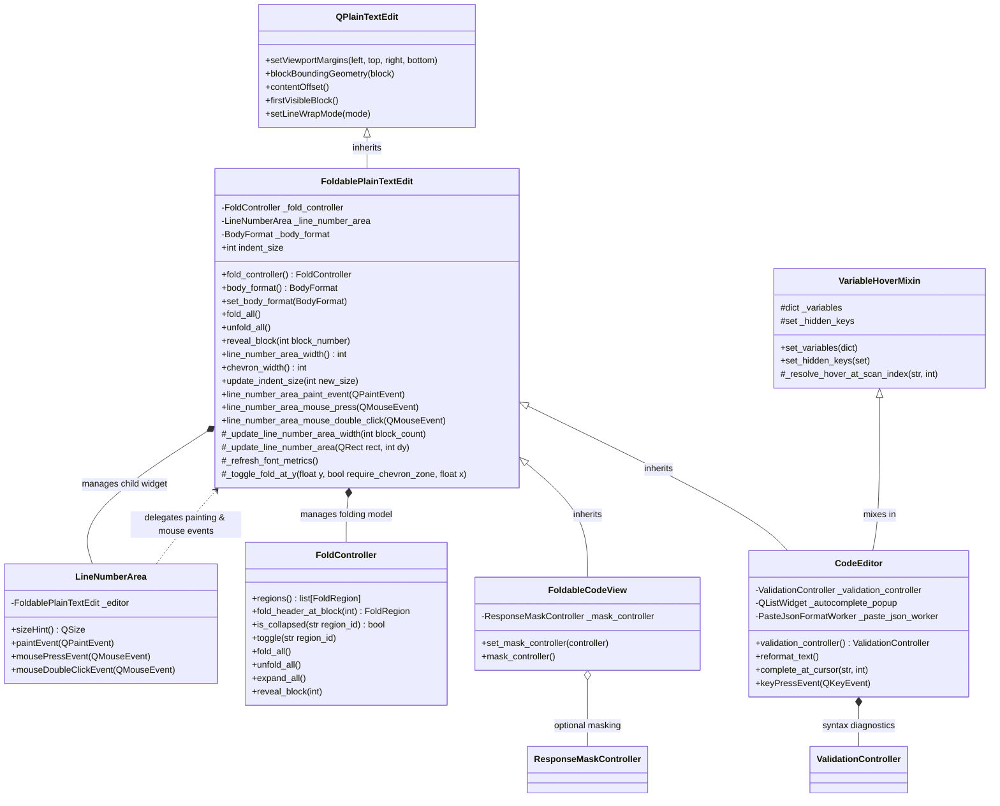
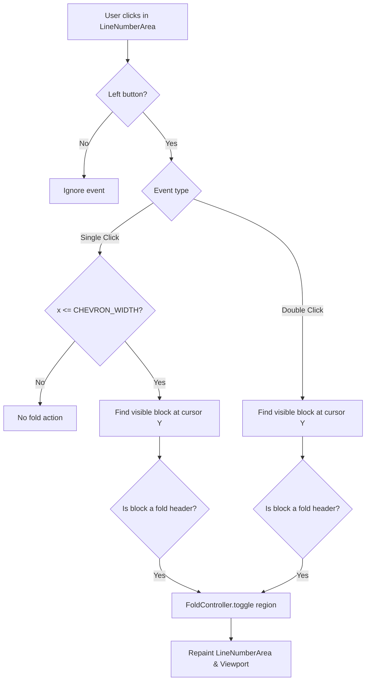

# Foldable Plain Text Edit Base Class

## Overview

`FoldablePlainTextEdit` (`pypost.ui.widgets.foldable_plain_text_edit.FoldablePlainTextEdit`) is a
reusable base class extending PySide6's `QPlainTextEdit` with a synchronized line-number gutter,
code-folding chevrons, and folding controller integration.

### Motivation

Prior to the extraction of `FoldablePlainTextEdit` (PYPOST-1365 / PYPOST-1369), the codebase
maintained two separate plain text widgets with gutter and code folding capabilities:
1. `CodeEditor`: Interactive request body editor with syntax validation, auto-complete, auto-indent,
   and bracket pairing.
2. `FoldableCodeView`: Read-only viewer used across response viewing surfaces (`ResponseView`,
   WebSocket stream inspector, MCP tool result viewer) with sensitive response field masking.

These two classes duplicated nearly 150 lines of identical gutter layout calculations, margin
adjustments, font metric listeners, block coordinate translations, chevron rendering, and mouse
event routing. Furthermore, minor behavioral discrepancies had emerged over time: for example,
double-clicking anywhere on a fold header in the gutter was supported in `FoldableCodeView` but
silently ignored in `CodeEditor`.

Unifying both widgets under `FoldablePlainTextEdit`:
- **Eliminates Code Duplication**: Consolidates gutter geometry, painting, and mouse dispatch into a
  single well-tested base class.
- **Enforces Behavioral Uniformity**: Standardizes single-click chevron toggling and double-click
  gutter fold toggling across both interactive editing and read-only viewing surfaces.
- **Provides a Common Folding Contract**: Exposes consistent methods (`fold_all()`, `unfold_all()`,
  `reveal_block()`, `set_body_format()`, `fold_controller()`) regardless of the concrete widget.
- **Maintains Full Backward Compatibility**: Subclasses preserve all domain-specific behaviors
  (e.g., variable hover/autocomplete in `CodeEditor`, response masking in `FoldableCodeView`).

---

## Architecture & Class Hierarchy



### Component Roles

1. **`FoldablePlainTextEdit` (`pypost.ui.widgets.foldable_plain_text_edit`)**:
   Direct subclass of `QPlainTextEdit`. Instantiates and manages `LineNumberArea` and
   `FoldController`. Handles viewport margins, scroll updates, font metrics, gutter paint events,
   and mouse click/double-click fold toggling.

2. **`LineNumberArea` (`pypost.ui.widgets.line_number_area`)**:
   A dedicated `QWidget` hosted within the left viewport margin of `FoldablePlainTextEdit`. It acts
   as an event-forwarding bridge, delegating `sizeHint()`, `paintEvent()`, `mousePressEvent()`, and
   `mouseDoubleClickEvent()` to the host editor.

3. **`FoldController` (`pypost.ui.widgets.fold.fold_controller`)**:
   Orchestrates document structure scanning (JSON, YAML, XML) via `StructureScanner` implementations.
   Tracks collapsed region IDs and adjusts document block visibility (`QTextBlock.setVisible()`).

4. **`FoldableCodeView` (`pypost.ui.widgets.foldable_code_view`)**:
   Subclasses `FoldablePlainTextEdit` for read-only code viewing. Adds support for sensitive response
   field masking via `ResponseMaskController`. Used in `ResponseView`, WebSocket `StreamDetailPane`,
   and `McpResultView`.

5. **`CodeEditor` (`pypost.ui.widgets.code_editor`)**:
   Subclasses `FoldablePlainTextEdit` and mixes in `VariableHoverMixin`. Adds syntax diagnostics
   (`ValidationController`), variable autocompletion popup, asynchronous JSON formatting on paste,
   and intelligent auto-indentation / bracket matching.

### Multiple Inheritance Considerations in PySide6

PySide6 enforces Qt's C++ object model rules: **multiple inheritance from more than one `QObject` or
`QWidget` subclass is strictly disallowed** and causes a runtime `TypeError` (`multiple bases have
instance lay-out conflict`).
- `FoldablePlainTextEdit` inherits from `QPlainTextEdit` (a `QWidget`).
- `VariableHoverMixin` is a pure Python generic mixin (`Generic[TWidget]`) that does **not** inherit
  from `QObject` or `QWidget`.
- Therefore, `class CodeEditor(VariableHoverMixin, FoldablePlainTextEdit):` conforms to Python MRO
  without layout conflicts.

---

## Gutter Layout and Rendering Mechanics

### 1. Dynamic Width Calculation

The gutter reserves space for line number digits, fold chevrons, and aesthetic padding:

$$\text{width} = \text{CHEVRON\_WIDTH} (14\text{px}) + \text{CHEVRON\_PADDING} (2\text{px}) + 3\text{px} + (\text{digits} \times \text{char\_width})$$

```python
def line_number_area_width(self) -> int:
    digits = max(1, len(str(self.blockCount())))
    font_metrics = QFontMetrics(self.document().defaultFont())
    number_width = font_metrics.horizontalAdvance("9") * digits
    return _CHEVRON_WIDTH + _CHEVRON_PADDING + 3 + number_width
```

When block counts change (e.g. crossing digit boundaries 9 → 10 or 99 → 100), `blockCountChanged`
fires `_update_line_number_area_width()`, which calls `setViewportMargins(width, 0, 0, 0)` and
adjusts `_line_number_area.setGeometry()`.

### 2. Viewport Scrolling and Resizing Synchronization

- **Scrolling (`updateRequest`)**: Qt's `updateRequest(rect, dy)` signal notifies the editor of
  viewport updates. If vertical scroll delta `dy` is non-zero, `_line_number_area.scroll(0, dy)`
  scrolls the gutter pixels directly without a full repaint. Otherwise, the gutter region is updated.
- **Resizing (`resizeEvent`)**: When the editor resizes, `resizeEvent` repositions the gutter to
  match the editor's contents rectangle `QRect(cr.left(), cr.top(), width, cr.height())`.
- **Font Changes (`changeEvent`)**: Listening for `QEvent.Type.FontChange` recalculates the tab stop
  distance and triggers a gutter width refresh.

### 3. Block Coordinate Translations and Chevron Painting

In `line_number_area_paint_event(event: QPaintEvent)`:
1. Fills the gutter background using the editor palette's background color role.
2. Identifies the first visible document block via `self.firstVisibleBlock()`.
3. Translates document block coordinates to viewport coordinates:
   ```python
   top = round(self.blockBoundingGeometry(block).translated(self.contentOffset()).top())
   bottom = top + round(self.blockBoundingRect(block).height())
   ```
4. Iterates through visible blocks (`block.isVisible()`) until `top > event.rect().bottom()`.
5. For each block:
   - Queries `self._fold_controller.fold_header_at_block(block_number)`.
   - If the block begins a collapsible region, renders a chevron centered in the left `_CHEVRON_WIDTH`
     zone: `▼` (`\u25bc`) if expanded, or `▶` (`\u25b6`) if collapsed.
   - Renders the 1-based line number (`str(block_number + 1)`) right-aligned within the remainder of
     the gutter width using a 50% opacity foreground pen.

---

## Gutter Interaction Mechanics

Fold toggling is supported through two complementary gutter interactions:



### Single-Click Interaction (`line_number_area_mouse_press`)

- Triggered by `Qt.MouseButton.LeftButton`.
- Evaluates whether the click X-position falls within the chevron zone:
  `event.position().x() <= _CHEVRON_WIDTH (14px)`.
- If inside the chevron zone, maps the cursor Y-coordinate to the visible document block.
- If the block is a fold header, calls `_fold_controller.toggle(region.region_id)` and repaints the
  gutter.

### Double-Click Interaction (`line_number_area_mouse_double_click`)

- Triggered by double-clicking anywhere on the fold header row in the gutter
  (`require_chevron_zone=False`).
- Does **not** require precise clicking within the 14px chevron zone; double-clicking on the line
  number digits also toggles the fold.
- Supported uniformly on both `FoldableCodeView` and `CodeEditor`.

### Document Replacement Flow (`setPlainText` / `setText`)

When document contents are replaced via `setPlainText(text)` or `setText(text)`:
1. `FoldablePlainTextEdit.setPlainText()` calls `self._fold_controller.expand_all()` to reveal all
   hidden blocks and clear stored collapse state before setting new text.
2. In `CodeEditor`, `setPlainText()` additionally clears syntax validation diagnostics.

---

## API Methods and Usage

### Public Interface

```python
class FoldablePlainTextEdit(QPlainTextEdit):
    def __init__(self, parent: QWidget | None = None, indent_size: int = 2) -> None: ...
    def fold_controller(self) -> FoldController: ...
    def body_format(self) -> BodyFormat: ...
    def set_body_format(self, body_format: BodyFormat) -> None: ...
    def fold_all(self) -> None: ...
    def unfold_all(self) -> None: ...
    def reveal_block(self, block_number: int) -> None: ...
    def line_number_area_width(self) -> int: ...
    def chevron_width(self) -> int: ...
    def update_indent_size(self, new_size: int) -> None: ...
    def setText(self, text: str) -> None: ...
    def setPlainText(self, text: str) -> None: ...
```

### Usage Examples

#### Instantiating Standalone Foldable Editor

```python
from pypost.ui.widgets.fold import BodyFormat
from pypost.ui.widgets.foldable_plain_text_edit import FoldablePlainTextEdit

# Create widget with 2-space indentation
editor = FoldablePlainTextEdit(indent_size=2)
editor.set_body_format(BodyFormat.JSON)
editor.setPlainText('{\n  "title": "Example",\n  "items": [1, 2, 3]\n}')

# Bulk fold operations
editor.fold_all()    # Collapses all foldable regions
editor.unfold_all()  # Expands all foldable regions

# Programmatically disclose a specific line (e.g. from search results)
editor.reveal_block(block_number=2)
```

#### Subclassing `FoldablePlainTextEdit`

When creating a specialized code widget, subclass `FoldablePlainTextEdit` and override lifecycle
methods carefully:

```python
from PySide6.QtGui import QResizeEvent
from PySide6.QtWidgets import QWidget
from pypost.ui.widgets.foldable_plain_text_edit import FoldablePlainTextEdit

class CustomCodeWidget(FoldablePlainTextEdit):
    def __init__(self, parent: QWidget | None = None) -> None:
        super().__init__(parent=parent, indent_size=4)
        # Custom initialization...

    def resizeEvent(self, event: QResizeEvent) -> None:
        # Crucial: always invoke super().resizeEvent to keep gutter geometry aligned
        super().resizeEvent(event)
        # Position custom overlays (e.g., status badges, error banners)...
```

---

## Troubleshooting & Maintenance Notes

### 1. Viewport Margin or Gutter Misalignment

- **Symptom**: Text overlaps with the gutter or the gutter does not stretch to the bottom of the
  editor.
- **Cause**: Overriding `resizeEvent` without invoking `super().resizeEvent(event)`.
- **Resolution**: Ensure all subclasses call `super().resizeEvent(event)` before performing
  subclass-specific layout operations (such as `ValidationController.layout_error_banner()`).

### 2. Orphaned Collapsed State Across Text Loads

- **Symptom**: After setting new text, blocks remain hidden or line numbers appear skipped.
- **Cause**: Bypassing `setPlainText()` or altering document contents directly on the underlying
  `QTextDocument` without calling `expand_all()`.
- **Resolution**: Use `editor.setPlainText(...)` or ensure `editor.fold_controller().expand_all()` is
  invoked before replacing document content.

### 3. Font Metric Desynchronization

- **Symptom**: Gutter width clips line numbers or chevron vertical alignment drifts from text lines.
- **Cause**: Changing application or widget font without triggering a font metric recalculation.
- **Resolution**: `FoldablePlainTextEdit` automatically listens for `QEvent.Type.FontChange`. If
  modifying fonts programmatically on a parent container, verify `update_indent_size()` or
  `_refresh_font_metrics()` is triggered.

### 4. Observability and Debug Logging

`FoldablePlainTextEdit` emits structured debug logs under logger
`pypost.ui.widgets.foldable_plain_text_edit`:
- `fold_body_format_changed widget=<class> format=<format>`
- `fold_all_invoked widget=<class>`
- `unfold_all_invoked widget=<class>`
- `reveal_block_invoked widget=<class> block=<int>`
- `fold_gutter_toggle widget=<class> block=<int> region_id=<str> toggle_type=<chevron_click|double_click>`

Enable `DEBUG` logging on `pypost.ui.widgets` to trace fold interactions during automated testing or
interactive troubleshooting.
