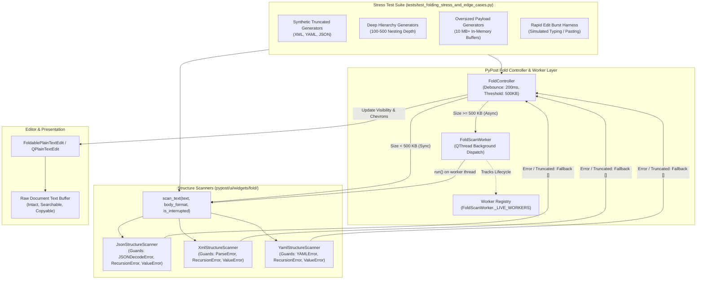

# Code Folding Stress and Edge-Case Payload Test Suite

## Overview

In PyPost, hierarchical code folding allows developers to collapse and expand nested data blocks (objects, arrays, elements) in structured payloads (JSON, YAML, XML) across interactive editors and response viewers:
- [`FoldablePlainTextEdit`](file:///home/src/pypost/ui/widgets/foldable_plain_text_edit.py) — Unified base editor with line numbers and folding gutter chevrons.
- [`CodeEditor`](file:///home/src/pypost/ui/widgets/code_editor.py) — Interactive request body composer.
- [`FoldableCodeView`](file:///home/src/pypost/ui/widgets/foldable_code_view.py) — Read-only response viewer, WebSocket stream inspector, and MCP tool output view.

### The Challenge of Real-World Edge Cases and Extreme Payloads

During real-world API development, debugging, and network diagnostics, payloads delivered over HTTP, WebSockets, or MCP frequently deviate from clean, well-formed specifications:
1. **Truncated Payloads**: Premature socket termination, dropped TCP connections, or stream chunk timeouts can abruptly cut off payloads mid-line, leaving unclosed JSON braces, incomplete XML elements, or dangling YAML keys.
2. **Syntactically Malformed Payloads**: Upstream server bugs or proxy corruption can yield malformed documents (mismatched XML tags, tab-indented YAML mappings, duplicate colons, invalid character entities).
3. **Deeply Nested Structures**: Payloads containing deep recursion (100 to 500+ nesting levels) can exceed Python's internal call stack recursion limits (`RecursionError`).
4. **Oversized Payloads (> 10 MB)**: Large bulk database exports, diagnostic memory dumps, or high-volume log streams routinely exceed 10 MB. Parsing such documents synchronously on the Qt main thread freezes user interfaces, causing frame drops and application unresponsiveness.
5. **High-Frequency Rapid Edits**: Rapid typing or copy-pasting into large documents can queue rapid successive parse requests, risking race conditions and thread leaks.

### Core Objectives of the Stress Suite

Introduced in **PYPOST-1365 / PYPOST-1371**, the stress and edge-case testing subsystem ensures:
- **Zero Unhandled Exceptions & Crash Immunity**: Scanners intercept all parser and runtime exceptions internally (`RecursionError`, `ValueError`, library syntax errors).
- **Graceful Degradation to Plain Text**: If document structure cannot be parsed, the raw text buffer remains completely intact, readable, searchable, and copyable without error dialogs or broken widgets.
- **Asynchronous Worker Offloading for Payloads > 500 KB and > 10 MB**: Document parsing is offloaded to background `QThread` workers, preserving UI responsiveness.
- **Deterministic CI Execution via Strict Timeouts**: All stress tests run under explicit test timeouts (`@pytest.mark.timeout(30)`), preventing CI test suite hangs.
- **Data Privacy in Observability**: Errors are logged with structured metadata (`error_type`, `length`) while guaranteeing zero raw payload or secret token leakage.

---

## Architecture & Design

### System Module Diagram



### Synthetic Generators vs. Raw File Fixtures

A foundational architectural decision in this suite is the exclusive use of **in-memory synthetic payload generators** over static test files checked into git:

1. **Repository Hygiene & Storage**: Committing 10 MB+ sample files bloats git repository history permanently, increases clone times for all contributors, and risks merge conflicts.
2. **Determinism & Flexibility**: Generators allow dynamic parameterization—such as arbitrary cut ratios (`cut_ratio=0.2, 0.4, 0.6, 0.8`), configurable recursion depths (`depth=200, 500`), and variable payload sizes (`target_bytes=10*1024*1024 + 1024`).
3. **Execution Efficiency**: Generating synthetic JSON or XML in memory takes between 15 and 35 milliseconds, incurring zero disk I/O latency in CI pipelines.

```python
# tests/test_folding_stress_and_edge_cases.py

def generate_truncated_payload(
    body_format: BodyFormat, sample_text: str, cut_ratio: float = 0.5
) -> str:
    """Return payload truncated at cut_ratio of length."""
    cut_len = max(1, int(len(sample_text) * cut_ratio))
    return sample_text[:cut_len]


def generate_deep_json(depth: int = 200) -> str:
    """Generate deeply nested JSON array structure."""
    return ("[" * depth) + "1" + ("]" * depth)


def generate_deep_xml(depth: int = 200) -> str:
    """Generate deeply nested XML element hierarchy."""
    open_tags = "".join(f"<n{i}>" for i in range(depth))
    close_tags = "".join(f"</n{i}>" for i in reversed(range(depth)))
    return f"<root>{open_tags}leaf{close_tags}</root>"


def generate_deep_yaml(depth: int = 200) -> str:
    """Generate deeply nested YAML mapping hierarchy with indentation."""
    lines = [f"{'  ' * i}k{i}:" for i in range(depth)]
    lines.append(f"{'  ' * depth}value")
    return "\n".join(lines)


def generate_oversized_json(target_bytes: int = 10 * 1024 * 1024 + 1024) -> str:
    """Generate synthetic JSON document exceeding target_bytes (~10 MB)."""
    chunk_size = 200_000
    num_chunks = (target_bytes // chunk_size) + 1
    chunk_str = "x" * chunk_size
    items = [f'{{"id": {i}, "data": "{chunk_str}"}}' for i in range(num_chunks)]
    return '{"items": [\n' + ",\n".join(items) + "\n]}"
```

### Failure Isolation & Raw Text Preservation

In PyPost, document folding is an enhancement layer over the underlying `QTextDocument`. Structural scanning failures are completely isolated:
- If a scanner fails or encounters a malformed document, it returns an empty fold region list `[]`.
- The controller safely removes existing fold regions, clearing gutter chevrons.
- The raw document text in [`FoldablePlainTextEdit`](file:///home/src/pypost/ui/widgets/foldable_plain_text_edit.py) is untouched. The user can continue inspecting, navigating, copying to the clipboard, and searching the raw payload.

### Recursion Protection

Python's standard parsing libraries (`json.loads`, `xml.etree.ElementTree`) and third-party libraries (`PyYAML`) rely on recursive function calls or internal C stacks:
- Standard catch blocks catching only `json.JSONDecodeError`, `yaml.YAMLError`, or `ET.ParseError` do **not** catch `RecursionError` or certain `ValueError` instances raised when recursion limits are exceeded.
- Without explicit guards, a hostile or deeply nested document (such as 200+ nested brackets `[[[[...]]]]` or 500 levels of YAML indentation) raises an unhandled `RecursionError`, crashing the worker thread or main Qt event loop.
- All scanners wrap document parsing in unified exception handlers catching `(LibrarySpecificError, RecursionError, ValueError)`.

### Oversized Payload Offloading

[`FoldController`](file:///home/src/pypost/ui/widgets/fold/fold_controller.py) enforces a threshold:
```python
LARGE_DOCUMENT_THRESHOLD_BYTES = 500 * 1024  # 500 KB
```
- **Payloads < 500 KB**: Executed synchronously on the UI thread with minimal overhead.
- **Payloads >= 500 KB (and > 10 MB)**: Dispatched to [`FoldScanWorker`](file:///home/src/pypost/ui/widgets/fold/fold_worker.py), a dedicated `QThread`.
- To preserve thread safety, only an immutable string snapshot (`editor.toPlainText()`) is passed across threads; `QTextDocument` and widget instances are never touched by worker threads.

---

## Scanner Robustness

### Exception Handling Matrix

Each scanner in [`pypost/ui/widgets/fold/`](file:///home/src/pypost/ui/widgets/fold/) implements a robust `scan_text` method:

| Scanner | Module | Primary Exceptions Caught | Fallback Return | Log Event |
| --- | --- | --- | --- | --- |
| [`JsonStructureScanner`](file:///home/src/pypost/ui/widgets/fold/json_structure_scanner.py) | `json_structure_scanner.py` | `(json.JSONDecodeError, RecursionError, ValueError)` | `[]` | `json_scan_parse_skipped` |
| [`YamlStructureScanner`](file:///home/src/pypost/ui/widgets/fold/yaml_structure_scanner.py) | `yaml_structure_scanner.py` | `(yaml.YAMLError, RecursionError, ValueError)` | `[]` | `yaml_scan_parse_skipped` |
| [`XmlStructureScanner`](file:///home/src/pypost/ui/widgets/fold/xml_structure_scanner.py) | `xml_structure_scanner.py` | `(ET.ParseError, RecursionError, ValueError)` | `[]` | `xml_scan_parse_skipped` |

### Code Implementation Patterns

#### JSON Scanner
```python
# pypost/ui/widgets/fold/json_structure_scanner.py
try:
    json.loads(text)
    if is_interrupted is not None and is_interrupted():
        return []
    return _scan_regions(text, is_interrupted=is_interrupted)
except (json.JSONDecodeError, RecursionError, ValueError) as exc:
    logger.warning(
        "json_scan_parse_skipped error_type=%s length=%d",
        type(exc).__name__,
        len(text),
    )
    return []
```

#### YAML Scanner
```python
# pypost/ui/widgets/fold/yaml_structure_scanner.py
try:
    stream = io.StringIO(text)
    regions: list[FoldRegion] = []
    for node in yaml.compose_all(stream, Loader=yaml.SafeLoader):
        if is_interrupted is not None and is_interrupted():
            return []
        _collect_regions(node, [], regions)
    return regions
except (yaml.YAMLError, RecursionError, ValueError) as exc:
    logger.warning(
        "yaml_scan_parse_skipped error_type=%s length=%d",
        type(exc).__name__,
        len(text),
    )
    return []
```

#### XML Scanner
```python
# pypost/ui/widgets/fold/xml_structure_scanner.py
try:
    ET.fromstring(text)
    if is_interrupted is not None and is_interrupted():
        return []
    return _scan_regions(text, is_interrupted=is_interrupted)
except (ET.ParseError, RecursionError, ValueError) as exc:
    logger.warning(
        "xml_scan_parse_skipped error_type=%s length=%d",
        type(exc).__name__,
        len(text),
    )
    return []
```

### Privacy & Sensitive Data Protection in Logs

To comply with application security standards and prevent secret leakage:
- Raw payload content is **strictly omitted** from log messages.
- Only the exception type name (`error_type=%s`, e.g. `RecursionError`, `JSONDecodeError`) and document character count (`length=%d`) are logged.
- Any authorization headers, bearer tokens, passwords, or personal data embedded inside malformed or stress payloads are never written to disk or console.

---

## Test Suite Structure & Categories

The automated test suite lives in [`tests/test_folding_stress_and_edge_cases.py`](file:///home/src/tests/test_folding_stress_and_edge_cases.py) and is organized into five distinct verification categories:

### Category A: Truncated & Malformed Payloads (`TestTruncatedAndMalformedPayloads`)

Verifies that truncated and syntactically corrupt inputs safely return an empty region list `[]` without raising unhandled exceptions:
- **Truncated JSON**: Payloads sliced at 20%, 40%, 60%, and 80% boundaries (cut braces, cut keys, cut values).
- **Malformed JSON**: Unclosed quotes (`'{"key": "val'`), duplicate colons (`'{"k":: 1}'`), trailing commas, unquoted keys, raw non-JSON text.
- **Truncated XML**: Truncated at 20% to 80% byte ratios, mid-tag cuts (`<root><item id="1`), truncated CDATA blocks.
- **Malformed XML**: Mismatched tags (`<root><item></other></root>`), multiple root elements, undeclared XML entities (`&invalid;`), unclosed attribute strings.
- **Truncated YAML**: Cut flow sequences (`items:\n  - [1, 2, `), cut flow mappings, unclosed single/double quotes.
- **Malformed YAML**: Tab/space indentation mixing, unclosed scalars, invalid colon syntax.

### Category B: Deeply Nested Hierarchies & Recursion Safety (`TestDeeplyNestedRecursionSafety`)

Verifies that deep nesting cannot crash the application via unhandled `RecursionError`:
- **Deep YAML**: 500 levels of nested indented mappings (`k0:\n  k1:\n    ...`) triggering PyYAML stack depth limits.
- **Deep JSON**: 200 levels of nested brackets (`[[[[...]]]]`) exercising recursion guards.
- **Deep XML**: 200 levels of nested elements (`<n0><n1>...`) exercising XML recursion guards.
- **Contract**: Scanners safely catch recursion limit exceptions, log a warning, and return `[]`.

### Category C: Extreme Payloads (> 10 MB) (`TestOversizedPayloads`)

Verifies that payloads exceeding 10 MB are handled safely and offloaded off the UI thread:
- Generates a synthetic ~10.5 MB JSON payload using `generate_oversized_json`.
- Confirms payload size exceeds `10 * 1024 * 1024` bytes.
- Asserts that [`FoldController`](file:///home/src/pypost/ui/widgets/fold/fold_controller.py) spawns an active [`FoldScanWorker`](file:///home/src/pypost/ui/widgets/fold/fold_worker.py) in the background.
- Uses `process_until` to keep the Qt event loop pumping while waiting for the worker.
- Verifies that `scan_finished` signal fires, fold regions are populated, and the worker reference is cleanly cleared.

### Category D: High-Frequency Rapid Edits and Debounce (`TestRapidEditsAndDebounce`)

Simulates rapid typing or continuous paste events:
- Dispatches multiple document edits in rapid succession (burst typing).
- Confirms `FoldController` debouncing (200 ms) delays scanning until editing pauses.
- Confirms cooperative interruption via `requestInterruption()` halts obsolete workers.
- Asserts that zero worker threads leak in `FoldScanWorker._LIVE_WORKERS` after processing settles.

### Category E: Observability & Structured Warning Logging (`TestObservabilityAndStructuredLogging`)

Validates structured telemetry under failure conditions:
- Verifies warning emission for `json_scan_parse_skipped`, `yaml_scan_parse_skipped`, and `xml_scan_parse_skipped`.
- Asserts log output contains `error_type` and `length`.
- Asserts that secret tokens embedded in malformed payloads (`super_secret_user_token_...`) are not present in log records.

---

## Timeouts & CI Performance Considerations

### Explicit Test Timeouts

To guarantee that the CI pipeline never hangs due to quadratic parser complexity or thread deadlocks, strict timeouts are enforced:

```python
# tests/test_folding_stress_and_edge_cases.py
pytestmark = pytest.mark.timeout(30)
```

1. **Module-Level Timeout (`30s`)**: Every test function in the module has a hard 30-second ceiling enforced by `pytest-timeout`.
2. **Event Loop Polling Ceiling (`process_until`)**: Background worker tests enforce explicit polling timeouts (e.g. `timeout_ms=25_000` for 10 MB payload parsing, `5_000` for rapid edits).
3. **Deterministic Failure**: If a parser enters an infinite loop or thread communication stalls, the test fails loudly with a timeout traceback rather than hanging the entire CI workflow.

### Execution Performance

Despite exercising documents over 10 MB and up to 500 levels of recursion, the entire test suite executes in under **10 seconds** on standard hardware:
- Truncated & malformed tests (sync): ~0.05 seconds.
- Deep recursion safety tests: ~0.15 seconds.
- 10 MB synthetic payload generation & background parse: ~2.5 to 4.0 seconds.
- Rapid burst debounce & worker cleanup: ~0.35 seconds.
- Observability log capture tests: ~0.05 seconds.

---

## Troubleshooting & Maintenance Notes

### 1. Adding New Syntax Scanners
When introducing a new syntax scanner (e.g., Markdown, GraphQL, TOML):
- Implement the pure-text scanning contract:
  ```python
  def scan_text(
      self, text: str, is_interrupted: Callable[[], bool] | None = None
  ) -> list[FoldRegion]:
      ...
  ```
- Always wrap parsing in a `try...except (ParserError, RecursionError, ValueError)` block.
- Log warning diagnostics using structured parameters (`error_type=%s length=%d`).
- Never pass raw text to the logger to avoid secret exposure.
- Return `[]` on failure.

### 2. Investigating Stress Test Timeouts
If `test_oversized_payload_background_dispatch_and_completion` times out in CI:
- Check whether CI environment has severely constrained CPU allocation (e.g., single-core runner).
- Verify that `process_until` is running and `qapp.processEvents()` is processing queued signals.
- Check if `FoldScanWorker._LIVE_WORKERS` contains orphaned workers.

### 3. Debugging Worker Thread Leaks
- If tests report leaked workers, inspect `FoldScanWorker._LIVE_WORKERS`.
- Ensure that `worker.finished.connect(worker.deleteLater)` is intact.
- Verify that `FoldController._cleanup_worker()` is called when the host editor is destroyed.

---

## Related Files & Classes

- [`tests/test_folding_stress_and_edge_cases.py`](file:///home/src/tests/test_folding_stress_and_edge_cases.py) — Automated stress and edge-case test suite.
- [`FoldController`](file:///home/src/pypost/ui/widgets/fold/fold_controller.py) — Coordinator managing scan timers, size thresholds, and worker lifecycle.
- [`FoldScanWorker`](file:///home/src/pypost/ui/widgets/fold/fold_worker.py) — `QThread` offloading CPU-heavy AST parsing for large payloads.
- [`StructureScanner` & `scan_text`](file:///home/src/pypost/ui/widgets/fold/structure_scanner.py) — Protocol and registry routing parsing requests.
- [`JsonStructureScanner`](file:///home/src/pypost/ui/widgets/fold/json_structure_scanner.py) — JSON structure scanner with recursion and syntax error guards.
- [`YamlStructureScanner`](file:///home/src/pypost/ui/widgets/fold/yaml_structure_scanner.py) — YAML structure scanner with recursion and syntax error guards.
- [`XmlStructureScanner`](file:///home/src/pypost/ui/widgets/fold/xml_structure_scanner.py) — XML structure scanner with recursion and syntax error guards.
- [`FoldablePlainTextEdit`](file:///home/src/pypost/ui/widgets/foldable_plain_text_edit.py) — Unified foldable text editor widget.
- [`Background Folding Scanner Documentation`](file:///home/src/doc/dev/background_folding_scanner.md) — Comprehensive background scanner architecture reference.
