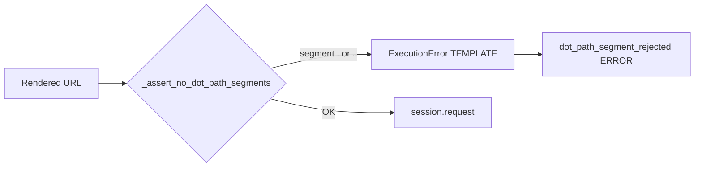

# HTTP Path Segment Rejection (`.`, `..`) — PYPOST-1346

## Overview

After URL templates are rendered (including `urlencode` / `to_int` and other expression
functions), `HTTPClient` rejects any request whose path contains a segment that is exactly
`.` or exactly `..`. The failure is fail-closed: no `session.request` call is made, and
callers (GUI, inbound MCP tools, collection offline `_prepare` helpers) receive an
`ExecutionError` with `ErrorCategory.TEMPLATE`.

Without this guard, a value such as `..` survives `urllib.parse.quote(..., safe="")` as a
literal path segment. Downstream `requests` / urllib3 then apply RFC 3986 remove-dot-segments
normalisation, so a curated MCP URL like `/repos/../user` can become a different same-host
path while still using the collection method and token.

This protection lives in the shared HTTP stack, so every collection that renders path
placeholders benefits—not only GitHub and GitLab.

## Architecture

```
TemplateService.render_string(url)
        │
        ▼
HTTPClient._prepare_request_kwargs
        │
        ├─ _assert_no_dot_path_segments(url)   ← PYPOST-1346
        │         │
        │         └─ on reject: ERROR log + re-raise ExecutionError(TEMPLATE)
        │
        └─ build headers / params / body → session.request(**kwargs)
```

- **`_assert_no_dot_path_segments(url)`** (`pypost/core/http_client.py`): module-level helper.
  Splits `urlsplit(url).path` on `/`, skips empty pieces (leading slash / `//`), and raises
  when a non-empty segment is `.` or `..`.
- **`HTTPClient._prepare_request_kwargs`**: calls the helper on the final rendered URL
  before headers, params, or body work. Catches `ExecutionError`, emits
  `dot_path_segment_rejected`, then re-raises.
- **`_urlencode`** (`pypost/core/function_registry.py`): unchanged. Dot characters remain
  unencoded per `quote` rules; rejection is post-assembly, not inside the template function.
- **Extension seam**: empty / blank path segments are intentionally ignored here and owned by
  [PYPOST-1332](https://pypost.atlassian.net/browse/PYPOST-1332). Prefer extending this helper
  (or a thin shared path-safety function at the same checkpoint) rather than a second guard.



## API / Usage

### `_assert_no_dot_path_segments(url: str) -> None`

Private helper used by `HTTPClient`. Not part of the public package API; documented for
maintainers and offline tests that exercise `_prepare_request_kwargs`.

- **url**: Fully rendered request URL (scheme/host/path already substituted).
- **Returns**: `None` when every non-empty path segment is allowed.
- **Raises**: `ExecutionError` with `category=ErrorCategory.TEMPLATE`,
  `message="Rejected request URL path segment."`, and
  `detail` naming the offending segment (for example `Path segment '..' is not allowed.`).

### Call sites

| Surface | Behaviour on reject |
| --- | --- |
| `HTTPClient.send_request` / `_prepare_request_kwargs` | Raises; `session.request` never called |
| `RequestService.execute` | Catches as `ExecutionResult.execution_error`; may emit `request_execution_failed` and `track_request_error(TEMPLATE)` |
| Inbound MCP (`MCPServerImpl`) | Structured tool error: `error: true`, `error_category=template`, actionable `error_message` / detail |

### What is rejected vs allowed

| Input (rendered path segment) | Result |
| --- | --- |
| `.` | Rejected |
| `..` | Rejected |
| `ci.yml`, `foo.bar`, `.github` | Allowed (not whole-segment `.` / `..`) |
| `../x` after `urlencode` → `..%2Fx` | Allowed (segment is `..%2Fx`, not `..`) |
| `%2e` / `%2E` as a segment | Allowed under current policy (out of scope) |
| Empty pieces from `/` or `//` | Ignored here (PYPOST-1332) |

## Configuration

No configuration knobs or environment variables. The guard always runs for every prepared
HTTP request URL.

Logging URL safety reuses the existing template-error helper:

- Origin-only URL via `HTTPClient._template_error_log_url` (scheme, hostname, valid explicit
  port; no userinfo / path / query / fragment).
- Malformed URLs become `[invalid-url]`; length capped at 512 characters.

## Observability

| Signal | Details |
| --- | --- |
| ERROR log | `dot_path_segment_rejected method=<METHOD> url=<origin-only>` on logger `pypost.core.http_client` |
| Metrics | No new series; RequestService path reuses `track_request_error(TEMPLATE)` |
| CI allowlist | Prefix registered under `pypost.core.http_client` in `tests/expected_log_allowlist.yaml` |

See [Logging Event Naming](logging.md) and [Test Log Guardrails](test_log_guardrails.md).

## Testing

Offline coverage (no network, no credentials):

- `tests/test_http_client.py` — `TestHTTPClientDotPathSegmentRejection` (core prepare /
  send paths, log assertions).
- `tests/test_github_mcp_collection.py` — representative owner / repo / workflow rejects;
  `ci.yml` allow control.
- `tests/test_gitlab_mcp_collection.py` — representative project / file path / branch /
  SHA-style rejects; legitimate file-path allow control.

```bash
make test PYTEST_ARGS='tests/test_http_client.py::TestHTTPClientDotPathSegmentRejection \
  tests/test_github_mcp_collection.py -k "dot_path or dotted_workflow" \
  tests/test_gitlab_mcp_collection.py -k "dot_path or legitimate_file_path"'
```

## Troubleshooting

| Symptom | Cause | Resolution |
| --- | --- | --- |
| MCP / send fails with "Rejected request URL path segment" | A path placeholder rendered to `.` or `..` | Pass a real segment value (owner, repo, file path, …); Git hosts disallow `.` / `..` as names |
| Expected reject but request went out | Guard only sees **whole** segments after render | Confirm the URL path (not query) and that encoding did not turn `..` into `..%2F…` |
| Blank path still dispatched (`//` in URL) | Empty segments are out of scope | Tracked in [PYPOST-1332](https://pypost.atlassian.net/browse/PYPOST-1332) |
| `%2e` segment not rejected | Percent-encoded lookalikes intentionally allowed | Documented debt; see `ai-tasks/PYPOST-1346/60-tech-debt.md` |

## Related documentation

- [Request Execution](request_execution.md) — pipeline placement
- [GitHub MCP Example Collection](github_mcp_collection.md) — collection notes and offline proof
- [GitLab MCP Example Collection](gitlab_mcp_collection.md) — collection notes and offline proof
- [Template Expression Functions](template_expression_functions.md) — `urlencode` / `to_int`
- [Logging Event Naming](logging.md) — `dot_path_segment_rejected`
- Task artifacts: `ai-tasks/PYPOST-1346/` (requirements, architecture, observability, tech debt)
