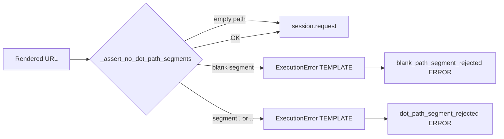

# HTTP Path Segment Rejection (`.`, `..`, blank) — PYPOST-1346 / PYPOST-1332 / PYPOST-1534

## Overview

After URL templates are rendered (including `urlencode` / `to_int` and other expression
functions), `HTTPClient` rejects any request whose path contains:

- a segment that is exactly `.` or exactly `..` ([PYPOST-1346](https://pypost.atlassian.net/browse/PYPOST-1346)), or
- a **blank** segment other than the synthetic empty piece from an absolute path’s leading
  `/` ([PYPOST-1332](https://pypost.atlassian.net/browse/PYPOST-1332)).

An **empty path** (no path component after the authority, e.g. `http://example.test`) is
allowed: there are no segments to inspect
([PYPOST-1534](https://pypost.atlassian.net/browse/PYPOST-1534)). That is distinct from a
trailing blank on a non-empty path (e.g. `http://example.test/projects/`), which remains
rejected.

The failure is fail-closed: no `session.request` call is made, and callers (GUI, inbound MCP
tools, collection offline `_prepare` helpers) receive an `ExecutionError` with
`ErrorCategory.TEMPLATE`.

Without the dot guard, a value such as `..` survives `urllib.parse.quote(..., safe="")` as a
literal path segment. Downstream `requests` / urllib3 then apply RFC 3986 remove-dot-segments
normalisation, so a curated MCP URL like `/repos/../user` can become a different same-host
path while still using the collection method and token.

Without the blank guard, an empty path variable can render `/projects//…` or a trailing
`/projects/` that some hosts treat as a different endpoint (for example GitLab list-projects)
instead of failing locally.

This protection lives in the shared HTTP stack, so every collection that renders path
placeholders benefits—not only GitHub and GitLab.

## Architecture

```
TemplateService.render_string(url)
        │
        ▼
HTTPClient._prepare_request_kwargs
        │
        ├─ _assert_no_dot_path_segments(url)   ← PYPOST-1346 + PYPOST-1332 + PYPOST-1534
        │         │
        │         ├─ empty path → allow (no segments)
        │         └─ on reject: ERROR log + re-raise ExecutionError(TEMPLATE)
        │
        └─ build headers / params / body → session.request(**kwargs)
```

- **`_assert_no_dot_path_segments(url)`** (`pypost/core/http_client.py`): module-level helper.
  If `urlsplit(url).path` is empty (origin-only URL, no path component), returns immediately
  (PYPOST-1534). Otherwise splits the path on `/`. Skips only the synthetic empty at index
  `0` when the path starts with `/`. Raises for any other empty segment, and for non-empty
  segments that are exactly `.` or `..`.
- **`HTTPClient._prepare_request_kwargs`**: calls the helper on the final rendered URL
  before headers, params, or body work. Catches `ExecutionError`, emits
  `blank_path_segment_rejected` or `dot_path_segment_rejected`, then re-raises.
- **`_urlencode`** (`pypost/core/function_registry.py`): unchanged. Dot characters remain
  unencoded per `quote` rules; rejection is post-assembly, not inside the template function.



## API / Usage

### `_assert_no_dot_path_segments(url: str) -> None`

Private helper used by `HTTPClient`. Not part of the public package API; documented for
maintainers and offline tests that exercise `_prepare_request_kwargs`. Name retained from
PYPOST-1346; behaviour now also covers blank segments (PYPOST-1332) and explicitly allows
an empty path component (PYPOST-1534).

- **url**: Fully rendered request URL (scheme/host/path already substituted).
- **Returns**: `None` when the path is empty or every inspected path segment is allowed.
- **Raises**: `ExecutionError` with `category=ErrorCategory.TEMPLATE`,
  `message="Rejected request URL path segment."`, and `detail` either
  `Blank path segment is not allowed.` or naming the offending `.` / `..` segment.

### Call sites

| Surface | Behaviour on reject |
| --- | --- |
| `HTTPClient.send_request` / `_prepare_request_kwargs` | Raises; `session.request` never called |
| `RequestService.execute` | Catches as `ExecutionResult.execution_error`; may emit `request_execution_failed` and `track_request_error(TEMPLATE)` |
| Inbound MCP (`MCPServerImpl`) | Structured tool error: `error: true`, `error_category=template`, actionable `error_message` / detail |

### What is rejected vs allowed

| Input (rendered path segment) | Result |
| --- | --- |
| `.` | Rejected |
| `..` | Rejected |
| Mid-path empty (`//`) or trailing blank (`/projects/`) | Rejected |
| Empty path (no path component, e.g. `http://example.test`) | Allowed (PYPOST-1534; no segments) |
| Synthetic leading empty from absolute `/…` | Ignored (not a missing variable) |
| `ci.yml`, `foo.bar`, `.github` | Allowed (not whole-segment `.` / `..`) |
| `../x` after `urlencode` → `..%2Fx` | Allowed (segment is `..%2Fx`, not `..`) |
| `%2e` / `%2E` as a segment | Allowed under current policy (out of scope) |

## Configuration

No configuration knobs or environment variables. The guard always runs for every prepared
HTTP request URL (always-on fail-closed; not opt-in).

Logging URL safety reuses the existing template-error helper:

- Origin-only URL via `HTTPClient._template_error_log_url` (scheme, hostname, valid explicit
  port; no userinfo / path / query / fragment).
- Malformed URLs become `[invalid-url]`; length capped at 512 characters.

## Observability

| Signal | Details |
| --- | --- |
| ERROR log (dots) | `dot_path_segment_rejected method=<METHOD> url=<origin-only>` on logger `pypost.core.http_client` |
| ERROR log (blank) | `blank_path_segment_rejected method=<METHOD> url=<origin-only>` on the same logger |
| Metrics | No new series; RequestService path reuses `track_request_error(TEMPLATE)` |
| CI allowlist | Both prefixes registered under `pypost.core.http_client` in `tests/expected_log_allowlist.yaml` |

See [Logging Event Naming](logging.md) and [Test Log Guardrails](test_log_guardrails.md).

## Testing

Offline coverage (no network, no credentials):

- `tests/test_http_client.py` — `TestHTTPClientDotPathSegmentRejection`,
  `TestHTTPClientBlankPathSegmentRejection` (core prepare / send paths, log assertions,
  empty-path allow control).
- `tests/test_github_mcp_collection.py` — representative owner / repo / workflow dot rejects;
  blank owner/repo rejects; `ci.yml` allow control.
- `tests/test_gitlab_mcp_collection.py` — representative project / file / branch / sha-style
  dot rejects; blank `gitlab_project` rejects; legitimate file-path allow control.

```bash
make test PYTEST_ARGS='tests/test_http_client.py::TestHTTPClientDotPathSegmentRejection \
  tests/test_http_client.py::TestHTTPClientBlankPathSegmentRejection \
  tests/test_github_mcp_collection.py -k "dot_path or blank_path or dotted_workflow" \
  tests/test_gitlab_mcp_collection.py -k "dot_path or blank_path or legitimate_file_path"'
```

## Troubleshooting

| Symptom | Cause | Resolution |
| --- | --- | --- |
| MCP / send fails with "Rejected request URL path segment" and `.` / `..` detail | A path placeholder rendered to `.` or `..` | Pass a real segment value (owner, repo, file path, …) |
| MCP / send fails with "Blank path segment is not allowed" | A path placeholder rendered empty (`//` or trailing blank) | Set a non-empty default or pass the path argument |
| Origin-only URL (`http://host`) rejected as blank | Over-broad guard (fixed in PYPOST-1534) | Empty path must be allowed; mid-path / trailing blanks still reject |
| Expected reject but request went out | Guard only sees **whole** segments after render | Confirm the URL path (not query) and encoding |
| `%2e` segment not rejected | Percent-encoded lookalikes intentionally allowed | Documented debt; see `ai-tasks/PYPOST-1346/60-tech-debt.md` |

## Related documentation

- [Request Execution](request_execution.md) — pipeline placement
- [GitHub MCP Example Collection](github_mcp_collection.md) — collection notes and offline proof
- [GitLab MCP Example Collection](gitlab_mcp_collection.md) — collection notes and offline proof
- [Template Expression Functions](template_expression_functions.md) — `urlencode` / `to_int`
- [Logging Event Naming](logging.md) — `dot_path_segment_rejected`, `blank_path_segment_rejected`
- Task artifacts: `ai-tasks/PYPOST-1346/`, `ai-tasks/PYPOST-1332/`
