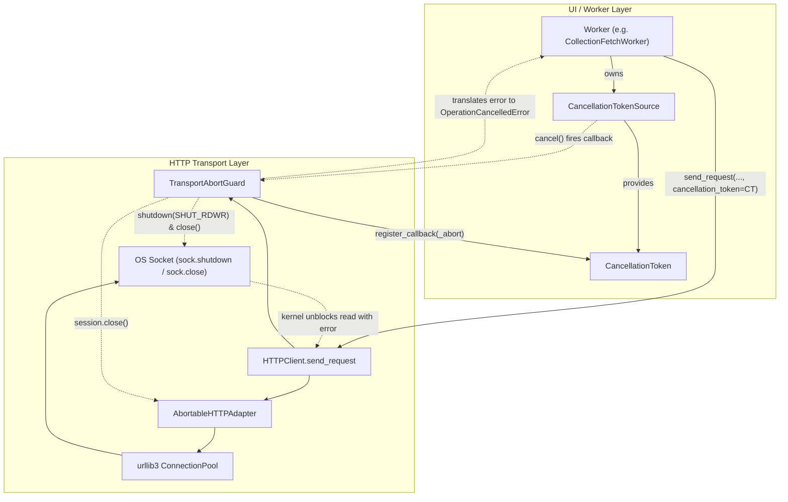

# HTTP Transport Abort and Session Teardown

## Overview

When a user cancels a long-running, stalled, or unwanted remote network operation (such as
remote collection imports or catalog manifest discovery), passive result discard is
insufficient. In Python's synchronous `requests` / `urllib3` stack, worker threads remain
blocked in kernel-level socket reads or connection handshakes until network timeouts (often
30+ seconds) elapse. This causes:

- **Resource waste**: Abandoned requests hold operating system sockets, thread capacity, and
  remote server bandwidth.
- **UI sluggishness and stalls**: Modal dialogs or tab closures lag while awaiting worker thread
  termination.
- **Connection pile-up**: Rapidly switching remote sources queues concurrent large downloads in
  the background.

The HTTP transport abort subsystem (`pypost/core/http_transport_abort.py`) introduces proactive
transport cancellation. By registering transport abort callbacks with `CancellationToken`, the
application actively severs in-flight HTTP connections and closes underlying OS sockets within
500 milliseconds of cancellation.

## Architecture

The transport abort architecture integrates `CancellationToken` with `requests` connection
pools and OS socket lifecycles:



### Components

- **`AbortableHTTPAdapter`**: A custom `requests.adapters.HTTPAdapter` mounted on `http://` and
  `https://` session prefixes. When connection pools are checked out (`get_connection` /
  `get_connection_with_tls_context`), it instruments the pool via `_instrument_pool`.
- **`_instrument_pool`**: Wraps `pool._get_conn` and `pool._put_conn` to track in-flight
  connection objects in a context-local set (`_active_connections_context`).
- **`TransportAbortGuard`**: A scoped context manager that:
  1. Checks if `cancellation_token` is already cancelled before dispatch.
  2. Registers its `_abort` callback with the `cancellation_token`.
  3. Binds the active connections set to the `_active_connections_context` context variable.
  4. On abort, immediately calls `sock.shutdown(socket.SHUT_RDWR)`, `sock.close()`, and
     `session.close()`, plus raw response stream cleanup (`resp.close()`, `resp.raw.close()`).
  5. In `__exit__`, guarantees callback unregistration to prevent memory leaks.
  6. Rejuvenates the client's `requests.Session` if it was closed during an abort.
  7. Translates transport/socket abort exceptions into `OperationCancelledError`.

### Socket Shutdown vs. Connection Pool Lifecycle

- **Low-level Socket Shutdown**: Calling `sock.shutdown(socket.SHUT_RDWR)` immediately interrupts
  any thread blocked in a system call (`recv`, `send`, `poll`). Calling `sock.close()` follows
  immediately to release the file descriptor.
- **Session and Pool Closure**: Calling `session.close()` closes idle pooled connections and
  prevents new connections from leasing from `urllib3.PoolManager`.
- **Stream Cleanup**: In-flight response objects attached via `guard.set_active_response(resp)`
  have their `raw` stream and `_fp` handles closed to unblock `read_streamed_body`.
- **Session Rejuvenation**: Closing a `requests.Session` renders its adapter pool unusable for
  subsequent calls. If an abort occurs, `TransportAbortGuard.__exit__` automatically provisions a
  fresh `requests.Session` on the `HTTPClient` via `create_abortable_session()`.

## API and Usage

### `HTTPClient.send_request`

`HTTPClient.send_request` accepts an optional `cancellation_token` parameter:

```python
from pypost.core.cancellation import CancellationTokenSource, OperationCancelledError
from pypost.core.http_client import HTTPClient
from pypost.models.models import RequestData

client = HTTPClient()
cts = CancellationTokenSource()

request_data = RequestData(method="GET", url="https://api.example.com/large-catalog.json")

try:
    result = client.send_request(
        request_data,
        cancellation_token=cts.token,
    )
except OperationCancelledError:
    # Triggered if cts.cancel() was called before or during network dispatch
    print("Request cancelled cleanly and sockets closed.")
```

### Pre-Cancelled Invocations

If `cts.token.is_cancellation_requested` is already `True` when `send_request` begins:

1. `TransportAbortGuard.__enter__` calls `cancellation_token.throw_if_cancellation_requested()`.
2. `OperationCancelledError` is raised immediately.
3. Zero network sockets or HTTP connections are opened.

### Adapter Helper Functions

When working with standalone `requests.Session` instances:

```python
from pypost.core.http_transport_abort import (
    create_abortable_session,
    mount_abortable_adapter,
)

# Option A: Create a pre-configured session
session = create_abortable_session()

# Option B: Instrument an existing session
mount_abortable_adapter(existing_session)
```

## Error Handling and Exception Translation

When low-level sockets are severed mid-flight, Python's network libraries raise low-level
exceptions (`requests.exceptions.RequestException`, `urllib3.exceptions.HTTPError`,
`ConnectionResetError`, or `OSError: [Errno 9] Bad file descriptor`).

`TransportAbortGuard.__exit__` inspects the active `cancellation_token`:

| Condition | Caught Exception | Resulting Behavior |
| --- | --- | --- |
| Token requested cancel | Transport/socket error | Raised as `OperationCancelledError` |
| Token not cancelled | Transport/socket error | `ExecutionError` (`NETWORK`) |
| Normal completion | None | Unregisters callback; keeps session |

Workers (`CollectionFetchWorker`, `ManifestDiscoveryWorker`) catch `OperationCancelledError`
quietly without emitting error signals or showing error dialogs to the user.

## Observability

The transport abort module emits structured log messages:

- `http_transport_abort_triggered`: Logged at `INFO` with `active_connections` count and
  `has_response` boolean when abort initiates.
- `http_transport_session_closed`: Logged at `DEBUG` when `session.close()` succeeds.
- `http_transport_sockets_aborted`: Logged at `DEBUG` with count of shut down sockets.
- `http_transport_session_recreated`: Logged at `INFO` when an aborted session is replaced with a
  fresh instance.
- `http_transport_pre_cancelled`: Logged at `INFO` when dispatch is prevented before network I/O.
- `http_transport_aborted_by_cancellation`: Logged at `INFO` when translating a socket exception to
  `OperationCancelledError`.

## Troubleshooting and Best Practices

- **Never block on passive timeouts**: Always pass `cancellation_token` to `send_request` for
  operations initiated by background workers or user dialogs.
- **Automatic callback cleanup**: `TransportAbortGuard` unregisters its callback in `__exit__`.
  Ensure `send_request` or custom callers do not bypass context manager teardown.
- **Custom Session instances**: If injecting a custom `requests.Session` into `HTTPClient`,
  ensure `mount_abortable_adapter(session)` is called so active sockets can be tracked during
  transfers.
- **Thread Safety**: Sockets may be shut down concurrently from the thread calling `cts.cancel()`.
  All socket and session close calls inside `_abort` catch and suppress low-level OS errors
  defensively.

## Related Documentation

- [Request Execution Pipeline](request_execution.md)
- [HTTP Path Segment Rejection](http_path_segment_rejection.md)
- [Architecture Overview](architecture.md)
