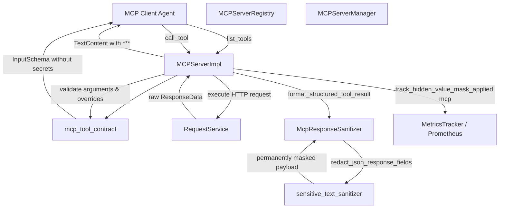

# Model Context Protocol (MCP) Server Architecture & Security Guarantees

## Overview

PyPost integrates the Model Context Protocol (MCP) to expose saved HTTP requests and collections as structured tools for automated AI coding agents (such as Claude Desktop, Cursor, or autonomous LLM pipelines). Through MCP, agents can discover available API endpoints via `list_tools` and execute requests with dynamic parameters via `call_tool`.

Because automated agents operate outside the local desktop security perimeter, PyPost enforces strict security boundaries to prevent credential leakage into LLM context windows, prompt transcripts, or external inference logs.

---

## Architecture

The MCP subsystem consists of the following core components:



### Key Components

- **`MCPServerRegistry`** (`pypost/core/mcp_server_registry.py`): Manages running MCP server instances and binds endpoint configurations (host, port, collection, environment snapshots).
- **`MCPServerManager`** (`pypost/core/mcp_server_manager.py`): Lifecycle manager for server start/stop and supplier dispatch.
- **`MCPServerImpl`** (`pypost/core/mcp_server_impl.py`): Core JSON-RPC protocol implementation for MCP `list_tools` and `call_tool`.
- **`McpSecretsPolicy`** (`pypost/core/mcp_secrets_policy.py`): Governs environment variable exposure in schemas vs. execution-time merging.
- **`McpResponseSanitizer`** (`pypost/core/mcp_response_sanitizer.py`): Output sanitization facade coordinating response body and post-script log redaction.
- **`sensitive_text_sanitizer`** (`pypost/core/sensitive_text_sanitizer.py`): Low-level redaction engine supporting recursive JSON traversal, path selectors, environment secret scrubbing, and header masking.

---

## Response Field Masking Security Guarantees (PYPOST-1378 / MASK-2)

When API requests are invoked as MCP tools, response payloads frequently contain authentication tokens, session identifiers, client secrets, passwords, or Personally Identifiable Information (PII). PyPost enforces the following security guarantees for all MCP client interactions:

### 1. Fail-Closed Permanent Redaction
All response fields matching the request's configured `hidden_response_fields` are permanently replaced with the placeholder `***` before results are serialized and transmitted over MCP:
- **Hierarchical Objects**: Redaction traverses root keys and deeply nested child objects.
- **Array Collections**: Wildcard and dot-notation paths match fields across all elements within arrays and lists of objects.
- **Header Selectors**: Selectors prefixed with `header:` (e.g. `header:Authorization`) redact corresponding HTTP response headers.

### 2. Irreversible Security Boundary Invariant
Unlike human developers using the PyPost desktop GUI (who can selectively inspect values using click-to-reveal tokens), automated AI agents are treated as untrusted with respect to secrets:
- **Zero Reveal Parameters**: Tool schemas generated by `build_tool_input_schema` contain strictly parameters derived from `{{mcp.request.<param>}}` expressions and permitted environment overrides. No parameter (e.g. `unmask`, `reveal`, `reveal_secrets`, `show_hidden`, `raw`) exists or is advertised to agents.
- **Zero Reveal Tools**: `MCPServerImpl` registers only endpoints marked `expose_as_mcp == True`. No auxiliary or reflection tools (such as `reveal_response_field`, `get_raw_body`, or `unmask_secret`) are registered on the MCP server.
- **No Reveal Bypass**: Masking is enforced server-side during output formatting. Even if a client passes unauthorized arguments, output serialization unconditionally masks all configured fields.

### 3. Display-Only Immutability of Underlying ResponseData
Masking is strictly an egress serialization transformation:
- The in-memory `ResponseData` stored on `ExecutionResult.response` and records committed to `HistoryManager` remain 100% authentic and unmodified.
- Post-request scripts, automated assertions, and desktop GUI inspection retain access to the authentic response.

### 4. Non-JSON Pass-Through and Graceful Error Fallback
- If an API returns non-JSON content (plain text, HTML, XML, binary) or malformed JSON, `redact_json_response_fields` safely catches `(json.JSONDecodeError, TypeError, ValueError)`.
- The raw body is passed through to `sanitize_text`, ensuring environment secret values, Bearer tokens, and sensitive headers are still redacted without causing unhandled exceptions or server crashes.
- Diagnostic logs emit only exception class names (`reason=JSONDecodeError`), preventing sensitive malformed response fragments from appearing in server logs.

---

## Selector Syntax Reference

Selectors configured in `RequestData.hidden_response_fields` support four complementary patterns:

| Selector Type | Syntax Example | Matching Behavior |
| :--- | :--- | :--- |
| **Simple Key** | `token`, `password`, `secret` | Matches keys with this exact name at any nesting level (root, nested objects, array items). |
| **Dot-Notation Path** | `auth.token`, `data.user.secret` | Matches exact hierarchical object paths starting from the root. |
| **Array Wildcard Path** | `users[*].email`, `items[*].secret` | Traverses arrays of objects and redacts the matching field on every item. |
| **Header Selector** | `header:Authorization`, `header:X-Key` | Redacts matching HTTP response headers (case-insensitive). |

---

## Tool Execution Lifecycle & Sanitization Pipeline

```python
# MCPServerImpl._call_tool_inner (pypost/core/mcp_server_impl.py)
item = self.tools_map[name]
result = self._execute_request_sync(item, arguments, env_vars, hidden_keys, overridable_keys)

# Extract request-configured hidden response fields
hidden_fields = item.hidden_response_fields if isinstance(item, RequestData) else None

# Format structured JSON tool output with permanent redaction
output_text = format_structured_tool_result(
    result,
    env_vars=env_vars,
    hidden_keys=hidden_keys,
    hidden_response_fields=hidden_fields,
)

# Track telemetry metric
if hidden_fields:
    self._metrics.track_hidden_value_mask_applied("mcp")
```

---

## Telemetry & Observability

- **Metrics**:
  - `hidden_value_masks_applied_total{surface="mcp"}`: Prometheus and OpenTelemetry counter incremented whenever an MCP tool executes a request with configured hidden response fields.
  - `mcp_tool_call_duration_seconds{method, outcome}`: Execution latency histogram.
  - `mcp_requests_received_total{method}` / `mcp_responses_sent_total{method, status}`: Request/response throughput counters.
- **Zero-Leakage Structured Logging**:
  - `mcp_response_masking_applied method=<method> tool=<tool> selector_count=<count>` (DEBUG)
  - `redact_json_response_fields_completed selectors_count=<count> masked_fields_count=<count>` (DEBUG)
  - `redact_json_response_fields_skipped_non_json reason=<exception_type>` (DEBUG)
  - No secret values, unmasked payload bodies, or user credentials are ever logged.

---

## Verification & Testing

Verify MCP server response masking and security boundary integrity:

```bash
# Run fast test suite including MCP masking verification
make test PYTEST_ARGS="tests/test_mcp_hidden_response_fields_masking.py"

# Run full quality gate
make check
```

---

## Related Documentation

- Hidden Response Fields Architecture: [hidden_response_fields.md](hidden_response_fields.md)
- MCP Secrets Policy: [mcp_secrets_policy.md](mcp_secrets_policy.md)
- Inbound MCP Trust Model: [mcp_trust_model.md](mcp_trust_model.md)
- MCP Integration Guide: [mcp_integration.md](mcp_integration.md)
- Sensitive Data Masking Policy: [sensitive_data_masking_policy.md](sensitive_data_masking_policy.md)
