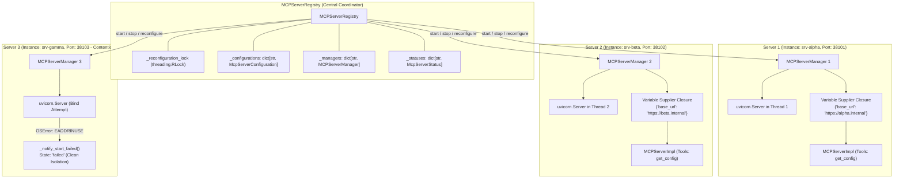
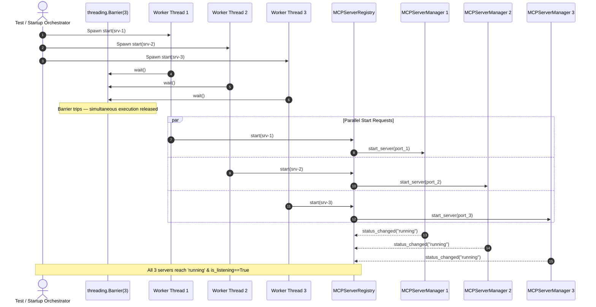
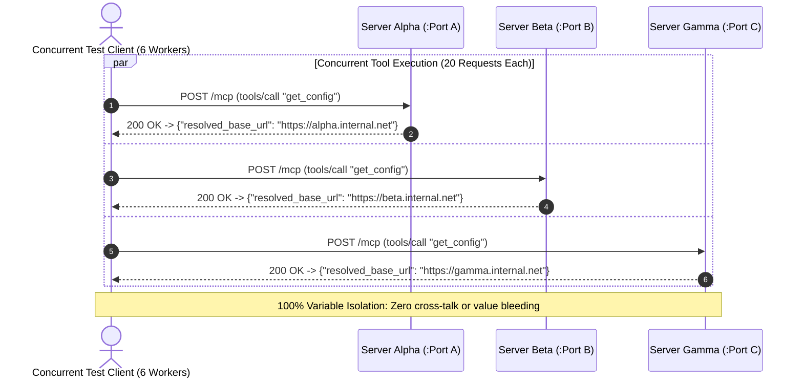
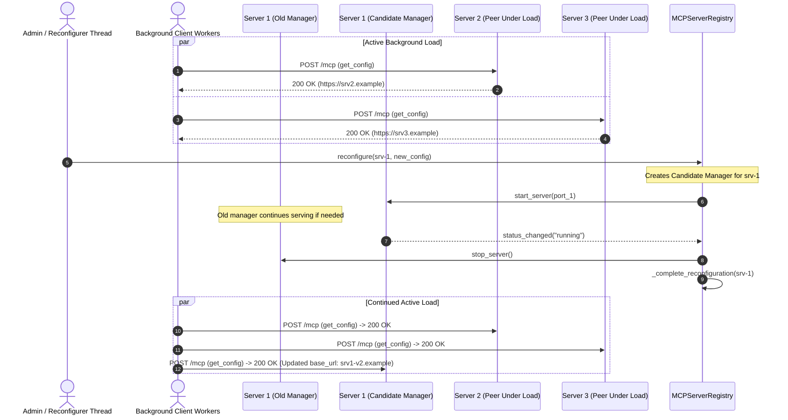

# Concurrent Multi-Server Lifecycle Execution and Port Contention (PYPOST-1418)

## Overview

Following the introduction of standalone MCP server execution in
[PYPOST-1410](collection_scoped_variables.md)
and the extraction of the reusable collection integration harness in
[PYPOST-1417](collection_integration_harness.md), PyPost supports hosting multiple standalone MCP
servers simultaneously within a single application or headless daemon process.

In enterprise and agentic workflows, developers frequently run several independent MCP servers in
parallel—for instance, serving Jira, GitHub, and GitLab tools concurrently, or running distinct
staging and production configurations side-by-side.
[PYPOST-1418](https://pypost.atlassian.net/browse/PYPOST-1418) establishes and validates
comprehensive concurrency, isolation, hot reload, port contention, and teardown guarantees for
multi-server operations:

1. **Parallel Startup Synchronization**: Multiple standalone servers can be initiated
   concurrently across worker threads using barrier synchronization without registry deadlocks or
   startup race conditions.
2. **Collection Variable Namespace Isolation**: Servers sharing identical variable keys (such as
   `base_url`, `api_key`, or `auth_token`) resolve values in complete isolation with zero
   cross-talk or runtime dictionary pollution.
3. **Hot Reload Under Active Load**: Live reconfiguration of a running server executes without
   interrupting, stalling, or dropping requests being handled by peer servers.
4. **Port Contention Resilience & Graceful Recovery**: When an OS port is occupied by an external
   process, the affected server transitions gracefully to `failed` state with descriptive
   diagnostic errors, leaving all peer servers operational; reconfiguring the server to a free
   port recovers cleanly.
5. **Multi-Server Teardown & Socket Hygiene**: Concurrent shutdown terminates all worker threads
   within bounded intervals (<2.0s) and releases OS socket descriptors immediately, enabling
   instant rebinding without `EADDRINUSE`.
6. **Cooperative Cancellation & Adaptive Backoff Thread Join (PYPOST-1437)**: Server termination
   signals cooperative cancellation tokens (`CancellationTokenSource`) and joins worker threads
   using an adaptive polling loop (`adaptive_thread_join`). Quickly-exiting workers unblock in
   milliseconds (<50ms) rather than rigid 2.0s sleeps, slow ASGI task drains are logged
   periodically, and uncooperative threads retain truthful `is_running() == True` state.
7. **Multi-Process Supervisor Evaluation & 10+ Server Stress Testing (PYPOST-1438)**: For
   enterprise high-density deployments (10+ servers), an architectural evaluation of multi-process
   supervisor isolation, trade-off matrix, and crash containment is documented in
   [`mcp_process_supervisor_evaluation.md`](mcp_process_supervisor_evaluation.md), backed by an
   automated 10+ concurrent server stress test suite
   ([`tests/test_mcp_multiserver_stress_10x.py`](../../tests/test_mcp_multiserver_stress_10x.py))
   covering barrier startup, namespace isolation under load, TCP RST drops, and immediate socket
   reclamation.

---

## Architecture & Concurrency Model

Multi-server lifecycle execution is coordinated by
[`MCPServerRegistry`](file:///home/src/pypost/core/mcp_server_registry.py), with each active server
endpoint encapsulated by an independent
[`MCPServerManager`](file:///home/src/pypost/core/qt/mcp_server.py) and
[`MCPServerImpl`](file:///home/src/pypost/core/mcp_server_impl.py).



### Threading & Concurrency Invariants

- **Instance-Level Isolation**: Each server endpoint maintains its own dedicated worker thread
  running a `uvicorn.Server` instance with its own private `asyncio` event loop.
- **Reentrancy Protection (`_reconfiguration_lock`)**: The registry protects transactional
  configuration updates, atomic manager swaps, and cleanup routines with a reentrant
  `threading.RLock`. Read access to server statuses and configurations is designed to avoid
  holding the lock during blocking I/O or network calls.
- **Deep-Copy Isolation**: Collection data models, requests, and variable mappings are deep-copied
  (`model_copy(deep=True)`) before instantiating or starting an `MCPServerManager`. No shared
  mutable data structures cross server boundaries.
- **Dynamic Port Allocation**: Ephemeral ports for automated multi-server tests are managed via
  [`allocate_tcp_port()`](file:///home/src/tests/helpers/port_allocation.py) using cross-process
  `fcntl.flock` locks, preventing TCP bind collisions in parallel test runs.

---

## Parallel Startup with Barrier Synchronization

When spinning up a cluster of standalone MCP servers (e.g., during application startup or test
harness initialization), startup requests may occur simultaneously across different threads.



### Guarantees

1. **Non-Blocking Registration**: `registry.start(instance_id)` spawns the underlying server manager
   in a background daemon thread, returning immediately to the caller.
2. **Deterministic Startup Verification**: The test suite employs `threading.Barrier(N)` to force
   all starter threads to release simultaneously. The registry smoothly processes parallel start
   signals without race conditions.
3. **Readiness Probe**: Each server independently transitions from `starting` to `running`, sets
   `mgr.is_listening = True`, and responds successfully to HTTP `POST /mcp` JSON-RPC `tools/list`
   requests.

---

## Collection Variable Isolation Across Overlapping Namespaces

A key challenge in multi-server architectures is avoiding cross-talk when multiple collections
define identical variable names with divergent values. For example, three different services might
all declare a required `base_url` variable:

| Server | Collection | Variable Name | Bound Value |
| :--- | :--- | :--- | :--- |
| **Server Alpha** | `col-alpha` | `base_url` | `https://alpha.internal.net` |
| **Server Beta** | `col-beta` | `base_url` | `https://beta.internal.net` |
| **Server Gamma** | `col-gamma` | `base_url` | `https://gamma.internal.net` |



### Isolation Architecture

- **Closure-Based Variable Suppliers**: The registry binds variable suppliers using unique lambda
  closures:
  ```python
  manager.set_variable_supplier(lambda: dict(effective_variables))
  manager.set_secret_supplier(lambda: set(hidden_keys))
  ```
- **Independent Dictionary Allocations**: `dict(effective_variables)` creates a fresh copy on every
  invocation. No global registry, module-level state, or shared mutable dictionary exists between
  endpoints.
- **Verification Contract**: As asserted in
  `test_shared_and_overlapping_collection_variables_isolation`, issuing 60 parallel tool
  executions (20 requests per server concurrently across 6 worker threads) results in 100%
  correct, isolated variable interpolation.

---

## Hot Reload Under Active Load

PyPost supports zero-downtime reconfiguration of running MCP servers via
[`MCPServerRegistry.reconfigure`](file:///home/src/pypost/core/mcp_server_registry.py).
During reconfiguration, existing servers must continue serving client traffic without dropping
requests or stalling.



### Hot Reload Invariants

1. **Transactional Swap**: If the replacement server fails to bind or start, the registry
   automatically triggers `_rollback_reconfiguration()`, retaining or restoring the original
   manager and leaving the running state intact.
2. **Zero Lock Contention for Peers**: While Server 1 is compiling runtime inputs and starting its
   candidate manager, Server 2 and Server 3 continue handling requests at full throughput.
3. **Zero Request Drop**: As asserted in `test_concurrent_hot_reload_under_active_execution`,
   background threads hammering Server 2 and Server 3 with hundreds of requests record zero failed
   calls and zero latency spikes during Server 1's hot reload.

---

## Port Collision Handling & Graceful Recovery

When multiple servers are configured, port contention can occur in two distinct modes:
1. **Internal Registry Collision**: Two configurations within PyPost specify the same port.
   Handled synchronously by `_validate_available_port(configuration)` before starting.
2. **External OS Port Contention**: An external process or raw socket already holds
   `127.0.0.1:PORT`. When `uvicorn` attempts to bind the TCP socket, the operating system raises
   `OSError(errno.EADDRINUSE)`.

```mermaid
sequenceDiagram
    autonumber
    actor ExternalApp as External Daemon / Rogue Socket
    actor Operator as Operator / Test Runner
    participant Registry as MCPServerRegistry
    participant Mgr2 as MCPServerManager 2 (Target)
    participant Mgr1 as MCPServerManager 1 (Peer)

    ExternalApp->>ExternalApp: bind("127.0.0.1", port=41000)
    Note over ExternalApp: Port 41000 is occupied externally

    Operator->>Registry: start(srv-2) [Configured on Port 41000]
    Registry->>Mgr2: start_server(port=41000)
    Mgr2->>Mgr2: uvicorn attempts socket.bind()
    Note over Mgr2: OSError(errno.EADDRINUSE): Address already in use
    Mgr2->>Mgr2: Catch OSError & format_mcp_bind_error()
    Mgr2-->>Registry: start_failed("MCP server could not bind to 127.0.0.1:41000...")
    Registry->>Registry: _set_status("srv-2", state="failed", message)

    Note over Registry,Mgr1: Registry remains unblocked; Server 1 continues serving requests!
    Operator->>Mgr1: POST /mcp (tools/list)
    Mgr1-->>Operator: 200 OK -> ["tool_1"]

    ExternalApp->>ExternalApp: close() (Releases port 41000)

    Operator->>Registry: upsert(srv-2 on new free_port)
    Operator->>Registry: start(srv-2)
    Registry->>Mgr2: start_server(free_port)
    Mgr2-->>Registry: status_changed("running")
    Note over Operator,Registry: Server 2 recovered cleanly! Both Server 1 and Server 2 running.
```

### Contention Handling Guarantees

- **No Process Crashes**: Uncaught `OSError` exceptions are intercepted within
  [`MCPServerManager._run_uvicorn`](file:///home/src/pypost/core/qt/mcp_server.py).
- **Graceful State Degradation**: The collided server transitions directly to `state="failed"`.
  The error message is formatted via `format_mcp_bind_error` and includes the port number and bind
  resolution guidance.
- **Log Hygiene**: Error logs emit `mcp_server_start_failed` at `ERROR` level without leaking
  credentials or secret variables.
- **Peer Server Isolation**: Running peer servers (such as Server 1 in the diagram) experience zero
  impact and continue answering client requests normally.
- **Clean Recovery**: Reconfiguring the server with an available port
  (`registry.upsert(recovered_config)`) and invoking `registry.start()` restarts the server cleanly
  without requiring an application restart.

---

## Concurrent Multi-Server Teardown, Cancellation, and Socket Hygiene

Clean shutdown of multi-server environments requires releasing kernel resources immediately so
ports can be rebound without lingering in `TIME_WAIT` or holding leaked file descriptors. Under
[PYPOST-1437](https://pypost.atlassian.net/browse/PYPOST-1437), rigid 2.0s bounded thread joins were
replaced with cooperative cancellation tokens and an adaptive backoff polling loop
(`adaptive_thread_join`), allowing quickly-exiting worker threads to terminate and unblock callers
within milliseconds (<50ms) while tracking slow ASGI task or keep-alive connection drains.

```mermaid
sequenceDiagram
    autonumber
    actor Orchestrator as Application Shutdown / Teardown
    participant Registry as MCPServerRegistry
    participant Mgr1 as Server Manager 1 (Fast Exit)
    participant Mgr2 as Server Manager 2 (Slow ASGI Drain)
    participant Mgr3 as Server Manager 3 (Uncooperative)
    participant Kernel as Linux Kernel / TCP Stack

    Orchestrator->>Registry: stop_all() (or concurrent stop() calls)
    par Concurrent Adaptive Teardown
        Registry->>Mgr1: stop_server()
        Mgr1->>Mgr1: cts.cancel("stop_server requested")
        Mgr1->>Kernel: uvicorn should_exit = True & close listen socket
        Mgr1->>Mgr1: adaptive_thread_join (5ms initial poll)
        Note over Mgr1: Worker terminates in <50ms; thread reference cleared
    and
        Registry->>Mgr2: stop_server()
        Mgr2->>Mgr2: cts.cancel("stop_server requested")
        Mgr2->>Kernel: uvicorn should_exit = True & drain ASGI tasks
        Mgr2->>Mgr2: adaptive_thread_join (backoff 5ms->7.5ms->...->100ms)
        Note over Mgr2: Emits INFO log every 500ms; drains cleanly
    and
        Registry->>Mgr3: stop_server()
        Mgr3->>Mgr3: cts.cancel("stop_server requested")
        Mgr3->>Kernel: uvicorn should_exit = True
        Mgr3->>Mgr3: adaptive_thread_join (exceeds 2.0s deadline)
        Note over Mgr3: Emits WARNING; retains thread ref (PYPOST-1196)
    end

    Note over Kernel: All bound sockets released; SO_REUSEADDR set

    Orchestrator->>Kernel: Immediate socket.bind() on ports 1, 2
    Kernel-->>Orchestrator: Bind Success (No EADDRINUSE)

    Orchestrator->>Registry: Immediate restart on free ports
    Note over Registry: All recovered servers transition back to 'running'
```

### Cooperative Cancellation Architecture (`pypost/core/cancellation.py`)

The cooperative cancellation and adaptive thread join primitives in
[`pypost/core/cancellation.py`](file:///home/src/pypost/core/cancellation.py) provide structured,
clean lifecycle termination for worker threads, ASGI servers, and asynchronous background tasks.

#### `CancellationTokenSource` and `CancellationToken`

- **Cooperative Signaling**: `CancellationTokenSource` creates and manages a cooperative
  cancellation signal backed by an internal `threading.Event`. Worker threads or async handlers
  monitor the token's state via `token.is_cancellation_requested` or `token.wait(timeout)`.
- **Cancellation Reason Tracking**: `source.cancel(reason=...)` records a human-readable reason
  string accessible through `token.cancellation_reason`, simplifying observability and
  diagnostics during shutdown.
- **Callback Registration & Exception Isolation**: Handlers register shutdown callbacks via
  `token.register_callback(callback)`. If cancellation has already occurred when registered, the
  callback runs immediately. Callbacks run safely under exception isolation: any exception thrown
  inside a callback is captured and logged with `logger.exception()`, ensuring one faulty cleanup
  handler cannot prevent other callbacks or teardown steps from running. Registration returns an
  unregistration callable to detach callbacks when no longer needed.
- **Resource Disposal**: `source.dispose()` clears all registered callback references and marks
  the source as disposed to avoid memory leaks. `CancellationTokenSource` also implements the
  context manager protocol (`__enter__` / `__exit__`) for deterministic scoped disposal.
- **Exception Raising**: Callers in cooperative polling loops can call
  `token.throw_if_cancellation_requested()`, which raises `OperationCancelledError` if
  cancellation was triggered.

#### `AdaptiveJoinPolicy`

`AdaptiveJoinPolicy` is an immutable dataclass defining the timing and backoff parameters used by
`adaptive_thread_join`:

| Parameter | Type | Default | Description |
| :--- | :--- | :--- | :--- |
| `initial_poll` | `float` | `0.005` (5ms) | Initial polling duration for the first join slice. |
| `multiplier` | `float` | `1.5` (1.5x) | Exponential backoff factor applied to poll slices. |
| `max_poll` | `float` | `0.100` (100ms) | Maximum duration cap for any join poll slice. |
| `default_timeout` | `float` | `2.0` (2.0s) | Bounded fallback deadline for thread termination. |
| `progress_log_interval` | `float` | `0.500` (500ms) | Cadence for thread drain `INFO` logs. |

#### `adaptive_thread_join` Algorithm

Rather than blocking on a rigid `thread.join(timeout=2.0)`, `adaptive_thread_join` uses progressive
polling to dynamically balance rapid termination response with minimal CPU overhead:

1. **Immediate Exit for Inactive Threads**: If `thread` is `None` or `not thread.is_alive()`,
   the function returns `True` immediately without sleeping.
2. **Sub-Millisecond Unblocking (<50ms)**: Quickly-exiting worker threads terminate within the
   initial 5ms or early exponential slices (e.g., 5ms, 7.5ms, 11.25ms), returning control to the
   caller in milliseconds (<50ms) rather than waiting out a rigid timeout.
3. **Progressive Backoff**: Slices increase smoothly up to `max_poll` (100ms), avoiding CPU
   spinning while remaining responsive to thread termination.
4. **In-Flight Drain Logging**: For threads performing extended ASGI connection draining or
   keep-alive flushes, the function logs `INFO` progress messages every `progress_log_interval`
   (500ms):
   ```text
   Waiting for worker thread to drain: thread=mcp-server-38101 elapsed=0.502s timeout=2.000s
   ```
5. **Bounded Timeout Deadline & Truthful State Retention (PYPOST-1196)**: If the thread remains
   alive after the deadline (`start_time + max_timeout`), `adaptive_thread_join` emits a `WARNING`:
   ```text
   Worker thread exceeded join deadline: thread=mcp-38101 elapsed=2.003s timeout=2.000s alive=True
   ```
   The function returns `False`. In
   [`MCPServerManager.stop_server`](file:///home/src/pypost/core/qt/mcp_server.py),
   `self._server_thread` is only set to `None` if `not self._server_thread.is_alive()`. When a
   join times out, the thread reference is preserved so that `is_running() == True` remains
   truthful, preventing premature port rebinding while the orphaned worker still holds the
   listen socket.

### Teardown Contracts

1. **Fast-Path Thread Joins (<50ms)**: Cooperative worker threads are joined adaptively.
   Quick-exiting servers return in milliseconds instead of stalling for 2.0s.
2. **Cooperative Cancellation Signaling**: `stop_server()` signals
   `CancellationTokenSource.cancel()`, notifying cancellation token subscribers and setting
   `uvicorn.Server.should_exit = True`.
3. **Drain Progress Visibility**: Extended ASGI flushes and task drains are tracked with periodic
   `INFO` logging every 500ms.
4. **Bounded Timeout Enforcement**: Uncooperative threads are bounded by `timeout` (default 2.0s).
   A warning is logged upon timeout and the thread reference is retained (PYPOST-1196).
5. **Socket Hygiene & `SO_REUSEADDR`**: Listening sockets configure `SO_REUSEADDR`, allowing
   immediate re-use by subsequent server instances or test fixtures.
6. **Immediate Re-bindability**: As proven in
   `test_concurrent_multi_server_teardown_and_socket_hygiene`, raw TCP sockets and new server
   instances can bind to the exact same ports immediately after `stop()` completes without
   artificial delays.

---

## Automated Test Suite Reference

The automated regression test suites for concurrent multi-server execution, adaptive backoff
joins, and high-density stress testing are located in:
- [`test_mcp_concurrent_multiserver_repro.py`](../../tests/test_mcp_concurrent_multiserver_repro.py)
- [`test_mcp_server_adaptive_join.py`](../../tests/test_mcp_server_adaptive_join.py)
- [`test_mcp_multiserver_stress_10x.py`](../../tests/test_mcp_multiserver_stress_10x.py)

### Test Matrix

#### Concurrent Multi-Server Lifecycle (`tests/test_mcp_concurrent_multiserver_repro.py`)

- `test_concurrent_multi_server_startup_parallel`:
  - **Target**: Parallel startup of 3 standalone MCP servers via `threading.Barrier(3)`.
  - **Assertions**: All 3 servers reach `running` state with `is_listening == True` and
    tool catalogs.
- `test_shared_and_overlapping_collection_variables_isolation`:
  - **Target**: Complete variable isolation across identical variable keys (`base_url`).
  - **Assertions**: Zero cross-talk across 60 parallel requests across 6 worker threads.
- `test_concurrent_hot_reload_under_active_execution`:
  - **Target**: Hot reload under active background load.
  - **Assertions**: Server 1 updates `base_url` while Servers 2 and 3 experience zero
    dropped requests.
- `test_port_collision_detection_and_graceful_recovery`:
  - **Target**: External port collision resilience and recovery.
  - **Assertions**: Collided server transitions to `failed` state with descriptive error; recovers.
- `test_concurrent_multi_server_teardown_and_socket_hygiene`:
  - **Target**: Orderly multi-server shutdown and immediate port re-bindability.
  - **Assertions**: All threads terminate within deadline; immediate socket rebinding succeeds.

#### Adaptive Backoff Join & Cancellation (`tests/test_mcp_server_adaptive_join.py`)

- `test_cancellation_token_cooperative_lifecycle`:
  - **Target**: Cooperative cancellation token signaling, callback execution, exception isolation.
  - **Assertions**: Reason tracking, safe unregister, and `OperationCancelledError` raising.
- `test_adaptive_thread_join_fast_return_latency`:
  - **Target**: Fast return latency (<50ms) for quickly-exiting worker threads.
  - **Assertions**: Join completes promptly (<150ms) without waiting for rigid 2.0s timeout.
- `test_adaptive_thread_join_progressive_polling_on_slow_drain`:
  - **Target**: Progressive backoff polling across 200ms simulated ASGI drain.
  - **Assertions**: Polling slices scale up to 50ms cap and join completes with zero CPU spin.
- `test_adaptive_thread_join_timeout_boundary_and_diagnostics`:
  - **Target**: Timeout boundary enforcement and diagnostic warning logging.
  - **Assertions**: Join returns `False` and warning is logged for uncooperative thread.
- `test_mcp_server_manager_stop_server_adaptive_join_integration`:
  - **Target**: `MCPServerManager.stop_server` integration and state retention.
  - **Assertions**: Fast exit, token propagation, and truthful `is_running() == True` on timeout.

#### High-Density 10+ Server Stress Testing (`tests/test_mcp_multiserver_stress_10x.py`)

- `test_mcp_10x_parallel_startup_barrier_synchronization`:
  - **Target**: Parallel startup of 10 standalone MCP servers via `threading.Barrier(10)`.
  - **Assertions**: All 10 servers reach `running` state with `is_listening == True` and active tool
    endpoints without bind collisions.
- `test_mcp_10x_variable_namespace_isolation_under_concurrent_load`:
  - **Target**: Variable isolation across 10 distinct servers handling 100 concurrent requests.
  - **Assertions**: 100% namespace isolation with zero cross-talk across worker threads.
- `test_mcp_10x_abrupt_client_disconnect_rst_resilience`:
  - **Target**: Abrupt client disconnections using `SO_LINGER=0` TCP RST mid-flight.
  - **Assertions**: Zero thread crashes, no descriptor leaks, and subsequent requests succeed.
- `test_mcp_10x_concurrent_teardown_and_socket_reclamation`:
  - **Target**: Orderly teardown of 10 servers and immediate socket reclamation.
  - **Assertions**: All 10 threads terminate within deadline and all 10 OS ports can be
    rebound immediately without `EADDRINUSE`.

### Running the Test Suite

Execute the test suites through the repository Makefile:

```bash
# Run high-density 10+ server stress test suite (PYPOST-1438)
make test PYTEST_ARGS="tests/test_mcp_multiserver_stress_10x.py"

# Run dedicated adaptive thread join and cancellation token tests (PYPOST-1437)
make test PYTEST_ARGS="tests/test_mcp_server_adaptive_join.py"

# Run dedicated concurrent multi-server test suite (PYPOST-1418)
make test PYTEST_ARGS="tests/test_mcp_concurrent_multiserver_repro.py"

# Run combined standalone MCP, concurrency, and 10x stress tests
make test PYTEST_ARGS="\
tests/test_mcp_server_adaptive_join.py \
tests/test_mcp_concurrent_multiserver_repro.py \
tests/test_mcp_multiserver_stress_10x.py"

# Run full repository quality gate
make check
```

---

## Related Documentation

- [Collection Variables & Standalone MCP Servers](collection_scoped_variables.md)
- [Reusable Collection Integration Test Harness (PYPOST-1417)](collection_integration_harness.md)
- [Standalone MCP Wire IPC & Stdio Stress Testing (PYPOST-1416)](mcp_standalone_wire_ipc_stress.md)
- [Multiple Independent MCP Servers (PYPOST-1044)](mcp_server_registry.md)
- [Cancellation Architecture (PYPOST-1437)](../../ai-tasks/PYPOST-1437/20-architecture.md)
- [Multi-Process Supervisor Evaluation (PYPOST-1438)](mcp_process_supervisor_evaluation.md)
- [Adaptive Backoff Thread Join Implementation](file:///home/src/pypost/core/cancellation.py)
- [Ephemeral TCP Port Allocation Helper](file:///home/src/tests/helpers/port_allocation.py)
