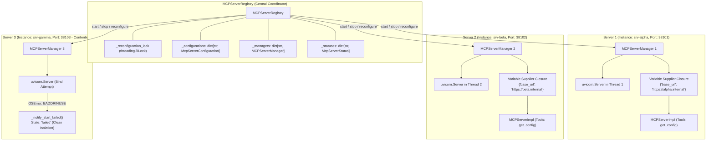
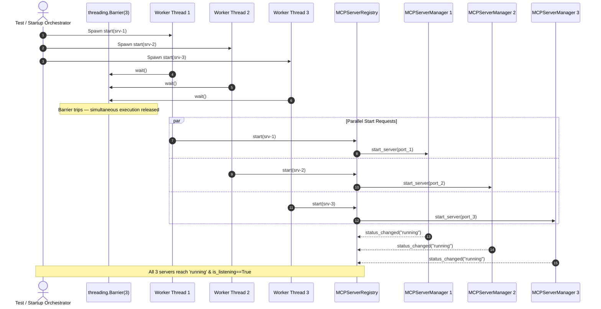
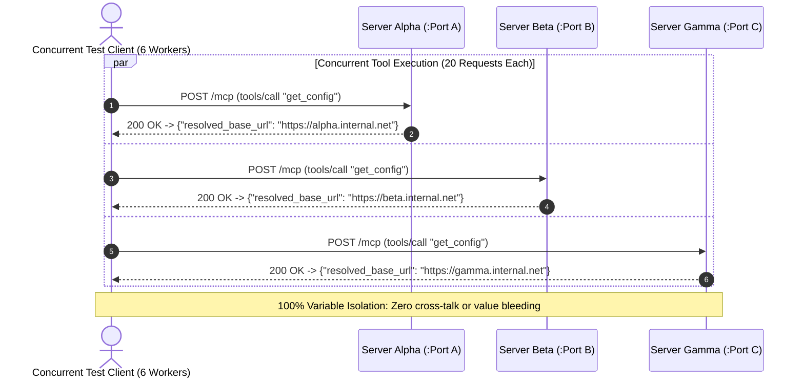
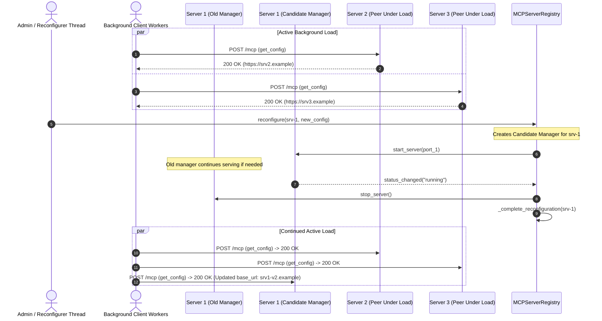

# Concurrent Multi-Server Lifecycle Execution and Port Contention (PYPOST-1418)

## Overview

Following the introduction of standalone MCP server execution in [PYPOST-1410](collection_scoped_variables.md#standalone-mcp-server-configuration-and-execution-pypost-1410) and the extraction of the reusable collection integration harness in [PYPOST-1417](collection_integration_harness.md), PyPost supports hosting multiple standalone MCP servers simultaneously within a single application or headless daemon process.

In enterprise and agentic workflows, developers frequently run several independent MCP servers in parallel—for instance, serving Jira, GitHub, and GitLab tools concurrently, or running distinct staging and production configurations side-by-side. [PYPOST-1418](https://pypost.atlassian.net/browse/PYPOST-1418) establishes and validates comprehensive concurrency, isolation, hot reload, port contention, and teardown guarantees for multi-server operations:

1. **Parallel Startup Synchronization**: Multiple standalone servers can be initiated concurrently across worker threads using barrier synchronization without registry deadlocks or startup race conditions.
2. **Collection Variable Namespace Isolation**: Servers sharing identical variable keys (such as `base_url`, `api_key`, or `auth_token`) resolve values in complete isolation with zero cross-talk or runtime dictionary pollution.
3. **Hot Reload Under Active Load**: Live reconfiguration of a running server executes without interrupting, stalling, or dropping requests being handled by peer servers.
4. **Port Contention Resilience & Graceful Recovery**: When an OS port is occupied by an external process, the affected server transitions gracefully to `failed` state with descriptive diagnostic errors, leaving all peer servers operational; reconfiguring the server to a free port recovers cleanly.
5. **Multi-Server Teardown & Socket Hygiene**: Concurrent shutdown terminates all worker threads within bounded intervals (<2.0s) and releases OS socket descriptors immediately, enabling instant rebinding without `EADDRINUSE`.

---

## Architecture & Concurrency Model

Multi-server lifecycle execution is coordinated by [`MCPServerRegistry`](file:///home/src/pypost/core/mcp_server_registry.py), with each active server endpoint encapsulated by an independent [`MCPServerManager`](file:///home/src/pypost/core/qt/mcp_server.py) and [`MCPServerImpl`](file:///home/src/pypost/core/mcp_server_impl.py).



### Threading & Concurrency Invariants

- **Instance-Level Isolation**: Each server endpoint maintains its own dedicated worker thread running a `uvicorn.Server` instance with its own private `asyncio` event loop.
- **Reentrancy Protection (`_reconfiguration_lock`)**: The registry protects transactional configuration updates, atomic manager swaps, and cleanup routines with a reentrant `threading.RLock`. Read access to server statuses and configurations is designed to avoid holding the lock during blocking I/O or network calls.
- **Deep-Copy Isolation**: Collection data models, requests, and variable mappings are deep-copied (`model_copy(deep=True)`) before instantiating or starting an `MCPServerManager`. No shared mutable data structures cross server boundaries.
- **Dynamic Port Allocation**: Ephemeral ports for automated multi-server tests are managed via [`allocate_tcp_port()`](file:///home/src/tests/helpers/port_allocation.py) using cross-process `fcntl.flock` locks, preventing TCP bind collisions in parallel test runs.

---

## Parallel Startup with Barrier Synchronization

When spinning up a cluster of standalone MCP servers (e.g., during application startup or test harness initialization), startup requests may occur simultaneously across different threads.



### Guarantees

1. **Non-Blocking Registration**: `registry.start(instance_id)` spawns the underlying server manager in a background daemon thread, returning immediately to the caller.
2. **Deterministic Startup Verification**: The test suite employs `threading.Barrier(N)` to force all starter threads to release simultaneously. The registry smoothly processes parallel start signals without race conditions.
3. **Readiness Probe**: Each server independently transitions from `starting` to `running`, sets `mgr.is_listening = True`, and responds successfully to HTTP `POST /mcp` JSON-RPC `tools/list` requests.

---

## Collection Variable Isolation Across Overlapping Namespaces

A key challenge in multi-server architectures is avoiding cross-talk when multiple collections define identical variable names with divergent values. For example, three different services might all declare a required `base_url` variable:

| Server | Collection | Variable Name | Bound Value |
| :--- | :--- | :--- | :--- |
| **Server Alpha** | `col-alpha` | `base_url` | `https://alpha.internal.net` |
| **Server Beta** | `col-beta` | `base_url` | `https://beta.internal.net` |
| **Server Gamma** | `col-gamma` | `base_url` | `https://gamma.internal.net` |



### Isolation Architecture

- **Closure-Based Variable Suppliers**: The registry binds variable suppliers using unique lambda closures:
  ```python
  manager.set_variable_supplier(lambda: dict(effective_variables))
  manager.set_secret_supplier(lambda: set(hidden_keys))
  ```
- **Independent Dictionary Allocations**: `dict(effective_variables)` creates a fresh copy on every invocation. No global registry, module-level state, or shared mutable dictionary exists between endpoints.
- **Verification Contract**: As asserted in `test_shared_and_overlapping_collection_variables_isolation`, issuing 60 parallel tool executions (20 requests per server concurrently across 6 worker threads) results in 100% correct, isolated variable interpolation.

---

## Hot Reload Under Active Load

PyPost supports zero-downtime reconfiguration of running MCP servers via [`MCPServerRegistry.reconfigure(instance_id, configuration)`](file:///home/src/pypost/core/mcp_server_registry.py). During reconfiguration, existing servers must continue serving client traffic without dropping requests or stalling.



### Hot Reload Invariants

1. **Transactional Swap**: If the replacement server fails to bind or start, the registry automatically triggers `_rollback_reconfiguration()`, retaining or restoring the original manager and leaving the running state intact.
2. **Zero Lock Contention for Peers**: While Server 1 is compiling runtime inputs and starting its candidate manager, Server 2 and Server 3 continue handling requests at full throughput.
3. **Zero Request Drop**: As asserted in `test_concurrent_hot_reload_under_active_execution`, background threads hammering Server 2 and Server 3 with hundreds of requests record zero failed calls and zero latency spikes during Server 1's hot reload.

---

## Port Collision Handling & Graceful Recovery

When multiple servers are configured, port contention can occur in two distinct modes:
1. **Internal Registry Collision**: Two configurations within PyPost specify the same port. Handled synchronously by `_validate_available_port(configuration)` before starting.
2. **External OS Port Contention**: An external process or raw socket already holds `127.0.0.1:PORT`. When `uvicorn` attempts to bind the TCP socket, the operating system raises `OSError(errno.EADDRINUSE)`.

```mermaid
sequenceDiagram
    autonumber
    actor ExternalApp as External Daemon / Rogue Socket
    actor Operator as Operator / Test Runner
    participant Registry as MCPServerRegistry
    participant Mgr2 as MCPServerManager 2 (Target)
    participant Mgr1 as MCPServerManager 1 (Peer)

    ExternalApp->>ExternalApp: bind("127.0.0.1", port=41000)
    Note over ExternalApp: Port 41000 is occupied externally

    Operator->>Registry: start(srv-2) [Configured on Port 41000]
    Registry->>Mgr2: start_server(port=41000)
    Mgr2->>Mgr2: uvicorn attempts socket.bind()
    Note over Mgr2: OSError(errno.EADDRINUSE): Address already in use
    Mgr2->>Mgr2: Catch OSError & format_mcp_bind_error()
    Mgr2-->>Registry: start_failed("MCP server could not bind to 127.0.0.1:41000...")
    Registry->>Registry: _set_status("srv-2", state="failed", message)

    Note over Registry,Mgr1: Registry remains unblocked; Server 1 continues serving requests!
    Operator->>Mgr1: POST /mcp (tools/list)
    Mgr1-->>Operator: 200 OK -> ["tool_1"]

    ExternalApp->>ExternalApp: close() (Releases port 41000)

    Operator->>Registry: upsert(srv-2 on new free_port)
    Operator->>Registry: start(srv-2)
    Registry->>Mgr2: start_server(free_port)
    Mgr2-->>Registry: status_changed("running")
    Note over Operator,Registry: Server 2 recovered cleanly! Both Server 1 and Server 2 running.
```

### Contention Handling Guarantees

- **No Process Crashes**: Uncaught `OSError` exceptions are intercepted within [`MCPServerManager._run_uvicorn`](file:///home/src/pypost/core/qt/mcp_server.py).
- **Graceful State Degradation**: The collided server transitions directly to `state="failed"`. The error message is formatted via `format_mcp_bind_error` and includes the port number and bind resolution guidance.
- **Log Hygiene**: Error logs emit `mcp_server_start_failed` at `ERROR` level without leaking credentials or secret variables.
- **Peer Server Isolation**: Running peer servers (such as Server 1 in the diagram) experience zero impact and continue answering client requests normally.
- **Clean Recovery**: Reconfiguring the server with an available port (`registry.upsert(recovered_config)`) and invoking `registry.start()` restarts the server cleanly without requiring an application restart.

---

## Concurrent Multi-Server Teardown and Socket Hygiene

Clean shutdown of multi-server environments requires releasing kernel resources immediately so ports can be rebound without lingering in `TIME_WAIT` or holding leaked file descriptors.

```mermaid
sequenceDiagram
    autonumber
    actor Orchestrator as Application Shutdown / Test Teardown
    participant Registry as MCPServerRegistry
    participant Mgr1 as Server Manager 1
    participant Mgr2 as Server Manager 2
    participant Mgr3 as Server Manager 3
    participant Kernel as Linux Kernel / TCP Stack

    Orchestrator->>Registry: stop_all() (or concurrent stop() calls)
    par Concurrent Server Teardown
        Registry->>Mgr1: stop_server()
        Mgr1->>Kernel: uvicorn should_exit = True & close server socket
        Mgr1->>Mgr1: thread.join(timeout=2.0)
    and
        Registry->>Mgr2: stop_server()
        Mgr2->>Kernel: uvicorn should_exit = True & close server socket
        Mgr2->>Mgr2: thread.join(timeout=2.0)
    and
        Registry->>Mgr3: stop_server()
        Mgr3->>Kernel: uvicorn should_exit = True & close server socket
        Mgr3->>Mgr3: thread.join(timeout=2.0)
    end

    Note over Kernel: All OS sockets closed; SO_REUSEADDR set

    Orchestrator->>Kernel: Immediate socket.bind() on ports 1, 2, 3
    Kernel-->>Orchestrator: Bind Success (No EADDRINUSE!)

    Orchestrator->>Registry: Immediate restart on same ports
    Note over Registry: All servers transition back to 'running'
```

### Teardown Contracts

1. **Bounded Thread Joins**: Server worker threads are joined with a bounded timeout (`timeout=2.0`). If uvicorn does not exit within the timeout, the registry logs a warning and retains the thread reference to prevent blocking the caller.
2. **Socket Hygiene & `SO_REUSEADDR`**: Listening sockets configure `SO_REUSEADDR`, allowing immediate re-use by subsequent server instances or test fixtures.
3. **Immediate Re-bindability**: As proven in `test_concurrent_multi_server_teardown_and_socket_hygiene`, raw TCP sockets and new server instances can bind to the exact same ports immediately after `stop()` completes, without requiring artificial sleep delays.

---

## Automated Test Suite Reference (`tests/test_mcp_concurrent_multiserver_repro.py`)

The automated regression test suite for concurrent multi-server execution is located in [`tests/test_mcp_concurrent_multiserver_repro.py`](file:///home/src/tests/test_mcp_concurrent_multiserver_repro.py).

### Test Matrix

| Test Function | Target Guarantees | Synchronization Technique | Assertions |
| :--- | :--- | :--- | :--- |
| `test_concurrent_multi_server_startup_parallel` | Parallel startup of 3 standalone MCP servers | `threading.Barrier(3)` across 3 worker threads | All 3 servers reach `running` state; `mgr.is_listening == True`; concurrent JSON-RPC `tools/list` returns expected tool catalogs. |
| `test_shared_and_overlapping_collection_variables_isolation` | Complete variable isolation with identical key names (`base_url`) | 6 worker threads firing 60 requests concurrently | All 20 Alpha requests return `alpha.internal.net`; Beta returns `beta.internal.net`; Gamma returns `gamma.internal.net`. Zero variable leakage. |
| `test_concurrent_hot_reload_under_active_execution` | Hot reload under active background traffic | Background worker threads continuously polling Servers 2 and 3 while Server 1 is reconfigured | Server 1 updates `base_url` to v2; Servers 2 and 3 complete hundreds of requests with zero errors or drops. |
| `test_port_collision_detection_and_graceful_recovery` | OS port collision resilience & recovery | External raw socket occupying port prior to startup | Server 2 transitions to `failed` state with bind failure message; Server 1 remains `running`; Server 2 recovers on free port. |
| `test_concurrent_multi_server_teardown_and_socket_hygiene` | Orderly shutdown and immediate port re-bindability | Concurrent `registry.stop()` across all servers | All threads terminated; immediate probe socket bind succeeds on same ports; immediate server restart succeeds. |

### Running the Test Suite

Execute the test suite through the repository Makefile:

```bash
# Run the dedicated concurrent multi-server test suite
make test PYTEST_ARGS='tests/test_mcp_concurrent_multiserver_repro.py'

# Run combined standalone MCP and concurrency tests
make test PYTEST_ARGS='tests/test_mcp_concurrent_multiserver_repro.py tests/test_mcp_standalone_wire_ipc_repro.py tests/test_collection_scoped_variables_integration.py'

# Run full repository quality gate
make check
```

---

## Related Documentation

- [Collection-Scoped Variables, Standalone MCP Servers, and Workspace Import](collection_scoped_variables.md)
- [Reusable Collection Integration Test Harness (PYPOST-1417)](collection_integration_harness.md)
- [Standalone MCP Server Live Wire IPC & Stdio Transport Stress Testing (PYPOST-1416)](mcp_standalone_wire_ipc_stress.md)
- [Multiple Independent MCP Servers (PYPOST-1044)](mcp_server_registry.md)
- [Ephemeral TCP Port Allocation Helper](file:///home/src/tests/helpers/port_allocation.py)
