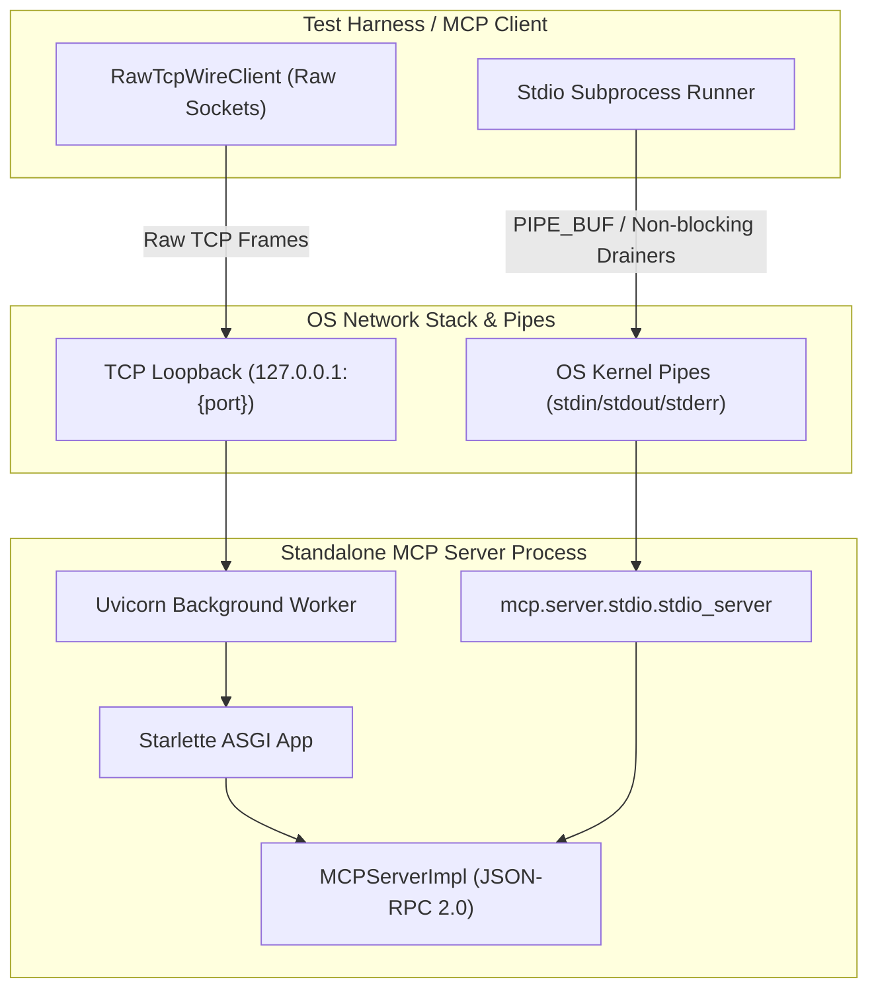

# Standalone MCP Server Live Wire IPC & Stdio Transport Stress Testing

## Overview

In PyPost, Model Context Protocol (MCP) servers expose saved HTTP requests and collections as discoverable, executable AI tools and resources. While in-process unit tests validate tool schema registration and supplier dispatch mechanisms, they execute in memory and bypass the physical operating system networking stack, socket buffers, kernel pipe buffers, and wire framing.

Story [PYPOST-1416](https://pypost.atlassian.net/browse/PYPOST-1416) establishes comprehensive live wire IPC and stdio transport stress testing implemented in [`tests/test_mcp_standalone_wire_ipc_repro.py`](file:///home/src/tests/test_mcp_standalone_wire_ipc_repro.py). This document describes the architecture, protocols, failure modes, test harness design, and execution guidelines for validating standalone MCP server transports under physical wire and pipe conditions.

---

## Architecture & Transports

Standalone MCP servers in PyPost support two primary physical communication channels:
1. **Network Loopback TCP Sockets**: Streamable HTTP and Server-Sent Events (SSE) hosted on an ASGI Starlette application running on a background Uvicorn daemon thread managed by [`MCPServerManager`](file:///home/src/pypost/core/qt/mcp_server.py).
2. **Out-of-Process OS Pipes (Stdio)**: Child subprocesses communicating via standard input/output streams (`stdin`/`stdout`/`stderr`) using `mcp.server.stdio.stdio_server`.



### 1. Streamable HTTP Wire Transport (`/mcp`)

- **Mount Point**: Mounted via `mcp.server.streamable_http_manager.StreamableHTTPSessionManager`.
- **Wire Framing**: Standard HTTP/1.1 `POST /mcp` requests.
- **Session Identification**: Session tracking occurs via the HTTP header `mcp-session-id: <session_uuid>`, assigned by the server on initial handshake.
- **Payload**: JSON-RPC 2.0 messages (requests, responses, notifications).
- **Keep-Alive**: Connections leverage HTTP/1.1 `Connection: keep-alive` to allow multiple pipelined or sequential requests over a single persistent TCP socket.

### 2. Legacy SSE Wire Transport (`/sse` & `/sse/messages`)

- **Mount Point**: Mounted via `mcp.server.sse.SseServerTransport`.
- **Stream Channel**: The client issues `GET /sse HTTP/1.1` with `Accept: text/event-stream`. The server keeps the HTTP connection open, returning `Content-Type: text/event-stream` and emitting an `endpoint` event containing the session URI:
  ```http
  event: endpoint
  data: /sse/messages?session_id=3fa85f64-5717-4562-b3fc-2c963f66afa6
  ```
- **Message Channel**: Client POSTs JSON-RPC requests to `/sse/messages?session_id=...`, which returns HTTP 202 Accepted. Responses are streamed back asynchronously over the active GET SSE connection as `event: message` blocks.

### 3. Out-of-Process Stdio IPC Transport

- **Process Model**: Standalone MCP servers execute in an independent process via `subprocess.Popen([sys.executable, "-c", ...], stdin=PIPE, stdout=PIPE, stderr=PIPE, bufsize=0)`.
- **Stream Framing**: Newline-delimited JSON-RPC 2.0 strings (`{"jsonrpc":"2.0",...}\n`).
- **Channel Segregation**: JSON-RPC traffic flows strictly over `stdin` and `stdout`. Diagnostic and debug logs are routed to `stderr` to prevent JSON stream contamination.

---

## Wire Stress Testing Harness (`RawTcpWireClient`)

To test raw network conditions without high-level HTTP client abstractions (which automatically buffer or reassemble packets), the harness implements `RawTcpWireClient`:

```python
class RawTcpWireClient:
    """Raw TCP socket client for injecting fragmented frames, pipelining, and bursts."""

    def __init__(self, host: str, port: int, timeout: float = 10.0):
        self.host = host
        self.port = port
        self.timeout = timeout
        self.sock: socket.socket | None = None
        self.session_id: str | None = None
        self._unread_buffer = bytearray()
```

### Core Capabilities

- **Wire Request Construction**: Formats compliant HTTP/1.1 POST requests with explicit `Content-Length`, `Connection: keep-alive`, and `mcp-session-id` headers.
- **Arbitrary Fragmentation Injection**: `send_fragmented(data, chunk_size, delay)` splits outgoing bytes into arbitrary micro-chunks (down to 1-byte packets) to simulate extreme network segmentation.
- **Stream-Aware Response Parsing**: Parses incoming socket streams across packet boundaries, handling header delimiters (`\r\n\r\n`), fixed `Content-Length`, and `Transfer-Encoding: chunked` streams.
- **JSON-RPC Extraction**: `parse_jsonrpc_from_response(body_bytes)` extracts and parses JSON-RPC objects from both direct JSON payloads and Server-Sent Event (`data: {...}`) blocks.

---

## Stress Test Scenarios & Invariants

The test suite in [`tests/test_mcp_standalone_wire_ipc_repro.py`](file:///home/src/tests/test_mcp_standalone_wire_ipc_repro.py) validates four critical architectural stress scenarios:

### 1. TCP Packet Fragmentation Resilience

- **Failure Mode**: TCP is a stream-oriented protocol. Packet boundaries are non-deterministic and can split across headers, within JSON keys, or across multibyte UTF-8 characters. If an ASGI server or stream parser assumes headers or payloads arrive in a single read call, the server fails with protocol syntax errors or desynchronization.
- **Verification Strategy**:
  1. Standalone server starts on an ephemeral allocated port via `allocate_tcp_port()`.
  2. `initialize` request is fragmented into 7-byte chunks across the wire.
  3. `notifications/initialized` is fragmented into 7-byte chunks.
  4. `tools/list` request is fragmented into 7-byte chunks.
  5. `tools/call` request is transmitted in **1-byte micro-chunks** (`chunk_size=1`).
- **Invariant**: The server buffers fragmented incoming packets, accurately reconstructs HTTP headers and bodies, dispatches tool execution through `MCPServerImpl`, and returns valid JSON-RPC responses.

### 2. Pipelined Burst Throughput (100-Request Bursts)

- **Failure Mode**: In high-velocity agent environments, clients stream back-to-back requests over an open keep-alive connection. Naive servers may suffer socket buffer overruns, ASGI worker starvation, connection resets (`ECONNRESET`), or dropped requests.
- **Verification Strategy**:
  1. Establish session via handshake over raw TCP keep-alive connection.
  2. Pre-generate 100 complete HTTP/JSON-RPC requests (`pipelined-0` through `pipelined-99`).
  3. Concatenate all 100 requests into a single continuous byte buffer and blast it over the wire using a single `client.send_all()` socket write.
  4. Read responses sequentially from the socket stream.
- **Invariant**: Exactly 100 HTTP 200 responses are returned in order, with zero socket stalls, resets, or dropped IDs.

### 3. Stdio Pipe Buffer Deadlock Avoidance (>64KB `PIPE_BUF`)

- **Failure Mode**: Operating system pipes have fixed kernel buffer capacities (Linux `PIPE_BUF` atomic write limit is 4096 bytes; standard pipe buffer capacity is 65,536 bytes / 64KB). If a client writes large payloads or rapid bursts to `stdin` without draining `stdout` concurrently, the kernel pipe buffer fills up, causing a permanent deadlock where both processes block on I/O.
- **Verification Strategy**:
  1. Launch standalone MCP server in an external Python subprocess running `mcp.server.stdio.stdio_server`.
  2. Spawn two dedicated background drainer threads:
     - `stdout_worker`: Continuously drains `process.stdout` using line iterators, parsing JSON-RPC messages into a thread-safe dictionary under a lock.
     - `stderr_worker`: Continuously drains `process.stderr` into a log buffer.
  3. Send initial handshake (`initialize`, `notifications/initialized`).
  4. Inject a burst of 50 requests, with requests 41–50 containing large 70KB payloads (`"X" * 70000`), exceeding the 64KB OS pipe buffer limit.
  5. Close `process.stdin` and assert clean exit with return code 0.
- **Invariant**: All 50 responses (including the 70KB payloads) are received intact without payload corruption or truncation. The server process terminates cleanly on `stdin` EOF.

### 4. Rapid Teardown & Immediate Port Re-Binding Under Hammer Load

- **Failure Mode**: Under heavy traffic, tearing down a server can leave TCP ports in `TIME_WAIT` or leak socket descriptors, causing subsequent `bind()` calls to fail with `OSError: [Errno 98] Address already in use` (`EADDRINUSE`).
- **Verification Strategy**:
  1. Start standalone MCP server on an allocated loopback port.
  2. Launch 3 concurrent "hammer" threads firing rapid TCP connect/send/close loops against `POST /mcp`.
  3. While hammer traffic is actively in flight, invoke `manager.stop_server()`.
  4. Join hammer threads and assert no unhandled exceptions.
  5. Verify the port can immediately be re-bound with `SO_REUSEADDR`.
  6. Immediately spin up a second `MCPServerManager` instance binding to the identical port, asserting successful startup and listener readiness.
- **Invariant**: Shutdown is graceful and immediate under active load; sockets and worker threads are released cleanly without port exhaustion or `EADDRINUSE`.

---

## Test Execution Guide

All tests must be run exclusively via `make` targets. Never invoke `pytest` or `pip` directly.

### Running Wire & Stdio Stress Tests

```bash
# Run standalone wire IPC and stdio stress test suite
make test PYTEST_ARGS='tests/test_mcp_standalone_wire_ipc_repro.py'

# Run wire stress tests together with standalone execution tests
make test PYTEST_ARGS='tests/test_mcp_standalone_execution_repro.py tests/test_mcp_standalone_wire_ipc_repro.py'

# Run all MCP-related test suites
make test PYTEST_ARGS='tests/test_mcp*.py'
```

### Running Full Quality Gates

```bash
# Run linting (flake8, doc linting, relative link verification)
make lint

# Run type checking (mypy baseline gate)
make typecheck

# Combined quality gate (lint + fast tests + verify-ai-tasks)
make check
```

---

## Related Documentation

- Multi-Server Registry Architecture: [mcp_server_registry.md](mcp_server_registry.md)
- Model Context Protocol Architecture & Security: [mcp.md](mcp.md)
- Inbound MCP Trust Model: [mcp_trust_model.md](mcp_trust_model.md)
- MCP Integration Guide: [mcp_integration.md](mcp_integration.md)
