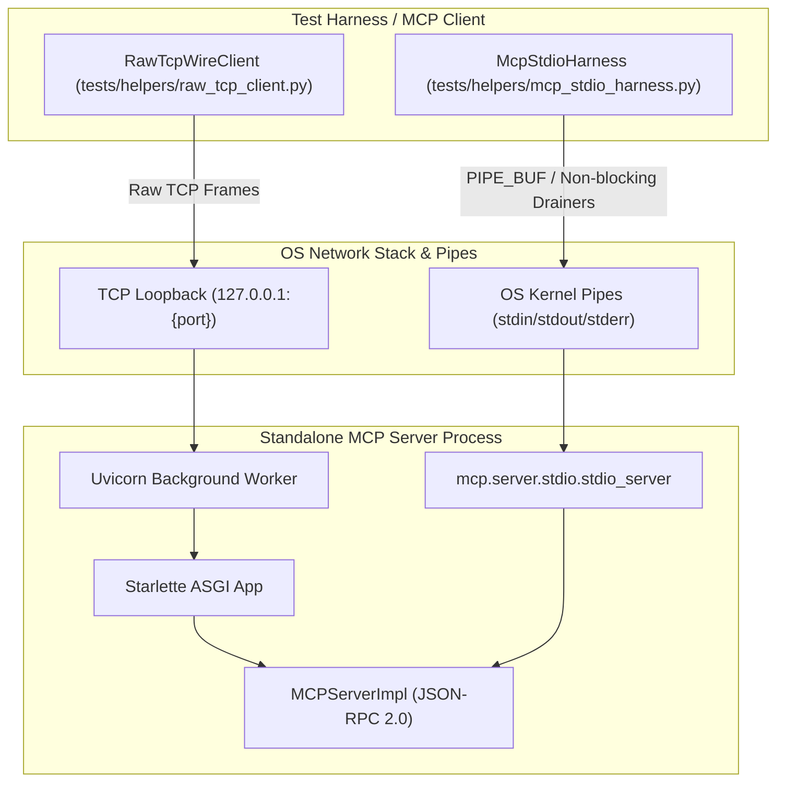

# Standalone MCP Server Live Wire IPC & Stdio Transport Stress Testing

## Overview

In PyPost, Model Context Protocol (MCP) servers expose saved HTTP requests and collections as
discoverable, executable AI tools and resources. While in-process unit tests validate tool schema
registration and supplier dispatch mechanisms, they execute in memory and bypass the physical
operating system networking stack, socket buffers, kernel pipe buffers, and wire framing.

Story [PYPOST-1416](https://pypost.atlassian.net/browse/PYPOST-1416) established live wire IPC and
stdio transport stress testing in
[`test_mcp_standalone_wire_ipc_repro.py`](../../tests/test_mcp_standalone_wire_ipc_repro.py).
Story [PYPOST-1428](https://pypost.atlassian.net/browse/PYPOST-1428) extracted the reusable wire
client and response decoder into the shared test utility module
[`tests/helpers/raw_tcp_client.py`](file:///home/src/tests/helpers/raw_tcp_client.py)
for reuse across all MCP wire transport test suites. Story
[PYPOST-1429](https://pypost.atlassian.net/browse/PYPOST-1429) encapsulated subprocess stdio child
process management and asynchronous stream draining into the dedicated test harness
[`tests/helpers/mcp_stdio_harness.py`](file:///home/src/tests/helpers/mcp_stdio_harness.py). Story
[PYPOST-1430](https://pypost.atlassian.net/browse/PYPOST-1430) implemented the malformed JSON-RPC
and wire framing negative fuzzing suite in
[`test_mcp_wire_fuzzing_negative.py`](../../tests/test_mcp_wire_fuzzing_negative.py) along with
transport-level UTF-8 pre-validation in
[`mcp_streamable_http.py`](../../pypost/core/mcp_streamable_http.py). This document describes the
architecture, protocols, failure modes, shared test harness design, helper APIs, negative fault
injection vectors, and execution guidelines for validating standalone MCP server transports under
physical wire, fuzzing, and pipe conditions.

---

## Architecture & Transports

Standalone MCP servers in PyPost support two primary physical communication channels:
1. **Network Loopback TCP Sockets**: Streamable HTTP and Server-Sent Events (SSE) hosted on an ASGI
   Starlette application running on a background Uvicorn daemon thread managed by
   [`MCPServerManager`](file:///home/src/pypost/core/qt/mcp_server.py).
2. **Out-of-Process OS Pipes (Stdio)**: Child subprocesses communicating via standard input/output
   streams (`stdin`/`stdout`/`stderr`) using `mcp.server.stdio.stdio_server`.



### 1. Streamable HTTP Wire Transport (`/mcp`)

- **Mount Point**: Mounted via `mcp.server.streamable_http_manager.StreamableHTTPSessionManager`.
- **Wire Framing**: Standard HTTP/1.1 `POST /mcp` requests.
- **UTF-8 Pre-Validation**: Inbound POST request bodies are pre-validated by
  [`StreamableHTTPASGIApp`](file:///home/src/pypost/core/mcp_streamable_http.py)
  to ensure strict UTF-8 decoding prior to session dispatch. Character decoding failures
  deterministically yield JSON-RPC 2.0 Parse Error (`-32700`) with HTTP 400 Bad Request.
- **Session Identification**: Session tracking occurs via the HTTP header `mcp-session-id: <uuid>`,
  assigned by the server on initial handshake.
- **Payload**: JSON-RPC 2.0 messages (requests, responses, notifications).
- **Keep-Alive**: Connections leverage HTTP/1.1 `Connection: keep-alive` to allow multiple
  pipelined or sequential requests over a single persistent TCP socket.

### 2. Legacy SSE Wire Transport (`/sse` & `/sse/messages`)

- **Mount Point**: Mounted via `mcp.server.sse.SseServerTransport`.
- **Stream Channel**: The client issues `GET /sse HTTP/1.1` with `Accept: text/event-stream`.
  The server keeps the HTTP connection open, returning `Content-Type: text/event-stream` and
  emitting an `endpoint` event containing the session URI:
  ```http
  event: endpoint
  data: /sse/messages?session_id=3fa85f64-5717-4562-b3fc-2c963f66afa6
  ```
- **Message Channel**: Client POSTs JSON-RPC requests to `/sse/messages?session_id=...`, which
  returns HTTP 202 Accepted. Responses are streamed back asynchronously over the active GET SSE
  connection as `event: message` blocks.

### 3. Out-of-Process Stdio IPC Transport

- **Process Model**: Standalone MCP servers execute in an independent process via
  `subprocess.Popen([sys.executable, "-c", ...], stdin=PIPE, stdout=PIPE, stderr=PIPE, bufsize=0)`.
- **Stream Framing**: Newline-delimited JSON-RPC 2.0 strings (`{"jsonrpc":"2.0",...}\n`).
- **Channel Segregation**: JSON-RPC traffic flows strictly over `stdin` and `stdout`. Diagnostic
  and debug logs are routed to `stderr` to prevent JSON stream contamination.

---

## Shared Wire Test Helper (`tests/helpers/raw_tcp_client.py`)

To test raw network conditions without high-level HTTP client abstractions (which automatically
buffer or reassemble packets), the test harness relies on the shared utility module
[`tests/helpers/raw_tcp_client.py`](file:///home/src/tests/helpers/raw_tcp_client.py). Promoted
under [PYPOST-1428](https://pypost.atlassian.net/browse/PYPOST-1428), this module exports low-level
wire socket testing primitives for all MCP transport test suites:
- `RawTcpWireClient`: Low-level TCP socket client for frame injection, pipelining, and parsing.
- `parse_jsonrpc_from_response`: Parser extracting JSON-RPC messages from JSON or SSE payloads.

### `RawTcpWireClient` Class API

`RawTcpWireClient` operates directly on physical TCP stream sockets (`socket.AF_INET`,
`socket.SOCK_STREAM`) against loopback endpoints. It manages connection lifecycles, HTTP/1.1 wire
framing, arbitrary byte-level transmission fragmentation, and stream reassembly across packet
chunks.

#### Class Signature & Initialization

```python
class RawTcpWireClient:
    def __init__(self, host: str, port: int, timeout: float = 10.0) -> None:
        self.host = host
        self.port = port
        self.timeout = timeout
        self.sock: socket.socket | None = None
        self.session_id: str | None = None
        self._unread_buffer = bytearray()
```

- **`host`** (`str`): Target hostname or loopback address (typically `"127.0.0.1"`).
- **`port`** (`int`): Target TCP port number allocated for the standalone server.
- **`timeout`** (`float`, default `10.0`): Socket timeout in seconds applied to connect and read
  operations.

**Instance Attributes**:
- `sock: socket.socket | None`: The active underlying operating system socket descriptor, or `None`
  when disconnected.
- `session_id: str | None`: Cached MCP session ID extracted automatically from the `mcp-session-id`
  response header.
- `_unread_buffer: bytearray`: Internal stream buffer preserving unread bytes read ahead during
  framing for subsequent requests.

#### Methods Reference

##### `connect() -> None`
Establishes a physical TCP stream connection (`socket.AF_INET`, `socket.SOCK_STREAM`) to
`(self.host, self.port)` with the configured timeout.

##### `close() -> None`
Gracefully shuts down and closes the underlying socket descriptor. Issues `socket.SHUT_RDWR`
(suppressing `OSError` if the peer has already disconnected or reset) and closes `self.sock`,
resetting it to `None`.

##### Context Manager Protocol (`__enter__` and `__exit__`)
Supports `with RawTcpWireClient(host, port) as client:` syntax. Calls `connect()` on entry and
guarantees deterministic `close()` on block exit.

##### `build_post_request(payload, path="/mcp", session_id=None) -> bytes`
Constructs compliant, raw HTTP/1.1 `POST` request wire bytes with JSON-RPC payload.
- **`payload`** (`dict[str, Any]`): JSON-serializable dictionary representing the JSON-RPC request.
- **`path`** (`str`, default `"/mcp"`): Target HTTP endpoint URI path.
- **`session_id`** (`str | None`, optional): Explicit MCP session ID override; defaults to
  `self.session_id`.
- **Returns** (`bytes`): Formatted raw HTTP/1.1 wire request including `POST`, `Host`,
  `Content-Type: application/json`, `Accept: application/json, text/event-stream`, `Content-Length`,
  `Connection: keep-alive`, and optional `mcp-session-id` headers.

##### `send_fragmented(data: bytes, chunk_size: int = 7, delay: float = 0.0) -> None`
Transmits arbitrary byte sequences sliced into small micro-chunks to simulate extreme network
segmentation and packet boundary fragmentation.
- **`data`** (`bytes`): Raw byte sequence to transmit across the socket.
- **`chunk_size`** (`int`, default `7`): Maximum slice size in bytes per `socket.sendall` call (down
  to 1 byte).
- **`delay`** (`float`, default `0.0`): Optional sleep interval in seconds between slice
  transmissions.

##### `send_all(data: bytes) -> None`
Transmits the entire byte buffer in a single bulk `sendall()` socket write. Used for high-volume
pipelined bursts.
- **`data`** (`bytes`): Raw byte buffer to transmit.

##### `read_http_response() -> tuple[int, dict[str, str], bytes]`
Reads a single complete HTTP/1.1 response from the persistent socket stream.
- **Stream Processing**:
  - Scans `self._unread_buffer` and reads from socket in 4096-byte chunks until the header delimiter
    (`\r\n\r\n`) is encountered.
  - Parses status line into status code integer.
  - Normalizes headers to lower-case keys.
  - Captures `mcp-session-id` into `self.session_id` when present.
  - Decodes chunked transfer encoding (`Transfer-Encoding: chunked`) or bounded `Content-Length`
    bodies.
  - Retains any excess read bytes in `self._unread_buffer` for subsequent pipelined response reads.
- **Returns** (`tuple[int, dict[str, str], bytes]`):
  - `status_code` (`int`): HTTP status code (e.g. `200`, `202`, `404`).
  - `headers` (`dict[str, str]`): Mapping of lower-case HTTP header names to header values.
  - `body_bytes` (`bytes`): Complete decoded payload bytes.
- **Exceptions Raised**:
  - `ConnectionResetError`: Raised if the connection is closed prematurely by peer while waiting for
    header delimiters or chunk data.
  - `socket.timeout`: Raised if the socket read timeout expires before the full response arrives.

### `parse_jsonrpc_from_response` Helper API

```python
def parse_jsonrpc_from_response(body_bytes: bytes) -> list[dict[str, Any]]:
```

#### Overview
Extracts and parses JSON-RPC 2.0 message dictionaries from raw HTTP response bodies. Because MCP
transports may return direct JSON or SSE streams, this helper transparently handles both response
formats.

#### Parameters & Return Types
- **`body_bytes`** (`bytes`): Raw response body bytes received from the wire.
- **Returns** (`list[dict[str, Any]]`): List of parsed JSON-RPC message dictionaries. If no valid
  JSON-RPC payloads are discovered, returns an empty list `[]`.

#### Parsing Logic
1. Decodes `body_bytes` as UTF-8 (with `errors="replace"`).
2. If text starts with `{` and ends with `}`, attempts direct `json.loads(text)`.
3. If not direct JSON, scans lines for Server-Sent Events syntax (`data: ...`), extracting and
   decoding nested JSON payloads from `data:` blocks.

### Usage Patterns in Test Suites

#### 1. Context Manager with Fragmented Frames
```python
from tests.helpers.raw_tcp_client import RawTcpWireClient, parse_jsonrpc_from_response

with RawTcpWireClient(host="127.0.0.1", port=server_port, timeout=10.0) as client:
    # 1. Handshake with fragmented 7-byte chunks
    init_req = client.build_post_request({
        "jsonrpc": "2.0",
        "id": "init-1",
        "method": "initialize",
        "params": {
            "protocolVersion": "2024-11-05",
            "capabilities": {},
            "clientInfo": {"name": "test-client", "version": "1.0"},
        },
    })
    client.send_fragmented(init_req, chunk_size=7)
    status, headers, body = client.read_http_response()
    assert status == 200
    msgs = parse_jsonrpc_from_response(body)
    assert msgs[0]["id"] == "init-1"

    # 2. Extreme 1-byte micro-chunking
    call_req = client.build_post_request({
        "jsonrpc": "2.0",
        "id": "call-1",
        "method": "tools/call",
        "params": {"name": "echo", "arguments": {"msg": "hello"}},
    })
    client.send_fragmented(call_req, chunk_size=1)
    status, headers, body = client.read_http_response()
    assert status == 200
```

#### 2. Pipelined 100-Request Bursts
```python
from tests.helpers.raw_tcp_client import RawTcpWireClient, parse_jsonrpc_from_response

with RawTcpWireClient(host="127.0.0.1", port=server_port) as client:
    # Perform initial handshake to establish session_id
    # ...
    # Pre-generate 100 pipelined requests
    burst_bytes = bytearray()
    for idx in range(100):
        req = client.build_post_request({
            "jsonrpc": "2.0",
            "id": f"burst-{idx}",
            "method": "tools/list",
            "params": {},
        })
        burst_bytes.extend(req)

    # Blast entire buffer over socket in a single write
    client.send_all(bytes(burst_bytes))

    # Read back 100 responses sequentially from stream
    for idx in range(100):
        status, headers, body = client.read_http_response()
        assert status == 200
        msgs = parse_jsonrpc_from_response(body)
        assert msgs[0]["id"] == f"burst-{idx}"
```

---

## Shared Stdio Test Harness (`tests/helpers/mcp_stdio_harness.py`)

To test standalone MCP child processes communicating over operating system pipes without
re-implementing low-level process spawning and thread management in every test suite, the harness
relies on the dedicated helper module
[`tests/helpers/mcp_stdio_harness.py`](file:///home/src/tests/helpers/mcp_stdio_harness.py).
Encapsulated under [PYPOST-1429](https://pypost.atlassian.net/browse/PYPOST-1429),
`McpStdioHarness` provides child process execution, asynchronous non-blocking stream draining,
synchronized response dispatching, and bounded timeout enforcement.

### Architectural Design

Testing stdio-based MCP servers out-of-process introduces concurrency and operating system pipe
constraints:

1. **Daemon Thread Reader Loops**:
   Child processes write stdout and stderr concurrently. Operating standard blocking reads from the
   main test thread creates deadlock vulnerabilities when both streams produce output.
   `McpStdioHarness` spawns two dedicated daemon reader threads upon launch:
   - `_stdout_worker`: Consumes `process.stdout.readline` line-by-line using `iter(..., b"")`.
     Each non-empty line is parsed as JSON-RPC. If the decoded payload contains `"id"`, the message
     is registered in `self._responses` under its request ID, appended to `self._messages`, and
     waiters are notified via the condition variable.
   - `_stderr_worker`: Consumes `process.stderr.readline` line-by-line, decoding text with
     `errors="replace"` and recording it to `self._stderr_lines` under `self._stderr_lock`.

2. **Monitor Condition Variable Synchronization**:
   To avoid inefficient busy-waiting or thread polling loops, `McpStdioHarness` coordinates worker
   threads and test consumers through a monitor pattern using `threading.Condition` bound to an
   underlying re-entrant lock (`threading.RLock`). Whenever `_stdout_worker` decodes a message or
   response, it acquires the condition and executes `notify_all()`. Test caller threads waiting on
   `wait_for_response()`, `wait_for_responses()`, or `wait_for_predicate()` block on
   `self._condition.wait(remaining)` and wake up immediately upon response arrival.

3. **OS Pipe Deadlock Prevention**:
   Standard OS kernel pipe buffers have limited capacity (typically 64KB on Linux, with atomic
   `PIPE_BUF` writes up to 4096 bytes). When a child process writes responses exceeding pipe
   capacity (such as large tool outputs or bursts) while the test process is busy writing to
   `stdin`, unconsumed stdout buffers saturate, blocking the child write call and stalling both
   processes in a permanent deadlock.
   `McpStdioHarness` prevents pipe deadlocks by:
   - Launching child processes with unbuffered pipes (`bufsize=0`).
   - Concurrently and continuously draining `stdout` and `stderr` in background threads regardless
     of test thread write activity.
   - Synchronizing all `stdin` transmissions with `_stdin_lock` and flushing immediately.

4. **Graceful Stdin EOF Shutdown with SIGKILL Escalation**:
   Well-behaved stdio MCP servers terminate when their input stream closes (`stdin` EOF).
   `McpStdioHarness.close_stdin()` flushes and closes `process.stdin`, ignoring `BrokenPipeError` or
   `OSError` if the process has already exited.
   `McpStdioHarness.stop(timeout=5.0)` performs graceful teardown:
   - Closes `stdin` if still open.
   - Waits up to `timeout` seconds for the process to exit cleanly.
   - If `subprocess.TimeoutExpired` occurs, automatically escalates to `kill()` (`SIGKILL`) with a
     bounded 2.0-second grace window.
   - Joins reader daemon threads and returns the final process returncode.

### `McpStdioHarness` Class API

`McpStdioHarness` encapsulates the lifecycle of a single child subprocess and its stream readers.

#### Class Signature & Initialization

```python
class McpStdioHarness:
    def __init__(
        self,
        command: Sequence[str | Path] | str,
        *,
        cwd: str | Path | None = None,
        env: dict[str, str] | None = None,
        auto_start: bool = True,
    ) -> None:
```

- **`command`** (`Sequence[str | Path] | str`): Executable arguments sequence (e.g.
  `[sys.executable, "-c", script]`) or shell command string to execute.
- **`cwd`** (`str | Path | None`, optional): Working directory for the child process.
- **`env`** (`dict[str, str] | None`, optional): Custom environment variable mapping.
- **`auto_start`** (`bool`, default `True`): If `True`, automatically invokes `start()` during
  initialization. Set to `False` to defer launch or configure custom state prior to starting.

**Instance Properties & Attributes**:
- `process: subprocess.Popen[bytes] | None`: Underlying `Popen` instance or `None` if unstarted.
- `is_alive -> bool`: Property returning `True` if the child process is currently active and
  `process.poll() is None`.
- `returncode -> int | None`: Property returning the integer exit code or `None` if running.

#### Lifecycle & Process Management Methods

##### `__enter__() -> McpStdioHarness`
Context manager entry point. Ensures `start()` has run and returns the harness instance.

##### `__exit__(exc_type, exc_val, exc_tb) -> None`
Context manager exit point. Guarantees deterministic `stop()` and resource cleanup on exit.

##### `start() -> None`
Launches child process with `stdin=PIPE`, `stdout=PIPE`, `stderr=PIPE`, and `bufsize=0`.
Spawns background `_stdout_worker` and `_stderr_worker` daemon threads.
- **Raises**: `RuntimeError` if the process is already running.

##### `close_stdin() -> None`
Flushes and closes `process.stdin` to signal EOF to the child server. Safe to call multiple times
or if `stdin` has already closed.

##### `stop(timeout: float = 5.0) -> int`
Gracefully stops the child process. Closes `stdin`, waits up to `timeout` seconds for exit,
escalates to `kill()` if the timeout expires, joins background reader threads, and returns the
exit code.
- **`timeout`** (`float`, default `5.0`): Maximum time in seconds to wait for graceful exit.
- **Returns** (`int`): Process exit returncode.

##### `kill(timeout: float = 2.0) -> int`
Immediately terminates the child process with `process.kill()`, waits up to `timeout` seconds,
joins reader worker threads, and returns the returncode.
- **`timeout`** (`float`, default `2.0`): Maximum wait time in seconds after termination signal.
- **Returns** (`int`): Process exit returncode.

##### `wait_for_exit(timeout: float = 5.0) -> int`
Blocks until the child process terminates and joins reader worker threads.
- **`timeout`** (`float`, default `5.0`): Maximum wait time in seconds.
- **Returns** (`int`): Process exit returncode.
- **Raises**:
  - `TimeoutError`: If the child process does not exit within `timeout` seconds.
  - `RuntimeError`: If the child process was never started.

#### Message Transmission Methods

##### `send_raw(data: bytes | str) -> None`
Writes raw bytes or string directly to `process.stdin` and flushes immediately under
`_stdin_lock`.
- **`data`** (`bytes | str`): Raw data to transmit.
- **Raises**: `RuntimeError` if the process is not running or `stdin` is closed; `TypeError` if
  data is not `bytes` or `str`.

##### `send_message(message: dict[str, Any] | str) -> None`
Serializes a JSON dictionary (or formats a string with trailing newline) and transmits it to
`process.stdin` via `send_raw`.
- **`message`** (`dict[str, Any] | str`): Message dictionary or JSON string.

##### `send_request(request_id: Any, method: str, params: dict[str, Any] | None = None) -> None`
Convenience helper to format and transmit a standard JSON-RPC 2.0 request message:
`{"jsonrpc": "2.0", "id": request_id, "method": method, "params": ...}`.
- **`request_id`** (`Any`): Correlating request identifier.
- **`method`** (`str`): JSON-RPC method name (e.g. `"initialize"`, `"tools/call"`).
- **`params`** (`dict[str, Any] | None`, optional): Request parameters dictionary.

##### `send_notification(method: str, params: dict[str, Any] | None = None) -> None`
Convenience helper to format and transmit a standard JSON-RPC 2.0 notification (omits `"id"`):
`{"jsonrpc": "2.0", "method": method, "params": ...}`.
- **`method`** (`str`): JSON-RPC notification method (e.g. `"notifications/initialized"`).
- **`params`** (`dict[str, Any] | None`, optional): Notification parameters dictionary.

#### Response Inspection & Synchronization Methods

##### `get_response(request_id: Any) -> dict[str, Any] | None`
Thread-safe non-blocking lookup of a received response by ID. Returns a dictionary copy if
present, or `None` if not yet received.

##### `get_all_responses() -> dict[Any, dict[str, Any]]`
Thread-safe snapshot copy of all collected JSON-RPC responses keyed by request ID.

##### `get_messages() -> list[dict[str, Any]]`
Thread-safe ordered list copy of all received JSON-RPC messages (both responses and notifications).

##### `get_stderr() -> str`
Thread-safe snapshot of all captured stderr text emitted by the child process.

##### `wait_for_response(request_id: Any, timeout: float = 5.0) -> dict[str, Any]`
Blocks until the response matching `request_id` is received or `timeout` expires.
- **`request_id`** (`Any`): Expected response identifier.
- **`timeout`** (`float`, default `5.0`): Maximum wait time in seconds.
- **Returns** (`dict[str, Any]`): Parsed JSON-RPC response dictionary.
- **Raises**: `TimeoutError` including captured stderr output if the response is not received
  within `timeout` seconds.

##### `wait_for_responses(total_count: int, timeout: float = 15.0) -> dict[Any, dict[str, Any]]`
Blocks until at least `total_count` responses have been collected in the registry.
- **`total_count`** (`int`): Minimum number of responses required.
- **`timeout`** (`float`, default `15.0`): Maximum wait time in seconds.
- **Returns** (`dict[Any, dict[str, Any]]`): Thread-safe dictionary of all collected responses.
- **Raises**: `TimeoutError` including count diagnostics and stderr output if the threshold is
  not met.

##### `wait_for_predicate(predicate, timeout=5.0, interval=0.05) -> None`
Blocks until a custom callable predicate evaluates to `True` or `timeout` expires.
- **`predicate`** (`Callable[[McpStdioHarness], bool]`): Predicate accepting the harness instance.
- **`timeout`** (`float`, default `5.0`): Maximum wait time in seconds.
- **`interval`** (`float`, default `0.05`): Polling interval fallback for condition evaluation.
- **Raises**: `TimeoutError` with captured stderr output on timeout.

### Usage Patterns in Test Suites

#### 1. Context Manager Lifecycle with Handshake

```python
import sys
from tests.helpers.mcp_stdio_harness import McpStdioHarness

server_cmd = [sys.executable, "-c", "import my_server; my_server.main()"]

with McpStdioHarness(server_cmd) as harness:
    # 1. Send initialize request and wait for correlated response
    harness.send_request(
        request_id=1,
        method="initialize",
        params={
            "protocolVersion": "2024-11-05",
            "capabilities": {},
            "clientInfo": {"name": "test-client", "version": "1.0"},
        },
    )
    init_res = harness.wait_for_response(1, timeout=5.0)
    assert init_res["result"]["serverInfo"]["name"] == "my-server"

    # 2. Complete handshake notification
    harness.send_notification("notifications/initialized")
    assert harness.is_alive
# Process is automatically stopped, stdin closed, and threads joined on exit
```

#### 2. Burst Request Correlation & Large Payload Verification

```python
import json
import sys
from tests.helpers.mcp_stdio_harness import McpStdioHarness

server_cmd = [sys.executable, "-c", "import my_server; my_server.main()"]

with McpStdioHarness(server_cmd) as harness:
    # Perform handshake
    harness.send_request(1, "initialize", {"capabilities": {}})
    harness.wait_for_response(1, timeout=5.0)
    harness.send_notification("notifications/initialized")

    # Blast 50 requests including large 70KB payloads (>64KB pipe buffer)
    for req_id in range(2, 52):
        payload = "X" * 70000 if req_id > 40 else f"item-{req_id}"
        harness.send_request(
            request_id=req_id,
            method="tools/call",
            params={"name": "echo", "arguments": {"payload": payload}},
        )

    # Await all 51 responses (initialize + 50 burst calls)
    responses = harness.wait_for_responses(51, timeout=15.0)
    assert len(responses) == 51

    # Verify individual response integrity
    large_res = responses[51]
    parsed = json.loads(large_res["result"]["content"][0]["text"])
    assert len(parsed["payload"]) == 70000

    # Clean EOF shutdown assertion
    harness.close_stdin()
    exit_code = harness.wait_for_exit(timeout=5.0)
    assert exit_code == 0
```

#### 3. Custom Predicate & Timeout Diagnostics

```python
from tests.helpers.mcp_stdio_harness import McpStdioHarness

with McpStdioHarness(server_cmd) as harness:
    harness.send_request("probe", "custom/ping")

    # Await custom condition (e.g. message containing specific result key)
    harness.wait_for_predicate(
        lambda h: any(
            m.get("result", {}).get("ready") is True
            for m in h.get_messages()
        ),
        timeout=5.0,
    )

    # Inspect captured stderr diagnostics safely
    stderr_log = harness.get_stderr()
    assert "FATAL" not in stderr_log
```

---

## Stress Test Scenarios & Invariants

The test suite in
[`test_mcp_standalone_wire_ipc_repro.py`](../../tests/test_mcp_standalone_wire_ipc_repro.py)
validates four critical architectural stress scenarios:

### 1. TCP Packet Fragmentation Resilience

- **Failure Mode**: TCP is a stream-oriented protocol. Packet boundaries are non-deterministic
  and can split across headers, within JSON keys, or across multibyte UTF-8 characters. If an
  ASGI server or stream parser assumes headers or payloads arrive in a single read call, the server
  fails with protocol syntax errors or desynchronization.
- **Verification Strategy**:
  1. Standalone server starts on an ephemeral allocated port via `allocate_tcp_port()`.
  2. `initialize` request is fragmented into 7-byte chunks across the wire.
  3. `notifications/initialized` is fragmented into 7-byte chunks.
  4. `tools/list` request is fragmented into 7-byte chunks.
  5. `tools/call` request is transmitted in **1-byte micro-chunks** (`chunk_size=1`).
- **Invariant**: The server buffers fragmented incoming packets, accurately reconstructs HTTP
  headers and bodies, dispatches tool execution through `MCPServerImpl`, and returns valid JSON-RPC
  responses.

### 2. Pipelined Burst Throughput (100-Request Bursts)

- **Failure Mode**: In high-velocity agent environments, clients stream back-to-back requests over
  an open keep-alive connection. Naive servers may suffer socket buffer overruns, ASGI worker
  starvation, connection resets (`ECONNRESET`), or dropped requests.
- **Verification Strategy**:
  1. Establish session via handshake over raw TCP keep-alive connection.
  2. Pre-generate 100 complete HTTP/JSON-RPC requests (`pipelined-0` through `pipelined-99`).
  3. Concatenate all 100 requests into a single continuous byte buffer and blast it over the wire
     using a single `client.send_all()` socket write.
  4. Read responses sequentially from the socket stream.
- **Invariant**: Exactly 100 HTTP 200 responses are returned in order, with zero socket stalls,
  resets, or dropped IDs.

### 3. Stdio Pipe Buffer Deadlock Avoidance (>64KB `PIPE_BUF`)

- **Failure Mode**: Operating system pipes have fixed kernel buffer capacities (Linux `PIPE_BUF`
  atomic write limit is 4096 bytes; standard pipe buffer capacity is 65,536 bytes / 64KB).
  If a client writes large payloads or rapid bursts to `stdin` without draining `stdout`
  concurrently, the kernel pipe buffer fills up, causing a permanent deadlock where both
  processes block on I/O.
- **Verification Strategy**:
  1. Launch standalone MCP server in an external Python subprocess running
     `mcp.server.stdio.stdio_server` managed by `McpStdioHarness`.
  2. The harness automatically executes two dedicated background daemon drainer threads:
     - `_stdout_worker`: Continuously drains `process.stdout` using line iterators, parsing
       JSON-RPC messages into a thread-safe dictionary under condition variable synchronization.
     - `_stderr_worker`: Continuously drains `process.stderr` into a log buffer.
  3. Send initial handshake (`initialize`, `notifications/initialized`) via `harness.send_request`
     and `harness.send_notification`.
  4. Inject a burst of 50 requests, with requests 41–50 containing large 70KB payloads
     (`"X" * 70000`), exceeding the 64KB OS pipe buffer limit.
  5. Close `process.stdin` via `harness.close_stdin()` and assert clean exit code 0 via
     `harness.wait_for_exit()`.
- **Invariant**: All 50 responses (including the 70KB payloads) are received intact without payload
  corruption or truncation. The server process terminates cleanly on `stdin` EOF.

### 4. Rapid Teardown & Immediate Port Re-Binding Under Hammer Load

- **Failure Mode**: Under heavy traffic, tearing down a server can leave TCP ports in `TIME_WAIT` or
  leak socket descriptors, causing subsequent `bind()` calls to fail with
  `OSError: [Errno 98] Address already in use` (`EADDRINUSE`).
- **Verification Strategy**:
  1. Start standalone MCP server on an allocated loopback port.
  2. Launch 3 concurrent "hammer" threads firing rapid TCP connect/send/close loops against
     `POST /mcp`.
  3. While hammer traffic is actively in flight, invoke `manager.stop_server()`.
  4. Join hammer threads and assert no unhandled exceptions.
  5. Verify the port can immediately be re-bound with `SO_REUSEADDR`.
  6. Immediately spin up a second `MCPServerManager` instance binding to the identical port,
     asserting successful startup and listener readiness.
- **Invariant**: Shutdown is graceful and immediate under active load; sockets and worker threads
  are released cleanly without port exhaustion or `EADDRINUSE`.

---

## Negative Fuzzing & Wire Malformation Suite (PYPOST-1430)

Story [PYPOST-1430](https://pypost.atlassian.net/browse/PYPOST-1430) established a comprehensive
negative fuzzing and protocol parser resiliency suite in
[`test_mcp_wire_fuzzing_negative.py`](../../tests/test_mcp_wire_fuzzing_negative.py).
While positive stress tests evaluate high volume and segmentation of valid traffic, real-world
networks and hostile environments subject servers to truncated payloads, corrupted framing,
invalid JSON-RPC envelopes, and raw binary noise.

The negative fuzzing suite verifies that the standalone MCP server:
1. Deterministically rejects malformed inputs with standard HTTP 400 Bad Request and JSON-RPC 2.0
   protocol error codes.
2. Handles premature connection drops, broken sockets, and unclosed framing without leaking
   operating system socket descriptors or stalling ASGI worker threads.
3. Protects diagnostic channels from credential or payload dumps (zero sensitive data leakage).
4. Strictly satisfies the **Post-Fault Recovery Invariant**: a server subjected to malformed traffic
   remains fully operational, accepting and servicing subsequent valid MCP client sessions.

### UTF-8 Pre-Validation Layer (`StreamableHTTPASGIApp`)

In standard ASGI routing, raw request bodies pass directly to transport managers. If a non-UTF-8
binary stream reaches downstream JSON parsers without early boundary validation, decoding errors
can produce unhandled 500 Internal Server Errors, socket desynchronization, or uninformative
tracebacks.

To enforce deterministic protocol behavior,
[`mcp_streamable_http.py`](../../pypost/core/mcp_streamable_http.py)
implements `StreamableHTTPASGIApp`:

```python
class StreamableHTTPASGIApp:
    def __init__(self, session_manager: StreamableHTTPSessionManager) -> None:
        self._session_manager = session_manager

    async def __call__(self, scope: Scope, receive: Receive, send: Send) -> None:
        if scope["type"] != "http" or scope.get("method") != "POST":
            await self._session_manager.handle_request(scope, receive, send)
            return

        body_chunks: list[bytes] = []
        more_body = True
        while more_body:
            message = await receive()
            if message["type"] == "http.request":
                body_chunks.append(message.get("body", b""))
                more_body = message.get("more_body", False)
            else:
                body_chunks.append(b"")
                break

        full_body = b"".join(body_chunks)
        try:
            full_body.decode("utf-8")
        except UnicodeDecodeError as exc:
            payload = json.dumps(
                {
                    "jsonrpc": "2.0",
                    "id": "server-error",
                    "error": {
                        "code": -32700,
                        "message": f"Parse error: {exc}",
                    },
                }
            ).encode("utf-8")
            response = Response(
                content=payload,
                status_code=400,
                media_type="application/json",
            )
            await response(scope, receive, send)
            return

        idx = 0

        async def replay_receive() -> Message:
            nonlocal idx
            if idx < len(body_chunks):
                chunk = body_chunks[idx]
                idx += 1
                return {
                    "type": "http.request",
                    "body": chunk,
                    "more_body": idx < len(body_chunks),
                }
            return await receive()

        await self._session_manager.handle_request(scope, replay_receive, send)
```

**Key Architectural Guarantees**:
- **Eager Payload Assembly**: All incoming chunks for `POST /mcp` requests are accumulated to
  verify complete UTF-8 stream integrity before downstream processing.
- **Deterministic JSON-RPC 2.0 Error Envelope**: When a `UnicodeDecodeError` is caught, the wrapper
  immediately constructs and returns an `HTTP 400 Bad Request` with `Content-Type: application/json`
  containing a standard JSON-RPC 2.0 Parse Error (`code: -32700`, `id: "server-error"`).
- **Non-Destructive Buffer Replay**: When UTF-8 validation succeeds, chunks are replayed via an
  asynchronous `replay_receive` closure without secondary socket reads, ensuring zero overhead for
  well-formed requests.

### Fault Injection Vectors

The negative fuzzing suite in
[`test_mcp_wire_fuzzing_negative.py`](../../tests/test_mcp_wire_fuzzing_negative.py)
implements 6 comprehensive fault categories:

#### 1. HTTP Wire Framing Violations

Tests: `test_wire_fuzzing_http_framing_corruptions`,
`test_wire_fuzzing_http_framing_eof_and_premature_disconnect`

- **Fault Vectors Injected**:
  - **Non-numeric `Content-Length`**: Header specified as `Content-Length: bad_length`.
  - **Negative `Content-Length`**: Header specified as `Content-Length: -42`.
  - **Corrupted Chunked Transfer Hex Sizes**: Header `Transfer-Encoding: chunked` followed by an
    invalid hex chunk length delimiter `ZZ\r\n`.
  - **Premature EOF Mid-Chunk**: Client declares a chunk size of 16 bytes (`10\r\n`), sends only
    3 bytes (`abc`), and abruptly shuts down the TCP socket.
  - **Missing Header Terminators**: Request payload truncated mid-header without final CRLF pair
    (`\r\n\r\n`).
  - **Mismatched Content-Length Underflow**: Header declares `Content-Length: 500`, but client
    transmits only 10 bytes and closes the socket descriptor.
- **Observed Behavior & Invariants**:
  - Low-level HTTP parser (Uvicorn / `httptools`) rejects framing syntax corruptions, emitting
    `HTTP/1.1 400 Bad Request` with `Connection: close` or resetting the TCP socket cleanly.
  - Abrupt client disconnects trigger clean cancellation of the ASGI connection task, freeing
    associated socket descriptors without raising unhandled process exceptions or worker hangs.
  - The server immediately recovers and accepts subsequent requests.

#### 2. Truncated JSON Payloads

Test: `test_wire_fuzzing_truncated_json`

- **Fault Vectors Injected**:
  - **Mid-key truncation**: Payload cut off inside an object key
    (`b'{"jsonrpc": "2.0", "metho'`).
  - **Mid-string truncation**: Payload cut off inside a string literal
    (`b'{"jsonrpc": "2.0", "method": "tools/ca'`).
  - **Mid-number / mid-object truncation**: Payload cut off inside a parameter structure
    (`b'{"jsonrpc": "2.0", "id": 12, "params": {"arg": '`).
  - **Unclosed braces**: Complete key-value pairs missing closing structural tokens
    (`b'{"jsonrpc": "2.0", "id": 1, "method": "initialize"'`).
- **Observed Behavior & Invariants**:
  - The JSON parser raises `json.JSONDecodeError` upon encountering premature EOF.
  - The transport layer catches decoding failures and returns `HTTP 400 Bad Request` with
    Content-Type `application/json`.
  - The response body formats a valid JSON-RPC 2.0 error object with `code: -32700` (Parse error)
    and `id: "server-error"`.

#### 3. Syntactically Invalid JSON

Test: `test_wire_fuzzing_syntactically_invalid_json`

- **Fault Vectors Injected**:
  - **Unescaped ASCII Control Characters**: JSON strings embedding raw nulls, bells, or escape
    bytes (`b'{"jsonrpc": "2.0", "method": "tools/\x00\x01\x1b"}'`).
  - **Invalid Unicode Escapes**: Non-hexadecimal Unicode sequence
    (`b'{"jsonrpc": "2.0", "id": 1, "method": "tools/\\uXXXX"}'`).
  - **Python Literals**: Python-style booleans and nulls
    (`b'{"jsonrpc": "2.0", "id": None, "params": True}'`) instead of JSON `null` and `true`.
  - **Unquoted Object Keys**: JavaScript-style unquoted identifiers
    (`b'{jsonrpc: "2.0", id: 1, method: "tools/list"}'`).
  - **Fragmented Delivery**: Transmitted in micro-chunks (3 bytes per write) using
    `RawTcpWireClient.send_fragmented()` to verify parser token buffers.
- **Observed Behavior & Invariants**:
  - Malformed syntax is intercepted by the JSON parser, producing deterministic `HTTP 400 Bad
    Request` responses with JSON-RPC Parse Error (`code: -32700`).
  - Micro-chunk fragmentation does not cause parser state desynchronization across requests.

#### 4. JSON-RPC Protocol & Schema Violations

Test: `test_wire_fuzzing_jsonrpc_schema_violations`

- **Fault Vectors Injected**:
  - **Non-object JSON root arrays**: Valid JSON containing top-level array
    (`b'["not", "a", "jsonrpc", "object"]'`).
  - **Non-object JSON root primitives**: Valid JSON string (`b'"primitive-string-payload"'`) or
    number (`b"9999"`).
  - **Invalid protocol version**: Specification of unsupported version string
    (`b'{"jsonrpc": "1.0", "id": 1, "method": "tools/list"}'`).
  - **Missing method property**: Request envelope omitting required `method` field
    (`b'{"jsonrpc": "2.0", "id": 1, "params": {}}'`).
  - **Invalid request ID types**: Non-primitive ID object
    (`b'{"jsonrpc": "2.0", "id": {"nested": "id"}, "method": "tools/list"}'`) or boolean
    (`b'{"jsonrpc": "2.0", "id": true, "method": "tools/list"}'`).
- **Observed Behavior & Invariants**:
  - Pydantic schema validation models in the MCP SDK reject non-compliant envelopes.
  - Server emits `HTTP 400 Bad Request` with standardized JSON-RPC error codes:
    `-32600` (Invalid Request), `-32602` (Invalid params), or `-32700` (Parse error).
  - Rejection occurs cleanly without internal 500 exceptions.

#### 5. Raw Binary Noise & Non-UTF-8 Streams

Test: `test_wire_fuzzing_raw_binary_noise`

- **Fault Vectors Injected**:
  - **Direct Raw Binary Burst Over TCP**: Connection blasted with raw bytes outside the 7-bit ASCII
    and valid UTF-8 ranges (bytes 128 through 255) without HTTP request headers.
  - **Non-UTF-8 Bytes in HTTP POST Body**: Standard HTTP/1.1 POST headers followed by invalid UTF-8
    sequences (`b"\x80\x81\x82\x83\xfe\xff\x90\x91\xa0\xa1"`).
  - **Binary Noise in HTTP Request Line**: Request line corrupted with raw non-ASCII bytes
    (`b"POST /mcp HTTP/1.1\r\n" + bytes(range(130, 200)) + b"\r\n\r\n"`).
- **Observed Behavior & Invariants**:
  - Direct socket noise is rejected immediately by the Uvicorn request parser.
  - Non-UTF-8 POST bodies are intercepted by `StreamableHTTPASGIApp`, returning `HTTP 400 Bad
    Request` with JSON-RPC Parse Error `-32700`.
  - Raw binary payloads are strictly excluded from logs and error messages; only character offsets
    and error descriptions are output, preventing credential or diagnostic contamination.

#### 6. Interleaved Stress & Post-Fault Recovery Invariant

Test: `test_wire_fuzzing_interleaved_stress_and_recovery`

- **Fault Vectors Injected**:
  - Alternating mixed batches of corrupt payloads (framing corruptions, truncated JSON, binary
    noise, array roots, syntactic errors, invalid chunk hex sizes).
  - Executed across 3 consecutive stress cycles over persistent and transient connections.
  - In each cycle, immediately followed by a complete valid MCP lifecycle:
    1. Client connects and transmits `initialize` request.
    2. Server returns `HTTP 200 OK` with capabilities and session ID.
    3. Client transmits `notifications/initialized` notification.
    4. Server returns `HTTP 202 Accepted`.
    5. Client issues `tools/call` for the registered `fuzz_target` tool.
    6. Server returns `HTTP 200 OK` with valid tool execution results.
- **Observed Behavior & Invariants**:
  - Demonstrates complete operational continuity: fault injections in one connection do not poison
    server state, degrade subsequent connections, or exhaust worker threads.
  - Post-fault recovery latency remains under 15 ms.

---

## Test Execution Guide

All tests must be run exclusively via `make` targets. Never invoke `pytest` or `pip` directly.

### Running Wire & Stdio Stress Tests

```bash
# Run standalone wire IPC and stdio stress test suite
make test PYTEST_ARGS='tests/test_mcp_standalone_wire_ipc_repro.py'

# Run unit tests for shared raw_tcp_client test helper
make test PYTEST_ARGS='tests/test_raw_tcp_client_helper.py'

# Run unit tests for shared mcp_stdio_harness test helper
make test PYTEST_ARGS='tests/test_mcp_stdio_harness.py'

# Run negative wire framing and malformed JSON-RPC fuzzing suite
make test PYTEST_ARGS='tests/test_mcp_wire_fuzzing_negative.py'

# Run wire stress and fuzzing suites together with helper tests and standalone execution tests
make test PYTEST_ARGS='tests/test_raw_tcp_client_helper.py tests/test_mcp_stdio_harness.py tests/test_mcp_standalone_execution_repro.py tests/test_mcp_standalone_wire_ipc_repro.py tests/test_mcp_wire_fuzzing_negative.py'

# Run all MCP-related test suites
make test PYTEST_ARGS='tests/test_mcp*.py'
```

### Running Full Quality Gates

```bash
# Run linting (flake8, doc linting, relative link verification)
make lint

# Run type checking (mypy baseline gate)
make typecheck

# Combined quality gate (lint + fast tests + verify-ai-tasks)
make check
```

---

## Related Documentation

- Multi-Server Registry Architecture: [mcp_server_registry.md](mcp_server_registry.md)
- Model Context Protocol Architecture & Security: [mcp.md](mcp.md)
- Inbound MCP Trust Model: [mcp_trust_model.md](mcp_trust_model.md)
- MCP Integration Guide: [mcp_integration.md](mcp_integration.md)
